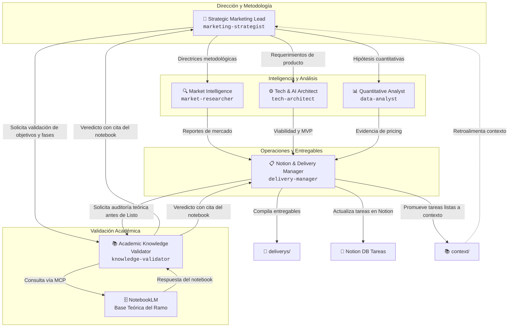

# Sistema Multi-Agente: Strategic Marketing Proyect

Este documento define la arquitectura, perfiles, contratos operativos y protocolos de invocación del **Escuadrón de 5 Agentes Especializados** diseñado para el desarrollo integral del **Strategic Marketing Proyect**.

El sistema está diseñado bajo un estándar abierto y desacoplado, lo que permite su ejecución fluida tanto en **Antigravity CLI (`agy`)** como en **Claude Code** u otros entornos de pair programming agéntico.

---

## 1. Visión General del Escuadrón



| Agente | Identificador | Rol Principal | Enfoque Metodológico |
| :--- | :--- | :--- | :--- |
| **Strategic Marketing Lead** | `marketing-strategist` | Dirección metodológica y estratégica | 5 Fases estratégicas y formulación de objetivos |
| **Market Intelligence** | `market-researcher` | Benchmarking e inteligencia de industria | Referentes globales y modalidades de venta |
| **Tech & AI Architect** | `tech-architect` | Arquitectura técnica de IA y producto | Visión computacional para inspección y MVP |
| **Quantitative Analyst** | `data-analyst` | Análisis de datos y dispersión de precios | Evidencia estadística (*"Dataaaaaaa!"*) |
| **Notion & Delivery Manager**| `delivery-manager` | Sincronización de Notion y entregables | Gobernanza de contexto y compilación |
| **Academic Knowledge Validator** | `knowledge-validator` | Validación teórica contra base del ramo | Consulta NotebookLM vía MCP |

---

## 2. Perfiles y Fichas Técnicas de los Agentes

### 2.1 🧠 Strategic Marketing Lead (`marketing-strategist`)
* **Archivo de definición:** [`.agents/marketing-strategist.md`](./.agents/marketing-strategist.md)
* **Objetivo:** Velar por la rigurosidad conceptual y la consistencia estratégica en todo el proyecto.
* **Responsabilidades Clave:**
  - Conducir las **5 fases del proceso estratégico** (`SM | Class 3`): Background, Client Profile / Investigación, Contexto / FODA, Objetivos y Plan de Marketing.
  - Asegurar la formulación canónica de objetivos (`SM | Objective definition`):
    - **Objetivo General:** $\text{Verbo en infinitivo} + \text{Fenómeno de interés}$. Prohibido incluir definiciones muestrales (*"quiénes/dónde"*) o metodológicas (*"medir/aplicar/levantar"*).
    - **Objetivos Específicos:** Descomposición en dimensiones observables (atributos valorados, beneficios, barreras, experiencias).
  - Validar que cada entregable cumpla con las pautas docentes antes de su cierre.
* **Inputs:** `context/README.md`, notas de clase en Notion, pautas en `deliverys/`.
* **Outputs:** Formulaciones de objetivos, marcos conceptuales, matrices FODA y planes de marketing.

---

### 2.2 🔍 Market & Industry Intelligence (`market-researcher`)
* **Archivo de definición:** [`.agents/market-researcher.md`](./.agents/market-researcher.md)
* **Objetivo:** Investigar el ecosistema automotriz, modelos de negocio globales y modalidades locales de compraventa.
* **Responsabilidades Clave:**
  - Realizar benchmarking profundo de referentes internacionales (Kavak, Carvana, Auto1, Shift): modelos de inspección técnica, logística, garantías y pricing algorítmico.
  - Analizar las modalidades de comercialización de autos usados en Chile (concesionarios tradicionales, plataformas C2C, consignación virtual, compra directa).
  - Analizar estadísticas gremiales (informes CAVEM, transferencias anuales, penetración de marcas chinas).
  - Registrar insumos en Notion bajo los tipos permitidos: `team-research` y `Articulo`.
* **Inputs:** Reportes CAVEM, noticias del sector, artículos de prensa, páginas web de competidores.
* **Outputs:** Fichas de benchmarking de competidores, análisis de modalidades de venta, reportes de tendencias de mercado.

---

### 2.3 ⚙️ Technical AI & Product Architect (`tech-architect`)
* **Archivo de definición:** [`.agents/tech-architect.md`](./.agents/tech-architect.md)
* **Objetivo:** Diseñar la arquitectura técnica del asistente de IA y definir el alcance viable del producto (MVP).
* **Responsabilidades Clave:**
  - Analizar y sintetizar los papers en `data/technical-bases/` (*Deep Learning para detección de daños en carrocería, segmentación semántica, estimación de costos de reparación*).
  - Definir la capacidad de la IA: detección de abolladuras, rayones, desalineación de paneles, quiebres de focos/vidrios a partir de fotos/video y cotización preliminar de repuestos y mano de obra.
  - Diseñar el flujo de usuario del MVP (Mobile/Web) y la arquitectura de datos necesaria para entrenar y operar el modelo.
  - Aportar a la dimensión de *Infraestructura* del diagnóstico de la empresa (Fase 1) y propuesta de valor funcional (Fase 2).
* **Inputs:** Papers en `data/technical-bases/damage-with-IA/` y `data/technical-bases/vehicule-damage-detection/`.
* **Outputs:** Especificación técnica del MVP, matriz de componentes inspeccionables por IA, diagrama de arquitectura de solución.

---

### 2.4 📊 Quantitative & Scraping Analyst (`data-analyst`)
* **Archivo de definición:** [`.agents/data-analyst.md`](./.agents/data-analyst.md)
* **Objetivo:** Proporcionar sustento empírico riguroso sobre la dispersión de precios y dinámicas de mercado.
* **Responsabilidades Clave:**
  - Analizar datos crudos en `data/raw-data/` y generar scripts reproducibles en `analysis/`.
  - Demostrar cuantitativamente el problema: dispersión de precios en modelos idénticos (ej. Ford F-150 de CLP 2.0M a 68.9M en 2025), variaciones por segmento (hatchbacks vs pickups vs SUVs) y curvas de depreciación según kilometraje/año.
  - Diseñar las reglas y variables necesarias para el módulo de scraping de mercado.
  - Generar tablas, histogramas y gráficos para respaldar la síntesis FODA del proyecto.
* **Inputs:** Datasets en `data/raw-data/`, datos de transferencias CAVEM, scraping de portales automotrices.
* **Outputs:** Scripts de Python en `analysis/`, visualizaciones estadísticas, tablas de dispersión y modelos de pricing.

---

### 2.5 📋 Notion & Delivery Manager (`delivery-manager`)
* **Archivo de definición:** [`.agents/delivery-manager.md`](./.agents/delivery-manager.md)
* **Objetivo:** Administrar la sincronización con Notion, la gobernanza de contexto y la entrega de hitos.
* **Responsabilidades Clave:**
  - Documentar el desarrollo de cada tarea directamente en su página de la base de tareas de Notion (`961bc1fb-56f8-4066-b7ac-b5f557c4507e`).
  - Aplicar la **Regla de Promoción a Contexto**: monitorear el estado de las tareas y, únicamente cuando pasan a `Listo`, consolidar su contenido en `context/` como insumo oficial.
  - Validar que los recursos en Notion respeten los tipos autorizados (`Articulo`, `Minuta`, `Notas`, `team-research`).
  - Ensamblar y formatear los entregables en `deliverys/` (por ejemplo, `deliverys/workshop-2/`).
* **Inputs:** Entregas parciales de todos los agentes, base de datos de tareas y recursos de Notion.
* **Outputs:** Páginas de Notion actualizadas, archivos consolidados en `context/`, documentos finales en `deliverys/`.

---

### 2.6 📚 Academic Knowledge Validator (`knowledge-validator`)
* **Archivo de definición:** [`.agents/knowledge-validator.md`](./.agents/knowledge-validator.md)
* **Objetivo:** Actuar como árbitro teórico del proyecto consultando la base de conocimiento oficial del ramo en **NotebookLM** (vía MCP) y contrastando entregables, objetivos y solicitudes contra ese marco.
* **Responsabilidades Clave:**
  - Consultar el notebook del curso de Strategic Marketing usando las herramientas MCP de NotebookLM (`list_notebooks` → `ask_notebook`) para obtener la fuente de verdad teórica.
  - Validar que la formulación de objetivos, las fases metodológicas y los entregables sean coherentes con lo dictado en el ramo.
  - Emitir veredictos estructurados (✅ Alineado / ⚠️ Observación / ❌ No alineado) con cita textual del notebook como sustento.
  - Responder consultas puntuales de cualquier agente sobre coherencia conceptual con el marco teórico.
* **Inputs:** Borradores de entregables, formulaciones de objetivos, solicitudes de validación de `marketing-strategist` y `delivery-manager`.
* **Outputs:** Informes de validación con veredicto ítem por ítem y citas del notebook; recomendaciones de ajuste fundamentadas.
* **Restricción crítica:** NUNCA emite veredicto sin haber consultado primero el notebook vía MCP. El notebook es la única fuente de verdad del ramo.

---

## 3. Workflow de Colaboración e Interacción

El desarrollo de cualquier tarea o taller sigue este flujo secuencial estandarizado:

```
[1. Inicio de Tarea en Notion] (Estado: Sin empezar)
                 │
                 ▼
[2. Investigación y Análisis]
     ├── `market-researcher`: Referentes, mercado y benchmarks
     ├── `tech-architect`: Factibilidad técnica y soporte de IA
     └── `data-analyst`: Extracción de métricas y evidencia ("Dataaaaaaa!")
                 │
                 ▼
[3. Validación Metodológica]
     └── `marketing-strategist`: Enmarca en las 5 fases y formula objetivos canónicos
                 │
                 ▼
[3.5 Validación Académica — NUEVO]
     └── `knowledge-validator`:
           ├── Consulta el notebook del ramo en NotebookLM vía MCP
           └── Emite veredicto ✅/⚠️/❌ con cita del notebook
                 │
                 ▼
[4. Consolidación y Entrega]
     └── `delivery-manager`:
           ├── Documenta el desarrollo en la página de Notion
           ├── Compila el entregable en deliverys/
           ├── Cambia estado a "Listo" en Notion
           └── Promueve el resultado consolidado a context/
```

---

## 4. Guía de Invocación en Antigravity CLI (`agy`)

Los 6 agentes están registrados formalmente en Antigravity mediante `define_subagent`. Puedes invocarlos y orquestarlos de tres formas:

### 4.1 Invocación Directa como Subagente (`invoke_subagent`)
Para asignar una tarea específica a un agente en segundo plano, se invoca indicando su nombre registrado:

```json
{
  "Subagents": [
    {
      "TypeName": "market-researcher",
      "Role": "Market Intelligence Specialist",
      "Prompt": "Investiga los modelos de inspección técnica y compra inmediata de Kavak y Carvana. Genera un reporte comparativo en context/benchmarks_kavak_carvana.md.",
      "Model": "inherit"
    }
  ]
}
```

### 4.2 Invocación en Paralelo (Trabajo en Equipo)
Puedes lanzar múltiples agentes de forma concurrente para resolver diferentes aspectos de una entrega:

```json
{
  "Subagents": [
    {
      "TypeName": "tech-architect",
      "Role": "AI Architect",
      "Prompt": "Revisa los papers en data/technical-bases/ y define qué daños vehiculares son detectables por Computer Vision para el MVP.",
      "Model": "inherit"
    },
    {
      "TypeName": "data-analyst",
      "Role": "Data Analyst",
      "Prompt": "Analiza la dispersión de precios de la Ford F-150 y prepara una tabla resumen en analysis/dispersion_f150.md.",
      "Model": "inherit"
    }
  ]
}
```

### 4.3 Invocar el `knowledge-validator` para auditoría académica
Usa este agente antes de declarar cualquier objetivo o entregable como terminado:

```json
{
  "Subagents": [
    {
      "TypeName": "knowledge-validator",
      "Role": "Academic Theory Validator",
      "Prompt": "Valida la siguiente formulación de Objetivo General contra el marco teórico del ramo en NotebookLM: 'Comprender los factores que inciden en la toma de decisiones de compra de autos usados en Chile.' Emite veredicto con cita del notebook.",
      "Model": "inherit"
    }
  ]
}
```

### 4.4 Comandos Recomendados en `agy`
- `/teamwork-preview`: Activa la vista previa y coordinación autónoma del equipo de agentes para tareas complejas.
- `/plan`: Genera un plan de acción detallado paso a paso antes de delegar a los subagentes.
- `/goal`: Ejecuta una meta de largo aliento donde los agentes investigan, documentan y no se detienen hasta completar el objetivo.

---

## 5. Guía de Invocación en Claude Code

Claude Code lee automáticamente [`CLAUDE.md`](./CLAUDE.md) al inicio de la sesión. Para invocar o alternar entre perfiles en Claude Code, utiliza los siguientes patrones:

### 5.1 Modo Interactivo (Asumir Perfil)
En la consola interactiva de Claude Code, puedes instruirlo a adoptar cualquier agente:

```
> Actúa como el agente market-researcher según se define en AGENTS.md. Investiga las modalidades de compraventa de autos usados en Chile y redacta un resumen en context/.
```

```
> Actúa como el agente marketing-strategist. Revisa las instrucciones de deliverys/workshop-2/ y define el Objetivo General y los Objetivos Específicos del proyecto.
```

### 5.2 Modo CLI con Prompt Único (`claude -p`)
Para ejecutar tareas puntuales desde la terminal usando Claude Code:

```bash
# Ejecutar tarea de análisis de mercado
claude -p "Como market-researcher (ver AGENTS.md), analiza los reportes de CAVEM en context/ y sintetiza las cifras de transferencias de marcas chinas."

# Ejecutar tarea técnica
claude -p "Como tech-architect (ver AGENTS.md), examina los papers en data/technical-bases/ y redacta un brief técnico en context/ai_inspection_capabilities.md."

# Ejecutar compilación de entrega
claude -p "Como delivery-manager (ver AGENTS.md), compila el informe de entrega en deliverys/workshop-2/ consolidando los insumos de los demás agentes."
```

### 5.3 Convención de Archivos para Claude Code
Cada agente tiene su prompt completo almacenado en [`.agents/<nombre-agente>.md`](./.agents/). Claude Code puede consultar directamente el archivo respectivo para cargar en su contexto las restricciones, responsabilidades y salidas esperadas.

---

## 6. Protocolo de Sincronización y Reglas de Contexto

Todo agente que opere en este repositorio debe respetar estrictamente las reglas fijadas en [`context/README.md`](./context/README.md):

1. **Recursos de Notion admitidos como contexto:**
   - Únicamente tipos: `Articulo`, `Minuta`, `Notas` y `team-research`.
   - Recursos con `in_trash = true` o archivados quedan excluidos.
2. **Ciclo de vida de tareas y promoción a contexto:**
   - Las tareas en estado `Sin empezar` o `En curso` son trabajo activo y **no son contexto**.
   - Solo al pasar al estado **`Listo`** en Notion, su contenido se promueve al repositorio local dentro de `context/`.
3. **Materia prima vs. entregables:**
   - La bibliografía técnica vive en `data/technical-bases/`.
   - Los datos brutos viven en `data/raw-data/`.
   - Los scripts de procesamiento cuantitativo viven en `analysis/`.
   - Las pautas y entregas finales viven en `deliverys/`.
4. **Obligatoriedad de Fuentes Reales y Verificables (Transversal):**
   - Todo agente tiene estrictamente prohibido utilizar fuentes ficticias, datos simulados o referencias no fundamentadas en la realidad.
   - Todo dato numérico, análisis de mercado, benchmark o estimación técnica debe basarse en fuentes reales (papers en `data/technical-bases/`, datasets en `data/raw-data/`, informes CAVEM o recursos validados en Notion).
5. **Citado y Referenciación en Formato APA 7ª Edición (APA-7):**
   - Todo documento de entrega, reporte, recomendación, análisis y texto generado por los agentes debe seguir el estándar **APA-7**.
   - Se debe incluir citación en el texto parentética `(Autor, Año)` o narrativa `Autor (Año)`, usando `et al.` para 3 o más autores.
   - Todo entregable o informe debe concluir obligatoriamente con su respectiva sección de **Referencias** completa en formato APA-7 con enlaces o DOI correspondientes.
