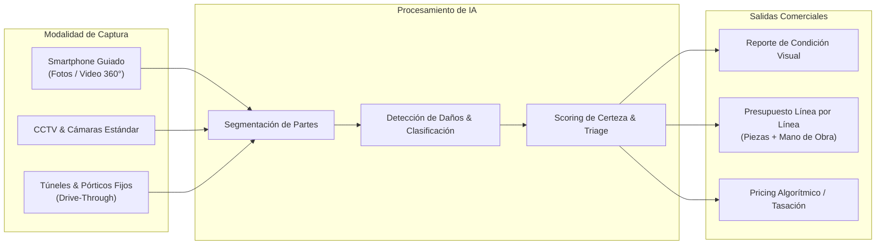
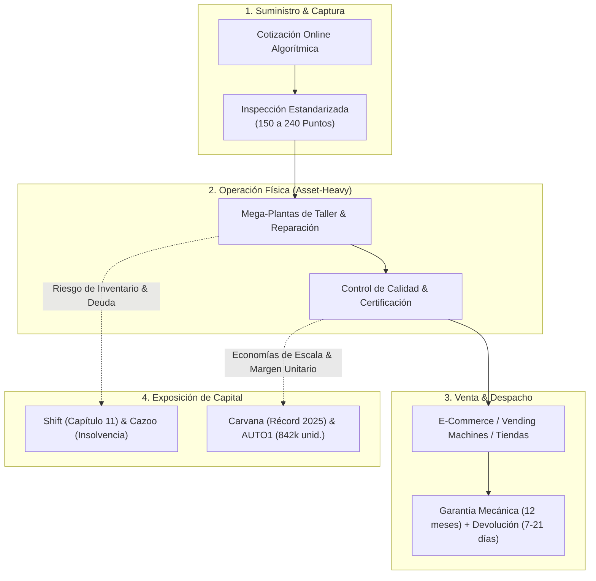
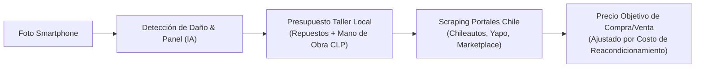
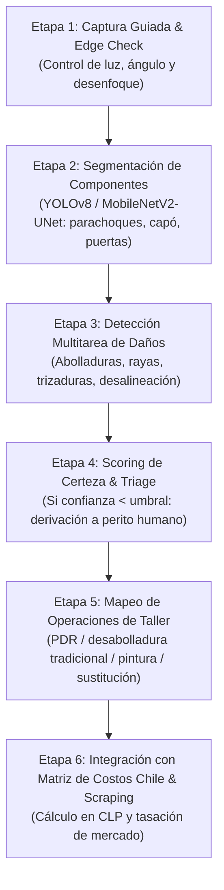

# Benchmarks y Referentes Internacionales: Inteligencia Artificial en Inspección Vehicular y Plataformas Transaccionales de Vehículos Usados

- **Fecha:** 12 de octubre de 2026
- **Versión:** Versión General de Referencia (`_vg`)
- **Elaborado por:** Equipo de Inteligencia de Mercado y Arquitectura Técnica (`market-researcher` & `tech-architect`), Strategic Marketing Proyect, Universidad del Desarrollo (UDD)
- **Marco metodológico:** Estándar de rigor empírico, verificación de fuentes primarias y citación académica APA 7ª Edición.
- **Clasificación:** Insumo Estratégico y Diagnóstico Tecnológico de Contexto

---

> **Convención metodológica y de integridad:**
> 1. Toda afirmación fáctica, métrica financiera, volumen de unidades y especificación técnica de producto proviene de fuentes primarias oficiales (estados financieros, notas de prensa corporativas, patentes y artículos científicos indexados) o reportes económicos especializados, debidamente citados en el texto bajo norma APA-7.
> 2. Las deducciones, derivaciones analíticas y propuestas estratégicas generadas por el equipo de investigación se identifican explícitamente mediante la etiqueta **[Inferencia del equipo]**.
> 3. Las métricas de desempeño o precisión declaradas por proveedores tecnológicos comerciales se especifican como autodeclaradas, distinguiéndolas de los hallazgos validados experimentalmente en literatura científica independiente.

---

## 1. Resumen Ejecutivo

El mercado global de inspección vehicular asistida por visión computacional e inteligencia artificial (IA) ha alcanzado un alto nivel de maduración operativa y tecnológica en economías desarrolladas (Norteamérica, Europa y Japón); no obstante, exhibe una marcada **concentración estructural en dos segmentos específicos: la liquidación automatizada de siniestros para aseguradoras de automóviles y la generación de reportes de condición para subastas mayoristas institucionales** (Hasan et al., 2025; LaChance, 2021; TechCrunch, 2023).

1. **Madurez técnica y concentración en seguros:** Soluciones líderes como CCC Estimate-STP y Solera Qapter procesan decenas de millones de reclamos anuales de forma automatizada ("straight-through processing") (LaChance, 2021; Solera, 2024). Asimismo, Tractable gestiona más de US$ 7.000 millones en siniestros vehiculares y de propiedad al año con clientes como Aviva, GEICO y Tokio Marine (TechCrunch, 2023). El estudio sistemático de Hasan et al. (2025), que analizó 55 investigaciones científicas entre 2014 y 2024, constató que aproximadamente el 75 % de la producción científica y de los desarrollos algorítmicos en detección de daños está dirigida a la industria aseguradora, dejando en un relativo vacío al retail automotriz y al ecosistema de compraventa de vehículos usados.
2. **El puente roto entre daño detectado y presupuesto de reparación:** La mayoría de los proveedores de IA comercial enfocados en compraventa automotriz (como UVeye, ProovStation, Monk AI de ACV Auctions o Fyusion de Cox Automotive) limitan su entrega a la detección visual y al reporte cualitativo de condición (rayas, abolladuras, panel gaps o desgaste de neumáticos) (ACV Auctions, s. f.; UVeye, s. f.; VentureBeat, 2021). Solo un reducido grupo de proveedores —con raíces profundas en la industria de seguros— logra vincular la imagen con un presupuesto detallado de reparación línea por línea (piezas a sustituir, horas de desabolladura y pintura, y costo de mano de obra), sustentado en catálogos propietarios y baremos de reparación desarrollados durante décadas para Estados Unidos y Europa Occidental (Audatex, Mitchell, CCC ONE) (LaChance, 2021; Repairer Driven News, 2020).
3. **El colapso de los modelos integrados y la lección del capital:** Las grandes plataformas de comercio electrónico de autos usados que intentaron internalizar toda la cadena de valor física (inspección de 150 a 240 puntos, compra a balance propio, mega-plantas de reacondicionamiento y logística de última milla) sufrieron severas crisis financieras ante el endurecimiento de las tasas de interés globales entre 2022 y 2024. Shift Technologies solicitó la bancarrota bajo el Capítulo 11 en octubre de 2023 para liquidar sus activos tras años de quema de caja insostenible (Financier Worldwide, 2023). En mayo de 2024, Cazoo se declaró en insolvencia y entró en administración judicial en el Reino Unido, destruyendo más de US$ 6.900 millones en valor de mercado (Retail Insight Network, 2024). Incluso Kavak tuvo que cerrar sus operaciones en Colombia y Perú, reducir su dotación global en un 50 % y aceptar una corrección de valoración desde US$ 8.700 millones a US$ 2.200 millones (Bloomberg Línea, 2023, 2025), antes de lograr su primer mes de rentabilidad operativa en diciembre de 2025 y levantar una ronda Serie F de US$ 300 millones en febrero de 2026 (Chócale, 2026).
4. **La brecha y oportunidad estratégica para Chile y Latinoamérica [Inferencia del equipo]:** Existe una desconexión estructural en el mercado chileno y regional: los concesionarios medianos, compraventas de barrio, revendedores que reparan ("flippers") y compradores particulares enfrentan una severa asimetría de información y una alta dispersión de precios de mercado (con brechas de hasta varios millones de pesos en unidades del mismo modelo y año), careciendo de acceso a herramientas de inspección objetiva. Los sistemas internacionales de túneles físicos (UVeye, ProovStation, DeGould) son inviables financieramente para estos actores (costos de hardware de entre US$ 50.000 y US$ 200.000), y las herramientas de aseguradoras (CCC, Solera) no poseen bases de datos adaptadas a los precios de repuestos alternativos y mano de obra del parque automotriz chileno. Se abre así una ventana de oportunidad única para una solución **asset-light** basada en teléfonos inteligentes, que unifique visión computacional para diagnóstico de daños, costeo paramétrico de reparación localizado en Chile y tasación comercial en tiempo real vía scraping de mercado.

---

## 2. Deep Dive: Compañías Especializadas en Inspección y Diagnóstico de Daños con IA

A continuación se presenta un análisis exhaustivo y estructurado de las diez compañías globales más relevantes que han desarrollado y comercializado soluciones de visión computacional y aprendizaje profundo para la inspección y tasación vehicular.

---

### 2.1 Tractable (Reino Unido / Global)

* **Origen, Fundadores y Alcance Geográfico:** Fundada en Londres en 2014 por Alex Dalyac, Alexandre Robicquet y Razvan Ranca. Con sedes en Londres, Nueva York y Tokio, opera a escala global con fuerte penetración en Japón, Reino Unido, Francia, Alemania y Estados Unidos (TechCrunch, 2023).
* **Mecánica Técnica del Producto:**
  * *Modalidad de Captura:* Dispositivos móviles inteligentes (smartphone). Los usuarios (asegurados o inspectores de taller) cargan fotografías guiadas mediante una aplicación web o aplicación nativa móvil. El sistema valida en tiempo real la resolución, ángulo, encuadre y niveles de luminosidad (Tractable, 2022).
  * *Modelos de Visión Computacional:* Redes neuronales convolucionales profundas (CNN) propietarias entrenadas con cientos de millones de fotografías históricas de siniestros y desarmes vehiculares. Emplea segmentación semántica a nivel de componente para individualizar piezas de carrocería (tapabarros, parachoques, capó, puertas) y clasificación multitarea para identificar la tipología de daño (abolladura, rasgadura, rayón profundo, quiebre de óptica).
  * *Scoring de Certeza:* Cada evaluación asigna un puntaje de certeza algorítmica (*confidence score*) a nivel de daño y de panel. Cuando la confianza decae debido a reflejos pronunciados u oclusiones, el sistema activa un protocolo de *human-in-the-loop*, derivando el expediente a un perito humano para validación (Tractable, s. f.).
* **Salida del Sistema:**
  * Detección y localización perimetral del daño exterior.
  * Determinación de la operación técnica requerida: decisión binaria o probabilística entre **reparar vs. reemplazar** (*repair vs. replace*).
  * Presupuesto preliminar de reparación línea por línea (*line-item estimate*), integrando baremos de horas de trabajo y catálogos de repuestos en mercados donde mantiene acuerdos con proveedores de datos de carrocería (Tractable, 2022).
* **Monetización y Segmentos Atendidos:**
  * *Modelo de Negocio:* Software as a Service (SaaS) B2B enterprise, con tarifas por volumen de expedientes procesados (*pay-per-claim*) o licencias corporativas recurrentes.
  * *Segmentos:* Aseguradoras automotrices (Aviva, GEICO, Admiral, Tokio Marine, Mitsui Sumitomo), cadenas de talleres de desabolladura y pintura, empresas de reciclaje vehicular (*salvage*) y concesionarios de flotas (TechCrunch, 2023).
* **Estatus Financiero y Comercial Verificado (2025–2026):**
  * Alcanzó estatus de unicornio en su Serie D (2021) y consolidó su posición financiera en julio de 2023 tras levantar US$ 65 millones en una ronda Serie E liderada por SoftBank Vision Fund 2 (TechCrunch, 2023).
  * Procesa anualmente más de US$ 7.000 millones en reclamos automotrices y siniestros de hogar a nivel mundial (TechCrunch, 2023).
  * En 2025 y 2026 anunció la expansión de acuerdos con importantes aseguradoras europeas (como Covéa y Foyer) y el despliegue comercial de *LumaScanner*, una herramienta orientada al área de postventa y operaciones de servicio (*Fixed Ops*) de concesionarios automotrices para capturar retomas y oportunidades de servicio de taller (Tractable, s. f.).

---

### 2.2 Ravin AI (Israel / Reino Unido / Estados Unidos)

* **Origen, Fundadores y Alcance Geográfico:** Fundada en 2018 por Eliron Ekstein y Roman Brand, con centros de desarrollo e ingeniería en Haifa y Tel Aviv (Israel), y oficinas comerciales en Londres y Carrollton, Texas. Cuenta con despliegues activos en Norteamérica, Europa Occidental y Australia (Insurance News, 2023).
* **Mecánica Técnica del Producto:**
  * *Modalidad de Captura:* Híbrida y flexible. Permite la captura mediante aplicaciones móviles guiadas en smartphones convencionales (aplicación *Ravin Inspect*) y mediante la integración de cámaras de circuito cerrado de televisión (CCTV) estándar ya existentes en campas, talleres, centros de arriendo o líneas de inspección (Insurance News, 2023; Ravin AI, s. f.).
  * *Modelos de Visión Computacional:* Motor de aprendizaje profundo registrado bajo la marca *DeepDetect* (Patente de EE. UU. 11,640,684 otorgada en 2023 y patente concedida en Japón en 2024). Entrenado con más de 2.000 millones de imágenes de vehículos. Utiliza reconstrucción visual 360° para mapear el estado completo de la carrocería, diferenciando suciedad ambiental de daños estructurales o superficiales (Ravin AI, s. f.).
  * *Scoring de Certeza:* Clasifica la severidad del daño en escalas ordinales (leve, moderado, severo) y asocia un índice de confiabilidad basado en la concordancia multi-ángulo de las tomas.
* **Salida del Sistema:**
  * Reporte de condición vehicular estandarizado en formato digital 360°.
  * Detección precisa de abolladuras, rayaduras, grietas en parachoques y daños en llantas/vidrios.
  * Estimación automatizada de costos de reacondicionamiento y reparación cosmética/mecánica básica para retomas comerciales y entrega/devolución de vehículos de arriendo (Ravin AI, s. f.).
* **Monetización y Segmentos Atendidos:**
  * *Modelo de Negocio:* Licenciamiento SaaS B2B, cobro por vehículo escaneado (*per-inspection fee*) y suscripciones para grandes flotas.
  * *Segmentos:* Compañías de seguros de autos, rent-a-car (Hertz, Sixt), operadores de flotas comerciales, subastas mayoristas y redes de concesionarios automotrices.
* **Estatus Financiero y Comercial Verificado (2025–2026):**
  * Ha recaudado más de US$ 30 millones en capital de riesgo, incluyendo el respaldo estratégico de IAG Firemark Ventures (brazo de inversión de Insurance Australia Group), Shell Ventures y FM Capital (Insurance News, 2023).
  * Durante 2025 y 2026 fortaleció su ecosistema comercial mediante alianzas con Five Sigma, ROLLin', QUEENS (integración de su IA para la tasación instantánea de retomas en concesionarios) y BidBus (plataforma digital de subastas automotrices) (Ravin AI, s. f.).

---

### 2.3 Monk AI / ACV Auctions (Francia / Estados Unidos)

* **Origen, Fundadores y Alcance Geográfico:** Monk SAS fue fundada en 2019 en París por Abou Bakr Sabil y Mohamed Gaber. El 28 de febrero de 2022 fue adquirida por ACV Auctions Inc. (NASDAQ: ACVA), plataforma líder de subastas mayoristas de vehículos usados en Estados Unidos (ACV Auctions, 2022).
* **Mecánica Técnica del Producto:**
  * *Modalidad de Captura:* Captura móvil guiada por smartphone. El usuario sigue un contorno dinámico en pantalla que exige capturar los ángulos correctos del vehículo; el sistema verifica en el borde (*edge verification*) el desenfoque, la distancia focal y la ausencia de reflejos directos antes de aceptar la fotografía (ACV Auctions, s. f.).
  * *Modelos de Visión Computacional:* Modelos de segmentación semántica a nivel de píxel (*pixel-level segmentation*) optimizados para identificar micro-daños cosméticos (rayas de llave, pequeños toques de estacionamiento, desgaste de pintura) y componentes específicos de carrocería.
  * *Scoring de Certeza:* Genera índices de probabilidad de daño y clasifica el estado del panel bajo estándares de subasta comercial (ACV Auctions, s. f.).
* **Salida del Sistema:**
  * Reporte de Condición Automatizado (*Automated Condition Report* - CR) generado en menos de un minuto.
  * Mapeo perimetral interactivo de anomalías cosméticas.
  * **Alcance de costeo:** Enfocado primordialmente en la transparencia de condición; la plataforma no genera un presupuesto paramétrico de desabolladura y pintura de taller (*line-item body shop estimate*), sino un reporte estandarizado de defectos que alimenta el motor de tasación mayorista (ACV Auctions, s. f.).
* **Monetización y Segmentos Atendidos:**
  * *Modelo de Negocio:* Integrado en el ecosistema transaccional de ACV Auctions (como motor de sus herramientas *Drivably*, *MAX Digital* y ACV inspection apps) y comercializado como SaaS independiente para terceros en Europa.
  * *Segmentos:* Concesionarios de autos usados, subastas B2B mayoristas y financieras automotrices (ACV Auctions, 2022).
* **Estatus Financiero y Comercial Verificado (2025–2026):**
  * Opera como el núcleo de visión artificial de ACV Auctions en Norteamérica, respaldando millones de transacciones mayoristas anuales.
  * En Europa, Toyota Financial Services Francia mantiene el uso de la tecnología de Monk para la inspección automatizada en la devolución de vehículos al término de contratos de leasing (*off-lease inspections*) (ACV Auctions, 2023).

---

### 2.4 UVeye (Israel / Estados Unidos)

* **Origen, Fundadores y Alcance Geográfico:** Fundada en Tel Aviv en 2016 por los hermanos Amir Hever y Ohad Hever. Con sede corporativa en Teaneck, Nueva Jersey, y oficinas en Israel, Alemania y Japón, es el principal referente mundial en inspección de alta velocidad basada en hardware especializado (Fleet Maintenance, 2025; UVeye, s. f.).
* **Mecánica Técnica del Producto:**
  * *Modalidad de Captura:* Estaciones fijas de inspección tipo túnel o pórtico de paso (*drive-through*). El automóvil atraviesa la estación a velocidades de entre 5 y 15 km/h sin necesidad de detenerse (UVeye, s. f.).
  * *Hardware y Sensores:* Arquitectura modular compuesta por tres subsistemas:
    1. *Helios:* Escáner de chasis inferior compuesto por cámaras lineales y luces estroboscópicas que detectan fugas de fluidos, rotura de fuelles, corrosión y deformaciones del piso.
    2. *Artemis:* Módulo de neumáticos que mide la profundidad del dibujo de la banda de rodadura (*tread depth*), presión de aire, desgaste irregular y daño en flancos.
    3. *Atlas / Atlas Lite:* Pórtico exterior de 360° dotado de cámaras estereoscópicas de alta resolución y sensores ópticos que escanean la totalidad de la carrocería y vidrios (UVeye, s. f.).
  * *Modelos de Visión Computacional:* Algoritmos propietarios de aprendizaje profundo para detección y reconstrucción 3D que procesan terabytes de información sensorial por pasada, identificando anomalías milimétricas en menos de 5 segundos.
* **Salida del Sistema:**
  * Reporte de inspección integral de alta definición (carrocería, bajos y neumáticos).
  * Alertas automáticas de seguridad mecánica y fallas de componentes.
  * Generación de órdenes de trabajo preliminares (*repair recommendations*) orientadas a la venta de servicios de mantenimiento en concesionarios (neumáticos, alineación, frenos, desabolladura rápida) (UVeye, s. f.).
* **Monetización y Segmentos Atendidos:**
  * *Modelo de Negocio:* Arrendamiento financiero de hardware (*Hardware-as-a-Service* - HaaS) combinado con una suscripción de software SaaS mensual de alto costo (UVeye, s. f.).
  * *Segmentos:* Concesionarios de marcas oficiales (con soporte corporativo de General Motors, Toyota y Volvo Car USA), empresas de arriendo de vehículos (Hertz), flotas logísticas de última milla (Amazon Delivery Service Partners) y plantas de ensamblaje OEM (Fleet Maintenance, 2025; UVeye, s. f.).
* **Estatus Financiero y Comercial Verificado (2025–2026):**
  * Ha recaudado un total acumulado de US$ 380,5 millones de financiamiento. En enero de 2025 cerró una ronda de US$ 191 millones estructurada en US$ 41 millones de capital accionario (liderada por Woven Capital, fondo de crecimiento de Toyota) y US$ 150 millones en líneas de crédito otorgadas por Trinity Capital (Fleet Maintenance, 2025).
  * Cuenta con más de 1.000 estaciones operativas instaladas en Estados Unidos, con planes activos de despliegue de cientos de nuevas instalaciones adicionales durante 2025 y 2026 (Fleet Maintenance, 2025).

---

### 2.5 ProovStation (Francia / Europa)

* **Origen, Fundadores y Alcance Geográfico:** Fundada en Lyon, Francia, en 2017 por Cédric Bernard y Gabriel Tissandier. Su presencia comercial se concentra en Francia, Alemania, Reino Unido, Bélgica, España e Italia (Tech.eu, 2023).
* **Mecánica Técnica del Producto:**
  * *Modalidad de Captura:* Estación fija de pórtico drive-through de paso rápido. Permite inspeccionar un automóvil en un tiempo récord de **menos de 3 segundos** mientras el vehículo circula por el arco (Huetter, 2020; Tech.eu, 2023).
  * *Modelos de Visión Computacional y Hardware:* Integración de docenas de cámaras industriales de alta velocidad, iluminación LED de espectro controlado, fotogrametría y escáneres magnéticos de neumáticos desarrollados en alianza con Michelin (*Michelin QuickScan*). Sus redes convolucionales detectan rayas, abolladuras, decoloraciones y profundidad de neumáticos con precisión milimétrica (Tech.eu, 2023).
  * *Scoring de Certeza:* Algoritmos de clasificación basados en el estándar internacional de subastas automotrices.
* **Salida del Sistema:**
  * Escaneo exterior y reporte de condición vehicular panorámico de 360°.
  * Cuantificación del número de paneles afectados y nivel de severidad cosmética.
  * La plataforma no proporciona un presupuesto desglosado de mano de obra y repuestos de taller, limitándose a la certificación de estado físico (Tech.eu, 2023).
* **Monetización y Segmentos Atendidos:**
  * *Modelo de Negocio:* Venta/arriendo de infraestructura física con suscripción de software analítico por vehículo procesado.
  * *Segmentos:* Grandes casas de subastas mayoristas, centros logísticos de distribución de vehículos y cadenas de supermercados/retail (Huetter, 2020; Tech.eu, 2023).
* **Estatus Financiero y Comercial Verificado (2025–2026):**
  * Cerró una ronda Serie A de €10,4 millones en enero de 2023 liderada por Supernova Invest y Crédit Agricole Création (Tech.eu, 2023).
  * Mantiene una alianza estratégica a gran escala con BCA (la mayor firma de subastas de vehículos de Europa) para el despliegue de hasta 40 estaciones en 13 países (Huetter, 2020). Asimismo, implementó en Francia estaciones de autoservicio de tasación en estacionamientos de hipermercados Carrefour en alianza con la firma autobiz (Tech.eu, 2023).

---

### 2.6 Fyusion / Cox Automotive (Estados Unidos)

* **Origen, Fundadores y Alcance Geográfico:** Fundada en San Francisco en 2013 por Radu Rusu y Stefan Holzer, pioneros en percepción tridimensional y computación visual. En enero de 2021 fue adquirida por Cox Enterprises e integrada directamente dentro de Cox Automotive, el mayor conglomerado de servicios de automoción y subastas de EE. UU. (dueño de Manheim, Kelley Blue Book y Autotrader) (VentureBeat, 2021).
* **Mecánica Técnica del Producto:**
  * *Modalidad de Captura:* Dispositivo móvil smartphone. El operador camina alrededor del vehículo grabando un video continuo guiado por la interfaz (VentureBeat, 2021).
  * *Modelos de Visión Computacional:* Tecnología propietaria de modelado tridimensional a partir de video monocular, respaldada por más de 130 patentes internacionales en percepción 3D. El software reconstruye la volumetría exterior e interior del vehículo en un formato interactivo *360° spin* y aplica redes de aprendizaje profundo para etiquetar de forma automática abolladuras, rayaduras, rasguños y trizaduras de cristales (VentureBeat, 2021).
* **Salida del Sistema:**
  * Visualización interactiva 3D/360° de alta inmersión con marcadores de defectos (*damage tagging*).
  * Resumen de severidad y clasificación cosmética estandarizada para subastas.
  * Integración directa con guías de precios de mercado (Kelley Blue Book y Manheim Market Report - MMR) (VentureBeat, 2021).
* **Monetización y Segmentos Atendidos:**
  * *Modelo de Negocio:* Tecnología propietaria integrada en los servicios del ecosistema de Cox Automotive y ofertada vía software para concesionarios clientes.
  * *Segmentos:* Subastas mayoristas digitales (Manheim Express), concesionarios independientes y concesionarios de marca en Estados Unidos (VentureBeat, 2021).
* **Estatus Financiero y Comercial Verificado (2025–2026):**
  * Opera como componente central de digitalización de inventario en Manheim Express y Cox Automotive, procesando cientos de miles de vehículos anuales en el mercado mayorista estadounidense.

---

### 2.7 CCC Intelligent Solutions / CCC Estimate-STP (Estados Unidos)

* **Origen, Fundadores y Alcance Geográfico:** Fundada en 1980 en Chicago, Illinois. CCC Intelligent Solutions Inc. (NYSE: CCCS) es la columna vertebral tecnológica de la industria de colisión y seguros vehiculares en Estados Unidos, conectando a más de 30.000 talleres de carrocería y 300 aseguradoras (LaChance, 2021).
* **Mecánica Técnica del Producto:**
  * *Modalidad de Captura:* Smartphone. El asegurado o inspector toma fotografías de los daños del siniestro a través de una aplicación web móvil optimizada (LaChance, 2021).
  * *Modelos de Visión Computacional y Motor de Reglas:* Plataforma *CCC Estimate-STP* (Straight-Through Processing), lanzada en noviembre de 2021. Integra redes neuronales profundas entrenadas con más de **US$ 1 billón en estimaciones históricas de reparación**, miles de millones de imágenes y los manuales de procedimientos de ensamblaje de los fabricantes de vehículos (OEM) (LaChance, 2021).
  * *Scoring de Certeza y Procesamiento STP:* Evalúa la certeza de detección y las reglas de negocio específicas de cada aseguradora (por ejemplo, límites monetarios de daño leve a moderado, deducibles y políticas de piezas originales vs. alternativas). Si el siniestro cumple con los parámetros de confianza, el presupuesto se genera en minutos sin intervención humana (LaChance, 2021).
* **Salida del Sistema:**
  * Presupuesto formal y completo de reparación línea por línea (*line-item estimate*): piezas que requieren sustitución con códigos de parte OEM, horas de desabolladura, horas de pintura, materiales de pintura e insumos, tarifas horarias de mano de obra locales e impuestos aplicables (LaChance, 2021).
* **Monetización y Segmentos Atendidos:**
  * *Modelo de Negocio:* Licenciamiento empresarial B2B y cobro transaccional por siniestro resuelto.
  * *Segmentos:* Aseguradoras automotrices (más de 90 compañías de seguros en EE. UU., siendo USAA la primera en desplegar la solución a nivel nacional) y redes de talleres de colisión afiliados a CCC ONE (LaChance, 2021).
* **Estatus Financiero y Comercial Verificado (2025–2026):**
  * Cotiza en la Bolsa de Nueva York. Había superado más de 5 millones de siniestros procesados integralmente mediante IA hacia fines de 2020 y continúa expandiendo la automatización de siniestros de daño moderado en su plataforma de nube inteligente durante 2025 y 2026 (LaChance, 2021).

---

### 2.8 Solera / Qapter Intelligent Estimating (Estados Unidos / Europa / Global)

* **Origen, Fundadores y Alcance Geográfico:** Solera Holdings LLC, con sede central en Westlake, Texas, es la matriz de Audatex, una de las mayores bases de datos mundiales de ingeniería de siniestros y baremos de reparación. Tiene presencia activa en más de 80 países en los cinco continentes (Repairer Driven News, 2020; Solera, 2024).
* **Mecánica Técnica del Producto:**
  * *Modalidad de Captura:* Carga de fotografías desde cualquier teléfono inteligente mediante aplicaciones web de autoservicio para asegurados o interfaces de peritaje para talleres (Repairer Driven News, 2020; Solera, 2024).
  * *Modelos de Visión Computacional:* *Qapter Intelligent Estimating*, solución basada en algoritmos de aprendizaje profundo alimentados por **más de 300 millones de expedientes históricos de siniestros y más de 1.000 millones de imágenes**. La IA reconoce componentes, evalúa la severidad del impacto y consulta la base de datos de ingeniería Audatex, que cubre más del 99 % del parque automotor en mercados clave (Repairer Driven News, 2020; Solera, 2024).
* **Salida del Sistema:**
  * Presupuesto preliminar y definitivo generado en menos de tres minutos.
  * Recomendación algorítmica de operaciones de taller (reparación de panel vs. sustitución).
  * Módulo de triage automatizado: clasificación instantánea entre pérdida total (*total loss*) y direccionamiento hacia talleres de desabolladura o patios de desarme (*salvage yards*) (Repairer Driven News, 2020; Solera, 2024).
* **Monetización y Segmentos Atendidos:**
  * *Modelo de Negocio:* SaaS empresarial y tarifas por expediente procesado.
  * *Segmentos:* Compañías de seguros de vehículos, redes de talleres de reparación de carrocería, peritos liquidadores independientes y gestores de flotas corporativas (Solera, 2024).
* **Estatus Financiero y Comercial Verificado (2025–2026):**
  * Solera continúa desplegando actualizaciones de la suite Qapter (incluyendo *Qapter Direct Dispatch* para la derivación automática de asignaciones estimadas por IA a talleres asociados sin importar su software de base) y mantiene su posición dominante en la liquidación automatizada de siniestros en Europa y Latinoamérica (Solera, 2024).

---

### 2.9 DeGould (Reino Unido / Global)

* **Origen, Fundadores y Alcance Geográfico:** Fundada en Exeter y Crewe, Reino Unido, en 2014. Especializada en la inspección automatizada de vehículos de alta gama a nivel de fabricante de equipo original (OEM) y logística portuaria internacional (Automotive Logistics, 2021).
* **Mecánica Técnica del Producto:**
  * *Modalidad de Captura:* Estaciones fijas cerradas de escaneo de alta resolución tipo túnel (*Auto-scan* y *Auto-compact*).
  * *Hardware y Visión Computacional:* El sistema *Auto-compact* utiliza entre 9 y 14 cámaras industriales de sensor completo (*full-frame* de alta resolución) sincronizadas con iluminación estructurada de campo claro y campo oscuro (*bright field & dark field lighting*). Captura imágenes de cientos de megapíxeles en cuestión de segundos mientras el vehículo pasa continuamente por la línea o empujado por un transportador de fábrica (Automotive Logistics, 2021).
  * *Detección:* Modelos de aprendizaje profundo diseñados específicamente para micro-defectos de pintura, rayaduras microscópicas, pequeñas abolladuras superficiales y verificación de especificaciones de fábrica (Automotive Logistics, 2021).
* **Salida del Sistema:**
  * Reporte de condición digital de nivel milimétrico.
  * Auditoría de calidad de acabado superficial antes de la entrega del vehículo nuevo (*pre-delivery inspection*).
  * Trazabilidad de daños en la cadena de transporte marítimo y terrestre (Automotive Logistics, 2021).
* **Monetización y Segmentos Atendidos:**
  * *Modelo de Negocio:* Venta e instalación de estaciones físicas con contratos de mantenimiento y soporte de software de alto ticket.
  * *Segmentos:* Plantas de ensamblaje de fabricantes OEM (Jaguar Land Rover, Bentley, Daimler) y operadores logísticos de vehículos terminados (*Finished Vehicle Logistics* - FVL), como la naviera Wallenius Wilhelmsen (Automotive Logistics, 2021).
* **Estatus Financiero y Comercial Verificado (2025–2026):**
  * Levantó una ronda de US$ 6 millones en noviembre de 2021 liderada por Wallenius Wilhelmsen para acelerar la instalación de sistemas compactos en puertos y centros de distribución de vehículos en Europa y Estados Unidos (Automotive Logistics, 2021).

---

### 2.10 Inspektlabs (Estados Unidos / India)

* **Origen, Fundadores y Alcance Geográfico:** Fundada en 2019 por Devesh Trivedi y Rohan Sharma. Registrada en Delaware, Estados Unidos, con operaciones principales en Nueva Delhi, India. Atiende clientes en el sur de Asia, Norteamérica y el sudeste asiático (Outlook Money, 2022).
* **Mecánica Técnica del Producto:**
  * *Modalidad de Captura:* Dispositivo móvil smartphone. Admite la captura mediante un video continuo de 360° alrededor del automóvil o un conjunto estructurado de fotografías (Outlook Money, 2022).
  * *Modelos de Visión Computacional:* Redes neuronales convolucionales y modelos de segmentación entrenados sobre decenas de millones de imágenes, capaces de individualizar y evaluar hasta 163 componentes vehiculares distintos. Incorpora detección de daños comunes (abolladuras, rayaduras, quiebres de cristal) e inferencia de severidad (Outlook Money, 2022).
  * *Módulos Antifraude:* Integra mecanismos avanzados de verificación de autenticidad: análisis de metadatos EXIF, detección de manipulación digital de imágenes, prevención de fotos tomadas de pantallas de computadores (*screen spoofing*) y cruce con fotos de pólizas anteriores para detectar daños preexistentes (Outlook Money, 2022).
* **Salida del Sistema:**
  * Reporte de inspección pericial en segundos con mapeo de anomalías.
  * Recomendación técnica preliminar de reparar vs. reemplazar partes dañadas.
  * Reporte de validación de riesgo para renovación de pólizas (Outlook Money, 2022).
* **Monetización y Segmentos Atendidos:**
  * *Modelo de Negocio:* SaaS B2B con tarifas por inspección (*per-inspection fee*).
  * *Segmentos:* Aseguradoras automotrices (First Notice of Loss - FNOL y renovación de pólizas de autos usados sin perito presencial), plataformas de suscripción vehicular y flotas de arriendo (Outlook Money, 2022).
* **Estatus Financiero y Comercial Verificado (2025–2026):**
  * Desplegado comercialmente en importantes aseguradoras de la India, entre ellas Kotak General Insurance, Liberty General Insurance y Reliance General Insurance, sustituyendo el peritaje presencial de renovación por inspecciones móviles de menos de dos minutos (Outlook Money, 2022).

---

## 3. Matrices Comparativas Cruzadas de Soluciones de IA

Para proporcionar una visión sintética y rigurosa del panorama tecnológico y comercial, se presentan a continuación tres matrices comparativas multidimensionales que abarcan los diez referentes analizados.

### Tabla 3.1: Comparativa Técnica de Captura, Algoritmos y Scoring

| Compañía | Modalidad de Captura | Modelos de Visión y Segmentación | Detección de Componentes | Scoring de Certeza / Triage |
| :--- | :--- | :--- | :--- | :--- |
| **Tractable** | Smartphone (fotos guiadas web/app) | CNN profundas multitarea; segmentación de piezas y daños | Sí, por componentes de carrocería | Sí, *confidence score* con derivación humana |
| **Ravin AI** | Smartphone (app Inspect) y cámaras CCTV estándar | Reconstrucción visual 360°; *DeepDetect* patentado | Sí, perimetral y piezas mayores | Sí, clasificación ordinal de severidad y certeza multi-ángulo |
| **Monk AI (ACV)** | Smartphone guiado con validación en tiempo real | Segmentación a nivel de píxel (*pixel-level*) | Sí, componentes exteriores clave | Sí, clasificaciones de severidad para subastas |
| **UVeye** | Estaciones fijas *drive-through* (Helios, Artemis, Atlas) | Reconstrucción 3D y estereovisión óptica multiespectral | Sí (carrocería, chasis inferior y neumáticos) | Sí, detección milimétrica y alertas de seguridad |
| **ProovStation** | Pórtico fijo *drive-through* (<3 segundos) | Fotogrametría, visión industrial y escáner magnético Michelin | Sí, exterior completo y banda de rodadura | Sí, clasificación según estándares de subasta europea |
| **Fyusion (Cox)** | Smartphone (video panorámico interactivo) | Modelado volumétrico 3D a partir de video (130+ patentes) | Sí, exterior e interior | Sí, mapeo y categorización de defectos cosméticos |
| **CCC Estimate-STP** | Smartphone (fotos subidas por el asegurado) | CNN profunda integrada con US$ 1T de datos históricos | Sí, catálogo completo OEM de piezas de colisión | Sí, umbrales STP configurables por la aseguradora |
| **Solera Qapter** | Smartphone / web (fotos de daños) | Aprendizaje profundo entrenado con 300M+ siniestros | Sí, vinculación directa con base de datos Audatex | Sí, scoring de confianza y derivación automática a triage |
| **DeGould** | Pórticos fijos cerrados (9-14 cámaras full-frame) | Visión industrial de alta resolución y luz estructurada | Sí, acabado superficial a nivel OEM | Sí, inspección de calidad de pintura y micro-defectos |
| **Inspektlabs** | Smartphone (fotos o video 360°) | CNN y segmentación sobre hasta 163 partes | Sí, granularidad sobre 163 componentes | Sí, scoring antifraude y validación de autenticidad |

---

### Tabla 3.2: Comparativa de Alcance de Diagnóstico, Costeo de Reparación y Pricing

| Compañía | Salida Principal Entregada | ¿Genera Presupuesto de Reparación? | Nivel de Detalle del Costeo | Conexión con Pricing de Mercado |
| :--- | :--- | :--- | :--- | :--- |
| **Tractable** | Daño, operaciones de taller y estimación económica | **Sí** | Desglose de reparación vs. reemplazo y mano de obra | Indirecta (orientada al pago de siniestros) |
| **Ravin AI** | Reporte 360°, severidad y estimado de reparación | **Sí (estimado)** | Estimación paramétrica de reacondicionamiento | Sí, integrada en retomas con QUEENS y BidBus |
| **Monk AI (ACV)** | Reporte de condición automatizado (CR) | **No** (solo daño visual) | No desglosa presupuesto de mano de obra/partes | Sí, alimenta el motor de tasación mayorista de ACV |
| **UVeye** | Diagnóstico visual 3D, bajo chasis y neumáticos | **No** (solo fallas visuales) | Alertas de servicio técnico, sin presupuesto formal | Indirecta, tasación de retoma en concesionarios |
| **ProovStation** | Reporte visual de daños exteriores y neumáticos | **No** | Identificación de piezas afectadas sin costeo | Sí, a través del integrador autobiz en retail |
| **Fyusion (Cox)** | Merchandising 3D interactivo con *damage tags* | **No** | Identificación y etiquetado de anomalías cosméticas | Sí, vinculada a Kelley Blue Book y Manheim MMR |
| **CCC Estimate-STP** | Presupuesto formal de siniestro línea por línea | **Sí** | Completo: piezas OEM, horas taller, pintura, impuestos | No (uso exclusivo en indemnización aseguradora) |
| **Solera Qapter** | Presupuesto detallado, triage y pérdida total | **Sí** | Completo: tiempos de operación Audatex y tarifas | No (enfoque en liquidación de reclamos) |
| **DeGould** | Reporte de condición y control de calidad OEM | **No** | Solo mapeo de defectos milimétricos | No (uso puramente logístico y de manufactura) |
| **Inspektlabs** | Reporte de daños, reparación vs. cambio y fraude | **Parcial** | Recomendación de acción y rango de costo orientativo | Indirecta, validación de deducible y prima |

---

### Tabla 3.3: Comparativa de Modelo de Negocio, Segmentos y Estatus Financiero 2025–2026

| Compañía | Segmento Primario | Segmentos Secundarios | Modelo de Monetización | Financiamiento / Respaldo | Estatus Comercial Verificado (2025–2026) |
| :--- | :--- | :--- | :--- | :--- | :--- |
| **Tractable** | Aseguradoras | Talleres, recicladores, dealers | SaaS B2B (*pay-per-claim*) | Serie E US$ 65M (SoftBank); >US$ 1.000M val. | Activa; alianzas europeas (Covéa) y LumaScanner para dealers |
| **Ravin AI** | Aseguradoras y flotas | Concesionarios, subastas, rent-a-car | SaaS / cobro por inspección | >US$ 30M (IAG Ventures, Shell Ventures) | Activa; alianzas con QUEENS (mar-2026) y BidBus (ago-2026) |
| **Monk AI (ACV)** | Subastas mayoristas | Dealers, financieras de leasing | SaaS integrado en ACV Auctions | Adquirida por ACV Auctions Inc. (NASDAQ: ACVA) | En producción con ACV y Toyota Financial Services Francia |
| **UVeye** | Concesionarios de marca | Flotas (Amazon), arriendo (Hertz), OEM | HaaS (hardware) + suscripción SaaS | US$ 191M (ene-2025; Woven/Toyota + Trinity); US$ 380,5M tot. | >1.000 estaciones en EE. UU.; despliegue masivo en 2025-2026 |
| **ProovStation** | Subastas (BCA) | Centros logísticos, retail (Carrefour) | Venta de pórticos + tarifa por escaneo | Serie A €10,4M (Supernova Invest) | Operando red de pórticos con BCA en Europa y Carrefour |
| **Fyusion (Cox)** | Subastas digitales | Redes de concesionarios | Integración interna en Cox Automotive | Adquirida por Cox Automotive en 2021 | Tecnología operativa clave en Manheim Express y Cox |
| **CCC Intelligent** | Aseguradoras | Red de más de 30.000 talleres de carrocería | SaaS corporativo y transacción por siniestro | Empresa cotizada en bolsa (NYSE: CCCS) | Procesando millones de reclamos STP de siniestros menores |
| **Solera Qapter** | Aseguradoras y talleres | Peritos tasadores y flotas | Licencias SaaS y uso por expediente | Solera Holdings LLC | Lanzamiento de Qapter Direct Dispatch y liderazgo global |
| **DeGould** | Fabricantes OEM | Operadores de logística portuaria (FVL) | Venta de estaciones físicas + soporte anual | US$ 6M (Wallenius Wilhelmsen) | Instalaciones activas en puertos europeos y plantas de JLR |
| **Inspektlabs** | Aseguradoras (India/EE. UU.) | Plataformas de arriendo y car-sharing | SaaS B2B por volumen de inspecciones | Capital semilla e institucional acelerado | Despliegue con Kotak General Insurance y Liberty en India |

---

## 4. Deep Dive: Plataformas Transaccionales de Vehículos Usados y Pricing Algorítmico

El ecosistema transaccional global de vehículos usados ha experimentado una profunda reconfiguración. Las plataformas digitales de compraventa integradas intentaron erradicar la asimetría de información y el riesgo de "limón" (*lemon cars*) mediante inspecciones mecánicas estandarizadas, reacondicionamiento propio y garantías postventa. A continuación, se examinan cinco casos paradigmáticos que ilustran los modelos exitosos, las transformaciones operativas y los colapsos por intensidad de capital.

---

### 4.1 Kavak (México, Chile, Brasil, Argentina)

* **Modelo Operacional y Proceso de Retoma:** Plataforma omnicanal de compra, reacondicionamiento y venta de vehículos usados. Ofrece al usuario una tasación orientativa en su sitio web en menos de 5 minutos ingresando datos básicos (marca, modelo, año, kilometraje y versión). La retoma comercial se perfecciona mediante una **inspección física presencial obligatoria** en sus centros de servicio, ofreciendo tres alternativas al cliente: compra inmediata en cuenta bancaria, consignación o entrega del vehículo como parte de pago por otra unidad del catálogo (Kavak, 2024b; Olmos, 2023).
* **Inspección Estandarizada y Reacondicionamiento:**
  * Implementa un protocolo de inspección estandarizada de **240 puntos** que abarca tren delantero, frenos, transmisión, motor, sistema eléctrico, habitáculo y carrocería exterior (Kavak, 2024a).
  * Todos los vehículos adquiridos son trasladados a plantas propias de reacondicionamiento vehicular donde son sometidos a reparaciones mecánicas y estética de carrocería antes de su publicación en el inventario digital (Olmos, 2023).
* **Mecanismos de Confianza y Garantías Postventa:**
  * En Chile ofrece una política de devolución de **7 días o 300 kilómetros** (lo que ocurra primero), bajo la cual el comprador puede devolver el auto si no satisface sus expectativas (Kavak, 2024a).
  * Incluye una garantía mecánica estándar de **12 meses** en componentes mayores (motor y caja de cambios) canalizada a través de su propia red de servicio técnico (Kavak, 2024a).
* **Pricing Algorítmico:**
  * Utiliza un motor de tasación dinámico que analiza la oferta y demanda regional, transacciones históricas y el costo proyectado de los 240 puntos de inspección (Olmos, 2023). El algoritmo no es público, pero ajusta la oferta de compra según las fallas detectadas en la inspección física.
* **Evolución Financiera y Situación 2025–2026:**
  * En septiembre de 2021 alcanzó una valoración de US$ 8.700 millones tras recaudar US$ 700 millones en su Serie E (Bloomberg Línea, 2021).
  * Entre 2022 y 2024 ejecutó un severo plan de ajuste operacional: despidió a más del 50 % de su personal, cerró sus operaciones en Colombia y Perú a contar del 1 de enero de 2024 (Bloomberg Línea, 2022, 2023) y en una ronda interna de 2025 su valoración de referencia se corrigió a la baja en US$ 6.500 millones, situándose en US$ 2.200 millones (Bloomberg Línea, 2025).
  * **Hito de inflexión (2025-2026):** En diciembre de 2025 logró su primer mes de rentabilidad operativa consolidada a nivel de EBITDA, cerrando 2025 con aproximadamente 120.000 transacciones vehiculares (+40 % interanual) (Chócale, 2026). En febrero de 2026 cerró una ronda de financiamiento **Serie F de US$ 300 millones liderada por Andreessen Horowitz (a16z)** para consolidar sus operaciones en México, Brasil y Chile (Chócale, 2026).
  * **Operación en Chile:** Arribó a Chile en 2022 tras comprometer una inversión de US$ 40 millones. Estableció una planta de reacondicionamiento mecánico y centro de inspección en Pudahuel y centros comerciales de Santiago, respaldada por un contrato de crédito y financiamiento con Activa Alta Assets (LarrainVial) (Olmos, 2023). A pesar del repliegue en el mercado andino vecino, Kavak mantuvo su operación chilena, reportando hitos de eficiencia y consolidación durante 2025 y 2026 (Chócale, 2026).

---

### 4.2 Carvana (Estados Unidos)

* **Modelo Operacional y Proceso de Retoma:** Minorista 100 % digital de vehículos usados cotizado en la Bolsa de Nueva York (NYSE: CVNA). Los clientes pueden adquirir vehículos íntegramente en línea con entrega a domicilio o retiro en sus icónicas "torres de autos" (*Car Vending Machines*). Para la retoma o venta directa, su motor digital genera una **oferta firme en efectivo en 2 minutos**, válida por 7 días, basada en el VIN, kilometraje, condiciones reportadas y registros históricos de accidentes (Carvana, s. f.-b).
* **Inspección Estandarizada y Reacondicionamiento:**
  * Todos los vehículos comercializados como *Carvana Certified* pasan por una rigurosa inspección de **150 puntos** en sus Centros de Inspección y Reacondicionamiento (*Inspection and Reconditioning Centers* - IRC), que incluyen la red de ADESA adquirida en 2022 (Carvana, s. f.-a).
  * Exige un historial limpio sin accidentes con despliegue de bolsas de aire, sin daños estructurales de chasis ni registros de inundación en CARFAX o AutoCheck (Carvana, s. f.-a).
* **Mecanismos de Confianza y Garantías Postventa:**
  * Ofrece un período de prueba de **7 días con derecho a devolución total sin preguntas**, considerado el estándar de oro en comercio electrónico automotriz (Carvana, s. f.-a).
  * Acompaña cada unidad con una garantía limitada estándar de 100 días o 4.189 millas (Carvana, s. f.-a).
* **Resultados Financieros y Operacionales Récord (Año Completo 2025):**
  * Tras superar una grave crisis de liquidez y deuda en 2022-2023, Carvana ejecutó un drástico plan de optimización de costos unitarios de reacondicionamiento y logística, alcanzando resultados históricos en el ejercicio 2025 (Carvana, 2026):
    * **Volumen minorista vendido:** 596.641 unidades (+43 % respecto a 2024).
    * **Ingresos totales:** US$ 20.322 millones.
    * **EBITDA ajustado:** US$ 2.237 millones, representando un margen EBITDA récord de 11,0 %.
    * **Utilidad neta:** US$ 1.895 millones (cifra que incluye un beneficio tributario no monetario de US$ 621 millones por reversión de provisiones de valuación de activos por impuestos diferidos) (Carvana, 2026).
  * Carvana demostró empíricamente la viabilidad financiera del modelo integrado una vez que se alcanzan densidades de escala industrial en centros de reacondicionamiento y adquisición algorítmica de inventario.

---

### 4.3 AUTO1 Group: wirkaufendeinauto.de y Autohero (Alemania / Europa)

* **Modelo Operacional y Proceso de Retoma:** Con sede en Berlín y cotizada en la Bolsa de Frankfurt (FRA: AG1), AUTO1 Group es la mayor plataforma digital automotriz de Europa, operando en más de 30 países bajo una arquitectura de doble motor (AUTO1 Group, 2026):
  1. *Canal C2B (Suministro):* A través de su marca de consumo *wirkaufendeinauto.de* (y sus homólogas locales como *compramostucoche.es* o *noicompriamoauto.it*), permite a particulares tasar su vehículo online de manera inmediata y venderlo el mismo día tras una revisión en su extensa red de más de 400 sucursales (Monsterdealz, 2026).
  2. *Canal B2B (Mayorista):* Comercializa inventario a una red de más de 60.000 concesionarios y compraventas profesionales en toda Europa.
  3. *Canal B2C (Minorista - Autohero):* Venta 100 % online de autos reacondicionados entregados a domicilio en camiones vitrina transparentes.
* **Inspección Estandarizada y Política de Transparencia Visual:**
  * Autohero no publicita un número cerrado de puntos de inspección, sino un estándar de control técnico industrial exhaustivo.
  * **Umbral de transparencia fotográfica:** Cualquier defecto cosmético visible a más de **2 metros de distancia** es fotografiado en ultra alta definición y expuesto explícitamente en la ficha web del vehículo, aplicando tolerancias estrictas: rayas superiores a 20 mm y abolladuras superiores a 5 mm son documentadas de forma obligatoria (Autohero, s. f.).
* **Mecanismos de Confianza y Garantías:**
  * Garantía mecánica completa de **12 meses** en todos los vehículos Autohero.
  * Período de devolución incondicional de **21 días sin costo**, superando ampliamente los estándares de Carvana y Kavak (Autohero, s. f.).
* **Pricing Algorítmico y Resultados Récord 2025:**
  * El modelo operativo descansa en un motor de fijación de precios gobernado por IA, que procesa millones de datos de transacciones históricas en tiempo real a nivel paneuropeo, optimizando los márgenes de compra y rotación (AUTO1 Group, 2026).
  * **Resultados 2025:** Año récord histórico con **842.271 unidades comercializadas (+22,1 % interanual)**, desglosadas en 740.732 unidades en el canal mayorista B2B (+21,8 %) y 101.539 unidades en el canal minorista Autohero (+24,4 %) (AUTO1 Group, 2026).
  * Generó ingresos anuales de aproximadamente €8.200 millones y un EBITDA ajustado de €197,5 millones, confirmando la rentabilidad de un modelo equilibrado entre volumen B2B y retail digital (AUTO1 Group, 2026).

---

### 4.4 Shift Technologies (Estados Unidos): Colapso y Liquidación Capítulo 11

* **Modelo y Promesa de Valor:** Fundada en San Francisco en 2014, Shift Technologies se posicionó como una plataforma omnicanal de compra y venta de autos usados enfocada en eliminar las fricciones del proceso presencial. Su principal factor diferenciador inicial fue el servicio de **"test-drive a domicilio"**, donde personal de la compañía trasladaba vehículos hasta la casa del interesado para pruebas de manejo (Financier Worldwide, 2023).
* **Adquisición Estratégica y Crisis:**
  * En diciembre de 2022 absorbió a su competidor CarLotz en un intento por ganar presencia física en la Costa Este y sumar infraestructura de consignación minorista.
  * Sin embargo, la integración fue deficiente y aceleró el consumo de caja operativa (Financier Worldwide, 2023).
* **Causas del Colapso:**
  1. *Ineficiencia logística y costos operativos disparados:* El traslado individualizado de vehículos para pruebas de manejo generaba costos variables unitarios incompatibles con márgenes brutos minoristas inferiores al 8 %.
  2. *Exposición a deuda y depreciación de inventario:* La subida agresiva de las tasas de interés por parte de la Reserva Federal entre 2022 y 2023 encareció severamente las líneas de crédito de inventario (*floor plan financing*), coincidiendo con una rápida caída en el precio mayorista de los autos usados en EE. UU., lo que provocó fuertes pérdidas por desvalorización de stock.
* **Desenlace y Liquidación (Octubre 2023):**
  * El 9 de octubre de 2023, Shift Technologies presentó una solicitud voluntaria de bancarrota bajo el **Capítulo 11 ante el Tribunal de Quiebras de EE. UU. con el fin de proceder a una liquidación ordenada de sus operaciones** (Financier Worldwide, 2023).
  * Clausuró inmediatamente sus sedes operativas en Oakland y Pomona (California), dio de baja su sitio web comercial y despidió a aproximadamente el 80 % de sus trabajadores restantes (Financier Worldwide, 2023).
  * **Lección estratégica [Inferencia del equipo]:** La intermediación física intensiva en capital con inventario en balance propio colapsa rápidamente cuando los costos de financiamiento se elevan y las pérdidas unitarias no están resueltas.

---

### 4.5 Cazoo (Reino Unido): Colapso y Administración Concursal 2024

* **Ascenso Meteórico y Modelo de Negocio:** Fundada en Londres en 2018 por el empresario serial Alex Chesterman (fundador de Zoopla). Se convirtió en el unicornio británico de más rápido crecimiento en la historia, debutando en la Bolsa de Nueva York en 2021 mediante una fusión SPAC con una valoración superior a los **US$ 7.000 millones** (Retail Insight Network, 2024).
* **Estrategia Expansiva Desmedida:**
  * Prometió vender autos usados 100 % online con entrega en la puerta de la casa en 72 horas.
  * Destinó cientos de millones de libras esterlinas a patrocinios deportivos masivos (equipos de fútbol de la Premier League como Everton y Aston Villa, torneos de críquet, golf y carreras de caballos).
  * Expandió operaciones simultáneamente a Francia, Alemania, España e Italia mediante la compra acelerada de centros de reacondicionamiento y empresas locales de arriendo (Retail Insight Network, 2024).
* **Giro Crítico y Fracaso del Pivote Marketplace:**
  * En 2022, golpeada por pérdidas superiores a las £700 millones anuales y el encarecimiento del crédito, cerró todas sus operaciones en la Europa continental para replegarse exclusivamente en el Reino Unido.
  * En marzo de 2024 anunció un cambio radical de modelo: abandonó la venta directa de vehículos de su propio balance para convertirse en un marketplace digital de anuncios clasificados (similar a Auto Trader) (Retail Insight Network, 2024).
* **Administración Concursal e Insolvencia (Mayo 2024):**
  * El giro estratégico llegó demasiado tarde. Sin liquidez suficiente para saldar su deuda corporativa, Cazoo se declaró insolvente y **entró en administración concursal el 21 de mayo de 2024**, designando a la firma consultora Teneo como administradores conjuntos (Retail Insight Network, 2024).
  * Su valor patrimonial colapsó desde más de US$ 7.000 millones a una cifra residual estimada por Reuters en torno a los US$ 30 millones, rematando sus centros de servicio y activos intangibles (Retail Insight Network, 2024).
  * **Lección estratégica [Inferencia del equipo]:** Comprar vehículos a balance propio, sumado a un gasto desmedido en marketing sobre una infraestructura logística inmadura, es una receta letal frente a fluctuaciones macroeconómicas.

---

## 5. Matriz Comparativa de Plataformas Transaccionales

A continuación se resume el comportamiento de los cinco gigantes transaccionales analizados, contrastando sus modelos de suministro, estándares de inspección, políticas de riesgo de cliente y estado financiero actual.

### Tabla 5.1: Comparativa Multidimensional de Plataformas de Compraventa de Usados

| Plataforma | Oferta Online de Retoma | Estándar de Inspección | Política de Devolución | Garantía Postventa | Motor de Fijación de Precios | Intensidad de Capital / Balance | Situación Financiera y Operativa (2025–2026) |
| :--- | :--- | :--- | :--- | :--- | :--- | :--- | :--- |
| **Kavak** | Sí (<5 min online) con inspección física obligatoria | **240 puntos** en plantas propias | **7 días o 300 km** (Chile) | **12 meses** en componentes mayores | Algorítmico dinámico (privado) | **Muy Alta** (adquiere a balance propio y opera plantas) | **Activa.** Rentabilidad operativa en dic-2025. Ronda Serie F de US$ 300M (feb-2026; a16z). ~120k autos en 2025. |
| **Carvana** | Sí (oferta firme en 2 min, válida por 7 días) | **150 puntos** (*Carvana Certified*) | **7 días** sin preguntas | Limitada (100 días o 4.189 millas) | Algoritmo predictivo de oferta/demanda y VIN | **Muy Alta** (centros IRC, inventario nacional e infraestructura) | **Activa y rentable.** Año 2025 récord: 596.641 unidades minoristas (+43%), EBITDA adj. US$ 2.237M, ingresos US$ 20.322M. |
| **AUTO1 / Autohero** | Sí (tasación inicial online + sucursales) | Inspección industrial completa; fotos de defectos a 2 m | **21 días** sin costo | **12 meses** completa | Motor de pricing con IA centralizado en millones de datos | **Alta** (combina canal mayorista B2B y retail Autohero) | **Activa y rentable.** Récord 2025: 842.271 unidades (+22,1%), ingresos €8.200M, EBITDA adj. €197,5M. |
| **Shift Technologies** | Sí (oferta digital y tasador móvil) | Inspección multipunto (no publicada formalmente) | 7 días (mientras operó) | Garantía limitada básica | Algorítmico básico regional | **Muy Alta** (test-drives a domicilio, tiendas y CarLotz) | **Liquidada.** Solicitó bancarrota bajo Capítulo 11 en octubre de 2023 para liquidación de activos. |
| **Cazoo** | Sí (tasación express online) | Inspección estandarizada en centros propios | 7 días (en su etapa e-commerce) | 90 días a 12 meses | Modelo de tasación de mercado británico | **Extrema** (compras masivas a balance propio, patrocinios y logística) | **Insolvente.** Entró en administración concursal en mayo de 2024 tras quemar >US$ 7.000M en valor. |

---

## 6. Lecciones Estratégicas y Brechas del Mercado Global

El cruce analítico entre la oferta tecnológica de las compañías especializadas de IA y los modelos transaccionales arroja conclusiones críticas sobre las oportunidades de disrupción en mercados emergentes como Chile.

### 6.1 Cómo Vincula la Industria el Diagnóstico Visual con la Dispersión de Precios

1. **La asimetría de información como motor de la dispersión de precios:** En mercados automotrices no regulados y fragmentados, la dispersión de precios en unidades idénticas es notable. Un vendedor particular o compraventa tradicional fija su precio en portales abiertos (como Chileautos, Yapo o Marketplace) con base en expectativas subjetivas o precios de lista de unidades similares sin considerar el estado estético real. La presencia de defectos visuales no cuantificados técnicamente (un raspón en parachoques, un panel abollado o una mala alineación) suele ser utilizada por compradores oportunistas para exigir rebajas arbitrarias de entre CLP $1.000.000 y $3.000.000, muy por encima del costo real de reparación técnica en taller [Inferencia del equipo].
2. **El desacoplamiento de la IA actual:**
   * Las plataformas transaccionales exitosas (Kavak, Carvana, AUTO1) resuelven la incertidumbre mediante **inspección física interna estandarizada y absorción del costo de reacondicionamiento en sus márgenes brutos**. Utilizan la IA primordialmente para optimizar su *pricing engine* y oferta de retoma, no como una herramienta abierta en manos del usuario o comprador.
   * Los proveedores puros de IA en subastas (Monk, Fyusion) producen un reporte visual de condición para defender el valor en remates mayoristas, pero no traducen el defecto en una cotización monetaria de piezas y mano de obra.
   * Las soluciones de seguros (CCC, Solera) sí traducen el píxel en presupuesto de taller, pero operan dentro de cotos cerrados B2B para liquidar indemnizaciones, completamente desconectadas de las plataformas transaccionales de compraventa abierta.
3. **La brecha no resuelta [Inferencia del equipo]:** Ningún referente internacional ha articulado en una herramienta liviana de libre acceso el ciclo virtuoso completo: **Captura móvil guiada $\rightarrow$ Detección perimetral de daños $\rightarrow$ Presupuesto paramétrico de repuestos y mano de obra local $\rightarrow$ Tasación de mercado corregida por costo de reparación**.

---

### 6.2 Lo que Aún No Está Resuelto en la Industria Global

| Brecha Detectada | Evidencia Fáctica en la Industria | Naturaleza y Justificación |
| :--- | :--- | :--- |
| **Hiperconcentración en Siniestros de Seguros** | Hasan et al. (2025) concluyen que ~75 % de los papers y los principales ingresos de Tractable, CCC y Solera provienen de reclamos de siniestros automotrices (TechCrunch, 2023; LaChance, 2021). | **Hecho.** El segmento minorista de compraventa de usados carece de herramientas de evaluación de daños orientadas al cliente o al dealer independiente. |
| **Barrera Económica de Hardware Fijo** | UVeye requiere inversiones de decenas de miles de dólares por estación; ProovStation y DeGould dependen de pórticos industriales complejos (Fleet Maintenance, 2025; Tech.eu, 2023). | **Hecho.** La compraventa tradicional o el revendedor chileno no pueden costear túneles de escaneo; requieren tecnología 100 % basada en smartphones [Inferencia del equipo]. |
| **Inexistencia de Baremos de Costo Localizados en Chile/LatAm** | CCC y Solera dependen de bases de datos Audatex y Mitchell concebidas para costos de repuestos OEM y horas de taller de EE. UU. y Europa (LaChance, 2021; Repairer Driven News, 2020). | **Hecho / [Inferencia del equipo].** En Chile predomina el repuesto alternativo y el taller independiente; una estimación en dólares con baremos estadounidenses es inaplicable en el mercado local. |
| **Desafíos Técnicos de Captura Móvil No Controlada** | El estudio sistemático de Hasan et al. (2025) y las pruebas de Amodu et al. (2024) documentan caídas drásticas de precisión ante reflejos de pintura, luz solar directa y ángulos oblicuos. | **Hecho.** La toma de fotografías al aire libre sin un asistente guiado genera una tasa inaceptable de falsos positivos y falsos negativos. |
| **Riesgo Sistémico de Balance en Modelos Integrados** | Shift Technologies se liquidó bajo Capítulo 11 en 2023; Cazoo entró en administración en 2024; Kavak tuvo que cerrar dos países y levantar US$ 300M adicionales (Financier Worldwide, 2023; Retail Insight Network, 2024; Chócale, 2026). | **Hecho.** Adquirir inventario físico a balance propio genera vulnerabilidad extrema frente a cambios de tasas macroeconómicas e inflación de inventario. |

---

### 6.3 Oportunidades Estratégicas para el Proyecto en Chile [Inferencia del equipo]

A partir de las debilidades y vacíos de los referentes internacionales, se perfila una oportunidad comercial de alto impacto para una solución de software inteligente en el mercado automotriz chileno:

1. **Modelo de Negocio *Asset-Light* (Cero Inventario):** Adoptar un enfoque estrictamente basado en software y servicios analíticos móviles, eliminando el riesgo de balance, patios de acopio y plantas físicas de reacondicionamiento que quebraron a Shift y Cazoo.
2. **Democratización para el Ecosistema Desatendido (Flippers y Compraventas Medianas):** Diseñar una herramienta concebida para los agentes que hoy están desarmados tecnológicamente: el revendedor que compra para reparar y revender (*car flipper*), la compraventa automotriz independiente y el particular que busca comprar o vender sin ser engañado.
3. **Triple Integración Local (Diferenciador Absoluto):**
   * *Módulo de Visión Computacional:* Reconocimiento instantáneo de daños de carrocería (rayas, abolladuras, holguras de panel, ópticas trizadas) mediante fotos de smartphone.
   * *Catálogo Paramétrico Chileno:* Algoritmo de costeo que convierte el daño detectado en un presupuesto realista de desabolladura, pintura y repuestos alternativos u originales, cotizados en pesos chilenos (CLP) con base en la estructura de costos de talleres de barrio y tiendas de repuestos locales (ej. sector 10 de Julio o distribuidores mayoristas nacionales).
   * *Scraping de Mercado en Tiempo Real:* Captura periódica de publicaciones de Chileautos, Yapo y Facebook Marketplace para identificar la dispersión del modelo específico (por kilometraje y año), restando el costo estimado de taller para entregar una oferta de compra óptima con margen garantizado.
4. **Certificación "Trust-as-a-Service":** Emitir un reporte digital de inspección estandarizado y compartible (análogo a los 150 o 240 puntos de Carvana y Kavak) que certifique objetivamente el estado cosmético del vehículo, permitiendo a los vendedores particulares y dealers cerrar ventas más rápido y reducir el regateo arbitrario.
5. **Mitigación del Riesgo Algorítmico (Triage con *Confidence Scoring*):** Implementar una arquitectura similar a Tractable y Qapter, donde el sistema entregue un índice de certeza explícito y, en casos de daño limítrofe o imágenes de baja calidad, sugiera una verificación manual o peritaje especializado presencial.

---

## 7. Fundamentación Académica y Arquitectura Técnica del Asistente de IA

La viabilidad técnica de la solución no se basa en conjeturas de marketing, sino en el estado del arte de la literatura científica sobre visión computacional aplicada a daños vehiculares, disponible en el repositorio (`data/technical-bases/`).

### 7.1 Revisión Sistemática de Literatura: Hasan et al. (2025)

El estudio de **Hasan et al. (2025)**, titulado *"Vehicle Damage Detection Using Artificial Intelligence: A Systematic Literature Review"* y publicado en la revista indexada *WIREs Data Mining and Knowledge Discovery*, constituye la revisión sistemática más reciente y rigurosa sobre la materia. Siguiendo las directrices internacionales PRISMA, los autores analizaron 55 artículos científicos clave publicados entre 2014 y 2024 en Scopus, IEEE Xplore, ACM y ProQuest.

Hallazgos fundamentales aplicables al diseño del proyecto:
1. **Contexto de Industria y Alianza Real:** El estudio fue co-financiado y desarrollado en estrecha colaboración con **carsales**, el principal portal de compraventa de vehículos de Australia (Hasan et al., 2025, p. 2). Esto valida académicamente la inquietud comercial de los marketplaces de clasificados respecto a cómo la IA puede resolver la asimetría de información en fotos subidas por usuarios.
2. **Taxonomía de Tareas de Visión Computacional:** La literatura formal divide el problema en tres niveles secuenciales:
   * *Clasificación (Image Classification):* Determina la presencia de anomalías y la categoría general del daño (abolladura, rayón, grieta, óxido).
   * *Detección de Objetos (Object Detection):* Localiza la región del daño mediante cajas delimitadoras (*bounding boxes*), garantizando que no se omitan piezas secundarias afectadas.
   * *Segmentación Semántica o de Instancia (Instance Segmentation):* Aisla el daño a nivel de píxel exacto, paso crítico para poder calcular la superficie de deformación ($cm^2$) requerida para cotizar pintura y desabolladura.
3. **Desafíos Operacionales en Ambientes No Controlados:** El 100 % de los estudios experimentales reconoce que los modelos entrenados en laboratorio fallan al enfrentarse a fotos de celulares en la vida real debido a: (a) condiciones de baja iluminación o contraluz, (b) reflejos especulares sobre la laca brillante de la carrocería, (c) daños superpuestos y (d) ángulos de cámara demasiado oblicuos (Hasan et al., 2025, p. 3).
4. **Problema de los Datasets Públicos:** La mayoría de los datasets de acceso abierto (CarDD, Kaggle) presentan un severo desbalance de clases: están saturados de imágenes de colisiones mayores y choques severos de aseguradoras, con escasa presencia de micro-rayas o pequeñas abolladuras de estacionamiento, que son las que dominan el día a día de las compraventas minoristas (Hasan et al., 2025, p. 18).

---

### 7.2 Benchmarking Experimental de Arquitecturas: Amodu et al. (2024)

La investigación de **Amodu, Shaban y Akinade (2024)**, titulada *"Revolutionizing Vehicle Damage Inspection: A Deep Learning Approach for Automated Detection and Classification"* y presentada en el congreso *IoTBDS 2024*, proporciona la evidencia empírica directa sobre la superioridad de arquitecturas profundas aplicadas a inspección automotriz.

* **Metodología Experimental:** Los autores evaluaron y compararon tres arquitecturas de inteligencia artificial (CNN, Deep Neural Networks - DNN y Generative Adversarial Networks - GAN) sobre un dataset de 1.631 imágenes de vehículos con daños exteriores (clasificados en 534 Leves / *Minor*, 583 Moderados / *Moderate* y 595 Severos / *Severe*), aplicando una partición estándar de 70 % entrenamiento (1.141 imágenes), 15 % validación (245 imágenes) y 15 % prueba (245 imágenes) (Amodu et al., 2024, pp. 201–202).
* **Resultados Comparativos de Rendimiento:**
  * **Convolutional Neural Network (CNN):** Logró la mayor exactitud con un **91,0 % de precisión global** (Amodu et al., 2024, p. 207). Su arquitectura empleó la base pre-entrenada **MobileNetV2** como extractor de características (*feature extractor*) acoplada a una cabeza personalizada (*custom head*) con capas de `MaxPooling2D(5,5)`, `Flatten`, `Dense(128, relu)`, `Dropout(0.5)` y `Softmax` de salida (Amodu et al., 2024, pp. 203–204).
  * **Deep Neural Network (DNN):** Alcanzó un **84,0 % de exactitud**. El estudio demostró que las redes densas tradicionales fracasan al procesar datos espaciales complejos al perder la correlación topológica bidimensional de los píxeles adyacentes (Amodu et al., 2024, p. 207).
  * **Generative Adversarial Network (GAN):** Obtuvo un **78,0 % de exactitud**. Los autores concluyeron que las GAN no deben ser empleadas como clasificadores primarios, sino como motores de aumento sintético de datos (*data augmentation*) para generar instancias realistas de tipos de daño poco frecuentes (Amodu et al., 2024, p. 207).
* **Optimización de Hiperparámetros y Aumento de Datos:**
  * La combinación de optimización de hiperparámetros demostró que un tamaño de lote (*batch size*) de **32** con una tasa de aprendizaje (*learning rate*) de **$1 \times 10^{-4}$** alcanzó el valor más alto de precisión media (*mAP* de 0,333) (Amodu et al., 2024, p. 204).
  * El aumento de datos mediante rotación (hasta 30°), desenfoque gaussiano (*Gaussian blur*) y variaciones de brillo elevó la detección de rayaduras complejas desde un mAP base de 0,067 a un **mAP de 0,161** (Amodu et al., 2024, p. 204).
  * Mantener la relación de aspecto (*aspect ratio*) resultó crítico para detectar piezas faltantes (*Missing*), mientras que redimensionar ignorando el aspecto mejoró la detección de abolladuras por granizo (*Hail*) y rayas superficiales (Amodu et al., 2024, p. 205).

---

### 7.3 Arquitectura del Pipeline de Visión Computacional para el MVP Móvil

Con base en la evidencia de Hasan et al. (2025) y Amodu et al. (2024), el diseño del producto de software para el mercado chileno debe estructurarse en un pipeline modular de seis etapas consecutivas:

1. **Etapa 1: Captura Guiada y Validación en el Dispositivo (*Edge Check*):** Para mitigar los problemas de iluminación y reflejos reportados por Hasan et al. (2025), la aplicación móvil implementará una máscara dinámica en pantalla que guíe al usuario para capturar las 8 vistas perimetrales estándar del automóvil, ejecutando un modelo liviano en el dispositivo que valide que la imagen no esté desenfocada ni presente saturación de brillo antes de transmitirla a la nube.
2. **Etapa 2: Detección y Segmentación de Paneles Vehiculares:** Mediante un modelo detector ligero basado en YOLOv8 o MobileNetV2-UNet, el sistema aísla y etiqueta los componentes exteriores individuales (parachoque delantero, tapabarro izquierdo, puerta conductor, capó, portalón trasero, etc.), restringiendo la búsqueda del daño al componente anatómico específico.
3. **Etapa 3: Detección y Clasificación Multitarea de Daños:** Aplicando transferencia de aprendizaje (*transfer learning*) con redes convolucionales profundas (como la arquitectura MobileNetV2 validada por Amodu et al., 2024 con 91 % de precisión), se clasifican y segmentan las patologías detectadas: abolladura leve (*ding*), abolladura moderada/severa, raya superficial (capa de laca/clear-coat), raya profunda (alcanza imprimación/chapa metálica) y rotura de óptica.
4. **Etapa 4: Scoring de Certeza y Protocolo de Triage:** Siguiendo la mejor práctica comercial de Tractable y Qapter, cada inferencia genera un puntaje de certeza algorítmica ($C \in [0, 1]$). Si $C \ge 0,80$, la estimación avanza de forma 100 % automatizada (*straight-through*); si $C < 0,80$, la interfaz alerta al usuario y solicita una toma adicional o marca el componente como "requiere peritaje presencial".
5. **Etapa 5: Motor de Reglas y Mapeo de Operaciones de Taller:** El sistema traduce la tipología y dimensiones del daño detectado a la técnica de reparación profesional correspondiente:
   * *Abolladura leve sin daño de pintura:* Técnica de desabolladura sin pintar (*Paintless Dent Repair* - PDR).
   * *Abolladura profunda con raya:* Desabolladura tradicional en banco/planchado + aplicación de masilla de relleno + pintura por pieza.
   * *Raya profunda extensa:* Lijado, imprimación y repintado de paño completo o medio paño.
   * *Rotura de soporte o quiebre de foco:* Reemplazo obligatorio de componente.
6. **Etapa 6: Integración con Matriz de Costos Locales y Tasación por Scraping:** Las horas de mano de obra y piezas identificadas se valorizan contra una base de datos local de repuestos y tarifas de taller en Chile (CLP $ por paño de pintura, CLP $ por hora de desabollador, CLP $ por repuesto alternativo u original). El monto total de reparación se descuenta del valor de mercado calculado en tiempo real vía scraping de portales (Chileautos, Yapo, Facebook Marketplace), entregando al comprador o dealer el margen esperado de ganancia neta.

---

## 8. Referencias

ACV Auctions. (2022, 28 de febrero). *ACV acquires Monk SAS, a leading AI-powered imaging and vehicle inspection platform* [Nota de prensa]. Investors ACV Auto. https://investors.acvauto.com/news-events/press-releases/detail/52/acv-acquires-monk-sas-a-leading-ai-powered-imaging-and-vehicle-inspection-platform

ACV Auctions. (2023, 17 de mayo). *ACV’s AI-powered Monk technology tapped by Toyota Financial Services France for off-lease vehicle inspections* [Nota de prensa]. Investors ACV Auto. https://investors.acvauto.com/news-events/press-releases/detail/23/acvs-ai-powered-monk-technology-tapped-by-toyota-financial-services-france-for-off-lease-vehicle-inspections

ACV Auctions. (s. f.). *Automated and AI powered vehicle inspections*. ACV Auto. Recuperado el 12 de octubre de 2026, de https://www.acvauto.com/monk

Amodu, O. D., Shaban, A., & Akinade, G. (2024). Revolutionizing vehicle damage inspection: A deep learning approach for automated detection and classification. En *Proceedings of the 9th International Conference on Internet of Things, Big Data and Security – IoTBDS* (Vol. 1, pp. 199–208). SciTePress. https://doi.org/10.5220/0012630700003705

AUTO1 Group. (2026, 25 de febrero). *AUTO1 Group achieves record-breaking 2025 results* [Nota de prensa]. AUTO1 Group Investor Relations. https://www.auto1-group.com/press/pressrelease/auto1-group-achieves-record-breaking-2025-results/

Autohero. (s. f.). *Standard qualité: Des voitures reconditionnées avec soin*. Autohero France. Recuperado el 12 de octubre de 2026, de https://www.autohero.com/fr/pourquoi-choisir-autohero/standard-qualite/

Automotive Logistics. (2021, 2 de noviembre). *DeGould secures funding for vehicle inspection future*. Automotive Logistics Media. https://www.automotivelogistics.media/finished-vehicle-logistics/degould-secures-funding-for-vehicle-inspection-future/42439.article

Bloomberg Línea. (2021, 22 de septiembre). *Kavak recauda serie E de US$700 millones y queda detrás de Nubank en valor*. Bloomberg Línea Latinoamérica. https://www.bloomberglinea.com/2021/09/22/kavak-recauda-serie-e-de-us700-millones-y-queda-detras-de-nubank-en-valor/

Bloomberg Línea. (2022, 19 de noviembre). *Kavak realiza nueva ola de despidos en México y Brasil, inicia recortes en Chile*. Bloomberg Línea Latinoamérica. https://www.bloomberglinea.com/2022/11/19/kavak-realiza-nueva-ola-de-despidos-en-mexico-y-brasil-inicia-recortes-en-chile/

Bloomberg Línea. (2023, 3 de noviembre). *Kavak anuncia cierre de operaciones en Colombia y Perú: estas son las razones*. Bloomberg Línea Latinoamérica. https://www.bloomberglinea.com/2023/11/03/kavak-anuncia-cierre-de-operaciones-en-colombia-y-peru-estas-son-las-razones/

Bloomberg Línea. (2025, 15 de abril). *Valoración de Kavak baja en US$6.500 millones en última ronda de financiamiento*. Bloomberg Línea Latinoamérica. https://www.bloomberglinea.com/latinoamerica/mexico/valoracion-de-kavak-baja-en-us6500-millones-en-ultima-ronda-de-financiamiento/

Carvana. (2026, 18 de febrero). *Carvana announces record fourth quarter and full year 2025 results* [Nota de prensa]. Carvana Investor Relations. https://press.carvana.com/carvana-announce-record-fourth-quarter-and-full-year-2025-results/

Carvana. (s. f.-a). *Peace of mind comes certified: The Carvana 150-point inspection*. Carvana. Recuperado el 12 de octubre de 2026, de https://www.carvana.com/certified-program

Carvana. (s. f.-b). *Sell or trade your car online*. Carvana. Recuperado el 12 de octubre de 2026, de https://www.carvana.com/trades

Chócale. (2026, febrero). *Kavak levanta US$300 millones en ronda Serie F liderada por Andreessen Horowitz*. Chócale Chile. https://chocale.cl/2026/02/kavak-levanta-us300-millones-en-ronda-serie-f/

Financier Worldwide. (2023, 12 de octubre). *Shift Technologies files for Chapter 11 bankruptcy*. Financier Worldwide Magazine. https://www.financierworldwide.com/fw-news/2023/10/12/shift-technologies-files-for-chapter-11-bankruptcy

Fleet Maintenance. (2025, 29 de enero). *UVeye receives $191M for AI-powered vehicle inspection systems*. Fleet Maintenance Magazine. https://fleetmaintenance.com/equipment/safety-and-technology/article/55263987/uveye-uveye-receives-191m-for-ai-powered-vehicle-inspection-systems

Hasan, M. J., Nguyen, C. K., Boo, Y. L., Jahani, H., & Ong, K.-L. (2025). Vehicle damage detection using artificial intelligence: A systematic literature review. *WIREs Data Mining and Knowledge Discovery, 15*(2), Artículo e70027. https://doi.org/10.1002/widm.70027

Huetter, J. (2020, 28 de enero). ProovStation announces rollout of AI vehicle exterior inspection stations. *Repairer Driven News*. https://www.repairerdrivennews.com/2020/01/28/proovstation-ai-vehicle-inspection-stations-coming-to-europe-uveye-works-with-oems/

Insurance News. (2023, 11 de mayo). *IAG to integrate AI-powered vehicle inspection in some brands with Ravin AI*. Insurance News Australia. https://insurancenews.com.au/daily/iag-to-integrate-ai-powered-vehicle-inspection-in-some-brands

Kavak. (2024a, 22 de julio). *¿Qué es la garantía Kavak y cómo protege tu auto usado?* Kavak Chile Blog. https://www.kavak.com/cl/blog/compra-autos-con-la-garantia-kavak

Kavak. (2024b, 29 de abril). *Cómo vender tu auto usado de manera simple y segura en Kavak Chile*. Kavak Chile Blog. https://www.kavak.com/cl/blog/quieres-vender-tu-auto-lo-compramos-en-kavak-chile

LaChance, D. (2021, 4 de noviembre). CCC launches AI-driven estimating process that eliminates need for human interaction. *Repairer Driven News*. https://www.repairerdrivennews.com/2021/11/04/ccc-launches-ai-driven-estimating-process-that-eliminates-need-for-human-interaction/

Monsterdealz. (2026). *wirkaufendeinauto.de Erfahrungen 2026: Auto verkaufen, Ablauf & Preise im Test*. Monsterdealz Magazin. https://www.monsterdealz.de/magazin/auto-kaufen-und-verkaufen-bei-wirkaufendeinauto-de

Olmos, R. (2023, 19 de julio). Los planes del unicornio mexicano Kavak para duplicar su operación en Chile. *Diario Financiero*. https://www.df.cl/df-lab/transformacion-digital/los-planes-del-unicornio-mexicano-kavak-para-duplicar-su-operacion-en-chile

Outlook Money. (2022, 12 de julio). *Kotak General Insurance launches AI-based vehicle inspection for motor insurance renewals with Inspektlabs*. Outlook Money India. https://www.outlookmoney.com/news/kotak-general-insurance-launches-ai-based-vehicle-inspection-for-motor-insurance-renewals-news-210018

Ravin AI. (s. f.). *AI-powered vehicle inspection and condition reporting*. Ravin AI. Recuperado el 12 de octubre de 2026, de https://www.ravin.ai/media

Repairer Driven News. (2020, 10 de julio). *Solera: New version of Qapter allows AI photo estimating in under three minutes*. Repairer Driven News. https://www.repairerdrivennews.com/2020/07/10/solera-new-version-of-qapter-allows-ai-photo-estimating/

Retail Insight Network. (2024, 22 de mayo). *Cazoo enters administration as UK online car retailer collapses*. Retail Insight Network. https://www.retail-insight-network.com/news/cazoo-administration-uk-car-online/

Solera. (2024). *Qapter intelligent estimating and direct dispatch platform*. Solera Global. https://www.solera.com/solutions/claims/qapter/

Tech.eu. (2023, 25 de enero). *ProovStation raises €10.4 million, continues to scan vehicles for damage across Europe*. Tech.eu. https://tech.eu/2023/01/25/proovstation-raises-eur104-million-continues-to-scan-for-damage/

TechCrunch. (2023, 18 de julio). *Tractable snaps up $65M led by SoftBank for car and property damage appraisals using AI*. TechCrunch. https://techcrunch.com/2023/07/18/tractable-snaps-up-65m-led-by-softbank-for-car-and-property-damage-appraisals-using-ai/

Tractable. (2022, 11 de mayo). *Beesafe to use AI to assess car damage and settle claims in minutes* [Nota de prensa]. Tractable AI. https://tractable.ai/beesafe-to-use-ai-to-assess-car-damage-and-settle-claims-in-minutes/

Tractable. (s. f.). *AI solutions for auto collision repair, recycling, and dealer service*. Tractable AI. Recuperado el 12 de octubre de 2026, de https://tractable.ai/

UVeye. (s. f.). *Automated drive-through vehicle inspection systems*. UVeye. Recuperado el 12 de octubre de 2026, de https://www.uveye.com/

VentureBeat. (2021, 5 de enero). *Cox acquires AI 3D scanner maker Fyusion to aid used car dealerships*. VentureBeat. https://venturebeat.com/ai/cox-acquires-ai-3d-scanner-maker-fyusion-to-aid-used-car-dealerships
