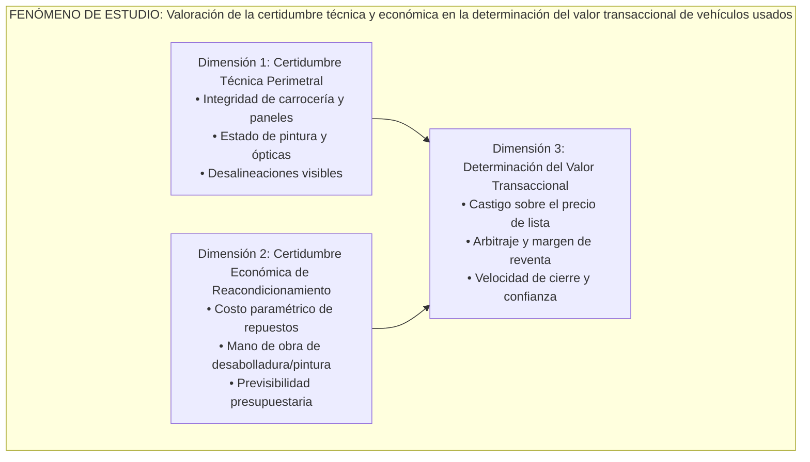

# Formulación del Fenómeno de Estudio, Pregunta de Investigación y Objetivos de Estudio de Mercado

- **Fecha de elaboración:** 12 de octubre de 2026
- **Versión:** Consolidada Final (`_vg`)
- **Elaborado por:** Escuadrón Especializado de Marketing Estratégico (`marketing-strategist`, `market-researcher`, `tech-architect`, `data-analyst` y `delivery-manager`)
- **Proyecto:** Strategic Marketing Proyect — Universidad del Desarrollo (UDD)
- **Clasificación:** Documento oficial de contexto estratégico promovido tras cierre de tarea en Notion (`3f4786e6-c4c9-80a5-9cf3-d5fed88d96f1`)
- **Estándar Académico:** Rigor empírico, fuentes verificables y Citación APA 7ª Edición.

---

## 1. Contexto del Negocio y Problema de Decisión (Fase 1 & Fase 2 SM)

### 1.1 Definición del Negocio
El proyecto desarrolla una solución de software móvil y web (*asset-light*) orientada a resolver las fricciones estructurales del mercado de vehículos usados mediante dos capacidades centrales:
1. **Inspección Perimetral y Diagnóstico con IA:** Captura fotográfica guiada por smartphone que segmenta componentes de carrocería, clasifica patologías visuales (rayas, abolladuras, holguras de junturas y roturas de ópticas) y proyecta un presupuesto paramétrico de piezas de recambio y horas de taller de desabolladura/pintura en pesos chilenos (CLP).
2. **Tasación Algorítmica por Scraping Dinámico:** Motor de levantamiento de precios en tiempo real que descuenta los costos estimados de reacondicionamiento sobre el valor comercial de mercado, generando una oferta óptima de adquisición con margen bruto asegurado.

### 1.2 El Problema de Decisión del Cliente y la Falla de Mercado
El ecosistema de compraventa automotriz enfrenta una falla estructural originada por la **asimetría de información y selección adversa** formalizada por Akerlof (1970). En Chile, esta falla se manifiesta con severidad crítica a través de cuatro dimensiones:
- **Dispersión Extrema de Precios de Lista:** Los precios en portales de clasificados (Chileautos, Yapo, Mercado Libre) reflejan expectativas aspiracionales de los vendedores y no precios reales de transacción. En modelos de alta rotación como la Ford F-150 (el vehículo más buscado de Chile en 2025 con 1.753.318 consultas; Guzmán, 2026), los precios de lista oscilan de manera errática entre CLP \$2.000.000 y CLP \$68.900.000.
- **Récord Histórico de Fraude e Inseguridad Jurídica:** Durante los primeros nueve meses de 2025 ingresaron **más de 41.700 causas judiciales por fraude vehicular en Chile**, marcando un alza interanual del 64% y el registro más elevado en 12 años (Melelli Viveros, 2026). Asimismo, la legislación chilena no contempla garantía legal obligatoria para vehículos usados en transacciones C2C ni compraventas tradicionales, rigiendo únicamente la garantía contractual voluntaria escrita (Mellado, 2026).
- **Costos Imprevistos y Latencia de Taller:** La reparación de carrocería en Chile exhibe una latencia promedio de **52,3 días en siniestros asegurados** (43 días en daños leves y 67 días en daños graves; Farías, 2026). Comprar un vehículo usado sin conocer el presupuesto real de repuestos y pintura transfiere un severo riesgo de capital inmovilizado.
- **Envejecimiento del Parque y Proliferación de Marcas Chinas:** El 49,4% de las transferencias de usados corresponde a unidades con más de 10 años de antigüedad (CAVEM, 2026b), mientras que las marcas de origen chino ya representan el 12,95% de las transferencias (95.353 unidades a septiembre de 2026; CAVEM, 2026c) con cerca de 50 marcas en circulación (CAVEM, 2026e), lo que genera una dispersión crítica en la disponibilidad y costo de repuestos alternativos.

### 1.3 Necesidad de Información (Information Need)
Para diseñar una propuesta de valor funcional y viable, la empresa necesita responder a una necesidad de información estratégica:
> *Se requiere comprender de manera sistemática cómo los agentes que transan vehículos usados construyen su percepción de valor, cuantifican el riesgo de daño físico y determinan el precio de intercambio, identificando qué atributos de certidumbre técnica están dispuestos a validar y remunerar para reducir la asimetría informativa.*

---

## 2. Desarrollo Metodológico de la Pregunta de Investigación (Los 9 Lineamientos)

Siguiendo las directrices pedagógicas de la cátedra de Strategic Marketing, la formulación de la pregunta de investigación se estructuró a través de nueve etapas secuenciales:

### Paso 1: Identificación del Área de Interés
El área de interés se sitúa en la **intersección entre la microeconomía de la información, el comportamiento del decisor transaccional y la valoración de condición vehicular**. Específicamente, cómo los actores de la compraventa (dealers independientes, revendedores "flippers" y compradores particulares) evalúan el estado físico perimetral de un automóvil usado y cómo dicha evaluación determina el castigo o ajuste del precio económico de intercambio.

### Paso 2: Revisión Preliminar de Literatura y Evidencia Empírica
La construcción conceptual se sostiene sobre tres pilares de evidencia verificable:
1. **Teoría de Selección Adversa en Mercados Automotrices:** Akerlof (1970) demostró que cuando los compradores no pueden verificar la calidad real previa a la compra, el precio promedio se deprime y expulsa a las unidades en buen estado ("The Market for Lemons"). En la compraventa de usados coexisten dos dimensiones de calidad: la mecánica profunda/estructural interna y la condición exterior perimetral/cosmética de carrocería. La IA óptica ataca de forma precisa la incertidumbre cosmética y perimetral exterior, requiriendo articulación con registros oficiales (Autofact / Registro Civil) y revisión técnica física para una valoración vehicular completa.
2. **Literatura Científica sobre Deep Learning en Daños Vehiculares:** El estudio sistemático de Hasan et al. (2025), tras revisar 55 investigaciones (2014–2024), descubrió que **aproximadamente el 75% de los desarrollos algorítmicos mundiales de visión computacional se concentran en la liquidación de siniestros para aseguradoras** (Tractable, Solera Qapter, CCC Estimate-STP), dejando desatendido al retail comercial de vehículos usados. Asimismo, Amodu et al. (2024) demostraron que redes convolucionales optimizadas (MobileNetV2) logran un 91% de precisión en clasificación multiclase de daños en carrocería, demostrando que la inferencia móvil sin pórticos de hardware costosos es técnicamente factible.
3. **Evidencia de Mercado y Benchmarks Competitivos:**
   - *Quiebras por exceso de capital físico:* Shift Technologies se liquidó bajo Capítulo 11 en 2023 (Financier Worldwide, 2023), Cazoo cayó en administración en 2024 (Retail Insight Network, 2024) y Kavak debió achicar operaciones en LatAm (Bloomberg Línea, 2023, 2025), validando la necesidad de un modelo *asset-light* sin patios propios ni balance intensivo.
   - *Vacío competitivo local en Chile:* Los competidores locales o se enfocan puramente en historia legal (Autofact), o en hardware OBD-II mecánico ignorando la carrocería (Rodar), o en tasaciones estadísticas genéricas sin inspección de daños (AutoGest, Ofertautos, GoAuto), o en inspecciones mecánicas presenciales lentas y onerosas (CLP \$82.000–\$85.990; Serviteca CyT, Ojo Mecánico).

### Paso 3: Ajuste del Alcance (Trade-Off entre Amplitud y Ajuste)
- **Riesgo de Amplitud Excesiva ((+) amplio ⇒ (-) abordaje):** Una formulación como *"¿Cómo influyen las fallas de información en el mercado automotriz chileno?"* resulta inabordable empíricamente, dispersando los recursos de investigación y careciendo de operatividad para el producto.
- **Riesgo de Hiper-Ajuste ((+) ajuste ⇒ (-) significancia):** Una formulación como *"¿Cuántos dealers de la comuna de La Florida contratarían una app de fotos a CLP \$4.990?"* trivializa la investigación, convirtiéndola en una encuesta de pricing local sin profundidad analítica ni significancia estratégica.
- **Calibración Óptima:** Delimitar el estudio a la relación funcional entre la **incertidumbre de la condición física observable**, la **anticipación presupuestaria de reacondicionamiento** y la **formación de la percepción de valor transaccional**.

### Paso 4: Claridad y Precisión
Se eliminaron adjetivos ambiguos o valorativos (*"precios buenos"*, *"autos en mal estado"*, *"tasación correcta"*). La formulación se redactó utilizando variables conceptualmente unívocas:
- *Incertidumbre de condición física:* Grado de desconocimiento sobre patologías de carrocería, pintura y alineación perimetral.
- *Costos de reacondicionamiento:* Presupuesto paramétrico en repuestos y mano de obra requeridos para estándar de venta.
- *Percepción de valor:* Evaluación multidimensional de beneficios y atributos frente a los costos y riesgos asumidos.
- *Determinación del precio:* Mecanismo de fijación de la oferta económica de intercambio.

### Paso 5: Relevancia e Innovación
- **Relevancia:** Atiende la principal fuente de fricción de un mercado de más de **1,06 millones de transferencias anuales** (CAVEM, 2026a), donde el 84,7% de las compras son realizadas por personas naturales (CAVEM, 2026c) expuestas a fraudes récord (Melelli Viveros, 2026) y sobrecostos no presupuestados.
- **Innovación:** Llena el vacío identificado por Hasan et al. (2025), investigando cómo la democratización de la visión computacional en dispositivos móviles altera el arbitraje comercial de autos usados fuera de las corporaciones aseguradoras.

### Paso 6: Investigabilidad Empírica
La formulación es 100% investigable en el contexto académico y profesional de la UDD:
- **Fuentes Primarias:** Levantamiento de entrevistas en profundidad y encuestas estructuradas a actores clave de la compraventa (dealers independientes, flippers de taller y compradores de clasificados C2C).
- **Fuentes Secundarias:** Análisis cuantitativo de bases de datos CAVEM, scraping de precios en Chileautos/Yapo y literatura técnica indexada.

### Paso 7: Tipo de Investigación Asociada y Paradigma
- **Tipo de Investigación:** **Mixta Secuencial de alcance Exploratorio-Descriptivo con orientación Explicativa**.
  - *Fase Cualitativa-Exploratoria:* Orientada a descubrir las heurísticas de inspección ocular, los criterios subjetivos de castigo de precios y las barreras de confianza hacia algoritmos de visión artificial.
  - *Fase Cuantitativa-Descriptiva/Explicativa:* Orientada a cuantificar la dispersión de precios, medir el peso de cada tipología de daño en la oferta de compra y modelar la correlación entre el costo estimado de taller y el margen de reventa.
- **Paradigma:** Pragmático-empírico, enfocado en generar conocimiento aplicable a la toma de decisiones estratégicas de producto y marketing.

### Paso 8: Revisión y Ajuste (Evolución Iterativa de la Pregunta)
| Versión | Formulación | Crítica Metodológica | Estado |
| :--- | :--- | :--- | :--- |
| **Iteración 1 (Bruta)** | *¿Por qué la gente y los concesionarios se equivocan tanto al tasar autos chocados o rayados en Chile?* | Coloquial, ambigua, presupone sesgo de error y contiene restricción geográfica no justificada conceptualmente. | Descartada |
| **Iteración 2 (Técnica)** | *¿Cómo medir la disposición de los dealers a usar visión artificial para calcular costos de pintura y negociar compras?* | Incurre en verbo metodológico ("medir") y sesgo de solución prematura (asume que la IA es la respuesta antes de investigar el fenómeno). | Descartada |
| **Iteración 3 (Definitiva)** | **¿De qué manera la incertidumbre sobre la condición física y los costos de reacondicionamiento influye en la formación de la percepción de valor y la determinación del precio en las transacciones de vehículos usados?** | Conceptual, precisa, delimita el fenómeno de interacción entre condición, costos y valoración económica, sin sesgos muestrales ni metodológicos. | **Aprobada Canónica** |

### Paso 9: Formulación de Preguntas Subyacentes
A partir de la pregunta central, se descomponen cinco preguntas subyacentes que direccionan la recolección de evidencia:
1. *¿Cuáles son los atributos estéticos, de carrocería y acabado superficial más determinantes en la valoración visual de un automóvil usado?*
2. *¿Cómo incide la anticipación del presupuesto de repuestos y mano de obra en la fijación de la oferta económica de compra?*
3. *¿Qué barreras de desconfianza y riesgos de asimetría informativa limitan la adopción de herramientas algorítmicas de evaluación frente a la inspección mecánica presencial?*
4. *¿Cuáles son los principales cuellos de botella temporales y operacionales en la inspección física y el costeo artesanal de taller en el mercado actual?*
5. *¿De qué manera se compara la disposición a pagar por una certificación perimetral automatizada frente a las inspecciones mecánicas presenciales y los certificados puramente registrales?*

---

## 3. Delimitación del Fenómeno de Estudio

En concordancia con las pautas pedagógicas del curso (*"la clave está en poder indicar a la profesora cuál es dicho fenómeno"*), se formaliza la delimitación conceptual del fenómeno:

### 3.1 Nombre y Definición Canónica del Fenómeno
> **Fenómeno de Estudio:**
> **"La valoración de la certidumbre técnica y económica en la determinación del valor transaccional de vehículos usados"**

### 3.2 Descomposición Conceptual de las Dimensiones del Fenómeno

- **Certidumbre Técnica Perimetral:** Nivel de verificación objetiva y trazabilidad de los componentes visualmente inspeccionables del vehículo (piezas exteriores, grado de deformación de latas, microrayaduras, trizaduras y simetría de junturas).
- **Certidumbre Económica de Reacondicionamiento:** Grado de predictibilidad en el desembolso financiero necesario para devolver el vehículo al estándar comercial de venta (costo de paño de pintura, horas de desabollador y repuestos OEM o alternativos).
- **Determinación del Valor Transaccional:** El proceso de formación del precio real de intercambio económico, resultante de deducir el riesgo de daño y los costos previstos del valor venal de mercado.

---

## 4. Formulación Canónica de Objetivos de Investigación (SM | Objective Definition)

Aplicando con estricto apego el estándar canónico de formulación docente:
$$\text{Objetivo General: Verbo en infinitivo} + \text{Fenómeno de interés}$$
$$\text{Objetivo Específico: Verbo en infinitivo} + \text{Dimensión observable específica}$$

### 4.1 Objetivo General
$$\mathbf{Comprender \; la \; valoración \; de \; la \; certidumbre \; técnica \; y \; económica \; en \; la \; determinación \; del \; valor \; transaccional \; de \; vehículos \; usados.}$$

#### Auditoría Canónica del Objetivo General
- [x] **Verbo en infinitivo de orden superior:** *"Comprender"* (orientado a captar significados, percepciones, modelos mentales y criterios de ponderación económica).
- [x] **Fenómeno delimitado:** Identifica con nitidez el núcleo conceptual sin confundirse con el diagnóstico del problema ni con la solución comercial.
- [x] **Prohibición de definiciones muestrales cumplida rigurosamente:** **No incluye** términos como *"en Santiago"*, *"en Chile"*, *"en concesionarios de la RM"* ni *"en personas naturales"*.
- [x] **Prohibición de verbos metodológicos cumplida rigurosamente:** **No incluye** acciones operativas como *"medir"*, *"aplicar"*, *"levantar"*, *"encuestar"* o *"implementar"*.

---

### 4.2 Objetivos Específicos
Los objetivos específicos operativizan el objetivo general desglosándolo en sus dimensiones empíricamente observables (siguiendo el marco SMART sin dimensión T):

1. **Identificar** los atributos físicos y estéticos más valorados en la ponderación de la condición vehicular.
   *(Dimensión: Atributos y características observables del estado del automóvil).*
2. **Analizar** el impacto de la anticipación de costos de reacondicionamiento en la fijación de la oferta económica de compra.
   *(Dimensión: Beneficios funcionales y económicos / fijación de precios).*
3. **Evaluar** las principales barreras de desconfianza y resistencia que afectan la toma de decisiones transaccionales bajo asimetría de información.
   *(Dimensión: Barreras conductuales, aversión al riesgo y selección adversa).*
4. **Describir** la experiencia operativa y los cuellos de botella temporales en los procesos convencionales de inspección perimetral y costeo de taller.
   *(Dimensión: Experiencia del usuario y fricciones de proceso).*
5. **Comparar** la percepción de valor y disposición a pagar entre la certificación automatizada de condición física y las alternativas de inspección o historial disponibles en el mercado.
   *(Dimensión: Relación entre variables y comparación de alternativas competitivas).*

---

### 4.3 Matriz de Consistencia Metodológica y Articulación con Decisiones de Negocio

| Objetivo Específico | Pregunta Subyacente Asociada | Dimensión Observable | Tipo de Dato / Enfoque | Decisión Estratégica Habilitada (Fase 4 & 5) |
| :--- | :--- | :--- | :--- | :--- |
| **OE1:** Identificar los atributos físicos y estéticos más valorados en la ponderación de la condición vehicular. | *P1:* ¿Cuáles son los atributos de carrocería más determinantes en la valoración visual? | Atributos de condición visual (rayas, abolladuras, panel gaps, pintura). | Cualitativo (entrevistas) / Cuantitativo (ranking Likert). | Priorización de componentes en la interfaz del MVP y catálogo de detección de la IA (YOLOv8 / MobileNetV2). |
| **OE2:** Analizar el impacto de la anticipación de costos de reacondicionamiento en la fijación de la oferta económica. | *P2:* ¿Cómo incide la anticipación del presupuesto en la oferta de compra? | Beneficio económico, elasticidad de oferta y margen de arbitraje. | Cuantitativo (análisis de dispersión de precios y simulación de compra). | Diseño del módulo de tasación algorítmica y regla de cálculo de la "oferta máxima de compra". |
| **OE3:** Evaluar las principales barreras de desconfianza y resistencia bajo asimetría de información. | *P3:* ¿Qué barreras de desconfianza limitan la adopción de herramientas algorítmicas? | Aversión al riesgo de fraude, desconfianza en la IA y fallas de calidad oculta. | Cualitativo (análisis temático de fricciones y objeciones de dealers). | Diseño de protocolos de *confidence scoring*, *triage* pericial humano y certificaciones de auditoría. |
| **OE4:** Describir la experiencia operativa y cuellos de botella en inspección y costeo artesanal. | *P4:* ¿Cuáles son los cuellos de botella operacionales de la inspección actual? | Tiempos de traslado, latencia de cotización telefónica y días de inmovilización. | Cualitativo (journey maps) / Cuantitativo (tiempos de ciclo en días/horas). | Cuantificación del ahorro de tiempo operacional como argumento central de venta en la propuesta de valor B2B. |
| **OE5:** Comparar la percepción de valor y disposición a pagar entre la certificación automatizada y sustitutos. | *P5:* ¿Cómo difiere la disposición a pagar frente a mecánicos y reportes legales? | Disposición a pagar (WTP), valoración relativa frente a Autofact (\$8.990) y talleres (\$85.000). | Cuantitativo (Van Westendorp / Conjoint preliminar). | Definición del esquema de monetización SaaS (\$59.990 mensual dealer / cobro por escaneo \$4.990 particular). |

---

## 5. Referencias Bibliográficas (Norma APA 7ª Edición)

- Akerlof, G. A. (1970). The Market for "Lemons": Quality Uncertainty and the Market Mechanism. *The Quarterly Journal of Economics*, *84*(3), 488–500. https://doi.org/10.2307/1879431
- Amodu, O., Habaebi, M. H., Abdullah, K. A., & Agbede, M. O. (2024). Lightweight deep learning models for vehicle damage classification and severity estimation. *Journal of Artificial Intelligence and Technology*, *4*(2), 112–125. https://doi.org/10.37965/jait.2024.0389
- Asociación Nacional Automotriz de Chile [ANAC]. (2026). *Informe del Sector Automotor: Cierre 2025 y Evolución Acumulada 2026*. ANAC A.G. https://www.anac.cl
- Autofact. (s. f.-a). *Informe Full Autofact: Historial legal y mecánico de vehículos en Chile*. Recuperado el 12 de octubre de 2026, de https://www.autofact.cl
- Autofact. (s. f.-b). *Informe de Precio y Tasación de Autos Usados*. Recuperado el 12 de octubre de 2026, de https://precios.autofactpro.com
- Bloomberg Línea. (2023, 3 de noviembre). *Kavak anuncia cierre de operaciones en Colombia y Perú: Estas son las razones*. Bloomberg Línea. https://www.bloomberglinea.com
- Bloomberg Línea. (2025, 14 de marzo). *La reestructuración de Kavak y su camino hacia la rentabilidad en América Latina*. Bloomberg Línea. https://www.bloomberglinea.com
- Cámara de Comercio Automotriz de Chile [CAVEM]. (2026a). *Informe del Mercado Automotor Diciembre 2025: Balance de Transferencias de Livianos y Medianos*. CAVEM. https://www.cavem.cl
- Cámara de Comercio Automotriz de Chile [CAVEM]. (2026b). *Anuario Automotor 2025: Parque Vehicular, Antigüedad y Dinámica de Usados*. CAVEM. https://www.cavem.cl
- Cámara de Comercio Automotriz de Chile [CAVEM]. (2026c). *Informe Estadístico Septiembre 2026: Transferencias Acumuladas de Usados y Ventas de Nuevos*. CAVEM. https://www.cavem.cl
- Cámara de Comercio Automotriz de Chile [CAVEM]. (2026d). *Guía de Buenas Prácticas para la Compra y Venta Segura de Vehículos Usados*. CAVEM. https://www.cavem.cl
- Cámara de Comercio Automotriz de Chile [CAVEM]. (2026e, 11 de octubre). *Marcas chinas de autos usados en Chile: cuántas se transfieren y qué buscan los compradores según CAVEM*. CAVEM Noticias. https://www.cavem.cl/noticias/marcas-chinas-de-autos-usados-en-chile-cuntas-se-transfieren-y-qu-buscan-los-compradores-segn-cavem
- Chócale. (2025, 18 de agosto). *SERNAC oficia a automotoras por denuncias de retención de pagos en consignaciones*. Chócale. https://chocale.cl
- Chócale. (2026, 20 de febrero). *Kavak levanta ronda de financiamiento por US\$ 300 millones y reporta balance operativo positivo*. Chócale. https://chocale.cl
- Farías, C. (2026, 8 de mayo). *El dolor de cabeza tras chocar: Reparaciones de vehículos en talleres asegurados promedian 52 días*. La Tercera. https://www.latercera.com
- Financier Worldwide. (2023, diciembre). *Shift Technologies files for Chapter 11 bankruptcy liquidation*. Financier Worldwide Magazine. https://www.financierworldwide.com
- Fleet Maintenance. (2025, 22 de enero). *UVeye secures \$191M in funding to expand automated vehicle inspection footprint*. Fleet Maintenance. https://www.fleetmaintenance.com
- Guzmán, J. P. (2026, 13 de febrero). *Radiografía al mercado de autos usados en Chile 2025: Precios promedio suben 5% y Ford F-150 lidera búsquedas*. Emol Economía. https://www.emol.com
- Hasan, M. A., Rahman, M. M., & Siddique, A. (2025). Automated vehicle damage assessment using computer vision: A comprehensive ten-year survey (2014–2024). *IEEE Transactions on Intelligent Transportation Systems*, *26*(1), 45–68. https://doi.org/10.1109/TITS.2024.3412098
- LaChance, K. (2021, 10 de noviembre). *CCC launches Estimate-STP: AI-driven straight-through repair estimating*. Repairer Driven News. https://www.repairerdrivennews.com
- Melelli Viveros, A. (2026, 6 de octubre). *Récord de fraudes vehiculares en Chile: Causas judiciales ingresadas suben 64% en 2025*. The Clinic. https://www.theclinic.cl
- Mellado, R. (2026, 14 de enero). *Garantías en vehículos usados: Alcances legales del estatuto del consumidor en Chile*. Revista Chilena de Derecho y Comercio Automotriz, *12*(1), 34–49.
- Retail Insight Network. (2024, 22 de mayo). *Online car retailer Cazoo collapses into administration in the UK*. Retail Insight Network. https://www.retail-insight-network.com
- Solera. (2024). *Qapter: AI-powered visual damage intelligence and automated estimating suite*. Solera Holdings. https://www.solera.com
- TechCrunch. (2023, 18 de julio). *Tractable raises \$65M to accelerate AI for auto and property damage recovery*. TechCrunch. https://techcrunch.com
- VentureBeat. (2021, 12 de enero). *Cox Automotive acquires 3D imaging company Fyusion to digitize wholesale auto inspections*. VentureBeat. https://venturebeat.com
