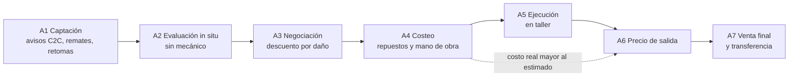
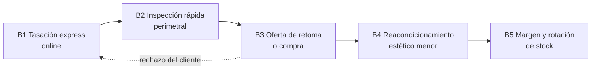
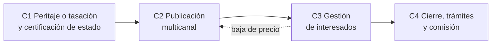
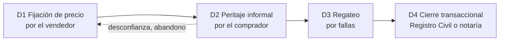

# Modalidades de compraventa de autos usados en Chile: flujos, cuellos de botella y eslabones de aporte de valor

- **Fecha:** 12-10-2026
- **Estado:** Borrador para validación del equipo
- **Elaborado por:** agente `market-researcher` (Strategic Marketing Proyect, UDD)
- **Clasificación:** Uso interno

---

## 1. Resumen ejecutivo

- **El mercado de usados triplica al de nuevos.** En 2025 se transfirieron 1.060.919 livianos y medianos usados (+5,8% vs. 2024), es decir, 3,4 usados por cada nuevo inscrito (CAVEM, 2026a). Entre enero y septiembre de 2026 van 821.781 transferencias (+4,2%) y la razón se mantiene en 3,4 (CAVEM, 2026c).
- **El stock que se transa es antiguo y mixto.** Cerca de la mitad de los usados transferidos en 2025 tenía más de 10 años (49,4%) (CAVEM, 2026b). Pasajeros (44,6%) y SUV (29,9%) concentran el volumen. Las marcas chinas pasaron de 11,0% de las transferencias en 2025 a 12,95% en enero-septiembre de 2026 (CAVEM, 2026a, 2026c).
- **El mercado está fragmentado en cuatro modalidades:** reparar y revender (*flip*), retoma o compra directa (concesionarios e iBuyers como Kavak y Clicar), consignación (física o virtual) y venta entre particulares (C2C) en clasificados (Chileautos, Yapo, Mercado Libre, Facebook Marketplace). En septiembre de 2026, el 84,7% de los compradores de usados fueron personas naturales (CAVEM, 2026c).
- **La asimetría de información es el problema de fondo** (Akerlof, 1970). Hoy se cubre con piezas sueltas: informes de historial (Autofact), certificados del Registro Civil, inspecciones precompra a pedido y tasaciones online de los compradores profesionales.
- **El fraude y la desconfianza van en alza.** Entre enero y septiembre de 2025 ingresaron más de 41.700 causas por fraude vehicular a tribunales (+64%) (Melelli Viveros, 2026). La PDI desarticuló una banda que operaba vía Marketplace con 38 víctimas (24horas, 2026). El SERNAC denunció una automotora por incumplimientos en consignación (Chócale, 2025).
- **Eslabones de mayor valor (inferencia del equipo):** (1) evaluación de daños en terreno sin mecánico, (2) costeo de reparación antes de ofertar, (3) tasación de retoma y fijación del precio de salida, (4) negociación con descuento por daño documentado y (5) certificación de estado para consignación y venta C2C.
- **La factibilidad técnica tiene respaldo académico, pero falta validarla en Chile.** Una revisión sistemática de 55 estudios confirma que la detección de daños con *deep learning* es viable, aunque cerca del 75% de los trabajos apunta a seguros y persisten limitaciones de iluminación, reflejos y datos (Hasan et al., 2025). Esto debe contrastarse con entrevistas a dealers y *flippers*.

---

## 2. Contexto de mercado en Chile

### 2.1 Volumen: usados vs. nuevos

| Indicador | 2022 | 2023 | 2024 | 2025 | Ene-sep 2026 | Fuente |
|---|---|---|---|---|---|---|
| Transferencias de livianos y medianos usados | 1.035.798 | 963.363 | 1.003.038 | 1.060.919 | 821.781 | CAVEM (2026a, 2026c) |
| Variación anual de usados | n/d | -7,0%* | +4,1%* | +5,8% | +4,2% vs. ene-sep 2025 | CAVEM (2026a, 2026c) |
| Inscripciones de livianos y medianos nuevos (CAVEM) | 431.440 | 319.568 | 306.046 | 313.644 | 240.451 | CAVEM (2026a, 2026c) |
| Razón usados/nuevos | 2,4 | 3,0 | 3,3 | 3,4 | 3,4 | CAVEM (2026a, 2026c) |

\* Cálculo del equipo a partir de las cifras de CAVEM (2026a).

- **Ventas de nuevos según ANAC:** 310.598 livianos y medianos en 2025 (+2,7%), bajo el promedio de 10 años, que ronda las 348.000 unidades (ANAC, 2026). La diferencia con CAVEM (313.644) se explica porque CAVEM mide inscripciones en el Registro Civil y ANAC mide ventas a público.
- **Ritmo mensual reciente:** en septiembre de 2026 se transfirieron 85.661 usados (+4,7% interanual) (CAVEM, 2026c). El primer semestre de 2026 sumó 559.415 transferencias (+5,8%) (cálculo del equipo sobre CAVEM, 2026c; cifra coincidente con Melelli Viveros, 2026).
- **Mercado global (nuevos y usados, incluidos camiones):** 1.431.699 operaciones en 2025, con los livianos usados como el 72,67% del total (CAVEM, 2026a).

### 2.2 Segmentos (carrocería)

| Segmento | Usados 2025: unidades | Usados 2025: participación | Usados sep-2026 | Nuevos 2025 (ANAC) |
|---|---|---|---|---|
| Pasajeros (sedán y hatchback) | 473.517 | 44,6% | 42,7% | 17,5% |
| SUV | 317.300 | 29,9% | 31,0% | 51,1% |
| Camionetas (pickup) | 195.641 | 18,4% | 19,3% | 20,4% |
| Comerciales | 74.461 | 7,0% | 7,1% | 11,0% |

Fuentes: CAVEM (2026b, 2026c) y ANAC (2026).

- **Lectura:** el SUV domina el mercado nuevo, pero en usados todavía predomina el auto de pasajeros. A medida que envejezca el parque de SUV vendidos en los últimos años, el *mix* de usados debería moverse hacia SUV (inferencia del equipo).
- **Demanda y precios en portales (Chileautos, no son transacciones):** en 2025, las búsquedas se distribuyeron en SUV 40%, sedán 21%, hatchback 21% y pickup 18%. El precio promedio de publicación subió 5%, de $17.527.519 a $18.396.548. Por segmento, el precio subió en hatchback (+5%), pickup (+4%) y sedán (+3%), y bajó en SUV (-1%). La Ford F-150 fue el modelo más buscado, con 1.753.318 búsquedas (Guzmán, 2026).
- **Nota de consistencia:** el informe mensual de diciembre de 2025 suma 1.051.917 unidades en su desglose por categoría, cifra distinta del total anual de 1.060.919 (CAVEM, 2026a). Este documento usa el desglose del Anuario 2025, que sí cuadra con el total (CAVEM, 2026b).

### 2.3 Marcas y origen chino

| Indicador | Valor | Fuente |
|---|---|---|
| Top 5 de marcas en usados 2025 | Chevrolet 11,9%; Hyundai 9,0%; Toyota 7,7%; Kia 7,3%; Nissan 7,1% (las 5 suman 42,9%) | CAVEM (2026a) |
| Marcas chinas en transferencias de usados 2025 | 116.884 unidades, 11,02% | CAVEM (2026a) |
| Marcas chinas en transferencias de usados, ene-sep 2026 | 95.353 unidades, 12,95% (máximo mensual: 13,87% en agosto) | CAVEM (2026c) |
| Marcas chinas en inscripciones de nuevos 2025 | 99.161 unidades, 31,62% | CAVEM (2026a) |
| Origen China en nuevos, ene-nov 2025 (ANAC) | 41,4% por país de fabricación; 32,4% por país de marca | ANAC (2026) |
| Diversidad | Cerca de 50 marcas chinas con al menos una transferencia de usado. Lideran MG y Changan en SUV y Great Wall en pickups | CAVEM (2026e) |

- **Implicancia para la solución (inferencia del equipo):** la llegada masiva de marcas chinas al mercado de usados amplía el catálogo de versiones y repuestos con poca historia de precios. Esto refuerza el valor de la tasación por *scraping* y de un catálogo de piezas actualizado.

### 2.4 Antigüedad y parque

| Antigüedad de los usados transferidos en 2025 | Participación |
|---|---|
| 0 a 5 años | 25,7% |
| 6 a 10 años | 24,9% |
| 11 a 15 años | 25,6% |
| 16 a 20 años | 11,6% |
| Más de 20 años | 12,2% |

Fuente: CAVEM (2026b).

- **Parque automotor 2025:** 6.738.858 vehículos (+100.531 vs. 2024), con una tasa de renovación de 4,9% (CAVEM, 2026b).
- **Edad promedio del parque:** **no verificada.** Ninguna fuente consultada publica la edad promedio; solo está disponible la distribución por antigüedad de los vehículos transferidos.

---

## 3. Actores reales por modalidad (vigencia verificada al 12-10-2026)

| Modalidad | Actor | Qué hace (verificado) | Tarifas o condiciones verificables | Vigencia |
|---|---|---|---|---|
| Retoma / compra directa (iBuyer) | **Kavak Chile** | Compra, venta y cambio de autos; financiamiento; *hubs* en Santiago (Kavak, s.f.). Tasación online en menos de 5 minutos, inspección gratuita y tres opciones: compra directa, consignación o cambio con bono (Kavak, 2024) | "7 días o 300 km de prueba"; "Más de 15.000 personas ya confiaron en Kavak" (Kavak, s.f.) | Operando: el sitio .cl está activo con copyright 2026 |
| Retoma / compra directa (grupo concesionario) | **Clicar (Grupo Americar / Salazar Israel)** | Usados y seminuevos multimarca; tasación online gratuita con confirmación en sucursal; "Vende tu auto usado sin publicarlo ni mostrarlo" (Clicar, s.f.) | Más de 3.000 seminuevos en stock; financiamiento en hasta 48 cuotas; campaña de SUV con 3 meses de garantía (Clicar, s.f.) | Operando |
| iBuyer (antecedente) | **OLX Autos Chile** | Latam Car Group vendió la operación chilena a Grupo Salazar Israel (Americar); la FNE la aprobó en octubre de 2023 (Espinosa, 2023) | n/d | Salió como operador independiente. **No se verificó** si la marca sigue en uso |
| Concesionarios tradicionales (Gildemeister, Derco, Kaufmann, Autofin) | n/d | **No se verificaron** programas vigentes de seminuevos certificados ni de retoma en fuentes oficiales | n/d | Excluidos del análisis por falta de verificación |
| Consignación virtual | **Te Vendemos el Auto** | "Nosotros vendemos, tú sigues usando tu auto"; publican, gestionan visitas y hacen los trámites; tasación gratuita (Te Vendemos el Auto, s.f.). Publican en su sitio, Chileautos, Facebook e Instagram (Prat, 2023) | Comisión **no publicada** | Operando |
| Consignación (dentro de un iBuyer) | **Kavak** | Opción de consignación en sede (Kavak, 2024) | n/d | Operando |
| Clasificados C2C y B2C | **Chileautos** | Portal de avisos; principal fuente de datos de búsqueda y precio publicado (Guzmán, 2026) | Cobro de 1% al vendedor: **solo reportado en reclamos de usuarios** (p. ej., Reclamos.cl, 2024). No verificado en los términos oficiales | Operando |
| Clasificados C2C | **Mercado Libre Autos** | Publicación de vehículos; según la plataforma, sin comisión por venta (Mercado Libre, s.f.) | Destacados pagados (montos no verificados) | Operando |
| Clasificados C2C | **Yapo.cl** | Aparece en resultados de búsqueda como portal de avisos con publicación gratuita y extras pagados (fuentes secundarias) | No verificado en el sitio oficial | No verificada directamente |
| Clasificados C2C informales | **Facebook Marketplace** | Canal usado en estafas desarticuladas por la PDI (24horas, 2026) | Sin costo de publicación (no verificado formalmente) | Operando |
| Informes de historial y precio | **Autofact** (CAR Group) | Informe Full de historial, Informe de Precio y Tasación, transferencia 100% online desde 2016 (Autofact, s.f.-a) | Informe de Precio $5.990; Informe Full ref. $8.990; transferencia online $59.990 más arancel del Registro Civil y el 1,5% de impuesto (Autofact, s.f.-a, s.f.-b) | Operando |
| Certificados públicos | **Registro Civil (SRCeI)** | Certificado de anotaciones vigentes: dueños, limitaciones al dominio y anotaciones (ChileAtiende, s.f.-b). Certificado de multas no pagadas (ChileAtiende, s.f.-c) | $1.560 y $1.430, respectivamente | Vigente |
| Inspección precompra | **Mecánicos independientes / *marketplaces* de inspectores** | Aparecen *marketplaces* de inspectores a domicilio en resultados de búsqueda (p. ej., 2x3.cl), pero no fue posible abrir la página | **Precios no verificados** | No verificada |

---

## 4. Flujos y etapas por modalidad

> Los flujos y las tablas de esta sección son un **modelo analítico del equipo**, basado en las fuentes citadas (CAVEM, ChileAtiende, SII, Kavak, Clicar, Te Vendemos el Auto, Autofact y prensa). Las duraciones y costos solo se informan cuando son verificables; en el resto de los casos se indica "n/v" (no verificado).

### 4.1 Modalidad A: comprar, reparar o reacondicionar y revender (*flip*)

| Etapa | Actor | Actividad | Información usada | Duración / costo típico | Fricción / riesgo |
|---|---|---|---|---|---|
| A1 Captación | *Flipper*, compraventa mediana | Barrido diario de avisos y contactos | Precio publicado en portales | n/v | Dispersión de precios y avisos fraudulentos (Melelli Viveros, 2026) |
| A2 Evaluación in situ | *Flipper* | Inspección visual y prueba corta | Experiencia propia; certificado de anotaciones ($1.560) | n/v | Daños estructurales u odómetro alterado no detectados (CAVEM, 2026d) |
| A3 Negociación | *Flipper* y vendedor | Descuento por fallas detectadas | Estimación mental del costo de reparación | n/v | Sin evidencia documentada, el descuento queda subestimado o se pierde el trato |
| A4 Costeo | *Flipper* y taller | Cotizar piezas y mano de obra | Cotizaciones telefónicas y catálogos dispersos | n/v | Costos imprevistos; repuestos de marcas nuevas, como las chinas, con poca referencia |
| A5 Ejecución | Taller | Reparación y pintura | Orden de trabajo | Referencia de siniestros asegurados: 52,3 días promedio desde la denuncia hasta el retiro (Farías, 2026); no es equivalente a un *flip* | Capital inmovilizado y retrasos |
| A6 Precio de salida | *Flipper* | Fijar precio de publicación | Planillas y comparación manual en portales | n/v | Sobreprecio (rotación lenta) o subprecio (pérdida de margen) |
| A7 Venta final | *Flipper* y comprador | Transferencia y cobro | Contrato e impuesto | Trámite $39.240 más el 1,5% (ChileAtiende, s.f.-a) | Fraude en el pago (CAVEM, 2026d) |

### 4.2 Modalidad B: compra directa y retoma comercial (concesionario e iBuyer)

| Etapa | Actor | Actividad | Información usada | Duración / costo típico | Fricción / riesgo |
|---|---|---|---|---|---|
| B1 Tasación express | iBuyer o concesionario | Oferta preliminar con datos del vehículo | Modelos de precio propios | Menos de 5 minutos en Kavak (Kavak, 2024); tasación online gratuita en Clicar (Clicar, s.f.) | Ancla de precio que después se ajusta y frustra al vendedor |
| B2 Inspección perimetral | Tasador | Revisión física para fijar el precio final | Pauta de inspección interna | Inspección gratuita en Kavak (Kavak, 2024) | Variabilidad entre tasadores y daños ocultos |
| B3 Oferta | Comercial | Compra al contado, cambio con bono o consignación | Costo estimado de reacondicionamiento y precio de reventa | Venta el mismo día en Clicar (Clicar, s.f.) | Margen comprimido si se sobreestima el precio de reventa |
| B4 Reacondicionamiento | Taller propio o externo | Estética, mantención y garantía | Checklist | n/v | Desviación de costo respecto de lo previsto |
| B5 Margen y rotación | Gerencia de usados | Precio de lista, financiamiento y garantía (p. ej., 7 días o 300 km en Kavak) | Benchmark de portales | n/v | Días en stock y depreciación |

### 4.3 Modalidad C: consignación virtual y venta intermediada

| Etapa | Actor | Actividad | Información usada | Duración / costo típico | Fricción / riesgo |
|---|---|---|---|---|---|
| C1 Peritaje y certificación | Consignador | Tasación y revisión del estado | Tasación del consignador; informes de historial | Tasación gratuita en Te Vendemos el Auto (Te Vendemos el Auto, s.f.) | No se publica un peritaje estandarizado; el estado es declarativo |
| C2 Publicación | Consignador | Aviso en su sitio, Chileautos y redes (Prat, 2023) | Fotos y descripción | n/v | Precio de publicación sin respaldo comparativo |
| C3 Gestión de interesados | Consignador | Visitas, preguntas y negociación | Información del vendedor | n/v | Preguntas repetidas sobre el estado; regateo |
| C4 Cierre y comisión | Consignador, vendedor y comprador | Contrato, transferencia y pago | Contrato de consignación | Comisión no publicada | Riesgo de incumplimiento de pago al consignante (caso Autal, SERNAC; Chócale, 2025) |

### 4.4 Modalidad D: venta asistida entre particulares (C2C)

| Etapa | Actor | Actividad | Información usada | Duración / costo típico | Fricción / riesgo |
|---|---|---|---|---|---|
| D1 Fijación de precio | Vendedor particular | Comparar avisos y publicar | Portales; Informe de Precio Autofact ($5.990) (Autofact, s.f.-b) | n/v | Anclaje en precios publicados, no transados |
| D2 Peritaje informal | Comprador | Prueba de manejo, mecánico de confianza y certificados | Certificado de anotaciones ($1.560); certificado de multas ($1.430) (ChileAtiende, s.f.-b, s.f.-c) | Inspección: precio n/v | Choques estructurales y odómetro adulterado (CAVEM, 2026d) |
| D3 Regateo | Comprador y vendedor | Descuento por fallas | Opinión del mecánico; cotizaciones | n/v | Discusión sin base objetiva |
| D4 Cierre | Ambos, Registro Civil o notaría | Contrato notarial o declaración consensual ante el Registro Civil, y pago del impuesto | Ver la tabla de trámites | Ver la tabla de trámites | Pagos falsos, depósitos con reversa y suplantación de identidad (CAVEM, 2026d; 24horas, 2026) |

**Trámites chilenos verificados para el cierre (D4)**

| Trámite | Detalle verificado | Fuente |
|---|---|---|
| Transferencia de dominio | El vehículo debe estar inscrito a nombre del vendedor. Se formaliza con contrato notarial o con declaración consensual ante el SRCeI, con hora reservada en línea mediante ClaveÚnica. Costo del trámite: $39.240 | ChileAtiende (s.f.-a) |
| Impuesto a la transferencia | Impuesto de beneficio municipal de 1,5%, "aplicado al mayor valor que resulte entre el precio de venta o el avalúo fiscal fijado por el SII". Se paga en un banco o en la TGR | SII (2025); ChileAtiende (s.f.-a) |
| Permiso de circulación al día | Documento exigido para la transferencia. Para obtenerlo se requiere revisión técnica vigente (o certificado de homologación), SOAP y padrón, sin multas impagas | ChileAtiende (s.f.-a, s.f.-d) |
| Certificado de anotaciones vigentes | Muestra dueños actuales y anteriores, limitaciones al dominio y anotaciones; $1.560; en línea | ChileAtiende (s.f.-b) |
| Certificado de multas no pagadas | Multas empadronadas; $1.430; en línea | ChileAtiende (s.f.-c) |
| Alternativa digital privada | Transferencia online de Autofact: $59.990 más arancel y el 1,5% | Autofact (s.f.-a) |

### 4.5 Modalidades vs. buyer persona

| Buyer persona | A *Flip* | B Retoma / iBuyer | C Consignación | D C2C | Rol principal |
|---|---|---|---|---|---|
| Dealer tradicional | Media | **Alta** | Media (como consignador) | Baja | Comprador de retomas y vendedor de stock |
| Compraventa mediana | **Alta** | **Alta** | **Alta** | Media (captación) | Compra a particulares, reacondiciona y consigna |
| Revendedor que repara (*flipper*) | **Alta** | Baja | Baja | **Alta** (como comprador y vendedor) | Arbitraje de daño y precio |
| Particular | Baja | **Alta** (como vendedor a un iBuyer) | **Alta** (como consignante) | **Alta** | Vendedor o comprador final |

Relevancia según el **modelo analítico del equipo**; queda por validar con fuente primaria.

---

## 5. Cuellos de botella y puntos ciegos

### 5.1 Fricciones transversales

1. **Asimetría de información (selección adversa).** El vendedor conoce la calidad real del auto y el comprador no. Por eso el precio se ajusta a la baja y los autos buenos salen del mercado (Akerlof, 1970). En Chile esto se ve en las recomendaciones de CAVEM de revisar dominio, kilometraje, chasis e inspección independiente (CAVEM, 2026d).
2. **Dispersión de precios en portales.** Los portales muestran precios publicados, no transados (Guzmán, 2026). El equipo plantea como síntoma una Ford F-150 listada entre CLP 2,0M y 68,9M en 2025. **Ese rango no se pudo verificar** con una fuente pública en esta investigación. Sí está verificado que la F-150 fue el modelo más buscado en Chileautos en 2025 (Guzmán, 2026).
3. **Costos imprevistos de taller y tiempos largos.** No existe un índice público de costo de reparación para usados. Como referencia, los siniestros asegurados toman 52,3 días promedio desde la denuncia hasta el retiro: 43 días si el daño es leve y 67 si es grave (Farías, 2026, con datos de la CMF del segundo semestre de 2025).
4. **Fraude y desconfianza.** Más de 41.700 causas por fraude vehicular entre enero y septiembre de 2025, el nivel más alto en 12 años; cerca del 69% son estafas y defraudaciones (Melelli Viveros, 2026, con datos del Poder Judicial vía la plataforma Sheriff). La PDI desarticuló una banda que operaba por Marketplace, con 38 víctimas y un perjuicio cercano a $378 millones (24horas, 2026). Entre enero de 2020 y junio de 2023, el SERNAC recibió más de 40.000 reclamos contra la industria automotriz; el 10,9% correspondió a autos usados (Reyes, 2023).
5. **Garantía débil en usados.** Según el SERNAC, citado por la prensa, los usados no tienen garantía legal, salvo una garantía voluntaria por escrito (Mellado, 2026).

### 5.2 Mapa de fricción por modalidad y etapa

| Modalidad | Etapa crítica | Tipo de pérdida | Por qué |
|---|---|---|---|
| A *Flip* | A2 Evaluación sin mecánico | Riesgo y margen | Un daño oculto no detectado convierte la compra en pérdida |
| A *Flip* | A4 Costeo | Margen | Las cotizaciones son lentas y la desviación aparece después de comprar |
| A *Flip* | A6 Precio de salida | Margen y tiempo | El precio se fija manualmente con planillas y portales |
| B Retoma | B1-B3 Tasación y oferta | Margen y conversión | La oferta debe ser competitiva y a la vez cubrir el reacondicionamiento |
| B Retoma | B4 Reacondicionamiento | Margen | Desviación entre el costo previsto y el real |
| C Consignación | C1 Certificación | Confianza | El estado es declarativo y no hay peritaje estandarizado visible |
| C Consignación | C4 Cierre | Riesgo | Incumplimiento de pagos al consignante (Chócale, 2025) |
| D C2C | D2-D3 Peritaje y regateo | Confianza y tiempo | No hay una base objetiva común entre las partes |
| D C2C | D4 Cierre | Riesgo | Fraude en el pago y suplantación de identidad |

### 5.3 Puntos ciegos (lo que hoy nadie resuelve de forma integrada, según el modelo analítico del equipo)

- **Informes separados.** El historial legal (Autofact, Registro Civil) y el estado físico (inspección) se entregan por separado. Ninguna fuente revisada los integra con un costo de reparación.
- **Tasación sin daño.** Las tasaciones online públicas (Autofact, Kavak, Clicar) no publican un ajuste explícito por daño visible antes de la inspección presencial.
- **Repuestos de marcas nuevas.** Con cerca de 50 marcas chinas en usados (CAVEM, 2026e), falta referencia de precios de repuestos.

---

## 6. Matriz de eslabones de aporte de valor

> **Las intensidades (Alta, Media, Baja) son una inferencia del equipo**: juicio analítico, no datos medidos. Deben validarse con entrevistas y pruebas piloto.
>
> **Módulos:** DX = Diagnóstico de daños con IA; PZ = Sugerencia de piezas; CR = Estimación del costo de reparación; TS = Tasación por *scraping*.

| Eslabón (modalidad, etapa) | Fricción principal | Módulo(s) | Tipo de valor | Intensidad (inferencia del equipo) |
|---|---|---|---|---|
| A1 Captación | Filtrar cientos de avisos con precios dispersos | TS | Ahorro de tiempo | Media |
| A2 Evaluación in situ sin mecánico | Daño oculto y falta de experto en el lugar | DX, PZ | Mitigación de riesgo | **Alta** |
| A3 Negociación con descuento por daño | Descuento sin evidencia | DX, CR | Protección de margen | **Alta** |
| A4 Costeo de repuestos y mano de obra | Cotizaciones lentas y desviaciones | PZ, CR | Protección de margen, ahorro de tiempo | **Alta** |
| A5 Ejecución en taller | Desviación entre presupuesto y costo real | CR, PZ | Protección de margen | Media |
| A6 Precio de salida | Precio manual con planillas | TS | Protección de margen, ahorro de tiempo | **Alta** |
| A7 Venta final | Desconfianza del comprador | DX (informe de estado) | Confianza | Media |
| B1 Tasación express | Oferta inicial imprecisa | TS, DX | Ahorro de tiempo, protección de margen | **Alta** |
| B2 Inspección perimetral | Variabilidad entre tasadores | DX | Ahorro de tiempo, mitigación de riesgo | **Alta** |
| B3 Oferta de retoma | Equilibrio entre oferta competitiva y margen | CR, TS | Protección de margen | **Alta** |
| B4 Reacondicionamiento estético | Presupuesto de estética | PZ, CR | Protección de margen | Media |
| B5 Margen y rotación | Precio de lista frente al mercado | TS | Protección de margen | Media |
| C1 Peritaje y certificación | Estado declarativo | DX, CR | Confianza | **Alta** |
| C2 Publicación | Precio sin respaldo | TS | Confianza, ahorro de tiempo | Media |
| C3 Gestión de interesados | Preguntas repetidas y regateo | DX (informe compartible) | Ahorro de tiempo, confianza | Media |
| C4 Cierre y comisión | Riesgo contractual y de pago | (fuera del alcance de los módulos) | n/a | Baja |
| D1 Fijación de precio C2C | Anclaje en precios publicados | TS | Confianza | Media |
| D2 Peritaje informal | Comprador sin conocimiento técnico | DX, PZ | Mitigación de riesgo, confianza | **Alta** |
| D3 Regateo por fallas | Discusión sin base objetiva | CR | Confianza, ahorro de tiempo | **Alta** |
| D4 Cierre transaccional | Fraude y trámites | (fuera del alcance; complementar con certificados oficiales) | n/a | Baja |

### 6.1 Ranking de los 5 eslabones de mayor valor (inferencia del equipo)

| # | Eslabón | Módulos | Justificación |
|---|---|---|---|
| 1 | A2 y B2: evaluación de daños en terreno sin mecánico | DX, PZ | Es el origen de la asimetría (Akerlof, 1970) y el punto donde se decide comprar. Hay respaldo técnico de detección por foto o video (Hasan et al., 2025; Amodu et al., 2024) |
| 2 | A4 y B3: costeo de la reparación antes de ofertar | CR, PZ | Convierte el daño en dinero y protege el margen antes de comprometer capital |
| 3 | A6, B1 y B5: tasación y precio de salida | TS | Ataca la dispersión de precios publicados y el trabajo manual con planillas |
| 4 | A3 y D3: negociación con descuento documentado | DX, CR | Entrega evidencia compartible y reduce el regateo sin base |
| 5 | C1 y D2: certificación de estado para consignación y C2C | DX, CR | Genera confianza en un contexto de fraude récord (Melelli Viveros, 2026) |

### 6.2 Síntesis por buyer persona (inferencia del equipo)

| Buyer persona | Eslabones prioritarios | Propuesta de valor resumida |
|---|---|---|
| Dealer tradicional | B1, B2, B3, B5 | Tasación de retoma más rápida y consistente, con el costo de reacondicionamiento incluido |
| Compraventa mediana | A2, A4, A6, B3, C1 | Proteger el margen por unidad y estandarizar la evaluación entre compradores |
| *Flipper* | A2, A3, A4, A6 | "Mecánico y tasador en el bolsillo": decidir en el lugar cuánto ofrecer y cuánto costará reparar |
| Particular | D1, D2, D3, C1 | Saber si el precio es justo y qué fallas tiene el auto antes de pagar |

---

## 7. Sustento de factibilidad técnica

| Fuente | Hallazgo relevante | Implicancia para la solución |
|---|---|---|
| Hasan et al. (2025), revisión sistemática de 55 artículos | La IA, en especial el *deep learning*, puede automatizar la detección de daños para seguros, ventas online y estimación de costos de reparación. Cerca del 75% de los estudios se enfoca en seguros; el 74,5% de los *datasets* es privado. Persisten desafíos de baja luz, reflejos, daños superpuestos y ángulos de captura por celular | El módulo DX es viable, pero requiere datos propios (autos y condiciones de captura chilenas). Su aplicación a compraventa de usados está menos estudiada que en seguros, lo que es una oportunidad y a la vez un riesgo |
| Hasan et al. (2025), resultados reportados | Los modelos YOLO recientes reportan precisiones de detección cercanas o superiores al 90% en sus *datasets* (p. ej., YOLOv5x con F1 de 90,8% según Setyawan et al., citado en la revisión) | Las métricas dependen de cada *dataset* y no son directamente transferibles |
| Amodu et al. (2024), IoTBDS 2024 | En la comparación de arquitecturas, la CNN alcanzó 91% de precisión, la DNN 84% y la GAN 78%, con imágenes en distintas condiciones de iluminación | Respalda el uso de CNN como base para la clasificación de daño y severidad |
| Tractable (2021) | "AI Inspection": aplicación web que evalúa el estado exterior a partir de un video de una vuelta al auto, con usos en compraventa, devolución de arriendo y reciclaje | Referente internacional de inspección por video |
| Kavak (s.f., 2024) | Tasación online e inspección gratuita para el precio final | Referente local de iBuyer; la IA podría acortar la etapa B2 |
| Carvana (s.f.) | Según los resultados de búsqueda de su sitio, los autos "Carvana Certified" pasan una inspección de 150 puntos y tienen garantía de devolución de 7 días | Referente de estandarización de la inspección (no se pudo abrir la página; HTTP 403) |

---

## 8. Supuestos y limitaciones

- **Sin fuente primaria.** Ninguna afirmación sobre dolores, márgenes o tiempos de dealers y *flippers* se validó con entrevistas. Hay que levantar: margen típico por unidad, desviación entre costo de reparación estimado y real, días en stock, frecuencia de daños ocultos y disposición a pagar.
- **Precios publicados, no transados.** Las cifras de Chileautos reflejan búsquedas y avisos (Guzmán, 2026).
- **Rango de la F-150 (CLP 2,0M a 68,9M) no verificado.** Proviene del planteamiento del equipo; conviene documentar la extracción de *scraping* que lo origina.
- **Tarifas no publicadas.** No se verificaron las comisiones de consignación, el cobro de 1% de Chileautos (solo hay reclamos de usuarios), las tarifas de Yapo ni el costo de inspecciones precompra.
- **Concesionarios.** No se verificaron programas de seminuevos o retoma de Gildemeister, Derco, Kaufmann ni Autofin; solo se incluyó Clicar (Grupo Americar).
- **Proxy de tiempos de taller.** Los 52,3 días corresponden a siniestros asegurados (CMF), no a reparaciones de *flip*.
- **Diferencias entre fuentes:**
  - Nuevos 2025: CAVEM 313.644 (inscripciones) frente a ANAC 310.598 (ventas).
  - Desglose por categoría en el informe de diciembre 2025 (1.051.917) frente al total anual (1.060.919).
  - Razón usados/nuevos: 3,4 (CAVEM, 2026c) frente a 3,5 en agosto de 2026 (Emol, 2026) y "cerca de cuatro" (Melelli Viveros, 2026).
  - Participación china acumulada 2026: 12,83% en una nota de CAVEM (2026e), probablemente con corte en agosto, frente a 12,95% a septiembre (CAVEM, 2026c).
  - Parque 2024 en el Anuario: aparece como 6.592.807 en una tabla y como 6.638.327 en otra (CAVEM, 2026b).
- **Edad promedio del parque:** no disponible en las fuentes consultadas.
- **Fuentes de terceros sobre fraude:** la cifra de 41.700 causas viene de la plataforma privada Sheriff, que procesa datos del Poder Judicial, y no del informe original.

---

## 9. Referencias

24horas. (2026, 18 de abril). *Cae banda que estafaba con autos en redes sociales: 38 víctimas* [Noticia]. https://www.24horas.cl/actualidad/nacional/cae-banda-que-estafaba-con-autos-en-redes-sociales-38-victimas

Akerlof, G. A. (1970). The market for "lemons": Quality uncertainty and the market mechanism. *The Quarterly Journal of Economics, 84*(3), 488–500. https://doi.org/10.2307/1879431

Amodu, O. D., Shaban, A., & Akinade, G. (2024). Revolutionizing vehicle damage inspection: A deep learning approach for automated detection and classification. En *Proceedings of the 9th International Conference on Internet of Things, Big Data and Security (IoTBDS 2024)* (pp. 199–208). SCITEPRESS. https://doi.org/10.5220/0012630700003705

Asociación Nacional Automotriz de Chile. (2026). *Informe sector automotor: Mercado automotor diciembre 2025* [Informe]. https://www.anac.cl/wp-content/uploads/2026/01/12-ANAC-Mercado-Automotor-Diciembre-2025.pdf

Autofact. (s.f.-a). *Autofact: llms.txt* [Descripción de servicios]. Recuperado el 12 de octubre de 2026 de https://www.autofact.cl/llms.txt

Autofact. (s.f.-b). *Conoce el precio real de un vehículo usado*. Recuperado el 12 de octubre de 2026 de https://autofact.cl/precio-autos-usados

Cámara de Comercio Automotriz de Chile. (2026a). *Informe mensual estadístico: Diciembre 2025*. https://www.cavem.cl/informes/6981f16e190e9.pdf

Cámara de Comercio Automotriz de Chile. (2026b). *Anuario automotor 2025*. https://www.cavem.cl/informes/6a7c9bdb0cbc1.pdf

Cámara de Comercio Automotriz de Chile. (2026c). *Informe mensual estadístico: Septiembre 2026*. https://www.cavem.cl/informes/6ac52d8391f8d.pdf

Cámara de Comercio Automotriz de Chile. (2026d, 31 de agosto). *Historial de un vehículo usado: la clave para comprar con confianza*. https://www.cavem.cl/noticias/historial-de-un-vehculo-usado-la-clave-para-comprar-con-confianza

Cámara de Comercio Automotriz de Chile. (2026e, 2 de octubre). *Marcas chinas de autos usados en Chile: cuántas se transfieren y qué buscan los compradores según CAVEM*. https://www.cavem.cl/noticias/marcas-chinas-de-autos-usados-en-chile-cuntas-se-transfieren-y-qu-buscan-los-compradores-segn-cavem

Carvana. (s.f.). *Carvana Certified Program*. Recuperado el 12 de octubre de 2026 de https://www.carvana.com/certified-program

ChileAtiende. (s.f.-a). *Transferencia de dominio de vehículos motorizados*. Recuperado el 12 de octubre de 2026 de https://www.chileatiende.gob.cl/fichas/3409-transferencia-de-dominio-de-vehiculos-motorizados

ChileAtiende. (s.f.-b). *Certificado de anotaciones vigentes de vehículos motorizados*. Recuperado el 12 de octubre de 2026 de https://www.chileatiende.gob.cl/fichas/3370-certificado-de-anotaciones-vigentes-de-vehiculos-motorizados

ChileAtiende. (s.f.-c). *Certificado de multas de tránsito no pagadas*. Recuperado el 12 de octubre de 2026 de https://www.chileatiende.gob.cl/fichas/3439-certificado-de-multas-de-transito-no-pagadas

ChileAtiende. (s.f.-d). *Permiso de circulación*. Recuperado el 12 de octubre de 2026 de https://www.chileatiende.gob.cl/fichas/9611-permiso-de-circulacion

Chócale. (2025, 22 de enero). *SERNAC denunció a Automotora Autal por eventual delito de estafa*. https://chocale.cl/2025/01/sernac-denuncio-a-automotora-autal-por-eventual-delito-de-estafa/

Clicar. (s.f.). *Clicar: Usados y seminuevos de todas las marcas*. Recuperado el 12 de octubre de 2026 de https://www.clicar.cl

Emol. (2026, 7 de septiembre). *Autos usados: informe CAVEM agosto 2026* [Especial digital]. https://www.emol.com/noticias/Autos/2026/09/04/1210584/autos-usados-cavem-agosto-2026.html

Espinosa, M. (2023, 11 de octubre). FNE da luz verde y Grupo Salazar Israel compra toda la operación de OLX Autos en Chile. *Diario Financiero*. https://www.df.cl/empresas/industria/fne-da-luz-verde-y-grupo-salazar-israel-compra-toda-la-operacion-de-olx

Farías, R. (2026, 30 de abril). Seguros automotrices: ¿cuáles son los tiempos de reparación promedio en Chile? *Autocosmos*. https://noticias.autocosmos.cl/2026/04/30/seguros-automotrices-cuales-son-los-tiempos-de-reparacion-promedio-en-chile

Guzmán, J. T. (2026, 13 de febrero). [Mercado de autos usados en Chile 2025 según búsquedas y precios de Chileautos]. *Emol*. https://www.emol.com/noticias/Economia/2026/02/13/1191407/autos-usados-chile-2025.html

Hasan, M. J., Nguyen, C. K., Boo, Y. L., Jahani, H., & Ong, K.-L. (2025). Vehicle damage detection using artificial intelligence: A systematic literature review. *WIREs Data Mining and Knowledge Discovery, 15*(2), e70027. https://doi.org/10.1002/widm.70027

Kavak. (s.f.). *Compra y venta de autos usados en Chile*. Recuperado el 12 de octubre de 2026 de https://www.kavak.com/cl

Kavak. (2024, 29 de abril). *Cómo vender tu auto usado de manera simple en Kavak*. https://www.kavak.com/cl/blog/quieres-vender-tu-auto-lo-compramos-en-kavak-chile

La Tercera. (2025, 19 de noviembre). Venta de vehículos usados crece en octubre y supera los 900 mil en 2025: qué marcas lideran. *La Tercera, MT Online*. https://www.latercera.com/mtonline/noticia/venta-de-vehiculos-usados-crece-en-octubre-y-supera-los-900-mil-en-2025-que-marcas-lideran/

Melelli Viveros, N. (2026, 23 de agosto). Fraudes en la compraventa de autos alcanzan cifras récord en Chile: estas son las principales señales de alerta. *Pauta*. https://www.pauta.cl/tendencias/2026/08/23/fraudes-en-la-compraventa-de-autos-alcanzan-cifras-record-en-chile-estas-son-las-principales-senales-de-alerta.html

Mellado, L. (2026, 1 de septiembre). Cómo comprar un auto usado en Chile sin llevarse sorpresas. *The Clinic*. https://www.theclinic.cl/2026/09/01/comprar-auto-usado-chile/

Mercado Libre. (s.f.). *Vende tu auto*. Recuperado el 12 de octubre de 2026 de https://www.mercadolibre.cl/l/vende-tu-auto

Prat, N. (2023, 21 de noviembre). Te Vendemos el Auto: el sitio que la rompe en el mercado automotriz. *Radio Agricultura*. https://www.radioagricultura.cl/motor/2023/11/21/te-vendemos-el-auto-el-sitio-que-la-rompe-en-el-mercado-automotriz/

Reclamos.cl. (2024, octubre). *Chileautos.cl: cobro 1% engañoso por venta de auto* [Reclamo de usuario]. https://www.reclamos.cl/chileautoscl/reclamo/2024/oct/chileautoscl-cobro-1-enga-oso-por-venta-de-auto

Reyes, V. (2023, 6 de diciembre). Revelan las automotoras con más reclamos en Chile y país de donde vienen autos con alta tasa de quejas. *BioBioChile*. https://www.biobiochile.cl/noticias/economia/mercado-automotriz/2023/12/06/revelan-las-automotoras-con-mas-reclamos-en-chile-y-pais-de-donde-vienen-autos-con-alta-tasa-de-quejas.shtml

Servicio de Impuestos Internos. (2025). *¿Qué impuesto afecta a las ventas de vehículos usados?* [Pregunta frecuente 001.130.0706.011]. https://www.sii.cl/preguntas_frecuentes/impuestos_mensuales/001_130_0706.htm

Te Vendemos el Auto. (s.f.). *Te Vendemos el Auto: consignación virtual*. Recuperado el 12 de octubre de 2026 de https://tevendemoselauto.cl/

Tractable. (2021). *New AI solution accurately assesses vehicle condition in minutes* [Comunicado de prensa]. https://tractable.ai/en/resources/new-ai-solution-accurately-assesses-vehicle-condition-in-minutes
