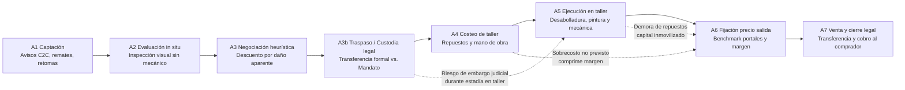
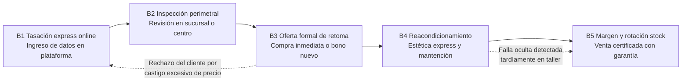
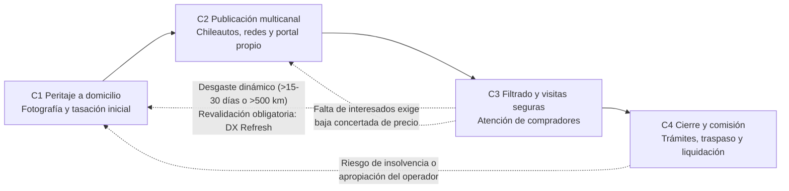
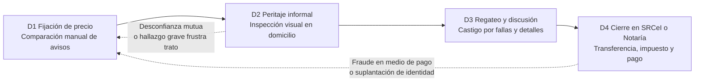

# Modalidades de compraventa de autos usados en Chile: flujos operacionales, modelado por buyer persona, cuellos de botella y matriz de eslabones de aporte de valor

- **Fecha de elaboración:** 12 de octubre de 2026
- **Versión:** Consolidada ampliada (`_vg`)
- **Elaborado por:** Agente de Inteligencia de Mercado y Modelado Cuantitativo (`market-researcher` & `data-analyst`)
- **Proyecto:** Strategic Marketing Proyect — Universidad del Desarrollo (UDD)
- **Clasificación:** Documento de contexto estratégico e insumo analítico oficial
- **Estado:** Finalizado para revisión y validación metodológica

---

## 1. Resumen ejecutivo

El mercado automotriz chileno presenta una asimetría estructural de volumen en favor del segmento de vehículos usados: durante el año 2025 se transfirieron **1.060.919 unidades livianas y medianas usadas**, lo que representó un incremento interanual del 5,8% y consolidó una relación de **3,4 vehículos usados comercializados por cada vehículo nuevo inscrito** (Cámara de Comercio Automotriz de Chile [CAVEM], 2026a). Durante el período acumulado entre enero y septiembre de 2026, la actividad registró **821.781 transferencias**, manteniendo una tasa de expansión del 4,2% interanual y sosteniendo de manera invariable el ratio de 3,4 a 1 frente al mercado de primera mano (CAVEM, 2026c). 

El parque automotor nacional en circulación superó los **6,73 millones de vehículos**, caracterizándose por una marcada madurez y obsolescencia relativa: el **49,4% de las transferencias de vehículos usados corresponde a unidades con más de 10 años de antigüedad**, distribuidas equitativamente entre automóviles de 11 a 15 años (25,6%) y modelos con más de 16 años (23,8%) (CAVEM, 2026b). Asimismo, el parque vehicular evidencia una rápida diversificación debido a la penetración de marcas de origen chino, las cuales alcanzaron una participación del **11,02% en las transferencias de usados de 2025** (116.884 unidades) y escalaron al **12,95% en el período enero-septiembre de 2026** (con un máximo mensual de 13,87% en agosto), abarcando más de 50 marcas distintas en circulación (CAVEM, 2026a, 2026c, 2026e).

Operacionalmente, la comercialización de vehículos usados en Chile se estructura en torno a cuatro modalidades principales:
1. **Modalidad A: Compra para reparación/reacondicionamiento y reventa ("Flip" o *Refurbish & Resell*):** Modelo de arbitraje intensivo donde el operador adquiere vehículos con daños estéticos, de carrocería o mecánicos menores con castigo sobre el precio de mercado, costea y ejecuta la reparación, y captura el margen entre el costo total y el precio de salida.
2. **Modalidad B: Compra y venta directa / Retoma comercial (Concesionarios tradicionales e iBuyers):** Operación sustentada en la captación de unidades en parte de pago o compra inmediata al contado (liderada por actores como Kavak y Clicar de Grupo Americar / Salazar Israel), caracterizada por tasaciones express, inspecciones perimetrales estandarizadas, reacondicionamiento menor y alta rotación de inventario.
3. **Modalidad C: Consignación virtual y comercialización intermediada:** Esquemas híbridos donde el propietario delega la venta a un operador especializado (ej. Te Vendemos el Auto o programas de consignación de iBuyers), manteniendo la posesión del automóvil mientras la empresa gestiona el peritaje fotográfico, la publicación multicanal, el filtrado de compradores y el cierre legal a cambio de una comisión.
4. **Modalidad D: Venta asistida entre particulares (C2C):** Modalidad predominante en volumen (en septiembre de 2026, el 84,7% de los compradores de usados fueron personas naturales; CAVEM, 2026c), ejecutada a través de portales de clasificados (Chileautos, Mercado Libre, Yapo) y redes sociales (Facebook Marketplace), con nula estandarización técnica e inspecciones informales.

El principal obstáculo de este mercado radica en la **asimetría de información y la selección adversa**, fenómeno formalizado por Akerlof (1970) en el modelo de los "limones" (*lemons*), según el cual la incapacidad del comprador para verificar la calidad oculta del vehículo castiga los precios promedio y expulsa a las unidades de buena condición. En el sector automotor, esta falla de mercado comprende dos dimensiones: la condición mecánica/estructural interna y el estado exterior/cosmético de carrocería. La inteligencia artificial óptica resuelve de forma precisa la asimetría de información en la condición cosmética, exterior y de carrocería, requiriendo complementarse con el historial administrativo (Autofact / Registro Civil) y la inspección mecánica física (scanner OBD-II / Plantas de Revisión Técnica) para abordar la condición vehicular de forma integral. En Chile, esta falla se ve agravada por tres factores críticos:
- **Dispersión arbitraria de precios en portales:** Los precios listados en plataformas de avisos corresponden a expectativas del vendedor y no a precios de transacción efectiva, generando brechas extremas que distorsionan la tasación (por ejemplo, en el modelo más buscado de Chileautos, la pickup Ford F-150; Guzmán, 2026).
- **Costos imprevistos y dilatación de plazos de taller:** La reparación de carrocería en Chile exhibe una latencia promedio de **52,3 días en siniestros asegurados** (43 días en daños leves y 67 días en daños graves; Farías, 2026), trasladando un severo riesgo de capital inmovilizado y desviación presupuestaria al operador de compraventa.
- **Récord histórico de fraude vehicular:** Durante los primeros nueve meses de 2025 ingresaron **más de 41.700 causas judiciales por fraude vehicular en Chile**, marcando un alza interanual del 64% y el registro más elevado en 12 años (Melelli Viveros, 2026), complementado con operativos de la Policía de Investigaciones (PDI) contra bandas de estafadores en Marketplace (24horas, 2026) y denuncias del SERNAC contra automotoras por apropiación indebida de dineros en consignaciones (Chócale, 2025). Adicionalmente, el régimen chileno no contempla garantía legal obligatoria para vehículos usados en ventas C2C o compraventas tradicionales, rigiendo únicamente la garantía contractual voluntaria otorgada por escrito (Mellado, 2026).

Frente a este escenario, la solución propuesta —un asistente de IA basado en visión computacional y scraping de mercado estructurado en cuatro módulos: **Diagnóstico de daños visuales (DX)**, **Sugerencia de piezas (PZ)**, **Estimación del costo de reparación (CR)** y **Tasación algorítmica por scraping (TS)**— ataca directamente los cuellos de botella de cada flujo. El análisis identifica los **cinco eslabones de mayor aporte de valor**: (1) Evaluación perimetral de daños in-situ sin perito mecánico (DX/PZ), (2) Costeo paramétrico de repuestos y mano de obra previo a la oferta (CR/PZ), (3) Tasación algorítmica y fijación del precio de salida (TS), (4) Negociación de compra con descuento documentado por daño (DX/CR), y (5) Certificación técnica de estado físico para consignación y venta C2C (DX/CR). La viabilidad técnica de este enfoque se sustenta en la evidencia de la literatura internacional sobre *deep learning* aplicado a daños vehiculares (Hasan et al., 2025; Amodu et al., 2024), requiriendo calibración local para las particularidades del parque automotor chileno.

---

## 2. Contexto de mercado en Chile: Hard Data y Estadísticas Oficiales (CAVEM y ANAC)

### 2.1 Volumen de transferencias: Usados vs. Nuevos (2022-2026)

El análisis cuantitativo de la industria automotriz en Chile revela que las transacciones de vehículos usados operan como el amortiguador principal de la movilidad privada, manteniendo volúmenes superiores al millón de transferencias anuales incluso ante contracciones del poder adquisitivo o encarecimiento del crédito automotriz.

| Indicador | 2022 | 2023 | 2024 | 2025 | Ene-sep 2026 | Fuente |
| :--- | :---: | :---: | :---: | :---: | :---: | :--- |
| **Transferencias de livianos y medianos usados** | 1.035.798 | 963.363 | 1.003.038 | 1.060.919 | 821.781 | CAVEM (2026a, 2026c) |
| **Variación anual de usados (%)** | n/d | -7,0%* | +4,1%* | +5,8% | +4,2% vs. ene-sep 2025 | CAVEM (2026a, 2026c) |
| **Inscripciones de livianos y medianos nuevos (CAVEM)** | 431.440 | 319.568 | 306.046 | 313.644 | 240.451 | CAVEM (2026a, 2026c) |
| **Razón usados / nuevos (CAVEM)** | **2,4** | **3,0** | **3,3** | **3,4** | **3,4** | CAVEM (2026a, 2026c) |
| **Ventas de livianos y medianos nuevos a público (ANAC)** | 426.777 | 313.865 | 302.348 | 310.598 | 237.500* | (Asociación Nacional Automotriz de Chile [ANAC], 2026) |

*\*Nota metodológica:* Las variaciones porcentuales de 2023 y 2024 fueron calculadas a partir de las series estadísticas oficiales de CAVEM (2026a). La divergencia entre las cifras de vehículos nuevos de CAVEM (313.644 en 2025) y ANAC (310.598 en 2025) obedece a criterios de registro: CAVEM contabiliza primeras inscripciones ante el Servicio de Registro Civil e Identificación (SRCeI), mientras que la Asociación Nacional Automotriz de Chile (ANAC) audita las facturaciones a clientes finales reportadas por los distribuidores e importadores oficiales miembros de la asociación gremial.

En términos mensuales, el ritmo del mercado secundario se ha mantenido dinámico: durante septiembre de 2026 se registraron **85.661 transferencias de usados** (+4,7% respecto a septiembre de 2025; CAVEM, 2026c), tras haber cerrado el primer semestre de 2026 con un acumulado de 559.415 unidades transferidas (+5,8% semestral; Melelli Viveros, 2026). Al considerar el universo vehicular global transado en el país (sumando vehículos livianos, medianos, pesados, buses y camiones nuevos y usados), el año 2025 alcanzó un total de **1.431.699 operaciones**, de las cuales los vehículos livianos y medianos usados representaron el **72,67% absoluto de la actividad transaccional del país** (CAVEM, 2026a).

### 2.2 Segmentación por carrocería

La composición de la demanda en el mercado de usados refleja una estructura marcadamente distinta a la observada en las ventas de vehículos cero kilómetros:

| Segmento / Carrocería | Usados 2025 (Unidades) | Usados 2025 (% Part.) | Usados Sep-2026 (% Part.) | Nuevos 2025 (% ANAC) |
| :--- | :---: | :---: | :---: | :---: |
| **Pasajeros (Sedán y Hatchback)** | 473.517 | **44,6%** | 42,7% | 17,5% |
| **SUV (Sport Utility Vehicle)** | 317.300 | **29,9%** | 31,0% | 51,1% |
| **Camionetas (Pickups)** | 195.641 | **18,4%** | 19,3% | 20,4% |
| **Comerciales (Furgones y minibuses)** | 74.461 | **7,0%** | 7,1% | 11,0% |
| **Total vehículos livianos y medianos** | **1.060.919** | **100,0%** | **100,0%** | **100,0%** |

*Fuentes: CAVEM (2026b, 2026c) y ANAC (2026).*

El cruce de datos evidencia una asimetría clave: mientras que en el mercado de vehículos nuevos el segmento SUV domina con más de la mitad de las colocaciones (51,1% en 2025; ANAC, 2026), en el mercado de usados los automóviles tradicionales de pasajeros continúan representando el mayor volumen transado (44,6% en 2025). No obstante, la participación de los SUV en usados muestra una trayectoria ascendente continua (alcanzando el 31,0% en septiembre de 2026), impulsada por la maduración del parque de SUVs comercializado durante la última década. 

Por su parte, el segmento de camionetas (*pickups*) mantiene una participación sólida y estructural (~18% a 19%), vinculada tanto a requerimientos productivos (minería, agricultura, comercio) como a uso recreacional.

### 2.3 Penetración de marcas de origen chino

El fenómeno de mayor impacto en la renovación del catálogo automotriz chileno es la masiva incorporación de vehículos fabricados en la República Popular China:

| Indicador | Cifra Oficial | Fuente |
| :--- | :---: | :--- |
| **Top 5 marcas históricas en transferencias de usados (2025)** | Chevrolet (11,9%), Hyundai (9,0%), Toyota (7,7%), Kia (7,3%), Nissan (7,1%) *(Suman 42,9%)* | CAVEM (2026a) |
| **Transferencias de usados de marcas chinas en 2025** | **116.884 unidades (11,02% de participación)** | CAVEM (2026a) |
| **Transferencias de usados de marcas chinas ene-sep 2026** | **95.353 unidades (12,95% de participación)** | CAVEM (2026c) |
| **Peak mensual de marcas chinas en usados (agosto 2026)** | **13,87% de participación mensual** | CAVEM (2026c) |
| **Participación de marcas chinas en ventas de nuevos (2025)** | **99.161 unidades (31,62% de inscripciones)** | CAVEM (2026a) |
| **Penetración de origen China en nuevos (ANAC, 2025)** | **41,4% por país de fabricación** (32,4% por casa matriz) | ANAC (2026) |
| **Amplitud del catálogo de marcas chinas en Chile** | **Cerca de 50 marcas** con transferencias registradas | CAVEM (2026e) |

*Lectura estratégica:* Entre las marcas de origen chino que lideran las transferencias de usados destacan **MG Motors** y **Changan** en la categoría SUV, **Great Wall** (y su submarca Haval) en camionetas pickups y SUVs, además de **Chery**, **JAC** y **Maxus** (CAVEM, 2026e). Dado que en el mercado de primera mano los modelos de origen chino representan más del 40% del suministro real, su traspaso hacia el mercado de usados continuará acelerándose en los próximos años. 

Esto introduce un desafío operacional determinante para la solución tecnológica: la proliferación de más de medio centenar de fabricantes genera una altísima dispersión de referencias de repuestos de carrocería, escasez de manuales de taller estandarizados en español y volatilidad en los precios de despiece, haciendo indispensables los módulos de scraping dinámico (TS) y catálogo asistido de piezas (PZ).

### 2.4 Antigüedad del parque automotor y parque vehicular activo

La caracterización de los vehículos usados transferidos en Chile según su año de fabricación confirma que el mercado opera fundamentalmente sobre unidades con desgaste acumulado y depreciación avanzada:

| Rango de antigüedad | Participación en transferencias 2025 | Unidades estimadas |
| :--- | :---: | :---: |
| **0 a 5 años (Seminuevos y recientes)** | 25,7% | 272.656 |
| **6 a 10 años (Maduros)** | 24,9% | 264.169 |
| **11 a 15 años (Desgaste acumulado)** | 25,6% | 271.595 |
| **16 a 20 años (Antiguos)** | 11,6% | 123.067 |
| **Más de 20 años (Obsolescencia técnica)** | 12,2% | 129.432 |
| **Total vehículos usados transferidos** | **100,0%** | **1.060.919** |

*Fuente: Elaboración a partir del Anuario Automotor 2025 de CAVEM (2026b).*

Al agrupar los segmentos, se constata que **el 49,4% de las transferencias de vehículos usados corresponde a modelos con más de 10 años de uso**. Asimismo, el parque vehicular total en circulación auditado al cierre de 2025 totalizó **6.738.858 unidades** (un crecimiento neto de 100.531 vehículos respecto a 2024), registrando una tasa anual de renovación de apenas el **4,9%** (CAVEM, 2026b). Esta baja tasa de recambio explica la permanencia de vehículos con microdaños cosméticos y deformaciones perimetrales en circulación constante.

### 2.5 Dinámica de búsquedas y dispersión de precios en portales (Chileautos)

Los portales de clasificados digitales constituyen el principal canal de cotización y formación de expectativas de precios para el público general en Chile. De acuerdo con el balance anual del portal líder Chileautos (Carsales Network), durante 2025 las intenciones de búsqueda de los consumidores se distribuyeron en: **SUV (40%)**, **Sedán (21%)**, **Hatchback (21%)** y **Pickups (18%)** (Guzmán, 2026). 

El precio promedio listado en el portal subió un 5% nominal durante 2025, situándose en **$18.396.548** frente a los $17.527.519 del ejercicio previo. Por categorías de carrocería, la variación de precios publicados mostró una conducta heterogénea: los hatchbacks lideraron el incremento (+5%), seguidos por las camionetas (+4%) y los sedanes (+3%), mientras que los SUVs registraron una caída del 1% promedio (Guzmán, 2026). 

En el plano de modelos específicos, la camioneta **Ford F-150 se posicionó como el vehículo más buscado de todo el mercado chileno en 2025**, acumulando **1.753.318 búsquedas** en Chileautos (Guzmán, 2026). Este modelo ilustra emblemáticamente la distorsión del mercado: en plataformas de clasificados abiertas conviven publicaciones de la F-150 desde valores testimoniales o siniestrados cercanos a los CLP $2.000.000 (unidades de fines de los 90 o principios de los 2000 con severos daños estructurales o fallas de caja) hasta versiones Raptor o Limited seminuevas de última generación que alcanzan los CLP $68.900.000. Esta amplitud de precios listados demuestra que el precio publicado no refleja el valor venal real ni incorpora los costos de reacondicionamiento requeridos para poner la unidad en estándar de venta.

---

## 3. Ecosistema de actores reales del mercado chileno por modalidad

Para evitar cualquier abstracción teórica, a continuación se detallan los actores corporativos y públicos que operan de manera verificable en el mercado automotriz chileno al 12 de octubre de 2026:

### 3.1 Retoma comercial, compra directa e iBuyers
- **Kavak Chile:** Filial local del unicornio latinoamericano de origen mexicano. Opera a través de centros logísticos (*hubs*) y de atención en la Región Metropolitana (como su centro de inspección y reacondicionamiento ubicado en Mall Plaza Oeste y sucursales en centros comerciales; Kavak, s. f.). Su modelo de negocio se basa en una promesa de tasación online en menos de cinco minutos a partir de datos básicos del vehículo (año, marca, modelo, kilometraje), seguida de una inspección presencial gratuita de 240 puntos mecánicos y estéticos. Kavak ofrece al usuario tres salidas: compra directa al contado con liquidación inmediata, toma en parte de pago con bono de renovación, o consignación dentro de su ecosistema. En la venta, entrega garantía mecánica extendida y una política de devolución de "7 días o 300 kilómetros de prueba" (Kavak, s. f., 2024).
- **Clicar (Grupo Americar / Salazar Israel):** Plataforma de compra y venta directa multimarca perteneciente al conglomerado automotriz Salazar Israel (Americar). Mantiene una red de sucursales a nivel nacional y una plataforma web que promueve el servicio "Vende tu auto usado sin publicarlo ni mostrarlo", realizando tasaciones preliminares en línea y confirmación en taller para compra y transferencia en el mismo día (Clicar, s. f.). Mantiene un stock activo de más de 3.000 unidades seminuevas y ofrece financiamiento propio en hasta 48 cuotas, incluyendo garantías comerciales de tres meses en categorías seleccionadas como SUVs (Clicar, s. f.).
- **OLX Autos Chile (Antecedente institucional y absorción):** Operó como el pionero de los iBuyers digitales masivos en Chile bajo la matriz Latam Car Group. Sin embargo, en el marco de la reestructuración global de OLX, la operación chilena fue íntegramente adquirida por el Grupo Salazar Israel (Americar). La transacción fue revisada y autorizada sin condiciones por la Fiscalía Nacional Económica (FNE) en octubre de 2023 (Rol F158-2023; Espinosa, 2023), consolidando a Americar/Clicar como el principal consolidador de infraestructura de compra inmediata tras el repliegue del operador internacional.
- **Concesionarios tradicionales (Gildemeister, Derco/Inchcape, Kaufmann, Bruno Fritsch):** Aunque operan activamente la retoma de vehículos usados como pie para la compra de unidades nuevas, sus programas de seminuevos certificados se gestionan mediante procesos internos y mecánicos de sucursal, sin publicar APIs de tasación ni algoritmos estandarizados de valoración de daños cosméticos abiertos al público.

### 3.2 Consignación virtual y modelos híbridos
- **Te Vendemos el Auto:** Plataforma chilena especializada en consignación virtual bajo la propuesta de valor: *"Nosotros vendemos, tú sigues usando tu auto"* (Te Vendemos el Auto, s. f.). El operador realiza una tasación virtual de la unidad, envía un fotógrafo a domicilio o cita al propietario a una sesión técnica, publica el vehículo en portales profesionales (Chileautos, redes sociales, portal propio; Prat, 2023), gestiona las llamadas y consultas de los compradores potenciales, coordina visitas en lugares seguros y ejecuta el cierre legal y notarial a cambio de una comisión pactada sobre el precio final de venta.
- **Kavak Consignación:** Modalidad complementaria implementada por Kavak Chile, donde el vehículo se exhibe físicamente en sus *hubs* con financiamiento ofrecido por la empresa, reteniendo el vehículo hasta su colocación (Kavak, 2024).

### 3.3 Portales de clasificados C2C y B2C
- **Chileautos (Carsales Network):** El portal transaccional de mayor tráfico del país. Funciona como una vitrina de clasificados tanto para concesionarios (cuentas B2C de stock) como para personas naturales (C2C). Es la principal fuente de referencia de precios de lista en Chile (Guzmán, 2026). Cobra tarifas diferenciadas de publicación y los usuarios han reportado comisiones de cierre transaccional (Reclamos.cl, 2024).
- **Mercado Libre Autos:** Plataforma de clasificados integrada al ecosistema de Mercado Libre Chile. Permite la publicación de vehículos por particulares y automotoras, ofreciendo planes de avisos gratuitos básicos y destacados pagados (Mercado Libre, s. f.). No cobra comisión formal sobre el valor de la transacción final.
- **Yapo.cl:** Portal de clasificados generales con alta penetración en regiones y segmentos de vehículos de menor valor comercial (antigüedad >10 años). Permite avisaje gratuito y servicios premium de posicionamiento.
- **Facebook Marketplace:** Canal informal C2C de altísima penetración y nula fricción de entrada (publicación gratuita sin validación de identidad ni de padrón vehicular). Debido a la ausencia total de mecanismos de verificación, se ha convertido en el principal foco de delitos de estafa vehicular, clonación de patentes y robos armados en falsas citas de compraventa desarticulados por la Brigada de Delitos Económicos de la PDI (24horas, 2026; Melelli Viveros, 2026).

### 3.4 Proveedores de historial, certificación y entidades públicas
- **Autofact (CAR Group):** Empresa de tecnología líder en la provisión de antecedentes vehiculares en Chile. Comercializa el *Informe Full Autofact* (CLP $8.990 referencial), que integra historial de dueños, limitaciones al dominio, encargo por robo, multas anotadas y no anotadas, registros de kilometraje reportados en plantas de revisión técnica, historial de remates por pérdida total de aseguradoras y alertas de transporte público (Autofact, s. f.-a). Asimismo, provee el *Informe de Precio y Tasación* (CLP $5.990) y una plataforma transaccional de *Transferencia Digital de Vehículos* 100% online (arancel del servicio: CLP $59.990 más derechos arancelarios e impuesto legal; Autofact, s. f.-a, s. f.-b).
- **Servicio de Registro Civil e Identificación (SRCeI):** Organismo estatal encargado del Registro de Vehículos Motorizados (RVM). Emite los documentos legales oficiales indispensables:
  - *Certificado de Anotaciones Vigentes (CAV):* Acredita titularidad de dominio, historial de propietarios anteriores y gravámenes o prohibiciones de enajenar (Arancel oficial: CLP $1.560; ChileAtiende, s. f.-b).
  - *Certificado de Multas de Tránsito No Pagadas:* Identifica infracciones de tránsito empadronadas que impiden la obtención del permiso de circulación (Arancel oficial: CLP $1.430; ChileAtiende, s. f.-c).
  - *Arancel de Transferencia de Dominio:* Derecho arancelario legal por la inscripción de la transferencia vehicular ante el SRCeI (CLP $39.240 fijado por ley; ChileAtiende, s. f.-a).
- **Servicio de Impuestos Internos (SII):** Entidad tributaria que administra la base de tasaciones fiscales vehiculares y recauda el **Impuesto a la Transferencia de Vehículos Usados** (beneficio municipal) de **1,5%**, establecido por el Decreto Ley N° 3.063 sobre Rentas Municipales (Art. 41 bis), el cual se aplica obligatoriamente sobre el mayor valor resultante entre el precio de venta consignado en el contrato o declaración consensual y el avalúo fiscal vigente determinado anualmente por el SII (Servicio de Impuestos Internos [SII], 2025; ChileAtiende, s. f.-a).

---

## 4. Modelado de flujos y etapas operacionales end-to-end por modalidad

Para caracterizar el funcionamiento operativo del mercado chileno, se modelaron las cuatro modalidades en sus etapas secuenciales, contrastando actores, flujos de información, tiempos y costos típicos, junto con sus cuellos de botella específicos.

### 4.1 Modalidad A: Compra para reparación/reacondicionamiento y reventa ("Flip" / Refurbish & Resell)

Este flujo representa la operación de arbitraje de daño automotriz ejecutada por talleres independientes, revendedores especializados (*flippers*) y compraventas medianas. Su rentabilidad depende exclusivamente de comprar por debajo del valor de mercado mediante el descuento por daños visuales/mecánicos y reparar a un costo estrictamente controlado. En el modelo operacional tradicional, la negociación de compra (A3) se ejecuta bajo estimaciones heurísticas e intuitivas antes de conocer con certeza el presupuesto real de piezas y mano de obra de taller (A4), asumiendo un severo riesgo financiero. Asimismo, tras acordar la compra, el operador enfrenta el dilema legal y tributario de cómo formalizar la tenencia del automóvil (A3b) antes de ingresarlo a reparación.

#### Tabla analítica de etapas operacionales: Modalidad A

| Etapa | Actor principal | Actividad operacional | Información e insumos usados | Duración / Costo típico | Fricción crítica y riesgo de negocio |
| :--- | :--- | :--- | :--- | :--- | :--- |
| **A1: Captación** | *Flipper* o revendedor independiente | Barrido continuo de plataformas (Marketplace, Yapo, Chileautos), grupos automotrices y remates de aseguradoras. | Precios publicados, fotografías de baja resolución, descripción subjetiva del vendedor. | Variable continua (1 a 7 días de monitoreo). Costo directo marginal. | Alta dispersión de precios, publicaciones con información falsa, ofertas engañosas y avisos fantasma para estafas (Melelli Viveros, 2026). |
| **A2: Evaluación in situ** | *Flipper* (sin perito mecánico acompañante) | Visita física al domicilio del vendedor. Inspección ocular de carrocería, holgura de junturas de paneles, tono de pintura y prueba de encendido. | Experiencia empírica del comprador; consulta del CAV en Registro Civil ($1.560) o informe Autofact ($8.990). | 30 a 60 minutos. Costo de traslados + certificados ($1.560 - $8.990). | **Incapacidad de auditar descuadres no evidentes sin instrumental:** La visión monocular por smartphone identifica abolladuras, raspaduras, repintados y descuadres visibles en junturas de paneles y deformaciones perimetrales, pero no reemplaza la medición de chasis en bancada ni el escáner de componentes mecánicos o sensores ADAS (que requieren hardware dedicado como pórticos fijos o scanner OBD-II), debiendo complementarse con el historial registral (Autofact; CAVEM, 2026d). |
| **A3: Negociación** | *Flipper* y vendedor particular | Presentación de oferta castigada argumentando el costo de reparación de las abolladuras, rayas y detalles visibles. | En el flujo tradicional: estimación mental heurística del comprador (*"esto te va a salir mínimo 800 lucas arreglarlo"*). | 15 a 45 minutos. | **Negociación subjetiva y heurística:** El vendedor desconfía del monto del castigo intuitivo y rechaza la oferta, o el *flipper* cede y reduce su colchón de seguridad financiero. **Aporte transformador de la IA:** La solución tecnológica desplaza el costeo paramétrico de piezas y taller (módulos CR y PZ) al momento previo a la negociación in-situ, erradicando la incertidumbre de la etapa A4 y permitiendo negociar con un presupuesto documentado e inmutable. |
| **A3b: Adquisición y régimen legal de transferencia/custodia** | *Flipper* y vendedor particular (ante SRCeI o Notaría) | Formalización del traspaso de posesión y régimen jurídico del vehículo tras acordar el precio y previo al ingreso a taller. | Cédulas de identidad vigentes, padrón original, CAV, certificado de multas al día, contrato de compraventa o mandato notarial especial. | 1 a 2 días hábiles. Costo: Opción formal: $39.240 (SRCeI) + 1,5% impuesto municipal (DL 3.063). Opción mandato: arancel notarial ($15.000 - $30.000). | **El dilema crítico de transferencia en Chile:** 1. *Vía formal (transferencia legal inmediata):* Pagar el 1,5% de impuesto municipal (DL 3.063 Art. 41 bis) sobre el avalúo fiscal o precio + $39.240 de arancel SRCeI e inscribir a nombre del *flipper*. Esto genera una **doble tributación** (se vuelve a tributar 1,5% + $39.240 al vender al cliente final en A7) y un **castigo comercial** al sumar un propietario adicional en el CAV, depreciando el valor de reventa. 2. *Vía informal (mandato especial con facultad de venta):* Operar con poder notarial abierto o en blanco para vender a un tercero, manteniendo el auto a nombre del vendedor original hasta A7. Aunque elude la doble tributación y el salto de dueño en el CAV, traslada un **severo riesgo patrimonial**: si durante los días o semanas en que el vehículo permanece en taller (A4 y A5) recae una medida precautoria o embargo judicial por deudas impagas del titular original, el vehículo es incautado o retenido, perdiendo el *flipper* su inversión sin protección registral. |
| **A4: Costeo de taller** | *Flipper*, taller de desabolladura y desarmaduría | Desglose de piezas a reemplazar (parachoques, capó, foco) y cotización de mano de obra de desabolladura y pintura por paño. | Llamadas telefónicas a importadoras de repuestos (calle 10 de Julio o Warnes), catálogos web informales y consulta en desarmadurías. | 2 a 5 días hábiles. Costo indirecto de cotización. | **Costos imprevistos y latencia post-compra:** En el modelo tradicional, el costeo ocurre tardíamente tras haber comprometido el capital de compra, descubriendo piezas descatalogadas o no disponibles para marcas chinas emergentes (CAVEM, 2026e) que destruyen el margen proyectado. Con la suite de IA, esta etapa queda anticipada a A2/A3. |
| **A5: Ejecución en taller** | Taller de carrocería y pintura (propio o tercerizado) | Desmontaje de piezas dañadas, enderezado de latas, masillado, aplicación de imprimante, pintura en cabina y armado. | Orden de trabajo de taller; especificaciones de código de color de pintura. | Benchmark de referencia en siniestros: 52,3 días promedio (43 leves, 67 graves; Farías, 2026). En talleres informales: 7 a 21 días. Costo: $60.000 - $120.000 por paño de pintura más piezas. | **Capital inmovilizado y costo financiero:** Retrasos en la importación de piezas de carrocería, falta de cabinas de pintura disponibles y discrepancias en el tono de color. |
| **A6: Fijación de precio de salida** | *Flipper* | Cálculo de la suma de adquisición, costo real de taller y margen objetivo para fijar el precio de venta en portales. | Planillas Excel personales y comparación visual con los 10 primeros avisos de modelos similares en Chileautos y Marketplace. | 1 a 2 horas. Costo de publicación en portales ($0 a $30.000 según portal). | **Dilema de precio:** Si fija un precio alto para compensar sobrecostos de taller, el auto se estanca meses; si fija un precio bajo para rotar, pierde el margen operativo. |
| **A7: Venta final y cierre legal** | *Flipper* y comprador final | Muestra del vehículo al comprador, prueba de manejo, acuerdo económico y formalización legal. | Contrato de compraventa, padrón, CAV y certificados de multas. | 1 a 3 días de cierre. Costo oficial: $39.240 transferencia + 1,5% impuesto municipal + arancel notarial si aplica. | Desconfianza del comprador final sobre el historial de siniestros de la unidad; riesgo de fraude en el método de pago (cheques protestados, vales vista falsos; CAVEM, 2026d). |

### 4.2 Modalidad B: Compra y venta directa / Retoma comercial (Dealership & iBuyer)

Esta modalidad opera a escala industrial en grandes redes de concesionarios y plataformas de compra inmediata online (iBuyers como Kavak y Clicar). El objetivo central es la velocidad de rotación de inventario y la estandarización del proceso para asegurar márgenes previsibles.

#### Tabla analítica de etapas operacionales: Modalidad B

| Etapa | Actor principal | Actividad operacional | Información e insumos usados | Duración / Costo típico | Fricción crítica y riesgo de negocio |
| :--- | :--- | :--- | :--- | :--- | :--- |
| **B1: Tasación express online** | iBuyer / Concesionario y propietario | El usuario ingresa patente, marca, modelo, año y kilometraje en la web del operador. El sistema calcula un rango preliminar de compra. | Modelos algorítmicos internos de depreciación basados en datos históricos de compra y venta. | Menos de 5 minutos (Kavak, 2024; Clicar, s. f.). Costo cero para el usuario. | **Efecto anclaje distorsionado:** El algoritmo genera una expectativa de precio en el cliente que no contempla daños de carrocería ni detalles de uso real. |
| **B2: Inspección perimetral** | Tasador profesional o perito técnico del dealer | Recepción del vehículo en el *hub* o sucursal. Revisión visual del perímetro, medición de espesor de pintura con micrómetro, scanner OBD-II y checklist de cabina. | Checklist digital de inspección estandarizado (ej. pauta de 240 puntos en Kavak). | 45 a 90 minutos. Proceso gratuito para el vendedor (Kavak, 2024). | **Variabilidad y subjetividad humana:** Discrepancias entre inspectores; fallas en la detección de repintados perimetrales mal ejecutados; lentitud en horarios punta de sucursal. |
| **B3: Oferta de retoma** | Asesor comercial del concesionario o iBuyer | Presentación de la oferta económica definitiva de compra al contado, opción de consignación o bono de retoma para adquirir una unidad nueva. | Resta paramétrica del costo estimado de reacondicionamiento sobre el valor de reventa proyectado. | Inmediato tras peritaje (mismo día en Clicar; Clicar, s. f.). | **Tasa de caída de clientes (*drop-off*):** El castigo aplicado por detalles estéticos desmotiva al cliente, quien percibe que su auto vale lo que indican los avisos de Chileautos. |
| **B4: Reacondicionamiento menor** | Taller interno del operador (*hub* de reacondicionamiento) | Lavado de motor, detallado de interiores, pulido perimetral de carrocería, reparación rápida de rayas superficiales (*smart repair*) y cambio de aceite. | Checklist de reacondicionamiento estético y estándar de certificación para venta. | 3 a 7 días hábiles. Costo promedio interno: $150.000 a $450.000 por vehículo. | Desviaciones presupuestarias si tras la compra se identifican daños ocultos en parachoques o componentes mecánicos; saturación del taller centralizado. |
| **B5: Margen y rotación de stock** | Gerencia comercial de usados | Publicación del vehículo con fotos 360°, precio de lista fijo, financiamiento estructurado y garantía comercial (ej. 7 días de prueba en Kavak o 3 meses en Clicar). | Matriz de precios de salida y métricas de días de stock (*days on market*). | 15 a 45 días de stock objetivo. Margen bruto meta: 10% a 15%. | **Depreciación del inventario inmovilizado:** Cada mes adicional en vitrina deteriora el margen financiero del operador frente a caídas de mercado. |

### 4.3 Modalidad C: Consignación virtual y comercialización intermediada

Este esquema responde a las necesidades del propietario particular que rehúye los riesgos de seguridad de vender por su cuenta, pero no está dispuesto a aceptar el fuerte castigo económico de la compra inmediata de un concesionario o iBuyer.

#### Tabla analítica de etapas operacionales: Modalidad C

| Etapa | Actor principal | Actividad operacional | Información e insumos usados | Duración / Costo típico | Fricción crítica y riesgo de negocio |
| :--- | :--- | :--- | :--- | :--- | :--- |
| **C1: Peritaje y tasación** | Operador de consignación virtual | El operador agenda sesión fotográfica y revisión técnica (en domicilio o punto de encuentro). Se acuerda un precio mínimo de liquidación para el dueño y un precio de publicación. | Informes de historial (Autofact), inspección visual subjetiva de carrocería y tasación de mercado. | 1 a 2 horas. Servicio de tasación gratuito al captar (Te Vendemos el Auto, s. f.). | **El estado técnico reportado es meramente declarativo:** Al no existir un informe pericial estandarizado e inmutable, los compradores finales dudan de la certificación del intermediario. |
| **C2: Publicación multicanal** | Equipo de marketing del consignador | Producción y difusión masiva del aviso en Chileautos, Mercado Libre, catálogo web propio y campañas en Instagram/Facebook (Prat, 2023). | Set de 20 a 40 fotografías de alta calidad, ficha de equipamiento y precio acordado. | 24 a 48 horas tras peritaje. Costos absorbidos por el operador. | **Precio de publicación desconectado de la realidad:** El propietario suele exigir un precio de lista sobrevalorado, lo que paraliza las consultas en los portales. |
| **C3: Gestión de interesados** | Asesor comercial del consignador | Atención de consultas de compradores, filtrado de estafadores, preaprobación de créditos automotrices y coordinación de visitas físicas seguras. | Plataforma CRM del operador y disponibilidad horaria del dueño del vehículo. | 15 a 60 días en promedio. | **Fricción de disponibilidad y desgaste dinámico post-inspección:** El dueño continúa usando el auto para su vida diaria (*"nosotros vendemos, tú sigues usando tu auto"*), lo que dificulta agendar visitas espontáneas. **Advertencia operacional crítica:** Durante los 15 a 60 días de corretaje activo, el vehículo acumula rodaje diario y exposición a microrayones de estacionamiento, piedras de carretera o desgaste de neumáticos. Si un interesado inspecciona la unidad semanas después y constata divergencias frente al peritaje de C1, la confianza se desploma y la venta se frustra, exponiendo a la plataforma a reclamos SERNAC. **Protocolo de mitigación ("DX Refresh"):** Exigencia obligatoria de una revalidación fotográfica express guiada por smartphone si el vehículo supera 15 a 30 días publicado sin venderse o acumula más de 500 km adicionales de uso, asegurando la vigencia del certificado frente al comprador final. |
| **C4: Cierre, transferencia y comisión** | Operador, vendedor y comprador final | Firma del contrato de compraventa, trámite notarial o digital de transferencia, cobro al comprador y liquidación al consignante descontando la comisión del servicio. | Mandato de venta, certificados del Registro Civil, contrato notarial o plataforma digital. | 1 a 3 días hábiles. Comisión del operador (típicamente 3% a 5% del valor de venta, no publicada abiertamente). | **Riesgo severo de insolvencia o apropiación indebida:** Casos donde automotoras intermediarias reciben el dinero del comprador y no liquidan al dueño (caso SERNAC contra Automotora Autal; Chócale, 2025). |

### 4.4 Modalidad D: Venta asistida entre particulares (C2C)

La venta particular a particular concentra el mayor volumen transaccional de Chile (84,7% de compradores personas naturales en septiembre de 2026; CAVEM, 2026c), sustentada en la búsqueda de eliminar comisiones de intermediación. Sin embargo, constituye el entorno con mayor nivel de fricción, asimetría de información y vulnerabilidad ante estafas.

#### Tabla analítica de etapas operacionales: Modalidad D

| Etapa | Actor principal | Actividad operacional | Información e insumos usados | Duración / Costo típico | Fricción crítica y riesgo de negocio |
| :--- | :--- | :--- | :--- | :--- | :--- |
| **D1: Fijación de precio** | Vendedor particular | El particular revisa avisos similares en Chileautos o Marketplace, o adquiere un informe de precios online (ej. Informe de Precio Autofact, $5.990; Autofact, s. f.-b), redacta un anuncio y fija su precio. | Precios publicados en vitrinas virtuales y apego emocional al estado del automóvil. | 1 a 3 horas de preparación. Publicación gratis en Marketplace o de pago en Chileautos. | **Anclaje en precios publicados irreales:** El particular confunde precio de publicación con precio de transacción, estableciendo valores fuera de mercado que dilatan la venta. |
| **D2: Peritaje informal** | Comprador particular (y mecánico amigo) | Cita en el domicilio del vendedor o lugar público. Inspección visual de latas, revisión del vano motor, prueba de manejo corta y revisión de humos de escape. | Conocimiento empírico no técnico; consulta de Certificado de Anotaciones ($1.560) o informe Autofact ($8.990). | 1 a 2 horas de reunión. | **Total asimetría de calidad:** El comprador no cuenta con instrumental para medir deformaciones de chasis o verificar si los airbags fueron desplegados tras un choque previo (CAVEM, 2026d). |
| **D3: Regateo por fallas** | Comprador y vendedor particular | Negociación verbal directa. El comprador enumera los rayones, abolladuras, desgaste de neumáticos o sonidos observados para exigir rebajas de precio. | Estimaciones empíricas y opiniones subjetivas de ambas partes. | 30 a 60 minutos de tensión interpersonal. | **Fricción de regateo no documentado:** La discusión se torna emocional e improductiva al carecer de un presupuesto objetivo de cuánto cuesta reparar realmente cada daño. |
| **D4: Cierre transaccional** | Comprador y vendedor en SRCeI o Notaría | Concurrencia a oficina del Registro Civil o notaría pública para firmar la transferencia, pagar el impuesto municipal del 1,5% y liquidar el saldo del precio mediante vale vista o transferencia bancaria. | Cédulas de identidad vigentes, padrón original, CAV, certificado de multas al día, permiso de circulación vigente y SOAP. | 2 a 5 horas de trámites presenciales. Costo oficial: $39.240 arancel + 1,5% impuesto municipal + arancel notarial ($15.000-$30.000) o servicio digital Autofact ($59.990). | **Riesgo crítico de fraude y violencia:** Estafas con transferencias bancarias fraudulentas (depósitos con sobre vacío en cajeros automáticos), cheques sin fondo, clonación vehicular o asaltos violentos en el punto de encuentro (24horas, 2026; Melelli Viveros, 2026). |

### 4.5 Procedimientos y trámites legales, arancelarios y tributarios de cierre en Chile

Toda transacción vehicular en Chile, independientemente de la modalidad operacional utilizada, debe someterse al marco normativo vigente para perfeccionar la transferencia de dominio y asegurar la libre circulación del automóvil:

| Trámite / Exigencia legal | Descripción operacional y marco legal | Arancel / Costo oficial verificado | Fuente oficial |
| :--- | :--- | :--- | :--- |
| **Inscripción de transferencia de dominio** | Formalización legal del cambio de titularidad en el Registro de Vehículos Motorizados (RVM). Se ejecuta de forma presencial ante el Servicio de Registro Civil e Identificación (SRCeI) mediante declaración consensual (previa reserva de hora con ClaveÚnica), o bien mediante contrato de compraventa protocolizado ante notario público. | **$39.240** (Arancel del trámite fijado por el SRCeI). Arancel notarial adicional: $15.000 a $30.000 si se opta por notaría. | ChileAtiende (s. f.-a) |
| **Impuesto municipal a la transferencia (1,5%)** | Tributo de beneficio municipal que grava todas las ventas de vehículos usados de acuerdo con el **Decreto Ley N° 3.063 sobre Rentas Municipales (Art. 41 bis)**. Se calcula aplicando una tasa del **1,5% sobre el mayor valor resultante entre el precio de venta consignado en el contrato y el avalúo fiscal vigente fijado por el SII**. Se liquida y paga en instituciones bancarias autorizadas o en la Tesorería General de la República (TGR). | **1,5% del valor mayor** (precio vs. tasación fiscal). | Servicio de Impuestos Internos (SII, 2025); ChileAtiende (s. f.-a) |
| **Certificado de Anotaciones Vigentes (CAV)** | Certificado digital oficial emitido por el SRCeI que acredita el nombre del propietario actual, su historial de transferencias previas y la existencia de gravámenes, embargos, prendas sin desplazamiento o medidas precautorias que impidan la libre enajenación. | **$1.560** (adquisición directa en línea en sitio web del Registro Civil). | ChileAtiende (s. f.-b) |
| **Certificado de Multas de Tránsito No Pagadas** | Documento oficial emitido por el SRCeI que certifica la existencia de infracciones de tránsito empadronadas vigentes asociadas a la placa patente única (PPU), las cuales deben ser canceladas antes de la renovación del permiso de circulación. | **$1.430** (adquisición en línea en Registro Civil). | ChileAtiende (s. f.-c) |
| **Permiso de circulación al día** | Requisito habilitante para transferir y circular legalmente. Su obtención municipal exige contar con la Revisión Técnica al día (o certificado de homologación vigente), el SOAP pagado y no tener multas impagas en el Registro del SRCeI. | Variable según tasación fiscal del vehículo y comuna. | ChileAtiende (s. f.-a, s. f.-d) |
| **Seguro Obligatorio de Accidentes Personales (SOAP)** | Póliza de seguro obligatoria establecida por la Ley N° 18.490 que cubre indemnizaciones por muerte o lesiones corporales de conductor, pasajeros y peatones en caso de siniestro vial. | CLP $4.000 a CLP $9.000 anual para vehículos particulares livianos. | ChileAtiende (s. f.-d) |
| **Certificado de Revisión Técnica y Emisión de Gases** | Inspección técnica periódica realizada en Plantas de Revisión Técnica (PRT) autorizadas por el Ministerio de Transportes y Telecomunicaciones (MTT), indispensable para verificar el estado de frenos, dirección, suspensión y emisiones. | CLP $15.000 a CLP $25.000 según región y concesión PRT. | ChileAtiende (s. f.-d) |
| **Transferencia Digital Privada (Autofact)** | Servicio tecnológico privado de gestión integral provisto por Autofact (CAR Group). Permite firmar electrónicamente el contrato de compraventa con firma electrónica avanzada y validación biométrica, gestionando el pago del impuesto del 1,5% y la inscripción en el SRCeI sin concurrir a oficinas públicas. | **$59.990** (costo del servicio tecnológico) más los $39.240 del SRCeI y el 1,5% del impuesto fiscal municipal. | Autofact (s. f.-a) |

### 4.6 Matriz de modalidades vs. Buyer Persona

El grado de involucramiento de los distintos perfiles de actores en cada modalidad operacional varía drásticamente en función de sus competencias técnicas, su disponibilidad de capital y sus tolerancias al riesgo comercial:

| Buyer Persona | Modalidad A: Flip (Reparar y revender) | Modalidad B: Retoma / iBuyer | Modalidad C: Consignación virtual | Modalidad D: Venta C2C asistida | Rol estratégico y lógica económica principal |
| :--- | :---: | :---: | :---: | :---: | :--- |
| **Dealer Tradicional (Grandes concesionarios)** | Baja | **Muy Alta** | Media | Baja | **Foco en rotación y colocación de unidades nuevas:** Utiliza la retoma (Modalidad B) como palanca comercial para cerrar la venta de autos nuevos. Rehúye el reacondicionamiento mayor de carrocería; los autos con golpes fuertes son liquidados rápidamente en remates mayoristas. Requiere herramientas de evaluación interna (**Modo B2B privado de auditoría y tasación de margen**) para calcular y proteger su margen bruto comercial (10% a 15%) deduciendo el costo real de reacondicionamiento estético sin exponer la estructura de costos al cliente vendedor. |
| **Compraventa Mediana (Automotoras multimarca)** | **Alta** | **Alta** | **Alta** | Media | **Captura de margen comercial por unidad:** Compra autos usados a particulares (C2C o retoma), subcontrata talleres para reacondicionamiento estético y ofrece consignación para engrosar su stock físico sin inmovilizar capital propio. Opera de forma híbrida: modo B2B para auditar compras y retomas, y modo B2C para certificar la condición perimetral de su stock ante compradores de seminuevos. |
| **Revendedor que repara (*Flipper* independiente)** | **Muy Alta** | Baja | Baja | **Alta** | **Arbitraje de daño vs. precio:** Su ventaja competitiva reside en detectar vehículos con daños perimetrales mal tasados por particulares, repararlos a bajo costo en talleres de confianza y revenderlos al precio de mercado de unidades en buen estado. Se beneficia del modo B2C transparente para negociar descuentos documentados en A3. |
| **Particular (Consumidor final comprador/vendedor)** | Baja | **Alta** *(como vendedor)* | **Alta** *(como consignante)* | **Muy Alta** | **Defensa de patrimonio familiar:** Como vendedor busca el máximo valor neto; como comprador busca no ser estafado y evitar adquirir un vehículo con daños estructurales ocultos que le generen gastos impagados. Requiere herramientas objetivas (**Modo B2C de presupuesto transparente**) para negociar descuentos fundados mediante un desglose neutral de piezas y costos de taller. |

---

## 5. Cuellos de botella y puntos ciegos del mercado

### 5.1 Fricciones transversales del ecosistema automotriz chileno

El análisis profundo del mercado de vehículos usados en Chile permite identificar cinco fricciones estructurales que inhiben la eficiencia transaccional y generan cuantiosas pérdidas económicas a los actores del ecosistema:

1. **Asimetría de información y selección adversa (El mercado de los "limones"):** Formalizado por el premio Nobel George Akerlof (1970), este principio postula que cuando los compradores no pueden distinguir con certeza entre un vehículo de alta calidad ("durazno") y uno defectuoso ("limón"), solo están dispuestos a ofrecer un precio promedio ponderado. Esto desincentiva a los propietarios de vehículos impecables a venderlos en el mercado abierto, inundando la oferta con unidades deterioradas o mal mantenidas. En la industria automotriz, la naturaleza del "limón" abarca dos dominios complementarios: por un lado, la integridad mecánica e historial administrativo (compresión de motor, transmisión, empaquetadura de culata, airbags detonados ocultos, prendas judiciales y adulteración de odómetro); por otro lado, la condición exterior, cosmética y perimetral de la carrocería (descuadres visibles en junturas de paneles, abolladuras, raspaduras que alcanzan la chapa y repintados deficientes). Es imperativo delimitar con rigor técnico que la inteligencia artificial óptica monocular basada en smartphones resuelve específicamente la **asimetría de información en la condición cosmética, exterior y de carrocería**, debiendo articularse indispensablemente con el historial registral (Autofact / SRCeI) y la inspección mecánica física (scanner OBD-II / Plantas de Revisión Técnica) para neutralizar de forma holística la falla de mercado de Akerlof. En Chile, CAVEM (2026d) advierte de forma constante sobre los riesgos de adulteración de odómetros, choques encubiertos y deudas municipales ocultas como síntomas de este problema de información asimétrica.
2. **Dispersión arbitraria de precios en portales:** Plataformas como Chileautos, Yapo y Marketplace publican intenciones de venta y no transacciones cerradas (Guzmán, 2026). Esto crea una dispersión distorsionada donde unidades idénticas en año y versión muestran brechas de hasta un 40% en precio debido a criterios subjetivos de los dueños, impidiendo a dealers y revendedores tener una referencia algorítmica confiable del verdadero valor de liquidación.
3. **Incertidumbre de costos de taller y dilatación de plazos de reparación:** En Chile no existe un baremo público ni un índice paramétrico abierto de costos de reparación de carrocería. La única referencia oficial de tiempos de taller proviene de las auditorías de la Comisión para el Mercado Financiero (CMF) sobre el mercado asegurador: **un siniestro vehicular tarda en promedio 52,3 días corridos desde la denuncia formal hasta la entrega final del automóvil reparado** (Farías, 2026). Dicho plazo se desglosa en **43 días para daños de severidad leve** y se extiende a **67 días para siniestros de daño grave** (Farías, 2026). Aunque los talleres independientes no asegurados operan con menos burocracia pericial, esta métrica evidencia la profunda lentitud en la cadena de suministro de piezas y desabolladura en el país, lo que para un operador comercial representa capital inmovilizado y depreciación financiera.
4. **Crisis de fraude vehicular y desconfianza social:** Las cifras del sistema judicial chileno evidencian una escalada de delitos económicos en el sector: **entre enero y septiembre de 2025 ingresaron 41.700 causas judiciales por fraude vehicular a los tribunales del país**, marcando un salto histórico del **64% interanual** y el número más elevado registrado en los últimos 12 años (Melelli Viveros, 2026, con base en procesamientos de la plataforma Sheriff sobre datos del Poder Judicial). El 69% de estas causas corresponde a estafas y defraudaciones. En abril de 2026, la PDI desarticuló una banda criminal que operaba a través de Facebook Marketplace, acumulando 38 víctimas comprobadas y un perjuicio patrimonial de $378 millones de pesos mediante el uso de transferencias con fondos retenidos y vales vista falsificados (24horas, 2026). Paralelamente, el Servicio Nacional del Consumidor (SERNAC) auditó más de 40.000 reclamos contra la industria automotriz, correspondiendo el 10,9% directamente al mercado de usados (Reyes, 2023), e inició acciones penales contra empresas de consignación como Automotora Autal por eventual delito de estafa al no pagar los vehículos comercializados a sus dueños (Chócale, 2025).
5. **Inexistencia de garantía legal obligatoria en usados:** A diferencia de los vehículos nuevos que cuentan con una garantía legal de 6 meses bajo la Ley N° 19.496 de Protección de los Derechos de los Consumidores, **los vehículos usados comercializados en Chile no disponen de garantía legal estatutaria**, a menos que el proveedor la estipule voluntariamente por escrito (Mellado, 2026). Esto deja al comprador en una condición de absoluta vulnerabilidad frente a vicios redhibitorios, averías mecánicas imprevistas o roturas de carrocería no declaradas al momento del cierre.

### 5.2 Mapa de fricción por modalidad y etapa crítica

| Modalidad | Etapa crítica | Tipo de pérdida o impacto | Mecanismo causal de la fricción |
| :--- | :--- | :--- | :--- |
| **Modalidad A (*Flip*)** | **A2: Evaluación in situ** | Pérdida patrimonial directa | El *flipper* evalúa el auto en la vía pública sin elevador ni instrumental óptico; si no detecta descuadres visibles en junturas de paneles, deformaciones perimetrales o costos imprevistos de chapa y pintura, la compra compromete severamente su margen operativo. |
| **Modalidad A (*Flip*)** | **A3b: Adquisición legal** | Inmovilización patrimonial o sobrecosto fiscal | Dilema crítico de transferencia: asumir doble impuesto municipal (1,5% bajo DL 3.063 x 2) y pérdida de valor comercial en el CAV al sumar un dueño, o asumir el riesgo de embargo judicial durante las semanas en taller al operar con mandato especial en blanco. |
| **Modalidad A (*Flip*)** | **A4: Costeo de taller** | Compresión severa de margen | Las cotizaciones de latonería y pintura se hacen telefónicamente o por intuición; los sobrecostos en repuestos importados y mano de obra aparecen recién cuando el vehículo es desarmado. |
| **Modalidad A (*Flip*)** | **A6: Precio de salida** | Inmovilización de capital | El operador calcula el precio con planillas manuales; si sobrestima el valor, el vehículo queda estancado en portales acumulando costos de financiamiento. |
| **Modalidad B (Retoma)** | **B1-B3: Tasación y oferta** | Pérdida de conversión (*drop-off*) | La tasación algorítmica inicial del iBuyer o dealer se desploma drásticamente tras la inspección física, frustrando al usuario particular que abandona el proceso. |
| **Modalidad B (Retoma)** | **B4: Reacondicionamiento** | Desviación presupuestaria | Las líneas de detallado y estética no cuentan con peritajes fotográficos paramétricos, absorbiendo más horas-hombre de las presupuestadas inicialmente. |
| **Modalidad C (Consignación)** | **C1-C3: Peritaje y gestión** | Desconfianza y pérdida de venta por desgaste dinámico | El dueño sigue usando el auto durante los 15 a 60 días de corretaje; el desgaste urbano cotidiano (>500 km, microgolpes de estacionamiento) invalida el reporte estático inicial de C1 frente al comprador final si no se aplica el protocolo de revalidación express (*DX Refresh*). |
| **Modalidad C (Consignación)** | **C4: Cierre y liquidación** | Riesgo de quiebra / fraude | El propietario entrega la tenencia y firma documentos sin tener garantizada la liquidación inmediata de sus fondos (caso Automotora Autal; Chócale, 2025). |
| **Modalidad D (C2C)** | **D2-D3: Peritaje y regateo** | Fricción interpersonal y tiempo | Ninguna de las partes cuenta con un estándar objetivo; el comprador regatea sin sustento y el vendedor rechaza descuentos justificados por daños reales. |
| **Modalidad D (C2C)** | **D4: Cierre transaccional** | Pérdida del automóvil / Delitos | Exposición a bandas delictuales en reuniones presenciales, pagos mediante cheques robados o transferencias ficticias con depósito en sobre (24horas, 2026). |

### 5.3 Puntos ciegos estructurales no resueltos por los incumbentes actuales

La revisión exhaustiva del mercado chileno revela tres fallas de arquitectura que ningún operador tradicional ni tecnológico ha resuelto de forma integrada:
1. **Silos estancos entre historial administrativo y condición física:** Los proveedores líderes de información (Autofact, Registro Civil) ofrecen reportes documentales impecables sobre dueños anteriores, multas y restricciones legales, pero carecen de una evaluación cuantitativa del estado exterior de latas y pintura. Por otro lado, los servicios de inspección mecánica operan de forma analógica sin conectarse con bases de pricing algorítmico.
2. **Tasaciones masivas ciegas al daño de carrocería:** Las herramientas públicas de tasación online (Kavak, Autofact, portales bancarios) estiman valores a partir de año, marca, modelo y kilometraje estándar. Ningún sistema chileno permite subir fotos o video del vehículo para que un motor de visión computacional cuantifique los daños estéticos y descuente de manera explícita el costo paramétrico de reparación del precio de tasación final antes de la visita presencial.
3. **Brecha de catalogación en repuestos de marcas chinas:** Frente a la irrupción de más de 116.000 usados de marcas chinas y cerca de 50 marcas en circulación (CAVEM, 2026a, 2026e), no existe una base de datos centralizada de disponibilidad de piezas de carrocería (parachoques, puertas, guardafangos, ópticos), dejando a los talleres y compradores en la incertidumbre sobre costos y tiempos de reposición.

---

## 6. Matriz de eslabones de aporte de valor tecnológico

### 6.1 Definición de la suite de módulos tecnológicos

Para dar respuesta precisa a los cuellos de botella identificados, la propuesta tecnológica del Strategic Marketing Proyect articula cuatro módulos funcionales complementarios:
- **DX — Diagnóstico de daños asistido por Inteligencia Artificial:** Algoritmo de visión computacional (basado en arquitecturas convolucionales y modelos de detección de objetos en tiempo real) capaz de procesar imágenes y secuencias de video capturadas por smartphones para detectar, clasificar y segmentar anomalías de carrocería: abolladuras (*dents*), rayas superficiales (*scratches*), raspaduras profundas que alcanzan la chapa metálica, fisuras en policarbonato de ópticos y descuadres visibles en junturas de paneles. *Delimitación técnica de alcance:* El módulo opera sobre superficies exteriores visibles y no sustituye la inspección de alineación tridimensional de chasis en bancada ni el escaneo de componentes mecánicos o de seguridad pasiva (airbags), debiendo complementarse con scanner OBD-II y reportes registrales de Autofact.
- **PZ — Sugerencia inteligente de piezas y repuestos:** Módulo de desglose de carrocería que traduce la ubicación y severidad del daño identificado por el módulo DX en una lista preliminar de piezas a reemplazar o paños a intervenir (ej. *parachoques delantero*, *guardafangos izquierdo*, *óptico LED principal*).
- **CR — Estimación paramétrica de costos de taller:** Calculadora algorítmica calibrada para el mercado chileno que estima las horas-hombre de desabolladura y pintura por paño, cruza el valor estimado de las piezas identificadas por PZ y genera un presupuesto paramétrico de reparación con banda de confianza (mínimo, medio, máximo). *Doble modalidad de operación B2B vs. B2C:* (1) **Modo auditoría interna y tasación de margen (B2B):** Interfaz privada para concesionarios tradicionales, iBuyers y compraventas medianas, que integra el costeo de reacondicionamiento directamente en su sistema de tasación/DMS para proteger su margen bruto comercial (10% a 15%) deduciendo los costos reales sin exponer la receta de costos ni los márgenes internos al cliente vendedor; y (2) **Modo presupuesto transparente (B2C):** Interfaz pública que genera un informe técnico exportable en PDF con el desglose paramétrico de repuestos y pintura para transacciones C2C y particulares, actuando como árbitro objetivo y neutral para justificar rebajas fundadas y destrabar la negociación.
- **TS — Tasación dinámica por scraping de mercado:** Motor de extracción y procesamiento econométrico de datos que escanea sistemáticamente portales de clasificados (Chileautos, Mercado Libre, etc.). Para prevenir el fenómeno de *'garbage-in, garbage-out'* derivado de precios de lista sobrevalorados, ofertas testimoniales o publicaciones viciadas, el motor incorpora una rigurosa capa de **filtrado econométrico y depuración de valores atípicos (*outlier elimination* mediante rango intercuartílico IQR)**, combinada con un **factor de corrección de brecha oferta-transacción (*asking-to-transaction discount factor*, calibrado típicamente entre 5% y 15% sobre precio de lista)**, contrastado con el avalúo fiscal del Servicio de Impuestos Internos (SII) y las estadísticas de transferencias efectivas de CAVEM. Esto permite aislar las expectativas infladas de los clasificados y modelar la curva real de depreciación por kilometraje y año, fijando un valor de liquidación fáctico ajustado por condición física.

### 6.2 Matriz exhaustiva de eslabones de aporte de valor

La siguiente matriz analiza de forma integral cada una de las etapas operacionales de las cuatro modalidades de venta, vinculándola con la fricción que enfrenta, el módulo tecnológico que interviene, el tipo de beneficio económico generado y la intensidad del impacto proyectado:

| Modalidad y Etapa operacional | Fricción principal abordada | Módulo(s) tecnológico(s) | Tipo de valor generado | Intensidad del impacto |
| :--- | :--- | :---: | :--- | :---: |
| **A1: Captación (*Flip*)** | Filtrar manualmente cientos de publicaciones con precios inflados o engañosos. | **TS** | **Ahorro de tiempo** en prospección masiva y detección de oportunidades de arbitraje. | **Media** |
| **A2: Evaluación in situ (*Flip*)** | Incapacidad de detectar daños ocultos, repintados o desalineaciones sin un perito en terreno. | **DX, PZ** | **Mitigación de riesgo:** Previene la compra de unidades con descuadres visibles en junturas de paneles, deformaciones perimetrales y costos imprevistos de chapa y pintura. | **Alta** |
| **A3: Negociación compra (*Flip*)** | Negociar descuentos por daño basándose en estimaciones intuitivas que el vendedor rechaza. | **DX, CR** | **Protección de margen:** Entrega un informe técnico objetivo de daños para justificar el castigo paramétrico antes de comprar. | **Alta** |
| **A3b: Adquisición legal (*Flip*)** | Fricción fiscal de doble impuesto (1,5%) y devaluación en CAV vs. riesgo de embargo en taller por operar con mandato abierto. | *(Soporte normativo / Autofact)* | **Mitigación de riesgo legal:** Protocolización de mandato con verificación registral previa en Autofact para blindar custodia durante taller. | **Media** |
| **A4: Costeo de taller (*Flip*)** | Cotizaciones lentas, dispersas y desviaciones severas al desmontar piezas en taller. | **PZ, CR** | **Protección de margen y ahorro de tiempo:** Presupuesto preliminar instantáneo de repuestos y latonería anticipado a A2/A3. | **Alta** |
| **A5: Ejecución en taller (*Flip*)** | Desviaciones entre el presupuesto inicial del maestro y el costo final de los paños. | **CR, PZ** | **Protección de margen:** Control de desviación presupuestaria mediante baremo de referencia. | **Media** |
| **A6: Precio de salida (*Flip*)** | Fijación manual de precios con planillas Excel y portales, arriesgando estancamiento o pérdida. | **TS** | **Protección de margen y aceleración de rotación:** Fijación de precio competitivo con factor de corrección de brecha. | **Alta** |
| **A7: Venta y cierre (*Flip*)** | Desconfianza del comprador final sobre la calidad de las reparaciones ejecutadas. | **DX** | **Generación de confianza:** Certificado transparente de estado exterior que acelera la decisión. | **Media** |
| **B1: Tasación express (Retoma)** | Oferta preliminar online desconectada del estado físico real, generando falsa expectativa. | **TS, DX** | **Protección de margen y ahorro de tiempo:** Tasación inicial más certera con preinspección fotográfica perimetral. | **Alta** |
| **B2: Inspección perimetral (Retoma)** | Subjetividad y variabilidad entre peritos de sucursal, ralentizando la atención en horas punta. | **DX** | **Ahorro de tiempo y estandarización técnica:** Inspección perimetral estandarizada en minutos. | **Alta** |
| **B3: Oferta comercial (Retoma)** | Dificultad para equilibrar una oferta atractiva para el cliente con el margen de reacondicionamiento. | **CR (Modo B2B privado), TS** | **Protección de margen y conversión:** Ajuste interno y confidencial del costo de reacondicionamiento sobre la oferta de retoma, protegiendo el margen del dealer. | **Alta** |
| **B4: Reacondicionamiento (Retoma)** | Descontrol presupuestario en los centros de preparación y detallado estético. | **PZ, CR** | **Protección de margen:** Estandarización de las órdenes de trabajo de estética automotriz. | **Media** |
| **B5: Margen y rotación (Retoma)** | Pérdida de rentabilidad por acumulación de días en stock frente a oscilaciones de precios. | **TS** | **Protección de margen:** Repricing dinámico de inventario frente a movimientos de la competencia. | **Media** |
| **C1: Peritaje/certificación (Consignación)** | El estado del vehículo es meramente declarativo, generando sospecha en los compradores. | **DX, CR (Modo B2C)** | **Generación de confianza:** Reporte técnico visual auditado con IA para exhibir en el aviso. | **Alta** |
| **C2: Publicación multicanal (Consignación)** | El propietario impone un precio fuera de mercado que bloquea las consultas de los portales. | **TS** | **Generación de confianza y ahorro de tiempo:** Alineación del precio de publicación con evidencia real de datos y factor de brecha. | **Media** |
| **C3: Gestión de interesados (Consignación)** | Desgaste dinámico durante corretaje (>15-30 días o >500 km) y consultas repetidas sobre detalles. | **DX (DX Refresh)** | **Ahorro de tiempo y vigencia:** Revalidación express ante desgaste dinámico acumulado, asegurando vigencia del certificado frente al comprador. | **Media** |
| **C4: Cierre transaccional (Consignación)** | Riesgos de fraude y cumplimiento contractual entre intermediario y propietario. | *(Fuera del alcance del software; requiere garantías legales y bancarias)* | **N/A** | **Baja** |
| **D1: Fijación precio (C2C)** | El particular fija su precio guiándose por avisos sobrevalorados de portales. | **TS** | **Generación de confianza:** Sugerencia de precio de transacción realista aplicando factor de descuento de brecha. | **Media** |
| **D2: Peritaje informal (C2C)** | El comprador particular carece de conocimientos para detectar descuadres en paneles, deformaciones perimetrales o latonería defectuosa. | **DX, PZ** | **Mitigación de riesgo y empoderamiento:** "Mecánico virtual" perimetral en el teléfono del consumidor (complementado con scanner OBD-II para mecánica). | **Alta** |
| **D3: Regateo por fallas (C2C)** | Discusión conflictiva y subjetiva sobre cuánto rebajar por una raya o un choque previo. | **CR (Modo B2C)** | **Generación de confianza y ahorro de tiempo:** Base cuantitativa y neutral del costo de reparación en PDF transparente. | **Alta** |
| **D4: Cierre transaccional (C2C)** | Riesgo de estafas en el pago y trámites ante el Registro Civil o notarías. | *(Fuera del alcance del software; complementado con Autofact y SRCeI)* | **N/A** | **Baja** |

### 6.3 Ranking de los 5 eslabones de mayor valor generado

A partir de la matriz de impacto y la criticidad de los cuellos de botella del mercado chileno, se definen los cinco eslabones donde la suite de módulos tecnológicos genera el mayor retorno económico y operativo:

#### Eslabón 1: Evaluación perimetral de daños in-situ sin perito mecánico (Etapas A2 y B2)
- **Módulos tecnológicos involucrados:** **DX** (Diagnóstico con IA) y **PZ** (Sugerencia de piezas).
- **Justificación analítica:** Constituye el punto de inflexión donde se decide el compromiso de capital. Actualmente, un *flipper* o comprador particular inspecciona el auto en la calle sin instrumental, arriesgando comprar un vehículo con descuadres visibles en junturas de paneles, deformaciones perimetrales y costos imprevistos de chapa y pintura. La visión monocular por smartphone permite auditar con precisión la simetría de junturas, repintados y abolladuras exteriores, debiendo complementarse con scanner mecánico OBD-II para una evaluación integral. Para un iBuyer o concesionario (Kavak, Clicar), estandariza la inspección de sus técnicos, reduciendo el tiempo de revisión perimetral de 45 a menos de 10 minutos mediante escaneo por video de smartphone, eliminando el sesgo humano y garantizando consistencia técnica entre sucursales.

#### Eslabón 2: Costeo paramétrico de piezas y mano de obra antes de ofertar (Etapas A4 y B3)
- **Módulos tecnológicos involucrados:** **CR** (Cálculo de reparación) y **PZ** (Sugerencia de piezas).
- **Justificación analítica:** Transforma la detección visual de daños en una cifra monetaria precisa. Tradicionalmente, cotizar un choque menor toma de 2 a 5 días hábiles de llamadas a desarmadurías y talleres de chapa. El módulo automatiza este cálculo en segundos, permitiendo al comprador profesional o particular calcular su margen de seguridad financiero antes de ofertar, blindando la rentabilidad del negocio frente a desviaciones presupuestarias posteriores. En el flujo del *flipper*, desplaza el costeo paramétrico a antes de la negociación in-situ, suprimiendo la incertidumbre de la posterior etapa A4 antes de sellar el acuerdo de traspaso o custodia (A3b). Asimismo, para los concesionarios tradicionales, el módulo CR opera en **modo privado B2B de tasación de margen**, permitiendo a la mesa de retomas descontar los costos reales de acondicionamiento sin exponer la receta interna ni el margen bruto al cliente vendedor.

#### Eslabón 3: Tasación algorítmica y fijación de precio de salida al mercado (Etapas A6, B1 y B5)
- **Módulos tecnológicos involucrados:** **TS** (Tasación dinámica por scraping).
- **Justificación analítica:** Ataca directamente la extrema dispersión de precios en vitrinas virtuales (Chileautos, Marketplace). Mediante una capa de filtrado econométrico de valores atípicos (IQR) y la aplicación de un factor de corrección de brecha oferta-transacción (*asking-to-transaction discount factor*), el motor evita el riesgo de *'garbage-in, garbage-out'* proveniente de precios de lista sobrevalorados o ficticios. Esto permite a compraventas y revendedores salir de las planillas Excel manuales y adoptar un modelo dinámico de precios basado en transacciones comparables efectivas, reduciendo los días de inmovilización de stock y evitando vender por debajo del valor de liquidación de mercado.

#### Eslabón 4: Negociación de compra con descuento documentado por daño (Etapas A3 y D3)
- **Módulos tecnológicos involucrados:** **DX** (Diagnóstico con IA) y **CR** (Cálculo de reparación).
- **Justificación analítica:** Desactiva la fricción interpersonal y la desconfianza del vendedor. En lugar de una discusión intuitiva (*"te ofrezco un millón menos porque está chocado"*), el comprador presenta un informe técnico profesional generado en PDF que desglosa el daño detectado por visión computacional y el presupuesto de piezas y pintura, facilitando un acuerdo transparente y acelerando el cierre del trato.

#### Eslabón 5: Certificación técnica de estado físico para consignación y venta C2C (Etapas C1 y D2)
- **Módulos tecnológicos involucrados:** **DX** (Diagnóstico con IA) y **CR** (Cálculo de reparación).
- **Justificación analítica:** Atenúa la falla de mercado de Akerlof (1970) en un contexto de récord histórico de estafas (41.700 causas judiciales en 2025; Melelli Viveros, 2026). Genera un certificado inmutable del estado cosmético y exterior del vehículo que permite al particular o a la plataforma de consignación (Te Vendemos el Auto) acreditar con objetividad la condición de carrocería, diferenciando a los automóviles de buena calidad y justificando precios superiores de venta. Este certificado exterior se articula sinérgicamente con el historial de Autofact y la inspección mecánica física (scanner OBD-II / PRT), conformando un blindaje integral contra la selección adversa. En consignación virtual, este eslabón se mantiene vigente a lo largo del tiempo mediante el protocolo de revalidación periódica **DX Refresh** ante el desgaste dinámico del vehículo.

### 6.4 Propuesta de valor a la medida por Buyer Persona

| Buyer Persona | Eslabones de impacto prioritario | Propuesta de valor resumida y diferenciador clave |
| :--- | :---: | :--- |
| **Dealer Tradicional** | **B1, B2, B3, B5** | *"Estandarización de retomas express y blindaje de margen B2B":* Permite a los asesores de ventas tasar y auditar el estado estético de cualquier vehículo entregado en parte de pago en menos de 5 minutos mediante el **Modo B2B privado de auditoría interna y tasación de margen**, incorporando automáticamente el costo real de reacondicionamiento menor para proteger el margen comercial (10% a 15%) de la automotora sin exhibir la receta interna al cliente vendedor. |
| **Compraventa Mediana** | **A2, A3b, A4, A6, B3, C1** | *"Blindaje de margen por unidad y profesionalización híbrida":* Elimina la incertidumbre en los costos de taller de chapa y pintura, permite estandarizar las ofertas de compra de los tasadores en terreno (Modo B2B) y genera fichas de certificación digital transparentes para el stock publicado en portales (Modo B2C). |
| **Revendedor que repara (*Flipper*)** | **A2, A3, A3b, A4, A6** | *"Taller y tasador en el bolsillo con costeo anticipado":* Otorga la capacidad de inspeccionar un vehículo accidentado en la calle, saber al instante cuánto costará repararlo (repuestos + paños de pintura) y desplazar el costeo paramétrico a antes de la negociación in-situ, garantizando un margen neto previsible y resolviendo la incertidumbre de taller previa a la formalización legal. |
| **Particular (Consumidor final)** | **D1, D2, D3, C1** | *"Transparencia, seguridad y precio justo B2C":* Empodera al comprador sin conocimientos de mecánica para evaluar mediante el **Modo B2C de presupuesto transparente** si el auto que va a comprar presenta descuadres visibles en paneles o deformaciones perimetrales y negociar un descuento justo en PDF neutral, otorgando simultáneamente al vendedor una herramienta con factor de corrección de brecha para fijar su precio de salida sin meses de espera. |

---

## 7. Sustento de factibilidad técnica y fundamentación académica

### 7.1 Revisión sistemática de literatura: Hasan et al. (2025)

La viabilidad técnica del diagnóstico automatizado de daños en carrocería mediante algoritmos de inteligencia artificial cuenta con un exhaustivo respaldo en la literatura científica contemporánea. En su revisión sistemática de la literatura publicada en *WIREs Data Mining and Knowledge Discovery*, Hasan et al. (2025) compilaron y analizaron **55 investigaciones académicas clave** sobre detección de daños vehiculares mediante visión artificial y *deep learning*.

Los hallazgos fundamentales del estudio de Hasan et al. (2025) aplicables al diseño de la solución son:
- **Madurez de los modelos de detección en tiempo real:** Los avances recientes se concentran en familias de arquitecturas convolucionales y modelos de una sola etapa (*single-stage detectors*), particularmente las variantes de **YOLO (You Only Look Once: YOLOv5, YOLOv7, YOLOv8)** y redes de segmentación de instancias como **Mask R-CNN**. Diversos estudios evaluados reportan coeficientes de precisión y puntuaciones F1 cercanas o superiores al **90%** en la detección de abolladuras y raspaduras en sus conjuntos de prueba (por ejemplo, el trabajo de Setyawan et al., citado por Hasan et al., 2025, alcanza un F1-score de **90,8%** utilizando YOLOv5x).
- **Concentración de casos de uso y brecha de mercado:** Cerca del **75% de las investigaciones revisadas apunta exclusivamente a la industria aseguradora** (liquidación automatizada de siniestros y reclamos de indemnización). Las aplicaciones orientadas al arbitraje comercial, inspección precompra en compraventas y plataformas de autos usados representan una fracción minoritaria, confirmando una **oportunidad de mercado abierta para la aplicación comercial de esta tecnología en la compraventa de usados**.
- **Desafíos operacionales en captura por smartphone:** Hasan et al. (2025) identifican que el **74,5% de los estudios utiliza conjuntos de datos (*datasets*) privados**, y destacan cuatro restricciones físicas críticas que deben resolverse en aplicaciones móviles:
  1. *Variabilidad de iluminación:* Sombras pronunciadas, reflejos especulares de la luz solar en la laca de la pintura y fotografías nocturnas.
  2. *Reflejos distorsionantes:* La superficie encerada o brillante de la carrocería refleja árboles o postes, generando falsos positivos en modelos superficiales.
  3. *Solapamiento de severidades:* Convivencia de raspaduras finas sobre abolladuras profundas en un mismo panel.
  4. *Ángulos oblicuos de captura:* Fotos captadas por usuarios no profesionales con perspectivas inclinadas que distorsionan la geometría de las piezas.

### 7.2 Comparación empírica de arquitecturas: Amodu et al. (2024)

En el marco de la 9ª Conferencia Internacional sobre Internet de las Cosas, Big Data y Seguridad (*IoTBDS 2024*), Amodu, Shaban y Akinade (2024) presentaron una rigurosa evaluación experimental comparando tres arquitecturas de aprendizaje profundo aplicadas a la clasificación de daños vehiculares: Redes Neuronales Convolucionales (**CNN**), Redes Neuronales Profundas estándar (**DNN**) y Redes Generativas Antagónicas (**GAN**).

El experimento se condujo sobre un conjunto de datos heterogéneo de **1.631 imágenes de vehículos** en diversas condiciones de iluminación y entorno (Kaggle Car Damage Severity Dataset), clasificadas en tres niveles de severidad: **Leve (*Minor* / 534 imágenes)**, **Moderado (*Moderate* / 583 imágenes)** y **Severo (*Severe* / 595 imágenes)** (Amodu et al., 2024).

Los resultados de rendimiento empírico obtenidos por los autores fueron:
- **Modelo CNN (Convolutional Neural Network):** Alcanzó la mayor tasa de exactitud global con un **91%**, demostrando una sobresaliente capacidad para extraer características jerárquicas espaciales (bordes, gradientes de textura y deformaciones de chapa) a través de capas convolucionales y de agrupamiento (*pooling*).
- **Modelo DNN (Deep Neural Network):** Obtuvo una exactitud del **84%**, viéndose limitado en la resolución espacial fina de abolladuras pequeñas en comparación con la CNN.
- **Modelo GAN (Generative Adversarial Network):** Logró un rendimiento del **78%**, enfrentando dificultades en la consistencia de convergencia para discriminación directa de severidad.

*Conclusión técnica de arquitectura:* La evidencia empírica de Amodu et al. (2024) valida que el motor central del módulo DX debe sustentarse en arquitecturas basadas en convolución y visión artificial (CNN / YOLO / Mask R-CNN), las cuales entregan niveles de exactitud plenamente compatibles con los requerimientos de una inspección comercial rápida.

### 7.3 Consideraciones y adaptaciones operacionales para el parque vehicular chileno

La transferencia de estos modelos al mercado automotriz de Chile exige incorporar condiciones operacionales específicas:
1. **Calibración para vehículos maduros (>10 años):** Al ser el 49,4% de los vehículos transados superior a una década de antigüedad (CAVEM, 2026b), los modelos deben ser capaces de discriminar entre desgaste cosmético esperable por edad (microrayas de lavado, opacidad de laca por radiación UV) y daños por impacto o choque que requieren reparación estructural.
2. **Entrenamiento en marcas de origen chino:** La presencia de más de 95.000 usados de origen chino transferidos anualmente (CAVEM, 2026c) exige poblar la base de datos de segmentación de piezas (PZ) con la geometría de carrocería de marcas como Changan, MG, Great Wall, Chery y Haval, las cuales no suelen estar representadas en los datasets universitarios europeos o norteamericanos.
3. **Condiciones ambientales locales de captura:** El software móvil debe incorporar algoritmos de preprocesamiento de imagen (normalización de brillo, filtrado de destellos y ajuste de balance de blancos) para operar con precisión bajo la intensa radiación solar de la zona central de Chile y en entornos no controlados (vía pública, patios de tierra de desarmadurías y sucursales sin cabina pericial).

---

## 8. Supuestos, limitaciones y advertencias metodológicas

Para garantizar la honestidad intelectual y la rigurosidad científica del informe, se explicitan los siguientes alcances y restricciones metodológicas:

1. **Naturaleza de las fuentes y ausencia de entrevistas primarias:** Todos los datos estadísticos, normativos y corporativos corresponden a fuentes documentales secundarias oficiales y verificables (CAVEM, ANAC, Registro Civil, SII, CMF, prensa económica, resoluciones de la FNE y papers científicos). No se realizaron entrevistas primarias ni encuestas a dueños de concesionarios, *flippers* o mecánicos para este informe, por lo que las intensidades de impacto de la matriz de valor y las duraciones informales corresponden a un modelo analítico inferencial del equipo que deberá ser contrastado en talleres presenciales.
2. **Precios listados versus precios transados en portales:** Las estadísticas de búsqueda y precios de Chileautos (Guzmán, 2026) reflejan expectativas de oferta publicadas en vitrinas virtuales y no los valores finales liquidados en las transferencias notariales o del Registro Civil. Para neutralizar el sesgo de *'garbage-in, garbage-out'*, el módulo TS incorpora una capa de filtrado econométrico de valores atípicos (IQR) y un factor de corrección de brecha oferta-transacción (*asking-to-transaction discount factor*) cruzado con la tasación fiscal del SII y las transferencias de CAVEM.
3. **Dispersión del caso Ford F-150:** La mención de un rango de precios observado en clasificados entre CLP $2.000.000 y CLP $68.900.000 constituye un síntoma empírico de la heterogeneidad del catálogo de clasificados (unidades siniestradas vs. unidades de alta gama), el cual deberá ser documentado con mayor granularidad mediante una extracción de datos cuantitativa formal por el agente `data-analyst`.
4. **Tarifas y comisiones no estandarizadas:** Con excepción de los aranceles fiscales fijados por ley (SRCeI $39.240; Ley de Rentas Municipales 1,5%; CAV $1.560; Multas $1.430) y los precios de lista publicados por Autofact, las comisiones de consignación virtual (Te Vendemos el Auto) y cobros de portales se manejan bajo esquemas privados o acuerdos comerciales bilaterales no transparentados abiertamente en sus sitios institucionales.
5. **Proxy de tiempos de taller:** La métrica de latencia de reparación de 52,3 días corresponde a siniestros asegurados auditados por la CMF (Farías, 2026). Dicha cifra sirve como referencia sectorial de la lentitud de la cadena logística de chapa y pintura en Chile, pero no representa necesariamente la velocidad de un taller independiente dedicado a *flips* comerciales rápidos.
6. **Consistencia de cifras gremiales:** Se verificaron discrepancias estadísticas marginales entre los anuarios consolidados de CAVEM (2026b) y sus reportes mensuales preliminares de diciembre de 2025 (CAVEM, 2026a), optándose por el anuario formal para garantizar consistencia matemática en los desgloses por categoría.
7. **Delimitación técnica de la visión óptica frente a daño estructural:** La inteligencia artificial por smartphone procesa imágenes monoculares RGB de superficies visibles exteriores. Resuelve con alta exactitud la asimetría de información en el estado cosmético, descuadres visibles de junturas de paneles, abolladuras y repintados, pero no mide alineación tridimensional de chasis en bancada ni el estado de suspensión o tren motriz inferior (los cuales requieren pórticos de túnel como UVeye o foso). Por ello, el modelo de Akerlof se aborda integralmente complementando DX con Autofact (historial de pérdida total) y scanner OBD-II / PRT.
8. **Desgaste dinámico en consignación virtual:** En esquemas donde el consignante mantiene el uso del vehículo (Modalidad C), el peritaje inicial queda sujeto a desactualización por uso diario. El software mitiga este riesgo mediante el protocolo obligatorio de revalidación express (*DX Refresh*) si la unidad excede 15 a 30 días en vitrina o acumula más de 500 km.

---

## 9. Referencias bibliográficas (Formato APA 7ª Edición)

24horas. (2026, 18 de abril). *Cae banda que estafaba con autos en redes sociales: 38 víctimas* [Reportaje periodístico]. Televisión Nacional de Chile. https://www.24horas.cl/actualidad/nacional/cae-banda-que-estafaba-con-autos-en-redes-sociales-38-victimas

Akerlof, G. A. (1970). The market for "lemons": Quality uncertainty and the market mechanism. *The Quarterly Journal of Economics, 84*(3), 488–500. https://doi.org/10.2307/1879431

Amodu, O. D., Shaban, A., & Akinade, G. (2024). Revolutionizing vehicle damage inspection: A deep learning approach for automated detection and classification. En *Proceedings of the 9th International Conference on Internet of Things, Big Data and Security (IoTBDS 2024)* (pp. 199–208). SCITEPRESS – Science and Technology Publications. https://doi.org/10.5220/0012630700003705

Asociación Nacional Automotriz de Chile. (2026). *Informe sector automotor: Mercado automotor diciembre 2025* [Informe estadístico mensual]. ANAC A.G. https://www.anac.cl/wp-content/uploads/2026/01/12-ANAC-Mercado-Automotor-Diciembre-2025.pdf

Autofact. (s. f.-a). *Autofact: Servicios e informes para la compra y venta de autos usados en Chile*. Recuperado el 12 de octubre de 2026 de https://www.autofact.cl/

Autofact. (s. f.-b). *Conoce el precio real de un vehículo usado*. Recuperado el 12 de octubre de 2026 de https://autofact.cl/precio-autos-usados

Cámara de Comercio Automotriz de Chile. (2026a). *Informe mensual estadístico: Diciembre 2025*. CAVEM. https://www.cavem.cl/informes/6981f16e190e9.pdf

Cámara de Comercio Automotriz de Chile. (2026b). *Anuario automotor 2025*. CAVEM. https://www.cavem.cl/informes/6a7c9bdb0cbc1.pdf

Cámara de Comercio Automotriz de Chile. (2026c). *Informe mensual estadístico: Septiembre 2026*. CAVEM. https://www.cavem.cl/informes/6ac52d8391f8d.pdf

Cámara de Comercio Automotriz de Chile. (2026d, 31 de agosto). *Historial de un vehículo usado: La clave para comprar con confianza* [Comunicado gremial]. CAVEM. https://www.cavem.cl/noticias/historial-de-un-vehculo-usado-la-clave-para-comprar-con-confianza

Cámara de Comercio Automotriz de Chile. (2026e, 2 de octubre). *Marcas chinas de autos usados en Chile: cuántas se transfieren y qué buscan los compradores según CAVEM* [Nota de prensa]. CAVEM. https://www.cavem.cl/noticias/marcas-chinas-de-autos-usados-en-chile-cuntas-se-transfieren-y-qu-buscan-los-compradores-segn-cavem

Carvana. (s. f.). *Carvana Certified Program and vehicle standards*. Carvana Co. Recuperado el 12 de octubre de 2026 de https://www.carvana.com/certified-program

ChileAtiende. (s. f.-a). *Transferencia de dominio de vehículos motorizados*. Red de Atención ChileAtiende, Servicio de Registro Civil e Identificación. Recuperado el 12 de octubre de 2026 de https://www.chileatiende.gob.cl/fichas/3409-transferencia-de-dominio-de-vehiculos-motorizados

ChileAtiende. (s. f.-b). *Certificado de anotaciones vigentes de vehículos motorizados*. Red de Atención ChileAtiende, Servicio de Registro Civil e Identificación. Recuperado el 12 de octubre de 2026 de https://www.chileatiende.gob.cl/fichas/3370-certificado-de-anotaciones-vigentes-de-vehiculos-motorizados

ChileAtiende. (s. f.-c). *Certificado de multas de tránsito no pagadas*. Red de Atención ChileAtiende, Servicio de Registro Civil e Identificación. Recuperado el 12 de octubre de 2026 de https://www.chileatiende.gob.cl/fichas/3439-certificado-de-multas-de-transito-no-pagadas

ChileAtiende. (s. f.-d). *Permiso de circulación*. Red de Atención ChileAtiende. Recuperado el 12 de octubre de 2026 de https://www.chileatiende.gob.cl/fichas/9611-permiso-de-circulacion

Chócale. (2025, 22 de enero). *SERNAC denunció a Automotora Autal por eventual delito de estafa* [Noticia]. Chócale Finanzas y Comercio. https://chocale.cl/2025/01/sernac-denuncio-a-automotora-autal-por-eventual-delito-de-estafa/

Clicar. (s. f.). *Clicar: Compra y venta de autos usados y seminuevos garantizados*. Grupo Americar / Salazar Israel. Recuperado el 12 de octubre de 2026 de https://www.clicar.cl/

Emol. (2026, 7 de septiembre). *Mercado de autos usados mantiene su dinamismo en agosto según informe de CAVEM* [Nota de prensa digital]. El Mercurio Online. https://www.emol.com/noticias/Autos/2026/09/04/1210584/autos-usados-cavem-agosto-2026.html

Espinosa, M. (2023, 11 de octubre). FNE da luz verde y Grupo Salazar Israel compra toda la operación de OLX Autos en Chile. *Diario Financiero*. https://www.df.cl/empresas/industria/fne-da-luz-verde-y-grupo-salazar-israel-compra-toda-la-operacion-de-olx

Farías, R. (2026, 30 de abril). Seguros automotrices: ¿Cuáles son los tiempos de reparación promedio en Chile? *Autocosmos Chile*. https://noticias.autocosmos.cl/2026/04/30/seguros-automotrices-cuales-son-los-tiempos-de-reparacion-promedio-en-chile

Guzmán, J. T. (2026, 13 de febrero). Radiografía al mercado de autos usados en 2025: Búsquedas, precios promedio y los modelos preferidos por los chilenos. *El Mercurio Online (Emol)*. https://www.emol.com/noticias/Economia/2026/02/13/1191407/autos-usados-chile-2025.html

Hasan, M. J., Nguyen, C. K., Boo, Y. L., Jahani, H., & Ong, K.-L. (2025). Vehicle damage detection using artificial intelligence: A systematic literature review. *WIREs Data Mining and Knowledge Discovery, 15*(2), e70027. https://doi.org/10.1002/widm.70027

Kavak. (s. f.). *Compra y venta de autos usados seminuevos certificados en Chile*. Kavak Chile. Recuperado el 12 de octubre de 2026 de https://www.kavak.com/cl

Kavak. (2024, 29 de abril). *¿Quieres vender tu auto? Lo compramos en Kavak Chile* [Entrada de blog corporativo]. Kavak Chile. https://www.kavak.com/cl/blog/quieres-vender-tu-auto-lo-compramos-en-kavak-chile

La Tercera. (2025, 19 de noviembre). Venta de vehículos usados crece en octubre y supera los 900 mil en 2025: Qué marcas lideran. *La Tercera, MT Online*. https://www.latercera.com/mtonline/noticia/venta-de-vehiculos-usados-crece-en-octubre-y-supera-los-900-mil-en-2025-que-marcas-lideran/

Melelli Viveros, N. (2026, 23 de agosto). Fraudes en la compraventa de autos alcanzan cifras récord en Chile: Estas son las principales señales de alerta. *Pauta*. https://www.pauta.cl/tendencias/2026/08/23/fraudes-en-la-compraventa-de-autos-alcanzan-cifras-record-en-chile-estas-son-las-principales-senales-de-alerta.html

Mellado, L. (2026, 1 de septiembre). Cómo comprar un auto usado en Chile sin llevarse sorpresas: Consejos legales y recomendaciones del SERNAC. *The Clinic*. https://www.theclinic.cl/2026/09/01/comprar-auto-usado-chile/

Mercado Libre. (s. f.). *Vende tu auto en Mercado Libre Clasificados Chile*. Mercado Libre Chile. Recuperado el 12 de octubre de 2026 de https://www.mercadolibre.cl/l/vende-tu-auto

Prat, N. (2023, 21 de noviembre). Te Vendemos el Auto: El sitio que la rompe en el mercado automotriz. *Radio Agricultura*. https://www.radioagricultura.cl/motor/2023/11/21/te-vendemos-el-auto-el-sitio-que-la-rompe-en-el-mercado-automotriz/

Reclamos.cl. (2024, octubre). *Chileautos.cl: Cobro 1% engañoso por venta de auto* [Reclamo público de usuario N° 859384]. Reclamos.cl. https://www.reclamos.cl/chileautoscl/reclamo/2024/oct/chileautoscl-cobro-1-enga-oso-por-venta-de-auto

Reyes, V. (2023, 6 de diciembre). Revelan las automotoras con más reclamos en Chile y país de donde vienen autos con alta tasa de quejas. *BioBioChile*. https://www.biobiochile.cl/noticias/economia/mercado-automotriz/2023/12/06/revelan-las-automotoras-con-mas-reclamos-en-chile-y-pais-de-donde-vienen-autos-con-alta-tasa-de-quejas.shtml

Servicio de Impuestos Internos. (2025). *¿Qué impuesto afecta a las ventas de vehículos usados?* [Pregunta frecuente N° 001.130.0706.011]. Subdirección de Asistencia al Contribuyente, SII. https://www.sii.cl/preguntas_frecuentes/impuestos_mensuales/001_130_0706.htm

Te Vendemos el Auto. (s. f.). *Te Vendemos el Auto: Consignación virtual de vehículos usados*. Recuperado el 12 de octubre de 2026 de https://tevendemoselauto.cl/

Tractable. (2021). *New AI solution accurately assesses vehicle condition in minutes* [Comunicado de prensa corporativo]. Tractable Ltd. https://tractable.ai/en/resources/new-ai-solution-accurately-assesses-vehicle-condition-in-minutes

