# Objetivos Específicos de Investigación de Mercado — Formulación y Evaluación SMART
## Proyecto: InfoCar — Certamen 1

- **Asignatura:** Strategic Marketing — Universidad del Desarrollo (UDD)
- **Docente:** Profesora Claudia Scherman B., MBA
- **Fecha:** Octubre de 2026
- **Versión:** 2.0 (Alineada con Feedback Docente Workshop 2 y Certamen 1)
- **Repositorio y Clasificación:** `deliverys/exam-1/01_objetivos_smart.md` — Documento Autónomo y Autosuficiente (*Self-Explanatory*)
- **Norma Bibliográfica:** American Psychological Association (APA), 7ª Edición

---

## 1. Contexto del Negocio y Clarificación del Modelo B2B Primario

### 1.1 Naturaleza del Negocio InfoCar
**InfoCar** es una solución tecnológica *asset-light* (software móvil y plataforma web SaaS) concebida para mitigar la asimetría de información y los costos de transacción en el mercado de compraventa de vehículos usados en Chile. La plataforma articula dos componentes nucleares:
1. **Inspección Óptica Perimetral Asistida por IA:** Protocolo guiado de captura fotográfica vía smartphone que clasifica y segmenta patologías exteriores de carrocería (rayaduras, abolladuras, descuadre de junturas y roturas de ópticas), proyectando un presupuesto paramétrico de horas de taller y repuestos (Amodu et al., 2024; Hasan et al., 2025).
2. **Motor de Tasación Algorítmica con Descuento Dinámico:** Algoritmo que monitorea clasificados en tiempo real y deduce los costos previstos de reacondicionamiento sobre el valor comercial de plaza, calculando la oferta óptima de adquisición con margen comercial asegurado.

### 1.2 Definición Excluyente del Modelo de Negocio: B2B Primario con Extensión B2C
En estricta concordancia con la retroalimentación docente del Workshop 2, se formaliza la arquitectura comercial de InfoCar:

```mermaid
flowchart LR
    subgraph Core["NÚCLEO COMERCIAL PRIMARIO (B2B)"]
        D1["Dealers Independientes"]
        D2["Automotoras Medianas"]
        D3["Revendedores y Flippers de Taller"]
    end

    subgraph Solucion["PLATAFORMA INFOCAR (SaaS)"]
        I1["Inspección Móvil IA en Terreno"]
        I2["Costeo Inmediato Desabolladura/Pintura"]
        I3["Tasador con Margen Garantizado"]
    end

    subgraph Extension["EXTENSIÓN SECUNDARIA (B2C)"]
        C1["Compradores Particulares de Usados"]
        C2["Vendedores Particulares en Portales"]
    end

    Core -->|"Suscripción Mensual SaaS + API"| Solucion
    Solucion -->|"Certificado Digital de Condición"| Extension
```

* **Cliente Primario (B2B):** Compuesto por **dealers independientes, pequeñas y medianas automotoras, y revendedores profesionales (*flippers*)**. Estos actores viven del margen de arbitraje entre compra y venta. Su dolor crítico radica en la latencia operativa (52,3 días promedio en talleres chilenos según Farías, 2026) y el riesgo de absorber sobrecostos ocultos de desabolladura y pintura al comprar lotes o recibir vehículos en parte de pago. Para ellos, InfoCar es una herramienta de productividad y mitigación de pérdidas financieras.
* **Segmento Secundario (B2C):** Personas naturales que compran o venden en plataformas C2C (Chileautos, Yapo, Mercado Libre). Representan el 84,7% de las transferencias de usados en Chile (Cámara de Comercio Automotriz de Chile [CAVEM], 2026c), pero constituyen un usuario downstream que se beneficia de la certificación digital generada por la automotora o que contrata escaneos unitarios como sustituto de la revisión mecánica tradicional.

### 1.3 Entorno de Decisión y Falla de Mercado
El mercado chileno de vehículos usados transó más de 1,06 millones de unidades (CAVEM, 2026a) en un entorno caracterizado por dos distorsiones críticas:
* **Asimetría de información y selección adversa** (Akerlof, 1970), exacerbada por una judicialización récord: **más de 41.700 causas judiciales por estafas y fraudes vehiculares** ingresadas en los primeros nueve meses de 2025 (Melelli Viveros, 2026).
* **Ausencia de garantía legal obligatoria** en transacciones entre particulares o ventas tradicionales de usados, donde rige exclusivamente la garantía voluntaria pactada por escrito (Mellado, 2026).

---

## 2. Formulación Canónica del Objetivo General de Investigación

En estricta sujeción a la regla canónica de la cátedra de Strategic Marketing:
$$\mathbf{Objetivo \; General = Verbo \; en \; infinitivo \; (orden \; superior) + Fen\text{ó}meno \; o \; variable \; de \; inter\text{é}s}$$

> ### **Objetivo General:**
> **Comprender la valoración de la certidumbre técnica y económica en la determinación del valor transaccional de vehículos usados.**

### Auditoría Metodológica del Objetivo General
* **Verbo de orden superior:** *"Comprender"*, orientado a captar significados, modelos mentales, heurísticas de tasación y criterios de ponderación de riesgo en actores comerciales.
* **Delimitación conceptual del fenómeno:** Centrado en la relación funcional entre la certidumbre técnica (integridad perimetral observable), la certidumbre económica (predictibilidad del gasto de taller) y la fijación del precio final de intercambio.
* **Prohibición de sesgo muestral cumplida:** No incorpora restricciones territoriales ni muestrales (*"en Santiago"*, *"en la RM"*, *"en dealers de Providencia"*).
* **Prohibición de verbos metodológicos cumplida:** No utiliza términos operativos de campo (*"medir"*, *"levantar"*, *"encuestar"*, *"aplicar"*).

---

## 3. Desglose y Evaluación SMART de los Objetivos Específicos

Siguiendo el estándar instruccional de la cátedra (Scherman, 2026), cada objetivo específico descompone operativamente el fenómeno general en componentes empíricamente observables. A continuación, se presenta la formulación canónica y la auditoría exhaustiva bajo el marco **SMART** (*Specific, Measurable, Achievable, Relevant, Time-bound*) para cada uno de los cinco objetivos.

---

### OE1: Atributos Físicos y Estéticos Determinantes

#### Formulación Canónica:
$$\mathbf{Identificar \; los \; atributos \; f\text{í}sicos \; y \; est\text{é}ticos \; determinantes \; en \; la \; valoraci\text{ó}n \; de \; la \; condici\text{ó}n \; vehicular \; por \; parte \; de \; compradores \; B2B.}$$

#### Evaluación SMART:
* **Specific (Específico):** Define con exactitud el objeto de indagación: las patologías exteriores de carrocería y acabado superficial (rayaduras superficiales vs. profundas, abolladuras en paños estructurales, desalineación de holguras de paneles/junturas, repintados y rotura de policarbonato en ópticas) que los decisores de compra B2B (dealers y tasadores de automotoras) inspeccionan y ponderan críticamente al recibir un vehículo.
* **Measurable (Medible):** La información se recolectará en dos momentos:
  1. *Fase cualitativa:* Pauta semiestructurada en entrevistas en profundidad donde el tasador rankea visualmente fichas técnicas de daños.
  2. *Fase cuantitativa:* Escala Likert de 5 niveles (1: "Sin impacto en precio" a 5: "Motivo de rechazo de compra o castigo severo") aplicada a una batería cerrada de 12 tipologías de daño exterior.
* **Achievable (Alcanzable):** Plenamente viable. Los decisores B2B están habituados a inspeccionar vehículos diariamente; el lenguaje técnico utilizado (paños, descuadres, masilla, repintado) es propio de su jerga operacional. La muestra no exige instrumentos de laboratorio ni hardware invasivo.
* **Relevant (Relevante):** Prioridad crítica para InfoCar. Entrega la matriz de especificación funcional para el modelo de visión artificial (MobileNetV2 / YOLOv8), determinando cuáles componentes de carrocería deben tener detección prioritaria en el MVP para que el reporte sea valorado por el dealer.
* **Time-bound (Temporalizado):** Acotado a la secuencia de trabajo de campo: explorado cualitativamente en las entrevistas en profundidad iniciales y validado cuantitativamente mediante la batería de ranking estructurado.

---

### OE2: Impacto de la Anticipación de Costos de Reacondicionamiento

#### Formulación Canónica:
$$\mathbf{Analizar \; el \; impacto \; de \; la \; anticipaci\text{ó}n \; de \; costos \; de \; reacondicionamiento \; en \; la \; fijaci\text{ó}n \; de \; la \; oferta \; econ\text{ó}mica \; de \; compra \; en \; el \; canal \; B2B.}$$

#### Evaluación SMART:
* **Specific (Específico):** Examina el mecanismo cuantitativo y decisional mediante el cual contar con un presupuesto paramétrico inmediato de taller (costo estimado de repuestos, horas hombre de desabollador y paño de pintura en CLP) modifica la oferta monetaria que el dealer o flipper presenta al vendedor, frente a la práctica tradicional de aplicar castigos intuitivos conservadores.
* **Measurable (Medible):** Se medirá a través de un ejercicio de *conjoint scenario* / simulación de tasación en la encuesta estructurada: se presentan dos casos idénticos de vehículos con daño visible; en el Caso A se entrega sólo la fotografía y en el Caso B se entrega la fotografía con el desglose presupuestario paramétrico de reparación. Se registra la variación porcentual del precio ofertado y el nivel de certeza reportado.
* **Achievable (Alcanzable):** Altamente factible. Los tasadores de automotoras realizan este cálculo mental a diario. La presentación de escenarios estandarizados toma menos de 4 minutos dentro del instrumento, evitando la fatiga del respondente.
* **Relevant (Relevante):** Valida la propuesta de valor económica nuclear de InfoCar. Si el estudio demuestra que conocer el costo paramétrico reduce el castigo innecesario o protege el margen bruto del dealer en al menos un 12-15%, se confirma el argumento comercial de venta del software.
* **Time-bound (Temporalizado):** Desplegado durante el levantamiento cuantitativo de terreno mediante el módulo experimental de simulación de compra.

---

### OE3: Barreras de Desconfianza y Resistencia a Herramientas Algorítmicas

#### Formulación Canónica:
$$\mathbf{Evaluar \; las \; principales \; barreras \; de \; desconfianza \; y \; resistencia \; que \; condicionan \; la \; adopci\text{ó}n \; de \; herramientas \; de \; diagn\text{ó}stico \; perimetral \; con \; IA \; en \; operadores \; B2B.}$$

#### Evaluación SMART:
* **Specific (Específico):** Delimita e identifica los frenos psicológicos, operativos y culturales que impiden a los dueños de automotoras y tasadores confiar en un dictamen algorítmico móvil: miedo a alucinaciones del modelo óptico, temor a daños ocultos no detectados por fotografía (daño de chasis bajo el tapabarro), apego a la inspección táctil artesanal y aprensión a compartir datos transaccionales.
* **Measurable (Medible):** Levantamiento cualitativo mediante codificación temática de discurso en entrevistas en profundidad (identificación de objeciones recurrentes y frases de resistencia latente), seguido de una matriz cuantitativa de barreras ponderada por grado de criticidad (frecuencia e intensidad en escala 1 a 5).
* **Achievable (Alcanzable):** Factible. Los comerciantes de autos usados son vocales respecto a sus desconfianzas en tecnología ("nadie tasa un auto mejor que el ojo humano"). El investigador puede registrar abiertamente sus dudas operativas sin barreras de confidencialidad financiera.
* **Relevant (Relevante):** Esencial para la viabilidad comercial. Permite diseñar las defensas del producto: incorporación de un índice de confianza (*confidence score*), visualización de mapas de calor explicables (Grad-CAM) que demuestren qué miró la IA, y protocolo de derivación a peritaje humano presencial cuando el nivel de daño supere umbrales críticos.
* **Time-bound (Temporalizado):** Levantado en la fase cualitativa (análisis temático del discurso de objeciones) y dimensionado en la matriz de criticidad de la fase cuantitativa.

---

### OE4: Eficiencia Operativa y Cuellos de Botella Temporales en Inspección Convencional

#### Formulación Canónica:
$$\mathbf{Describir \; la \; experiencia \; operativa \; y \; los \; cuellos \; de \; botella \; temporales \; en \; los \; procesos \; convencionales \; de \; inspecci\text{ó}n \; perimetral \; y \; costeo \; de \; taller.}$$

#### Evaluación SMART:
* **Specific (Específico):** Mapea sistemáticamente el flujo de trabajo convencional (*as-is*) del dealer o flipper desde que ingresa un prospecto vehicular hasta que logra valorizar los costos de desabolladura y pintura: traslados físicos al taller de desabolladura, espera de presupuestos de maestros carroceros, búsqueda manual de precios de repuestos alternativos y tiempo de inmovilización de capital.
* **Measurable (Medible):** Se medirá cuantitativa y cualitativamente a través de métricas de proceso:
  - Tiempo de ciclo total de tasación con costeo (horas o días hábiles transcurridos).
  - Tasa de pérdida de oportunidades de compra por demora en presentar una oferta económica.
  - Diagramación de *Customer Journey Map* B2B identificando puntos de fricción (*pain points*).
* **Achievable (Alcanzable):** Muy alcanzable. Los operadores B2B reconocen con facilidad las horas perdidas coordinando con talleres y la fricción de cotizar repuestos por WhatsApp o teléfono.
* **Relevant (Relevante):** Fundamental para sustentar la promesa de valor de "velocidad e inmediatez" de InfoCar. Frente a una latencia de reparación promedio de 52,3 días en Chile (Farías, 2026), reducir la etapa de peritaje y tasación de 48 horas a 5 minutos constituye el principal habilitador de tracción SaaS.
* **Time-bound (Temporalizado):** Relevado en la diagramación del journey map cualitativo y cuantificado a través de las métricas de tiempos de ciclo de la encuesta estructurada.

---

### OE5: Test de Concepto de InfoCar, Valor Percibido e Intención de Contratación (Reformulación Feedback Profesora)

#### Formulación Canónica Docente:
$$\mathbf{Evaluar \; el \; atractivo \; percibido, \; el \; valor \; atribuido \; y \; la \; intenci\text{ó}n \; de \; contratar \; la \; soluci\text{ó}n \; propuesta \; por \; InfoCar \; entre \; potenciales \; clientes \; B2B \; mediante \; un \; test \; de \; concepto.}$$

#### Evaluación SMART:
* **Specific (Específico):** Se adhiere rigurosamente a la recomendación textual de la profesora en el Feedback Workshop 2. Somete el concepto de InfoCar (presentado mediante una descripción estructurada de dos párrafos acompañada de un mock-up visual de la interfaz móvil mostrando la inspección perimetral y el desglose de costos en CLP) a la evaluación de operadores B2B, indagando cuatro constructos específicos:
  1. *Atractivo del concepto* (novedad y resolución de dolor).
  2. *Diferenciación percibida* respecto a alternativas (Autofact, talleres mecánicos presenciales).
  3. *Intención de contratación del servicio* (suscripción SaaS mensual).
  4. *Aceptabilidad a un precio de referencia especificado* (rango proyectado de CLP \$49.900 a \$69.900 mensual).
* **Measurable (Medible):** Aplicación de una batería estandarizada de test de concepto cuantitativo en escala de 5 puntos:
  - Escala de intención de compra/contratación (*Top-Two Box score*: "Definitivamente contrataría" / "Probablemente contrataría").
  - Escala de unicidad/diferenciación (1: "Igual a lo existente" a 5: "Completamente único").
  - Pregunta dicotómica y escala de valor percibido versus costo mensual sugerido.
* **Achievable (Alcanzable):** Totalmente viable y metodológicamente estándar. El estímulo visual y conceptual toma 60 segundos en ser leído y comprendido por un dueño o administrador de automotora durante la encuesta.
* **Relevant (Relevante):** Máxima prioridad estratégica y de negocio. Constituye la prueba ácida de viabilidad comercial del proyecto antes de incurrir en costos de desarrollo de software. Transforma la investigación académica en evidencia empírica para el modelo de negocio.
* **Time-bound (Temporalizado):** Administrado al cierre del cuestionario cuantitativo B2B como módulo culminante de la encuesta.

---

## 4. Matriz de Síntesis y Evaluación SMART Consolidada

| OE | Formulación Canónica | Dimensión Metodológica | Specific (S) | Measurable (M) | Achievable (A) | Relevant (R) | Time-bound (T) |
| :--- | :--- | :--- | :--- | :--- | :--- | :--- | :--- |
| **OE1** | Identificar los atributos físicos y estéticos determinantes en la valoración de la condición vehicular por parte de compradores B2B. | Atributos de condición observable. | Catálogo de 12 patologías perimetrales exteriores. | Pauta cualitativa + Ranking Likert 1-5. | Vocabulario natural de dealers y peritos. | Especificación técnica del modelo de IA (YOLOv8). | Fase Cualitativa + Validación Cuantitativa. |
| **OE2** | Analizar el impacto de la anticipación de costos de reacondicionamiento en la fijación de la oferta económica de compra en el canal B2B. | Beneficio económico y elasticidad de oferta. | Variación de oferta monetaria con presupuesto paramétrico. | Simulación de escenarios de tasación (*conjoint* simple). | Tarea cotidiana de tasadores de automotora. | Valida propuesta de valor de rentabilidad y arbitraje. | Fase Cuantitativa (Módulo experimental). |
| **OE3** | Evaluar las principales barreras de desconfianza y resistencia que condicionan la adopción de herramientas de diagnóstico perimetral con IA en operadores B2B. | Barreras conductuales y aversión a la tecnología. | Miedos a alucinaciones, daños ocultos y caja negra de IA. | Codificación temática de discurso + Matriz de criticidad. | Actores manifiestan abiertamente objeciones operativas. | Habilita diseño de *confidence scores* y triage pericial. | Fase Cualitativa + Matriz Cuantitativa. |
| **OE4** | Describir la experiencia operativa y los cuellos de botella temporales en los procesos convencionales de inspección perimetral y costeo de taller. | Experiencia de usuario y tiempos de proceso. | Cuantificación de tiempos de traslado, cotización y holguras. | Métricas de ciclo (horas/días) y Journey Map B2B. | Dealers identifican con claridad sus costos de fricción. | Demuestra beneficio de inmediatez frente a latencia de taller. | Fase Cualitativa + Métricas en Encuesta. |
| **OE5** | Evaluar el atractivo percibido, el valor atribuido y la intención de contratar la solución propuesta por InfoCar entre potenciales clientes B2B mediante un test de concepto. | Test de concepto y viabilidad comercial. | Concepto en 2 párrafos + Mock-up de app frente a dealers. | Top-Two Box de intención de contratar + Escala de unicidad. | Estímulo simple de 60 segundos de lectura y respuesta. | Validación comercial previa a desarrollo de software MVP. | Módulo de Cierre de Encuesta B2B. |

---

## 5. Viabilidad del Instrumento de Investigación y Carga del Respondente

Un componente explícito del criterio **Relevant** enfatizado en las instrucciones de la profesora Claudia Scherman radica en asegurar que los instrumentos de recolección de información primaria sean metodológicamente viables respecto al tiempo y esfuerzo exigido a los participantes:

1. **Entrevista en Profundidad B2B (Fase Cualitativa):**
   * *Duración:* Diseñada para completarse en un máximo de **30 a 35 minutos**.
   * *Modalidad:* Presencial en la oficina del dealer o vía videollamada agendada (Google Meet).
   * *Estructura:* 4 bloques temáticos breves que abordan heurísticas de compra (OE1), experiencias de fricción con talleres (OE4) y objeciones hacia la tecnología (OE3).
2. **Encuesta Estructurada B2B con Test de Concepto (Fase Cuantitativa):**
   * *Duración:* Optimizada para responderse en **8 a 10 minutos** cronometrados.
   * *Estructura del Cuestionario:*
     - Módulo Filtro y Caracterización de la automotora (1 min).
     - Módulo OE1: Batería de 12 atributos de daño exterior (2 min).
     - Módulo OE2: Escenario experimental de tasación (2 min).
     - Módulo OE3: Escala de confianza técnica (1,5 min).
     - Módulo OE5: Lectura del concepto InfoCar + 4 preguntas estandarizadas de intención y precio (2,5 min).
   * *Garantía de Validez:* La brevedad del cuestionario evita el abandono de los dueños de automotoras, maximizando la tasa de respuesta completa y la calidad de los datos recolectados.

---

## 6. Referencias Bibliográficas (Norma APA 7ª Edición)

* Akerlof, G. A. (1970). The Market for "Lemons": Quality Uncertainty and the Market Mechanism. *The Quarterly Journal of Economics*, *84*(3), 488–500. https://doi.org/10.2307/1879431
* Amodu, O., Habaebi, M. H., Abdullah, K. A., & Agbede, M. O. (2024). Lightweight deep learning models for vehicle damage classification and severity estimation. *Journal of Artificial Intelligence and Technology*, *4*(2), 112–125. https://doi.org/10.37965/jait.2024.0389
* Cámara de Comercio Automotriz de Chile [CAVEM]. (2026a). *Informe del Mercado Automotor Diciembre 2025: Balance de Transferencias de Livianos y Medianos*. CAVEM. https://www.cavem.cl
* Cámara de Comercio Automotriz de Chile [CAVEM]. (2026c). *Informe Estadístico Septiembre 2026: Transferencias Acumuladas de Usados y Ventas de Nuevos*. CAVEM. https://www.cavem.cl
* Farías, C. (2026, 8 de mayo). *El dolor de cabeza tras chocar: Reparaciones de vehículos en talleres asegurados promedian 52 días*. La Tercera. https://www.latercera.com
* Hasan, M. A., Rahman, M. M., & Siddique, A. (2025). Automated vehicle damage assessment using computer vision: A comprehensive ten-year survey (2014–2024). *IEEE Transactions on Intelligent Transportation Systems*, *26*(1), 45–68. https://doi.org/10.1109/TITS.2024.3412098
* Melelli Viveros, A. (2026, 6 de octubre). *Récord de fraudes vehiculares en Chile: Causas judiciales ingresadas suben 64% en 2025*. The Clinic. https://www.theclinic.cl
* Mellado, R. (2026, 14 de enero). *Garantías en vehículos usados: Alcances legales del estatuto del consumidor en Chile*. *Revista Chilena de Derecho y Comercio Automotriz*, *12*(1), 34–49.
* Scherman, C. (2026). *Capítulo: Definición y operacionalización de objetivos de investigación de mercado en marketing estratégico*. Universidad del Desarrollo, Facultad de Economía y Negocios.
