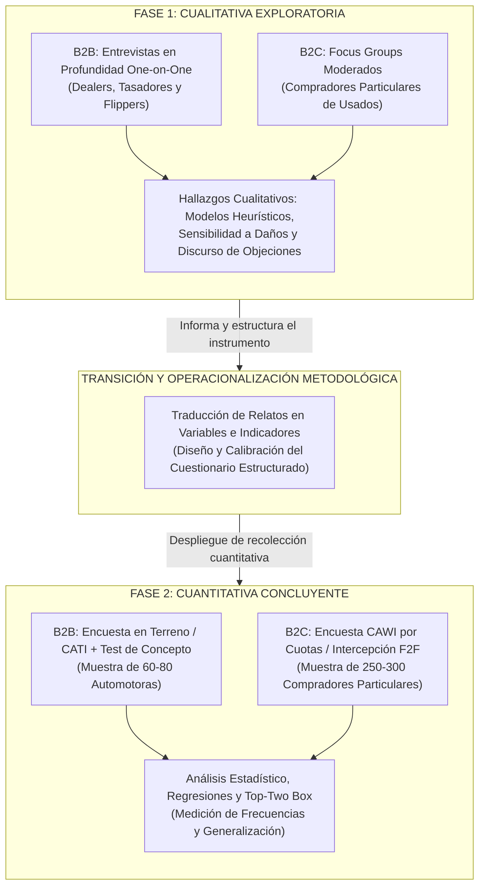
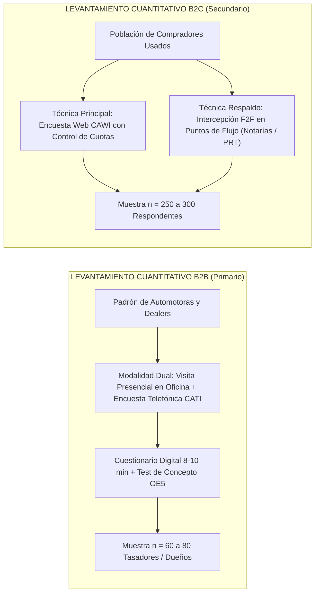
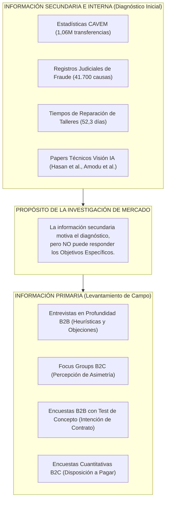

# Línea Argumentativa para el Diseño de la Metodología de Investigación
## Proyecto: InfoCar — Certamen 1

- **Asignatura:** Strategic Marketing — Universidad del Desarrollo (UDD)
- **Docente:** Profesora Claudia Scherman B., MBA
- **Fecha:** Octubre de 2026
- **Versión:** 1.0 (Consolidada y Autosuficiente)
- **Repositorio y Clasificación:** `deliverys/exam-1/02_metodologia_investigacion.md`
- **Sustento Teórico:** Base Conceptual de Cátedra — NotebookLM (`48214c4e-9538-4806-a8fc-c5105ebac848`), Capítulos de la Profesora Claudia Scherman B., MBA, y Literatura Científica Indexada
- **Norma Bibliográfica:** American Psychological Association (APA), 7ª Edición

---

## 1. Fundamentación Teórica del Enfoque Metodológico: Diseño Mixto Secuencial

Para responder con validez científica al Objetivo General del estudio (*"Comprender la valoración de la certidumbre técnica y económica en la determinación del valor transaccional de vehículos usados"*), el proyecto InfoCar adopta un **diseño de investigación mixto secuencial de dos etapas (Cualitativa $\rightarrow$ Cuantitativa)** (Scherman, 2026).

### 1.1 ¿Por qué primero Cualitativo? (Exploración y Comprensión del Fenómeno)
Tal como prescribe el marco teórico de la cátedra de Strategic Marketing (Scherman, 2026), cuando una investigación enfrenta variables complejas o poco estandarizadas —como la percepción subjetiva del daño físico vehicular y la desconfianza hacia la inteligencia artificial—, **es metodológicamente inválido aplicar cuestionarios cuantitativos cerrados de manera prematura**. 

La fase cualitativa inicial cumple tres funciones indispensables:
1. **Comprender la realidad profunda del decisor:** Permite explorar conceptos, vivencias cotidianas, heurísticas de tasación y motivaciones sin forzar categorías preestablecidas impuestas por el investigador (Scherman, 2026).
2. **Descubrir el lenguaje y los dolores latentes:** En el mercado automotriz de usados, los actores operan con vocabulario especializado (*"dar un baño de pintura"*, *"masilla oculta"*, *"descuadre de luz entre puertas"*, *"auto tostado"*). La exploración cualitativa capta estas expresiones naturales y las formaliza analíticamente.
3. **Mapear la resistencia psicológica y cultural:** Facilita entender por qué un comerciante habituado a la revisión táctil ("tocar la chapa") desconfiaría de un diagnóstico algorítmico móvil.

### 1.2 El Puente Metodológico: La Salida Cualitativa Informa a la Cuantitativa
El principio rector del enfoque secuencial radica en que **una etapa informa y fundamenta a la siguiente** (Scherman, 2026):
* Los hallazgos cualitativos (temas emergentes, atributos valorados y jerarquía de temores) se traducen rigurosamente en **variables observables, escalas psicométricas (Likert) e indicadores cuantitativos cerrados**.
* Esto asegura que el cuestionario de la segunda etapa no mida supuestos abstractos del equipo de investigación, sino factores empíricamente validados en terreno por los propios actores de la compraventa.

### 1.3 ¿Por qué después Cuantitativo? (Medición y Generalización Estadística)
Una vez identificadas y operacionalizadas las dimensiones críticas, la etapa cuantitativa se encarga de:
* **Recolectar datos numéricos estructurados** sobre muestras representativas del ecosistema automotriz (Scherman, 2026).
* **Dimensionar la prevalencia y magnitud relativa** de cada atributo físico y económico en la fijación de la oferta de compra.
* **Evaluar la significancia estadística y la intención de contratación** del servicio InfoCar mediante métricas estandarizadas (*Top-Two Box score* en el test de concepto).
* **Generalizar las conclusiones** a la población objetivo para sustentar decisiones de inversión y estrategia comercial.

---

## 2. Diferenciación Metodológica por Segmento: Apertura B2B vs. B2C

En plena correspondencia con el modelo de negocio **B2B primario con extensión B2C** de InfoCar y la recomendación docente registrada en la pauta de trabajo, el diseño metodológico bifurca sus técnicas cualitativas y cuantitativas para adecuarse a la naturaleza operativa de cada segmento.

### 2.1 Fase Cualitativa: Entrevistas en Profundidad (B2B) vs. Focus Groups (B2C)

| Criterio | Canal B2B Primario | Segmento B2C Secundario |
| :--- | :--- | :--- |
| **Técnica Aplicada** | **Entrevista Individual en Profundidad (*One-on-One*)** | **Grupo Focal (*Focus Group*) Moderado** |
| **Sujeto de Estudio** | Dueños de automotoras independientes, jefes de tasación y peritos revendedores (*flippers*). | Personas naturales que compraron o vendieron un auto usado en los últimos 12 meses (C2C o concesionario). |
| **Fundamentación Teórica de Cátedra** | La interacción uno a uno genera un clima de confianza que permite extraer **información cruda y no adulterada (*raw and unadulterated*)**, libre de la presión social y del riesgo de revelar secretos comerciales de arbitraje frente a competidores del mismo rubro (Scherman, 2026). | El foco reside en observar la **dinámica grupal, el lenguaje no verbal y el contraste social** de experiencias de compra, miedos al engaño y percepciones compartidas de asimetría informativa (Scherman, 2026). |
| **Abordaje Metodológico** | **Exhaustivo y pormenorizado (*Comprehensive*)**: Permite indagar al detalle el proceso financiero de costeo de taller y la estructura de margen por vehículo. | **Exploratorio y divergente**: Estimula la confrontación de vivencias entre compradores novatos y experimentados. |
| **Tamaño Muestral** | **8 a 10 entrevistas en profundidad** (de 30 a 35 minutos de duración cada una, hasta alcanzar saturación teórica). | **2 sesiones de Focus Group** (6 a 8 participantes por sesión; 75 a 90 minutos de duración). |
| **Aporte al Proyecto** | Insumos para OE1 (atributos técnicos), OE3 (barreras de confianza en IA) y OE4 (cuellos de botella de costeo). | Insumos complementarios para OE3 (miedo al fraude vehicular) y OE5 (reacción a reportes digitales). |

---

### 2.2 Fase Cuantitativa: Técnicas de Levantamiento, Muestreo y Cobertura

La recolección cuantitativa formaliza el levantamiento de **información primaria** directamente desde los actores de mercado, respetando los canales más eficaces para acceder a cada perfil:

#### A. Canal B2B Primario: Técnica Booster en Lugar de Trabajo y Contacto Telefónico (CATI)
* **Desafío Operativo:** Los dueños de automotoras y tasadores tienen alta fricción temporal y baja propensión a responder encuestas masivas por internet.
* **Estrategia Metodológica (*Booster* de Terreno):**
  1. *Levantamiento presencial en puntos de venta:* Encuestadores especializados visitan directamente los polos comerciales automotrices (ej. Av. Francisco Bilbao, Gran Avenida, Mall Plaza Vespucio automotor, ejes de talleres en Quinta Normal/San Miguel), aplicando el cuestionario estructurado en tablet en el lugar de trabajo del dealer.
  2. *Refuerzo telefónico asistido por computador (CATI):* Llamadas concertadas previas al mediodía con administradores y tasadores de concesionarios medianos.
* **Muestra:** Muestreo intencional no probabilístico por cuotas de tamaño de negocio ($n = 60 \text{ a } 80$ operadores comerciales).
* **Duración del Cuestionario:** Estrictamente acotada a **8 a 10 minutos** para garantizar completitud y validez de respuesta (Scherman, 2026).

#### B. Segmento B2C Secundario: Encuesta Web CAWI con Cuotas y Respaldo de Intercepción en Notarías (*Intercept Interview*)
* **Desafío Operativo:** Acceder a personas naturales en el momento exacto en que están tomando la decisión de compra o acaban de cerrar la transacción.
* **Estrategia Metodológica:**
  1. *Técnica Principal — Encuesta Web Autoadministrada (CAWI):* Difusión a través de comunidades digitales automotrices y paneles con **sistema de control de cuotas** cruzadas por sexo, edad (25 a 55 años) y tipo de vehículo adquirido (hatchback, sedán, SUV, pickup) para garantizar validez metodológica (Scherman, 2026).
  2. *Técnica de Respaldo / Complementaria — Intercepción en Puntos de Alta Afluencia (*Intercept Interview* F2F):* En caso de lentitud de llenado en el canal web, se despliega intercepción presencial en ubicaciones con alto flujo de compradores en pleno trámite de transferencia vehicular: **notarías con alta actividad de transferencias vehiculares, plantas de revisión técnica (PRT) y dependencias de Registro Civil**, deteniendo a las personas que transitan y cumplan con el perfil requerido (Scherman, 2026).
* **Muestra:** Muestreo no probabilístico por cuotas ($n = 250 \text{ a } 300$ respondentes particulares).

---

## 3. Delimitación Epistemológica: Información Primaria vs. Información Secundaria

En estricta concordancia con la teoría metodológica del ramo (Scherman, 2026), se define con precisión la frontera entre fuentes:

* **Información Secundaria:** Corresponde a datos preexistentes del entorno (anuarios CAVEM, reportes judiciales de The Clinic, estadísticas gremiales y literatura científica). Su rol se restringe a documentar la **Fase 1 (Diagnóstico del Negocio) y el contexto del problema**. La teoría del curso estipula expresamente que los objetivos de investigación **no deben depender de datos secundarios ni internos** (Scherman, 2026).
* **Información Primaria:** Es la evidencia empírica levantada *exprofeso* de primera fuente desde los clientes y prospectos dentro del marco temporal del estudio. Los 5 Objetivos Específicos SMART de InfoCar están formulados de tal manera que **el 100% de sus respuestas emana de la recolección primaria de campo** (Scherman, 2026).

---

## 4. Matriz de Operacionalización Metodológica de los Objetivos Específicos

A continuación, se detalla la matriz que conecta cada Objetivo Específico con su fase de levantamiento, técnica, unidad de análisis, variables observables e indicadores de medición:

| Objetivo Específico | Fase Metodológica | Técnica de Levantamiento | Unidad de Análisis / Informante | Variables Observables | Indicador / Forma de Registro |
| :--- | :--- | :--- | :--- | :--- | :--- |
| **OE1: Atributos físicos determinantes** | Mixta (Cuali $\rightarrow$ Cuanti) | Entrevista profundidad + Encuesta presencial tablet | Tasador / Dueño de automotora B2B | Tipologías de daño perimetral (abolladuras, rayas, junturas, ópticas). | - Mención espontánea y guiada. - Escala Likert 1-5 de impacto en precio. - Ranking top-3 de rechazo de compra. |
| **OE2: Impacto de anticipación de costos** | Cuantitativa concluyente | Módulo experimental en encuesta (*conjoint scenario*) | Tasador / Dealer B2B | Presupuesto paramétrico de taller vs. castigo intuitivo tradicional. | - Variación porcentual (\$) de oferta monetaria entre Caso A (ciego) y B (con costeo). - Nivel de certeza reportado (1 a 5). |
| **OE3: Barreras de desconfianza hacia IA** | Mixta (Cuali $\rightarrow$ Cuanti) | Pauta semiestructurada + Matriz de criticidad en encuesta | Dueño de automotora B2B | Factores de aversión técnica, alucinaciones de visión artificial y caja negra. | - Categorías temáticas cualitativas de objeción. - Ponderación de criticidad (1 a 5). - Disposición a aceptar *confidence scores*. |
| **OE4: Experiencia operativa y cuellos de botella** | Mixta (Cuali $\rightarrow$ Cuanti) | Entrevistas en profundidad + Módulo de métricas de proceso | Tasador / Administrador B2B | Latencia de tasación, traslados a taller carrocero y pérdida de oportunidades. | - Tiempo de ciclo total en horas/días. - Pérdida mensual estimada de compras por demora (\# vehículos). - Fricciones de Journey Map B2B. |
| **OE5: Test de concepto de InfoCar (Profesora)** | Cuantitativa concluyente | Test de concepto estandarizado (2 párrafos + mock-up de app) | Potencial cliente B2B (Dealers) | Atractivo de concepto, unicidad, intención de contratación y precio. | - *Top-Two Box score* (% Definitivamente / Probablemente contrataría). - Escala de diferenciación (1 a 5). - Aceptabilidad al precio de CLP \$49.900-\$69.900/mes. |

---

## 5. Plan de Acción y Secuencia Metodológica de Actividades Requeridas

Para asegurar una ejecución metodológicamente rigurosa sin depender de plazos calendáricos rígidos, el proceso de investigación se desglosa en las **acciones operativas necesarias a realizar**, organizadas de forma lógica y secuencial:

### 5.1 Secuencia Operativa por Fases

#### Fase I: Exploración Cualitativa de Campo
1. **Convocatoria y Reclutamiento B2B:** Identificación y contacto de tasadores, dueños de automotoras independientes y peritos revendedores (*flippers*) a través de padrones comerciales y visitas presenciales.
2. **Conducción de Entrevistas en Profundidad (*One-on-One*):** Aplicación de pautas semiestructuradas individuales (30-35 min) para levantar heurísticas de tasación, sensibilidad visual a daños (OE1), miedos a la IA (OE3) y fricciones de costeo artesanal (OE4).
3. **Conducción de Focus Groups B2C:** Moderación de 2 sesiones grupales con compradores particulares de usados para relevar percepciones de asimetría de información y actitudes hacia certificaciones digitales.
4. **Análisis Temático del Discurso:** Transcripción y codificación cualitativa para identificar constructos emergentes, taxonomía de daños más penalizados y argumentos de desconfianza latente.

#### Fase II: Transición y Operacionalización Instrumental
5. **Operacionalización de Variables e Indicadores:** Traducción formal de los hallazgos cualitativos en escalas psicométricas (Likert 1-5), preguntas cerradas de caracterización y escenarios de simulación de compra.
6. **Diseño y Maquetación del Test de Concepto:** Redacción del concepto InfoCar en dos párrafos estandarizados y preparación del mock-up visual de la interfaz móvil para evaluar atractivo, unicidad, intención de contratación y aceptabilidad de precio (OE5).
7. **Pilotaje y Calibración del Instrumento:** Prueba piloto del cuestionario con 3 decisores B2B para verificar comprensión de preguntas, fluidez y tiempo de respuesta (máximo 8-10 minutos).

#### Fase III: Levantamiento Cuantitativo de Terreno
8. **Despliegue de Terreno B2B (*Booster* Presencial y CATI):** Visita a polos automotrices para aplicación de encuestas en tablets en el lugar de trabajo del dealer, complementado con llamadas telefónicas asistidas por computador ($n = 60-80$).
9. **Despliegue Web B2C (CAWI con Cuotas):** Distribución de cuestionario autoadministrado en línea con control estricto de cuotas por edad, sexo y tipología de vehículo ($n = 250-300$).
10. **Técnica de Intercepción Presencial de Respaldo (*Intercept Interview*):** Aplicación cara a cara F2F en puntos de alto flujo de trámites vehiculares (notarías, plantas de revisión técnica y Registro Civil) para completar cuotas B2C en caso de requerirse.

#### Fase IV: Procesamiento, Modelación y Cierre
11. **Limpieza y Depuración de Datos:** Control de calidad de respuestas, eliminación de registros incompletos y validación de consistencia interna.
12. **Análisis Estadístico Descriptivo e Inferencial:** Tabulación cruzada de atributos de daño (OE1), análisis de varianza del impacto del costeo paramétrico en ofertas monetarias (OE2) y cálculo de matrices de criticidad de barreras (OE3).
13. **Modelación del Test de Concepto:** Cálculo de métricas clave de intención de contratación (*Top-Two Box score*), índice de diferenciación percibida y elasticidad de precio de suscripción mensual (OE5).
14. **Consolidación de Hallazgos y Síntesis Estratégica:** Elaboración del reporte final con recomendaciones tácticas para el desarrollo del producto InfoCar y su estrategia de comercialización B2B.

---

### 5.2 Matriz de Acciones y Entregables Requeridos

| Fase Metodológica | Acción Operativa Requerida | Entregable / Resultado Esperado |
| :--- | :--- | :--- |
| **Fase I: Cualitativa** | Reclutar y entrevistar a dealers B2B (8-10 entrevistas individuales). | Pauta de entrevista aplicada y transcripciones brutas. |
| **Fase I: Cualitativa** | Moderar 2 Focus Groups B2C con compradores particulares de usados. | Registros audiovisuales y notas de observación de dinámica grupal. |
| **Fase I: Cualitativa** | Codificar el discurso de objeciones y heurísticas de tasación. | Matriz temática cualitativa de atributos, fricciones y barreras hacia la IA. |
| **Fase II: Transición** | Operacionalizar variables y diseñar el cuestionario cuantitativo estructurado. | Cuestionario digital programado con test de concepto estandarizado (OE5). |
| **Fase II: Transición** | Pilotear el instrumento con 3 operadores comerciales. | Cuestionario calibrado y optimizado a 8-10 minutos de duración. |
| **Fase III: Cuantitativa** | Ejecutar levantamiento B2B en terreno (*booster* presencial y llamadas CATI). | Base de datos de $n = 60-80$ tasadores y automotoras. |
| **Fase III: Cuantitativa** | Desplegar encuesta web CAWI B2C con cuotas (e intercepción F2F en notarías si aplica). | Base de datos de $n = 250-300$ compradores particulares. |
| **Fase IV: Cierre** | Procesar estadísticamente las bases de datos y calcular métricas de intención (*Top-Two Box*). | Reporte analítico de resultados, validación de hipótesis y especificación para el MVP. |

---

## 6. Referencias Bibliográficas (Norma APA 7ª Edición)

* Akerlof, G. A. (1970). The Market for "Lemons": Quality Uncertainty and the Market Mechanism. *The Quarterly Journal of Economics*, *84*(3), 488–500. https://doi.org/10.2307/1879431
* Amodu, O., Habaebi, M. H., Abdullah, K. A., & Agbede, M. O. (2024). Lightweight deep learning models for vehicle damage classification and severity estimation. *Journal of Artificial Intelligence and Technology*, *4*(2), 112–125. https://doi.org/10.37965/jait.2024.0389
* Cámara de Comercio Automotriz de Chile [CAVEM]. (2026a). *Informe del Mercado Automotor Diciembre 2025: Balance de Transferencias de Livianos y Medianos*. CAVEM. https://www.cavem.cl
* Cámara de Comercio Automotriz de Chile [CAVEM]. (2026c). *Informe Estadístico Septiembre 2026: Transferencias Acumuladas de Usados y Ventas de Nuevos*. CAVEM. https://www.cavem.cl
* Farías, C. (2026, 8 de mayo). *El dolor de cabeza tras chocar: Reparaciones de vehículos en talleres asegurados promedian 52 días*. La Tercera. https://www.latercera.com
* Hasan, M. A., Rahman, M. M., & Siddique, A. (2025). Automated vehicle damage assessment using computer vision: A comprehensive ten-year survey (2014–2024). *IEEE Transactions on Intelligent Transportation Systems*, *26*(1), 45–68. https://doi.org/10.1109/TITS.2024.3412098
* Melelli Viveros, A. (2026, 6 de octubre). *Récord de fraudes vehiculares en Chile: Causas judiciales ingresadas suben 64% en 2025*. The Clinic. https://www.theclinic.cl
* Mellado, R. (2026, 14 de enero). *Garantías en vehículos usados: Alcances legales del estatuto del consumidor en Chile*. *Revista Chilena de Derecho y Comercio Automotriz*, *12*(1), 34–49.
* Scherman, C. (2026). *Capítulo: Definición y operacionalización de objetivos de investigación de mercado en marketing estratégico*. Universidad del Desarrollo, Facultad de Economía y Negocios.
