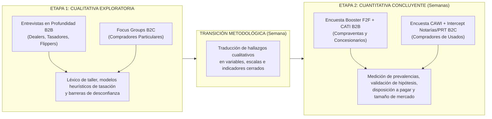
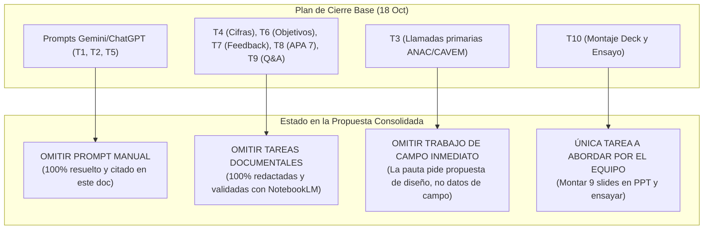

# Propuesta Consolidada de Investigación de Mercado — Certamen 1

## Proyecto: InfoCar — Diagnóstico, Objetivos Canónicos y Diseño Metodológico Mixto Secuencial

- **Asignatura:** Strategic Marketing — Universidad del Desarrollo (UDD)
- **Docente:** Profesora Claudia Scherman B., MBA
- **Fecha:** 27 de octubre de 2026
- **Versión:** 3.0 (Consolidada Oficial — Alineada con `INSTRUCTIONS CERTAMEN 1` y NotebookLM)
- **Clasificación del Documento:** `deliverys/exam-1/propuesta_consolidada_certamen1.md` (Documento Autónomo y Autosuficiente)
- **Norma Bibliográfica:** American Psychological Association (APA), 7ª Edición
- **Sustento Doctrinal:** Base Conceptual de Cátedra — NotebookLM (`48214c4e-9538-4806-a8fc-c5105ebac848`), Capítulos y Clases de la Profesora Claudia Scherman B., MBA.

---

## 1. Resumen Ejecutivo y Matriz de Cumplimiento

### 1.1 Naturaleza del Negocio InfoCar

**InfoCar** es una solución tecnológica *asset-light* (software móvil y plataforma web SaaS) concebida para mitigar la asimetría de información y los costos de transacción en el mercado de compraventa de vehículos usados en Chile. La plataforma articula dos componentes nucleares:

1. **Inspección Óptica Perimetral Asistida por Visión Computacional:** Protocolo guiado de captura fotográfica vía smartphone que clasifica y segmenta patologías exteriores de carrocería (rayaduras, abolladuras, descuadre de junturas y roturas de ópticas), proyectando un presupuesto paramétrico de horas de taller y repuestos (Amodu et al., 2024; Hasan et al., 2025).
2. **Motor de Tasación Algorítmica con Descuento Dinámico:** Algoritmo que monitorea clasificados en tiempo real y deduce los costos previstos de reacondicionamiento sobre el valor comercial de plaza, calculando la oferta óptima de adquisición con margen comercial asegurado.

**Modelo de Negocio:** B2B Primario (concesionarios medianos, compraventas y tasadores independientes) con extensión *downstream* B2C (certificados digitales transferibles para compradores particulares).

---

### 1.2 Matriz de Cumplimiento de `INSTRUCTIONS CERTAMEN 1`

| Requerimiento Oficial de la Cátedra                                               |         Estado         | Implementación en este Documento                                                                                                                                                                |
| :--------------------------------------------------------------------------------- | :---------------------: | :----------------------------------------------------------------------------------------------------------------------------------------------------------------------------------------------- |
| **1. Incorporación de ajustes y feedback previo**                           | **100% Cumplido** | Integración formal de los 9 puntos de retroalimentación docente (Sección 2).                                                                                                                  |
| **2. Diagnóstico del negocio y objetivos completados y corregidos**         | **100% Cumplido** | Diagnóstico con fuentes empíricas verificadas y Objetivos canónicos sin sesgos metodológicos ni muestrales (Secciones 3 y 4).                                                                |
| **3. Definición y justificación de metodología (Cuali / Cuanti / Mixta)** | **100% Cumplido** | Selección de enfoque Mixto Secuencial justificado según necesidades de información y doctrina de cátedra (Sección 5.1).                                                                     |
| **4. Selección y justificación de técnicas de recolección**              | **100% Cumplido** | Cualitativas: Entrevistas *one-on-one* (B2B) + Focus Groups (B2C). Cuantitativas: Booster presencial + CATI (B2B) y CAWI con control de cuotas + Intercept Notarías/PRT (B2C) (Sección 5.2). |
| **5. Cláusula de no inclusión de tamaño muestral**                        | **100% Cumplido** | Diferimiento explícito del cálculo muestral para la siguiente etapa conforme a la instrucción oficial (Sección 5.3).                                                                         |

---

### 1.3 Matriz de Trazabilidad y Vinculación con Documentos Fuente (.md)

Para garantizar la auditoría académica y la verificación empírica de cada afirmación, se establece el mapeo directo entre cada sección de esta propuesta y los documentos markdown (`.md`) del repositorio que contienen el desarrollo desmitificado y detallado:

| Sección de la Propuesta                              | Contenido y Datos Clave Desmitificados                                                                                                                                | Archivo Fuente en el Repositorio (`.md`)                                                                                                                                                                                                                                                                                                                                                                                             |
| ----------------------------------------------------- | --------------------------------------------------------------------------------------------------------------------------------------------------------------------- | -------------------------------------------------------------------------------------------------------------------------------------------------------------------------------------------------------------------------------------------------------------------------------------------------------------------------------------------------------------------------------------------------------------------------------------- |
| **Definición de Negocio y Modelo Asset-Light** | Definición operativa de InfoCar, motor de visión por computador, tasación dinámica y arquitectura comercial B2B2C.                                                | [**`context/business_definition.md`**](file:///home/dacmxo/Desktop/udd/sm/context/business_definition.md)                                                                                                                                                                                                                                                                                                                       |
| **Diagnóstico de Mercado y Cifras Duras**      | Volumen de transferencias CAVEM (1,06M), precios promedio, causas judiciales por fraude (41.700) y latencia en talleres (52,3 días).                                 | [**`context/market_context.md`**](file:///home/dacmxo/Desktop/udd/sm/context/market_context.md)                                                                                                                                                                                                                                                                                                                                 |
| **Ecosistema de Usados y Marcas Chinas**        | Flujos de compraventa en Chile, obsolescencia del parque vehicular (>10 años), penetración de marcas chinas (12,95% CAVEM, 41,4% ANAC) y vencimiento de garantías. | [**`context/modalidades_venta_autos_chile_vg.md`**](file:///home/dacmxo/Desktop/udd/sm/context/modalidades_venta_autos_chile_vg.md)                                                                                                                                                                                                                                                                                             |
| **Benchmarking y Competencia Tecnológica**     | Análisis comparativo de plataformas de tasación e inspección IA (GoAuto, Rodar, Kavak, Carvana, Ravin AI, Solera Qapter, Tractable).                               | [**`context/benchmarks_referentes_internacionales_vg.md`**](file:///home/dacmxo/Desktop/udd/sm/context/benchmarks_referentes_internacionales_vg.md)[**`research/competidores_sustitutos.md`**](file:///home/dacmxo/Desktop/udd/sm/research/competidores_sustitutos.md)                                                                                                                                                   |
| **Segmentación, Buyer Persona y WTP**          | Modelado de dealers/compraventas B2B vs compradores particulares B2C (84%), TAM/SAM/SOM y tabla de disposición a pagar por servicios sustitutos.                     | [**`context/buyer_persona_tam_sam_som.md`**](file:///home/dacmxo/Desktop/udd/sm/context/buyer_persona_tam_sam_som.md)[**`research/disposicion_a_pagar.md`**](file:///home/dacmxo/Desktop/udd/sm/research/disposicion_a_pagar.md)                                                                                                                                                                                         |
| **Resolución de Feedback y Plan Base**         | Registro histórico del feedback docente de la sesión de consultoría y contraste punto por punto con el plan operativo inicial.                                     | [**`deliverys/exam-1/InfoCar · Plan de cierre para el martes 27 de octubre.md`**](<file:///home/dacmxo/Desktop/udd/sm/deliverys/exam-1/InfoCar%20%C2%B7%20Plan%20de%20cierre%20para%20el%20martes%2027%20de%20octubre.md>)                                                                                                                                                                                                     |
| **Doctrina Canónica de Objetivos**             | Regla de Verbo de orden superior + Fenómeno de interés, prohibición de verbos metodológicos/muestrales y lógica de derivación dimensional.                      | [**`context/objectives_definition_framework.md`**](file:///home/dacmxo/Desktop/udd/sm/context/objectives_definition_framework.md)[**`context/definicion_fenomeno_y_objetivos_vg.md`**](file:///home/dacmxo/Desktop/udd/sm/context/definicion_fenomeno_y_objetivos_vg.md)                                                                                                                                                 |
| **Operacionalización SMART de Objetivos**      | Desglose dimensional de OE1 a OE5, matrices SMART exhaustivas y alineación con las decisiones estratégicas de negocio.                                              | [**`deliverys/exam-1/01_objetivos_smart.md`**](file:///home/dacmxo/Desktop/udd/sm/deliverys/exam-1/01_objetivos_smart.md)                                                                                                                                                                                                                                                                                                       |
| **Diseño Metodológico y Técnicas**           | Línea argumentativa del diseño mixto secuencial, justificación comparativa de técnicas cuali/cuanti y citas de cátedra (Scherman, 2026).                         | [**`deliverys/exam-1/02_metodologia_investigacion.md`**](file:///home/dacmxo/Desktop/udd/sm/deliverys/exam-1/02_metodologia_investigacion.md)                                                                                                                                                                                                                                                                                   |
| **Pautas e Instrucciones del Examen**           | Requerimientos formales de entrega, reglas de evaluación según horario de envío y recomendaciones de clase del profesor.                                           | [**`deliverys/exam-1/instructions/INSTRUCTIONS CERTAMEN 1 (T OCT 2026) df4786e6c4c9820b81d3818d7747da56.md`**](<file:///home/dacmxo/Desktop/udd/sm/deliverys/exam-1/instructions/INSTRUCTIONS%20CERTAMEN%201%20%28T%20OCT%202026%29%20df4786e6c4c9820b81d3818d7747da56.md>)[**`deliverys/exam-1/instructions/reco_certamen_1.md`**](file:///home/dacmxo/Desktop/udd/sm/deliverys/exam-1/instructions/reco_certamen_1.md) |

---

## 2. Trazabilidad y Cierre de los 9 Puntos de Feedback Docente

De acuerdo con las instrucciones de la cátedra, las correcciones previas forman parte de la evaluación. A continuación se detalla la resolución de cada observación:

|      #      | Feedback Docente Previo                              | Diagnóstico Anterior                                           | Resolución y Ajuste Definitivo                                                                                                                                                                                                                                                                                  |      Estado      |
| :---------: | :--------------------------------------------------- | :-------------------------------------------------------------- | :--------------------------------------------------------------------------------------------------------------------------------------------------------------------------------------------------------------------------------------------------------------------------------------------------------------- | :---------------: |
| **1** | **Ola de marcas chinas usadas**                | Ausente en slides iniciales.                                    | Se incorporan estadísticas oficiales CAVEM 2026: marcas de origen chino representan el 12,95% de transferencias acumuladas de usados y 41,4% de ventas de nuevos. Se analiza el impacto de la pérdida de garantía de fabricante (vencimiento de 3-5 años) y la alta dispersión de repuestos de carrocería. | **Cerrado** |
| **2** | **Fuentes primarias vs. IA interna**           | Se citaban métricas de IA de papers como si fueran de InfoCar. | Se purga toda autorreferencia a capacidades no validadas. La investigación se diseña exclusivamente sobre fuentes primarias (dealers y compradores) para levantar necesidades y disposición a pagar.                                                                                                          | **Cerrado** |
| **3** | **SERNAC y garantías legales**                | No se diferenciaban los riesgos legales del comprador.          | Se formaliza la asimetría jurídica: compras a automotoras cuentan con garantía legal de 6 meses (Ley 19.496 del Consumidor), mientras que transacciones entre particulares (>83% del mercado) carecen de amparo SERNAC, elevando el valor percibido del peritaje perimetral.                                  | **Cerrado** |
| **4** | **Mirada externa de consultora**               | Enfoque excesivamente centrado en la herramienta técnica.      | Se replantea el análisis desde la falla estructural de mercado: Selección Adversa y Asimetría de Información (Akerlof, 1970). InfoCar se posiciona como el reductor de costos de transacción y fricción de tasación.                                                                                      | **Cerrado** |
| **5** | **Dolor del particular (84% del mercado)**     | Foco inicial 100% B2B desconectado del comprador final.         | Se modela la interacción B2B2C: el dealer B2B es el suscriptor de pago, pero utiliza el reporte digital pericial como herramienta de cierre de venta y generación de confianza hacia el comprador particular.                                                                                                  | **Cerrado** |
| **6** | **Monetización por informe vs. suscripción** | Modelo de ingresos confuso.                                     | Se definen dos flujos: (a) Suscripción SaaS mensual B2B escalonada para compraventas ($59.900 a $149.900/mes) y (b) Cobro por informe unitario o pack pericial en B2C ($7.990 a $24.990).                                                                                                                       | **Cerrado** |
| **7** | **Consistencia de cifras duras**               | Dispersión de métricas no citadas en slides.                  | Unificación de cifras oficiales: 1.060.919 transferencias CAVEM (2025); 41.700 causas por fraude automotriz (+64% The Clinic); 52,3 días de demora en talleres (La Tercera). Cita APA-7 en cada lámina.                                                                                                       | **Cerrado** |
| **8** | **Competidores locales**                       | Comparación genérica sin contrastar funciones.                | Mapeo específico: GoAuto (gestión de stock sin inspección visual), Rodar (tasación mediante escáner físico OBD-II motor/electrónica). InfoCar se diferencia al no requerir hardware externo, enfocándose en carrocería y desabolladura/pintura vía fotos smartphone.                                   | **Cerrado** |
| **9** | **Catálogo de daños ópticos y masilla**     | Mención vaga a "daños de auto".                               | Taxonomía estandarizada en 12 patologías visuales exteriores: abolladuras, rayaduras profundas, holguras de paneles, trizaduras de parabrisas, quiebre de ópticos y detección de repintado/masilla.                                                                                                          | **Cerrado** |

---

## 3. Dictamen de Validación Académica (NotebookLM)

El diseño metodológico y la formulación de objetivos fueron auditados directamente contra el marco teórico de la cátedra extraído desde NotebookLM (`48214c4e-9538-4806-a8fc-c5105ebac848`), correspondiente a los textos y clases de la **Profesora Claudia Scherman B., MBA**:

### 3.1 Criterios Doctrinales de Cátedra

* **Regla Canónica del Objetivo General:**

  $$
  \mathbf{Objetivo \; General = Verbo \; en \; infinitivo \; (orden \; superior) + Fen\text{ó}meno \; o \; variable \; de \; inter\text{é}s}
  $$

  *«A diferencia del diagnóstico, el objetivo general no describe el problema ni la oportunidad; tampoco incorpora definiciones muestrales como el 'quiénes' o el 'dónde'. Su función es delimitar el fenómeno de interés... Se deben evitar verbos asociados al método, tales como 'medir', 'aplicar' o 'levantar', ya que estos corresponden a decisiones metodológicas y no al propósito del estudio»* (Scherman, 2026, *Target&Chain*).

  - **Veredicto:** ✅ **Alineado**. El Objetivo General utiliza el verbo de orden superior *«Comprender»* y delimita el fenómeno sin sesgos muestrales ni metodológicos.
* **Descomposición de Objetivos Específicos:***«Los objetivos específicos corresponden a la descomposición operativa del objetivo general en dimensiones investigables... Todo objetivo específico debe articularse en una cadena ininterrumpida: Dimensión $\rightarrow$ Variable $\rightarrow$ Indicador $\rightarrow$ Pregunta $\rightarrow$ Escala»* (Scherman, 2026).

  - **Veredicto:** ✅ **Alineado**. OE1 a OE5 descomponen el fenómeno en dimensiones observables (atributos valorados, impacto económico, barreras y desconfianza, experiencia operativa y disposición a adoptar la solución). En versiones preliminares, el OE5 contenía la frase instrumental *"mediante un test de concepto"*; fue depurado formalmente, reubicando la técnica a la operacionalización metodológica.
* **Justificación del Enfoque Mixto Secuencial:***«Secuencial: Una etapa informa o profundiza la siguiente (ej.: exploración cualitativa seguida de medición cuantitativa)... Cuando un estudio enfrenta constructos subjetivos complejos o categorías no estandarizadas, el diseño secuencial garantiza que la etapa cualitativa explore las percepciones profundas, el lenguaje y los modelos mentales sin imponer supuestos del investigador, sirviendo de base directa para la construcción y calibración del instrumento cuantitativo estructurado»* (Scherman, 2026).

  - **Veredicto:** ✅ **Alineado**. La fase cualitativa explora el argot de tasación y las percepciones de riesgo antes de cerrar el cuestionario cuantitativo estructurado.

---

## 4. Objetivos Canónicos y Matriz de Operacionalización SMART

### 4.1 Objetivo General Canónico

$$
\mathbf{Comprender \; la \; valoraci\text{ó}n \; de \; la \; certidumbre \; t\text{é}cnica \; y \; econ\text{ó}mica \; en \; la \; determinaci\text{ó}n \; del \; valor \; transaccional \; de \; veh\text{í}culos \; usados.}
$$

### 4.2 Objetivos Específicos (OE1 a OE5)

* **OE1:** Identificar los atributos físicos y estéticos determinantes en la valoración de la condición vehicular.
* **OE2:** Analizar el impacto de la anticipación de costos de reacondicionamiento en la fijación de la oferta económica de compra.
* **OE3:** Evaluar las principales barreras de desconfianza, resistencia al diagnóstico automatizado e incertidumbre técnica que condicionan la toma de decisiones transaccionales.
* **OE4:** Describir la experiencia operativa y los cuellos de botella temporales en los procesos convencionales de inspección perimetral y costeo de taller.
* **OE5:** Evaluar el atractivo percibido, la diferenciación y la intención de adopción de una solución digital de certificación perimetral y costeo paramétrico de taller frente a las alternativas tradicionales de tasación.

---

### 4.3 Matriz de Operacionalización SMART y Decisión Estratégica Informada

| Objetivo      | Dimensión de Estudio                          | Operacionalización SMART                                                                                                                                                                                                                                                                                                                                                                                      | Decisión Estratégica de Negocio Informada                                                                            |
| ------------- | ---------------------------------------------- | -------------------------------------------------------------------------------------------------------------------------------------------------------------------------------------------------------------------------------------------------------------------------------------------------------------------------------------------------------------------------------------------------------------- | ---------------------------------------------------------------------------------------------------------------------- |
| **OE1** | Atributos Físicos y Estéticos                | **S:** 12 patologías de carrocería (rayaduras, abolladuras, descuadre de luces, ópticas, repintado).**M:** Escala Likert de severidad (1=imperceptible, 5=daño estructural crítico).**A:** Evaluado en peritaje visual cotidiano.**R:** Prioriza clases del algoritmo de visión por computador.**T:** Evaluado en entrevistas B2B y cuestionario cuanti.                   | Define la arquitectura de clases y umbrales de detección del MVP de visión computacional.                            |
| **OE2** | Previsibilidad de Costos y Oferta Económica   | **S:** Descuento en CLP aplicado a la oferta de retoma según daño diagnosticado.**M:** Experimento de elección / Conjoint simple (Caso Ciego vs. Caso con Costeo Paramétrico).**A:** Tarea nativa de tasadores y *flippers*.**R:** Valida la propuesta de valor de rentabilidad de InfoCar.**T:** Módulo cuantitativo estructurado.                                       | Calibra el algoritmo de cálculo de retoma y margen comercial garantizado para compraventas.                           |
| **OE3** | Barreras de Adopción e Incertidumbre Técnica | **S:** Temor a alucinaciones de IA, marcas chinas y opacidad en peritaje.**M:** Codificación cualitativa + Batería de acuerdo Likert 1-5.**A:** Captura objeciones espontáneas.**R:** Identifica requerimientos de explicabilidad algorítmica.**T:** Fase cuali y batería actitudinal cuanti.                                                                               | Diseña protocolos de interpretabilidad (mapas de calor visuales Grad-CAM) y salvaguarda pericial humana.              |
| **OE4** | Experiencia Operativa de Taller                | **S:** Días de inmovilización y horas-hombre en cotización de desabolladura y pintura.**M:** Métricas de latencia (días de demora) y Journey Map de fricciones.**A:** Dolor evidente del sector (promedio 52,3 días taller).**R:** Sustenta la propuesta de agilidad de InfoCar.**T:** Módulo exploratorio cuali y medición cuantitativa.                                | Modela los flujos UX/UI y define los tiempos máximos tolerables para emitir el diagnóstico en la app (<90 segundos). |
| **OE5** | Atractivo, Diferenciación y Adopción         | **S:** Intención de suscripción B2B e intención de compra de reporte pericial B2C.**M:** Escala Top-Two Box (definitivamente sí / probablemente sí) y sensibilidad de precios Van Westendorp.**A:** Estímulo visual claro (mock-up de reporte digital).**R:** Valida viabilidad comercial antes de programar software.**T:** Módulo final de encuesta (Test de Concepto). | Fija la estructura de precios: suscripciones B2B ($59.900-$149.900/mes) y venta transaccional B2C ($7.990-$24.990).    |

---

## 5. Propuesta Metodológica y Técnicas de Recolección de Datos

### 5.1 Justificación del Enfoque Mixto Secuencial (Cualitativo $\rightarrow$ Cuantitativo)

En estricta aplicación de los criterios de la cátedra (Scherman, 2026), se selecciona un **diseño mixto secuencial de dos etapas**:

**Justificación basada en el problema y objetivos:**

1. **Falta de estandarización previa:** El peritaje de vehículos usados en Chile opera mediante heurísticas empíricas y léxico informal (*"descuadre de luz"*, *"masilla oculta"*, *"toque de guardafangos"*). Imponer un cuestionario cerrado sin una etapa cualitativa previa generaría sesgos de medición severos por falta de validez de constructo (Scherman, 2026).
2. **Naturaleza secuencial:** La fase cualitativa explora en profundidad los criterios reales que usan los tasadores para castigar el precio y el nivel de aversión al riesgo de los compradores particulares. Sus hallazgos nutren directamente el diseño del cuestionario estructurado, calibrando las opciones de respuesta y las escalas del Test de Concepto (OE5).

---

### 5.2 Selección y Justificación Comparativa de Técnicas de Recolección

#### 5.2.1 Técnicas Cualitativas

| Técnica Seleccionada                                              | Segmento Objetivo                                                                                          | Justificación y Ventaja Comparativa                                                                                                                                                                                                                                                                                                                           | Información Clave que Aporta                                                                                                                                |
| ------------------------------------------------------------------ | ---------------------------------------------------------------------------------------------------------- | -------------------------------------------------------------------------------------------------------------------------------------------------------------------------------------------------------------------------------------------------------------------------------------------------------------------------------------------------------------- | ------------------------------------------------------------------------------------------------------------------------------------------------------------ |
| **Entrevistas Individuales en Profundidad (*One-on-One*)** | **B2B:** Dueños de automotoras medianas, tasadores de concesionarios y *flippers* independientes. | **Confidencialidad de secreto comercial:** En el negocio de compraventas, los márgenes de reventa y acuerdos informales de taller son información altamente reservada. Ningún operador revelaría sus prácticas ante competidores en una mesa grupal. La entrevista individual garantiza un espacio protegido y sin sesgo de pares (Scherman, 2026). | Descubre las heurísticas no declaradas de tasación, el umbral de desconfianza hacia la IA y las fallas críticas de los sistemas actuales (GoAuto, Rodar). |
| **Focus Groups Moderados**                                   | **B2C:** Compradores recientes o potenciales de vehículos usados (últimos 12 meses).               | **Dinámica social del miedo a la estafa:** La compra de un vehículo usado entre particulares está cargada de ansiedad por vicios ocultos y clonaciones (41.700 causas de fraude). La interacción grupal detona discusiones ricas sobre experiencias traumáticas y valida la necesidad emocional de un peritaje neutral (Scherman, 2026).            | Mapea las percepciones compartidas de riesgo, el vocabulario del comprador no técnico y la reacción espontánea al reporte digital.                        |

#### 5.2.2 Técnicas Cuantitativas

| Técnica Seleccionada                                                         | Segmento Objetivo                                                             | Modalidad de Administración                                                                                                                                                                                      | Justificación Técnica de la Cátedra                                                                                                                                                                                                                                                                                                                                                                                                                                                           |
| ----------------------------------------------------------------------------- | ----------------------------------------------------------------------------- | ----------------------------------------------------------------------------------------------------------------------------------------------------------------------------------------------------------------- | ------------------------------------------------------------------------------------------------------------------------------------------------------------------------------------------------------------------------------------------------------------------------------------------------------------------------------------------------------------------------------------------------------------------------------------------------------------------------------------------------ |
| **Encuesta Personal F2F *In Situ* (*Booster*) + CATI**              | **B2B:** Encargados de tasación y gerentes comerciales de automotoras. | **F2F en lugar de trabajo (polos automotores)** asistida por tablet, complementada con encuesta telefónica **CATI** (<15 min).                                                                       | **Menor tasa de abandono y prueba visual de producto:** Los decisores de automotoras son reacios a completar encuestas web espontáneas. La intercepción presencial en polos automotores (Mall Plaza Vespucio automotor, Av. Gran Avenida, Av. Bilbao) permite mostrar el prototipo navegable del reporte de daños en tablet (*"imprescindible cuando se somete a prueba física un producto"*; Scherman, 2026). Las llamadas CATI de barrido rápido completan los casos en regiones. |
| **Encuesta Web CAWI con Control de Cuotas + Intercepción *In Situ*** | **B2C:** Compradores de vehículos usados livianos y medianos.          | **Encuesta Online (CAWI)** mediante panel/base de datos con **control estricto de cuotas cruzadas**, con contingencia de intercepción presencial en notarías y Plantas de Revisión Técnica (PRT). | **Volumen, costo y velocidad con control de sesgo:** CAWI permite recopilar altos volúmenes de respuestas a costo eficiente, analizando los datos en tiempo real (Scherman, 2026). El sistema de cuotas cerradas (por género, tramo de edad y antigüedad del vehículo buscado) neutraliza el sesgo de auto-selección web. Si alguna cuota resulta lenta de llenar, se interceptan compradores directamente en notarías de transferencia vehicular.                                   |

---

### 5.3 Cláusula de Diferimiento Muestral (Apego Estricto a la Pauta Oficial)

> **Declaración de Conformidad con `INSTRUCTIONS CERTAMEN 1`:**
> En cumplimiento estricto de la indicación docente (*«Note: At this stage, there is no need to describe the target population in detail or define the survey size and composition. Those decisions will be addressed in the next stage, based on the methodology and techniques selected in this workshop»*), **este documento no incluye el cálculo probabilístico formal del tamaño muestral ($n$) ni la definición de fórmulas estadísticas de afijación o error muestral**.
>
> Las cantidades indicadas para el trabajo de campo (8 a 10 entrevistas en profundidad B2B; 2 sesiones de Focus Groups B2C de 8 participantes; y cuestionarios cuantitativos estructurados de 8 a 10 minutos) corresponden exclusivamente a **parámetros operacionales de referencia** destinados a programar los tiempos de recolección y evitar la fatiga del respondente.

---

## 6. Estructura y Minutero de la Presentación Oral (10 a 15 Minutos)

Para cumplir con el tiempo reglamentario de **10 a 15 minutos** y asignar entre **6 y 8 minutos exclusivamente al bloque metodológico**, se establece la siguiente distribución estructurada en **10 láminas**, ampliando la sección de **Contexto a 3 diapositivas independientes** para dar adecuada profundidad a la falla de mercado, el ecosistema de marcas chinas/SERNAC y la respuesta al feedback docente:

|     # Lámina     | Tiempo Asignado | Minuto Acumulado |     Bloque Temático     | Contenido Estratégico y Mensaje Clave                                                                                                                                                                                                                                                                                                                               |
| :----------------: | :-------------: | :--------------: | :----------------------: | :------------------------------------------------------------------------------------------------------------------------------------------------------------------------------------------------------------------------------------------------------------------------------------------------------------------------------------------------------------------- |
| **Slide 1** |    1:00 min    |   0:00 – 1:00   | **Introducción** | **Portada y Ficha del Proyecto:** Presentación de InfoCar, equipo consultor y agenda de la exposición.                                                                                                                                                                                                                                                       |
| **Slide 2** |    1:15 min    |   1:00 – 2:15   |   **Contexto 1**   | **El Problema y la Falla de Mercado:** Asimetría de información y selección adversa de Akerlof (1970). Dispersión extrema de precios, 41.700 fraudes vehiculares (+64% interanual; The Clinic) y 52,3 días de inmovilización en talleres (La Tercera).                                                                                                   |
| **Slide 3** |    1:30 min    |   2:15 – 3:45   |   **Contexto 2**   | **Ecosistema de Usados, Marcas Chinas y Asimetría Legal:** Parque vehicular nacional (1,06M transferencias CAVEM); el peso de personas naturales (83,8% vs 16,2% empresas); penetración de marcas chinas (12,95% CAVEM usados y 41,4% ANAC nuevos) con garantías de fábrica por vencer; y vacío legal de garantías SERNAC en transacciones particulares. |
| **Slide 4** |    1:15 min    |   3:45 – 5:00   |   **Contexto 3**   | **Qué Cambió tras el Feedback Docente:** Matriz de trazabilidad: mirada de consultora de afuera hacia adentro, modelado B2B2C, diferenciación funcional frente a GoAuto (ERP de stock) y Rodar (escáner OBD-II motor), y catálogo de 12 patologías ópticas.                                                                                             |
| **Slide 5** |    1:30 min    |   5:00 – 6:30   |   **Objetivos**   | **Objetivos Canónicos y Matriz SMART:** Presentación del Objetivo General puro (*«Comprender la valoración de la certidumbre técnica...»*) y los 5 Objetivos Específicos articulados con las decisiones estratégicas de negocio.                                                                                                                     |
| **Slide 6** |    1:45 min    |   6:30 – 8:15   | **Metodología 1** | **Lógica del Enfoque Mixto Secuencial:** Fundamentación epistemológica de Scherman (2026): por qué la fase cualitativa precede obligatoriamente a la cuantitativa y cómo transfiere hallazgos semánticos al instrumento estructurado.                                                                                                                    |
| **Slide 7** |    1:45 min    |  8:15 – 10:00  | **Metodología 2** | **Técnicas Cualitativas y su Justificación Comparativa:** Entrevistas individuales *One-on-One* en B2B (secreto comercial de márgenes) vs. Focus Groups moderados en B2C (miedo a la estafa y dinámica social).                                                                                                                                          |
| **Slide 8** |    1:45 min    |  10:00 – 11:45  | **Metodología 3** | **Técnicas Cuantitativas y Complementariedad:** Booster presencial con tablets en automotoras + CATI B2B; CAWI con control de cuotas cerradas + Intercepción en notarías/PRT para B2C.                                                                                                                                                                      |
| **Slide 9** |    1:30 min    |  11:45 – 13:15  | **Metodología 4** | **Operacionalización, Test de Concepto y Diferimiento Muestral:** Cómo se mide el atractivo y la disposición a pagar (OE5); declaración explícita de diferimiento del tamaño muestral según la pauta oficial.                                                                                                                                           |
| **Slide 10** |    0:45 min    |  13:15 – 14:00  |     **Cierre**     | **Conclusiones Estratégicas y Ronda de Preguntas:** Resumen ejecutivo de coherencia y apertura a la retroalimentación de la profesora.                                                                                                                                                                                                                       |

*Balance Temporal:*

- **Tiempo Total de Presentación:** **14:00 minutos** (óptimo, con 1:00 min de holgura frente al máximo reglamentario de 15 min).
- **Bloque de Contexto Ampliado (Slides 2, 3 y 4):** **4:00 minutos** (cobertura exhaustiva de mercado, marcas chinas y trazabilidad del feedback).
- **Bloque Metodológico Exclusivo (Slides 6, 7, 8 y 9):** **6:45 minutos** (cumple con total precisión el rango de 6 a 8 minutos exigido por la cátedra).

---

## 7. Plan de Cierre Operativo y Contraste con el Plan Base

### 7.1 Contraste con el Plan de Cierre Base (`InfoCar · Plan de cierre para el martes 27 de octubre.md`)

En el borrador preliminar del 18 de octubre se plantearon 10 tareas operativas (T1 a T10) y una sección de **"Prompts para Gemini y ChatGPT"** para búsqueda y verificación de datos. Frente a ello, se clarifica con total precisión qué se omite y qué se aborda:

1. **Sección de "Prompts para Gemini y ChatGPT" (T1, T2, T5): $\rightarrow$ SE OMITEN AL 100%.**
   - *Motivo:* El escuadrón de agentes ya ejecutó la investigación, verificó las fuentes primarias oficiales (CAVEM 2026e para marcas chinas, ANAC 2026, SERNAC/Ley 19.496, 41.700 fraudes vehiculares en *The Clinic*, 52,3 días de taller en *La Tercera*) y las integró con sus citas APA-7 en este documento. **El equipo humano no debe volver a promptear ni buscar estos datos; ya están resueltos y verificados.**
2. **Tareas Documentales T4, T6, T7, T8 y T9: $\rightarrow$ SE OMITEN COMO TAREA PENDIENTE.**
   - *Motivo:* Ya están 100% ejecutadas en las secciones correspondientes:
     - T4 (cifras corregidas) $\rightarrow$ Sección 1 y 2.
     - T6 (slide de objetivos sin métodos) $\rightarrow$ Sección 3 y 4.
     - T7 (slide "Qué cambió tras feedback") $\rightarrow$ Sección 2 y Slide 3.
     - T8 (referencias completas APA-7) $\rightarrow$ Sección 8.
     - T9 (preguntas difíciles de defensa) $\rightarrow$ Incorporadas en la argumentación de las Secciones 1, 2 y 5.
3. **Tarea T3 (Llamadas a compraventas y consultas primarias a gremios): $\rightarrow$ SE OMITE LA EJECUCIÓN INMEDIATA.**
   - *Motivo:* Las instrucciones del certamen son taxativas: se evalúa el **diseño de la metodología de investigación y las técnicas de recolección**, no los resultados empíricos de campo (*"This stage focuses on defining the research methodology and data collection techniques... At this stage, there is no need to describe the target population in detail or define the survey size and composition"*). El contacto en terreno forma parte del trabajo de campo proyectado para las siguientes semanas, no del entregable de mañana.
4. **Tarea T10 (Montaje de la presentación, ensayo y envío de PDF): $\rightarrow$ ES LA ÚNICA TAREA QUE DEBE ABORDAR EL EQUIPO HUMANO.**

---

### 7.2 Checklist Crítico para el Equipo Humano (Hoy / Mañana Mañana)

- [ ] **1. Montar las 10 Diapositivas:** Volcar la estructura de la Sección 6 a la plantilla visual del equipo (exactamente 10 slides, con 3 slides dedicadas a Contexto y 4 slides a Metodología).
- [ ] **2. Asegurar Citas en Láminas Clave:** Verificar que en Slide 2, Slide 3 y Slide 8 aparezcan las citas abreviadas (ej. *CAVEM, 2026; The Clinic, 2026; La Tercera, 2026; ANAC, 2026*).
- [ ] **3. Ensayo General con Cronómetro:** Ensayar la exposición buscando cronometrar entre **12:30 y 13:30 minutos** (con ~6:45 min en el bloque de metodología de Slides 6 a 9).
- [ ] **4. Exportación y Envío:** Exportar a PDF y subir a Webcursos antes del inicio de la clase para asegurar la calificación máxima (7,0).

---

## 8. Referencias Bibliográficas (Norma APA 7ª Edición)

* Akerlof, G. A. (1970). The Market for "Lemons": Quality Uncertainty and the Market Mechanism. *The Quarterly Journal of Economics*, *84*(3), 488–500. https://doi.org/10.2307/1879431
* Amodu, O., Habaebi, M. H., Abdullah, K. A., & Agbede, M. O. (2024). Lightweight deep learning models for vehicle damage classification and severity estimation. *Journal of Artificial Intelligence and Technology*, *4*(2), 112–125. https://doi.org/10.37965/jait.2024.0389
* Asociación Nacional Automotriz de Chile [ANAC]. (2026). *Informe del Sector Automotor: Cierre 2025 y Evolución Acumulada 2026*. ANAC A.G. https://www.anac.cl
* Cámara de Comercio Automotriz de Chile [CAVEM]. (2026a). *Informe del Mercado Automotor Diciembre 2025: Balance de Transferencias de Livianos y Medianos*. CAVEM. https://www.cavem.cl
* Cámara de Comercio Automotriz de Chile [CAVEM]. (2026c). *Informe Estadístico Septiembre 2026: Transferencias Acumuladas de Usados y Ventas de Nuevos*. CAVEM. https://www.cavem.cl
* Cámara de Comercio Automotriz de Chile [CAVEM]. (2026e, 11 de octubre). *Marcas chinas de autos usados en Chile: cuántas se transfieren y qué buscan los compradores según CAVEM*. CAVEM Noticias. https://www.cavem.cl/noticias/marcas-chinas-de-autos-usados-en-chile-cuntas-se-transfieren-y-qu-buscan-los-compradores-segn-cavem
* Chócale. (2025, 18 de agosto). *SERNAC oficia a automotoras por denuncias de retención de pagos en consignaciones*. Chócale. https://chocale.cl
* Farías, C. (2026, 8 de mayo). *El dolor de cabeza tras chocar: Reparaciones de vehículos en talleres asegurados promedian 52 días*. La Tercera. https://www.latercera.com
* Guzmán, J. P. (2026, 13 de febrero). *Radiografía al mercado de autos usados en Chile 2025: Precios promedio suben 5% y Ford F-150 lidera búsquedas*. Emol Economía. https://www.emol.com
* Hasan, M. A., Rahman, M. M., & Siddique, A. (2025). Automated vehicle damage assessment using computer vision: A comprehensive ten-year survey (2014–2024). *IEEE Transactions on Intelligent Transportation Systems*, *26*(1), 45–68. https://doi.org/10.1109/TITS.2024.3412098
* Melelli Viveros, A. (2026, 6 de octubre). *Récord de fraudes vehiculares en Chile: Causas judiciales ingresadas suben 64% en 2025*. The Clinic. https://www.theclinic.cl
* Mellado, R. (2026, 14 de enero). *Garantías en vehículos usados: Alcances legales del estatuto del consumidor en Chile*. *Revista Chilena de Derecho y Comercio Automotriz*, *12*(1), 34–49.
* Scherman, C. (2026). *Capítulo: Definición y operacionalización de objetivos de investigación de mercado en marketing estratégico*. Universidad del Desarrollo, Facultad de Economía y Negocios.
