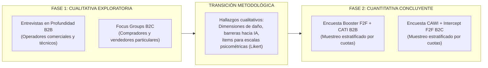
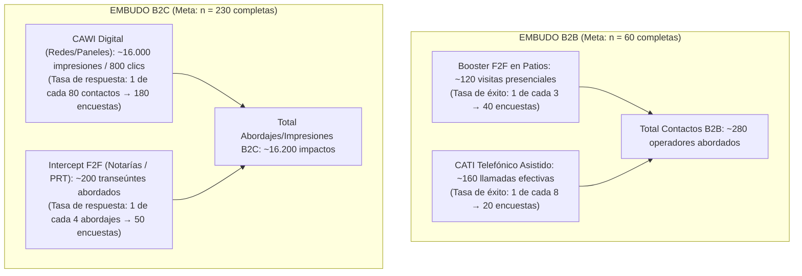
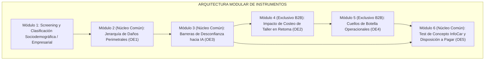
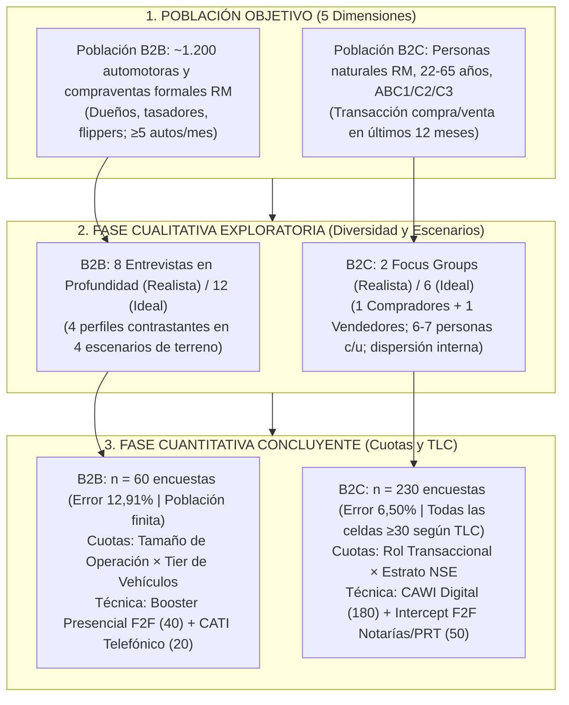

> **⚠️ Documento superado (07-nov-2026).** Las cifras de población y muestra de este archivo (N≈1.200–1.500; n=60/80 y 230/300) son de una versión anterior. Las vigentes están en el deck [`global-sm_v6.pptx`](./global-sm_v6.pptx): 4.116 / 1.066 / 487 dealers (SII 451002); diseño ideal 100 + 300 y realista 60 + 180. No citar este archivo en entregables.

# Workshop 3 — Diseño Muestral: Población, Muestra y Cuotas
## Proyecto: InfoCar — Definición de Población Objetivo y Plan de Muestreo Mixto

- **Asignatura:** Strategic Marketing — Universidad del Desarrollo (UDD)
- **Docente:** Profesora Claudia Scherman B., MBA
- **Fecha:** Noviembre de 2026
- **Versión:** 2.0 (Consolidada Oficial — Ajuste Metodológico y Muestral Riguroso)
- **Repositorio y Clasificación:** `deliverys/workshop-3/03_diseno_muestral_infocar.md`
- **Entregable Inmediatamente Anterior:** Certamen 1 (`deliverys/exam-1/propuesta_consolidada_certamen1.md`)
- **Norma Bibliográfica:** American Psychological Association (APA), 7ª Edición
- **Sustento Doctrinal:** Base Conceptual de Cátedra — NotebookLM (`48214c4e-9538-4806-a8fc-c5105ebac848`), Apuntes de Población y Muestra (Scherman, 2026b), Guías Cualitativas y Cuantitativas (Scherman, 2026c, 2026d) y Capítulo de Objetivos de Investigación (Scherman, 2026a).

---

## 0. Contexto, Alcance y Reglas del Entregable

### 0.1 Carácter Acumulativo del Proyecto
De acuerdo con las instrucciones oficiales del Workshop 3 (`INSTRUCTIONS WORKSHOP POPULATION AND SAMPLE`), este trabajo se construye de manera estrictamente **acumulativa**. Por lo tanto, este documento incorpora y mantiene actualizados los diagnósticos empíricos, los objetivos canónicos y las decisiones metodológicas acordadas en el Certamen 1 (`deliverys/exam-1/`), resolviendo exclusivamente lo que en dicha etapa quedó expresamente diferido: la delimitación formal de la población objetivo, el diseño muestral y la fijación de cuotas.

> [!IMPORTANT]
> **Regla de No Redefinición Metodológica:** El taller no autoriza redefinir las metodologías ni las técnicas de recolección de etapas previas. Se mantiene con 100% de consistencia el **Diseño Mixto Secuencial**: Fase 1 Cualitativa Exploratoria (Entrevistas en Profundidad B2B + Focus Groups B2C) seguida de Fase 2 Cuantitativa Concluyente (Encuestas Booster F2F + CATI para B2B y CAWI + Intercept F2F para B2C).

### 0.2 Reglas de Evaluación y Tiempos de Presentación (10–15 minutos)
- **Tiempo asignado:** 10 a 15 minutos en total. Se destinan entre **6 y 8 minutos exclusivamente** al bloque de Metodología y Diseño Muestral (Slides 4 a 7).
- **Regla de calificación por puntualidad:**
  - Envío antes del inicio de la sesión: Calificación máxima **7,0**.
  - Envío durante la clase: Calificación máxima **5,0**.
  - Envío posterior a la clase: Calificación máxima **1,0**.

---

## 1. Marco de Consistencia Estratégica: Diagnóstico y Objetivos

Para asegurar la rigurosa consistencia exigida por la cátedra entre diagnóstico, problema, objetivos, metodologías, población y muestra, se recapitulan los pilares aprobados en el Certamen 1:

### 1.1 Síntesis del Diagnóstico Empírico (Cifras Duras Verificadas)
1. **Volumen Transaccional y Asimetría:** El mercado automotriz chileno transó 1.060.919 vehículos usados livianos y medianos en 2025, superando en una relación de 3,4 a 1 al mercado de vehículos nuevos (CAVEM, 2026a). Más del 83% de estas transferencias ocurren directamente entre personas naturales (C2C) o a través de compraventas medianas informales, operando bajo profunda asimetría de información y selección adversa (Akerlof, 1970; CAVEM, 2026c).
2. **Inseguridad y Judicialización:** En 2025 se registraron más de 41.700 causas judiciales asociadas a estafas y vicios ocultos en la compraventa vehicular, con un alza del 64% interanual (The Clinic, 2026). Mientras las automotoras formales están afectas a 6 meses de garantía legal (Ley 19.496 del Consumidor), las ventas particulares C2C carecen de cobertura SERNAC, incrementando la prima por certidumbre pericial.
3. **Ineficiencia Operativa y Latencia de Taller:** Las demoras en presupuestación, falta de repuestos de carrocería y cuello de botella en desabolladura y pintura promedian 52,3 días de inmovilización de vehículos en taller (La Tercera, 2026), encareciendo drásticamente el costo de capital de trabajo para automotoras y *flippers*.
4. **Vulnerabilidad de Marcas Chinas:** Las marcas de origen chino representan ya el 12,95% de las transferencias de usados y el 41,4% de las ventas de nuevos (CAVEM, 2026c; ANAC, 2026). Al cumplir 3 a 5 años, estos vehículos pierden la garantía de fábrica y sufren una severa dispersión en disponibilidad y costos de repuestos de carrocería, demandando inspecciones ópticas paramétricas confiables.

### 1.2 Objetivo General Canónico
Conforme a la doctrina de formulación de la cátedra (*Target&Chain*, Scherman, 2026a), el objetivo general excluye sesgos muestrales (*"quiénes/dónde"*) y verbos metodológicos (*"medir/aplicar"*):

$$\mathbf{Objetivo \; General = Comprender \; la \; valoraci\acute{o}n \; de \; la \; certidumbre \; t\acute{e}cnica \; y \; econ\acute{o}mica \; en \; la \; determinaci\acute{o}n \; del \; valor \; transaccional \; de \; veh\acute{\imath}culos \; usados.}$$

### 1.3 Objetivos Específicos SMART (OE1–OE5)
| OE | Enunciado Canónico | Dimensión Investigable |
|:---:|:---|:---|
| **OE1** | Identificar los atributos físicos y estéticos determinantes en la valoración de la condición vehicular. | Daños ópticos perimetrales (rayas, abolladuras, descuadre de junturas, masilla/repintado, trizaduras). |
| **OE2** | Analizar el impacto de la anticipación de costos de reacondicionamiento en la fijación de la oferta económica de compra. | Cuantificación de presupuesto de taller en la fijación de oferta de compra/retoma comercial. |
| **OE3** | Evaluar las principales barreras de desconfianza, resistencia al diagnóstico automatizado e incertidumbre técnica que condicionan la toma de decisiones transaccionales. | Resistencia actitudinal y barreras de adopción de Computer Vision / IA frente al peritaje tradicional. |
| **OE4** | Describir la experiencia operativa y los cuellos de botella temporales en los procesos convencionales de inspección perimetral y costeo de taller. | Tiempos de inspección, latencia de cotizaciones en mesón y fricciones en retoma de vehículos. |
| **OE5** | Evaluar el atractivo percibido, la diferenciación y la intención de adopción de una solución digital de certificación perimetral y costeo paramétrico de taller frente a las alternativas tradicionales de tasación. | Test de concepto InfoCar (disposición a pagar, valor percibido y frecuencia de uso proyectada). |

---

## 2. Recordatorio Metodológico: Diseño Mixto Secuencial

Se ratifica sin modificaciones la arquitectura metodológica aprobada en el Certamen 1 (`deliverys/exam-1/`), diseñada bajo un enfoque mixto secuencial (Cualitativo $\rightarrow$ Cuantitativo):

| Fase de Investigación | Técnica de Levantamiento | Segmento Objetivo | Propósito Metodológico Principal |
|---|---|---|---|
| **Fase 1 (Cualitativa)** | Entrevistas en Profundidad *One-on-One* (30–35 min) | B2B (Automotoras, talleres, flippers, tasadores) | Explorar cuellos de botella operativos (OE4), reglas empíricas de tasación (OE2) y desconfianza en IA (OE3). |
| **Fase 1 (Cualitativa)** | Focus Groups Moderados (75–90 min) | B2C (Compradores y vendedores particulares) | Identificar heurísticas de compra, miedos al fraude (Akerlof, 1970) y jerarquía visual de daños (OE1, OE3). |
| **Fase 2 (Cuantitativa)** | Encuesta Booster F2F (en terreno) + CATI (telefónica) | B2B (Muestra por cuotas Tamaño $\times$ Tier) | Medir paramétricamente impacto en oferta de compra (OE2) y disposición a pagar por software (OE5). |
| **Fase 2 (Cuantitativa)** | Encuesta CAWI (digital) + Intercept F2F (notarías/PRT) | B2C (Muestra por cuotas Rol $\times$ NSE) | Cuantificar peso relativo de atributos (OE1), barreras hacia IA (OE3) e intención de adopción de InfoCar (OE5). |

---

## 3. Delimitación y Caracterización Rigurosa de la Población Objetivo

### 3.1 Principio Rector Doctrinal
> *"No se puede incluir en la muestra criterios que no hayan sido definidos previamente en la población. Si se desea segmentar o controlar la muestra por una dimensión, esa dimensión debe estar explícitamente declarada y descrita en la definición de la población"* (Scherman, 2026a, 2026b).

En cumplimiento estricto de las directrices del taller y la nueva fuente de cátedra (`Investigación de mercado - Población-Muestra.pdf`; Scherman, 2026b), la delimitación del segmento objetivo (*Target Segment*) exige una caracterización multidimensional exhaustiva que incluya obligatoriamente descriptores **demográficos y cualitativos**, complementados por variables geográficas, conductuales y de necesidad.

### 3.2 Población B2B: Operadores Comerciales de Vehículos Usados
Universo de establecimientos y operadores económicos dedicados a la comercialización habitual de vehículos usados livianos y medianos en la Región Metropolitana.

| Dimensión | Caracterización de la Población B2B | Justificación Causal en Diagnóstico y Objetivos |
|:---|:---|:---|
| **Demográfica** | Dueños, socios administradores, gerentes comerciales, jefes de retoma/tasación y encargados de taller de compraventas y automotoras formalmente establecidas, así como revendedores independientes profesionales (*flippers*) con giro comercial y actividad continua ($\ge 5$ autos/mes). Sin restricción de edad ni género. | Delimita al decisor técnico-económico que arriesga capital de trabajo y define la oferta de retoma (OE2, OE4). Excluye a vendedores ocasionales informales para asegurar representatividad del negocio comercial. |
| **Geográfica** | Establecimientos con patios de exhibición, oficinas o talleres operativos en la **Región Metropolitana de Santiago**, con foco en polos automotrices consolidados (Eje Bilbao/Providencia, Gran Avenida/San Miguel, Américo Vespucio, Quinta Normal y 10 de Julio). | La RM concentra el 37,8% de las transferencias nacionales CAVEM (2026a) y presenta la mayor densidad de infraestructura de desabolladura, pintura y peritaje del país. |
| **Psicográfica / Cualitativa** *(Base Mínima)* | Decisores comerciales con **alta aversión al riesgo financiero derivado de vicios ocultos de carrocería**; pragmáticos, orientados a la velocidad de rotación del inventario; con escepticismo inicial y resistencia cultural hacia algoritmos de tasación automatizada o IA frente a su propio "ojo clínico" experto, pero presionados por la reducción de costos y la estandarización pericial. | La dimensión cualitativa es indispensable para explorar las barreras de desconfianza y resistencia al cambio tecnológico hacia Computer Vision (OE3) y dimensionar el atractivo de la certificación perimetral (OE5). |
| **Consumo / Conducta** | Empresas y operadores que compran, reacondicionan, tasan y revenden vehículos livianos y medianos usados (antigüedad de 1 a 15 años). Volumen comercializable mínimo de **5 unidades al mes**. | Asegura que el respondente experimente habitualmente fricciones reales de tasación física, presupuestación en taller y negociación de retomas (OE1, OE2, OE4). |
| **Necesidades** | Necesidad crítica de: (a) reducir el tiempo de presupuestación de daños estéticos de días a minutos; (b) blindar la retoma contra compras descalabradas por siniestros ocultos; y (c) sustentar ante el vendedor particular una oferta de retoma justa con respaldo pericial transparente. | Responde directamente a los cuellos de botella de 52,3 días en talleres (La Tercera, 2026) y a las 41.700 causas por fraude (The Clinic, 2026). Vinculado a OE2 y OE4. |

### 3.3 Población B2C: Compradores y Vendedores Particulares
Universo de personas naturales que participan activamente en el mercado de compraventa de vehículos usados en la Región Metropolitana.

| Dimensión | Caracterización de la Población B2C | Justificación Causal en Diagnóstico y Objetivos |
|:---|:---|:---|
| **Demográfica** | Hombres y mujeres, entre **22 y 65 años**, bancarizados, pertenecientes a los estratos socioeconómicos **ABC1, C2 y C3** según clasificación AIM. Titulares de licencia de conducir clase B vigente. | Representan los segmentos con capacidad de compra real y acceso al crédito automotriz o financiamiento propio. El 84,7% de las compras son de personas naturales (CAVEM, 2026c). |
| **Geográfica** | Residentes permanentes en las comunas urbanas de la **Región Metropolitana de Santiago**. | Delimita el marco geográfico al mercado con mayor liquidez, cobertura digital de portales de clasificados y puntos de intercepción notarial y de revisión técnica. |
| **Psicográfica / Cualitativa** *(Base Mínima)* | Conductores con **marcada aversión al fraude técnico y mecánico**; inseguridad ante la asimetría de información frente al vendedor o la automotora; desconfianza de peritajes informales; búsqueda de certidumbre económica y validación independiente antes de comprometer ahorros personales significativos. | Justifica la indagación cualitativa de miedos y barreras subjetivas (Akerlof, 1970; OE3), y mide la disposición a pagar por una certificación independiente que valide la compra (OE5). |
| **Consumo / Conducta** | Personas que hayan **comprado o vendido un vehículo usado en los últimos 12 meses**, o que se encuentren **activamente en proceso de búsqueda o venta** (visita recurrente a portales Chileautos, Yapo, Marketplace o compraventas). | Garantiza que las heurísticas de decisión, el impacto visual de daños estéticos y las fricciones transaccionales estén plenamente vigentes en la memoria del consumidor (OE1, OE2). |
| **Necesidades** | Necesidad de conocer el estado real de carrocería y pintura sin pagar peritajes presenciales lentos y onerosos; certidumbre de no pagar sobreprecio; y contar con un informe técnico objetivo para negociar el precio de compra o venta. | Mitiga la asimetría de información estructural y la ausencia de garantía legal obligatoria en transacciones C2C (Mellado, 2026). Vinculado a OE1 y OE5. |

### 3.4 Matriz de Trazabilidad: Población $\rightarrow$ Cuotas Muestrales
En cumplimiento del principio de Scherman (2026b), la siguiente matriz demuestra que **todas las variables de segmentación utilizadas en el diseño muestral fueron formalmente declaradas en la población objetivo**:

| Segmento | Variable de Segmentación Muestral | Categorías o Celdas de Cuota | Dimensión Declarada en Población | Justificación Metodológica |
|:---:|:---:|:---:|:---:|:---|
| **B2B** | **Tamaño de Operación** | Pequeña (5–15 autos/mes) Mediana (16–50 autos/mes) Grande (>50 autos/mes) | Demográfica (Escala empresarial) | Permite contrastar si los cuellos de botella de inspección (OE4) y la rotación varían según la escala operativa. |
| **B2B** | **Tier de Vehículos** | Tier 2 (Mainstream: $5M–$15M) Tier 3 (Económico: <$5M) | Consumo / Conducta (Segmento comercial) | Concentra el 85%+ de las transferencias de usados CAVEM (2026a). Se excluye Tier 1 (lujo) del muestreo cuantitativo por ser un nicho atípico. |
| **B2C** | **Rol Transaccional** | Comprador Particular Vendedor Particular | Consumo / Conducta (Posición de mercado) | Compradores y vendedores tienen incentivos asimétricos contrapuestos frente al daño cosmético y la fijación de precio (OE1, OE2). |
| **B2C** | **Nivel Socioeconómico (NSE)** | Estrato ABC1 Estrato C2 Estrato C3 | Demográfica (Capacidad económica) | Fundamental para evaluar elasticidad de precio, disposición a pagar por el informe digital (OE5) y canales preferidos. |
| **B2C** | **Tipología Vehicular** *(Control)* | Sedán/Hatchback SUV/Crossover Pickup/Comercial | Consumo / Conducta (Tipo de carrocería) | Registrada como variable de control transversal en el cuestionario para correlacionar con costos de taller sin atomizar las celdas de cuota. |

---

## 4. Diseño de la Muestra Cualitativa (Fase 1): Diversidad, Dispersión y Escenarios

Conforme a la **Note 2** de las instrucciones del taller y a las pautas de Scherman (2026b, 2026c), la investigación cualitativa no persigue representatividad estadística paramétrica, sino **diversidad, dispersión de perfiles y variedad en los escenarios de interacción u observación de terreno**:

### 4.1 Entrevistas en Profundidad B2B: Perfiles y Escenarios de Terreno
Para abarcar la heterogeneidad del sector comercial automotriz, se definieron cuatro perfiles operacionales contrastantes evaluados en cuatro escenarios físicos reales de terreno, aplicando la regla de cátedra: **dos entrevistas por perfil en el diseño de referencia (ideal), o una entrevista por perfil en la muestra optimizada (realista)**.

#### Cuatro Perfiles Operacionales Contrastantes:
1. **Perfil 1 — Dueño / Administrador de Automotora Mediana Tradicional:** Negocio multimarca formal (15–40 autos en stock). Foco en rotación, margen financiero global y costo de capital inmovilizado por demoras.
2. **Perfil 2 — Jefe de Taller / Encargado de Reacondicionamiento:** Responsable técnico de la inspección perimetral, desabolladura, pintura y repuestos. Foco en precisión técnica, horas-hombre y cuellos de botella de taller (OE4).
3. **Perfil 3 — Revendedor Ágil Independiente (*Flipper*):** Operador individual de alta rotación (5–10 autos/mes) que compra a particulares y revende rápido. Foco en velocidad de inspección en calle y sensibilidad al margen unitario.
4. **Perfil 4 — Tasador Institucional en Concesionario Formal:** Opera con protocolos rígidos corporativos. Foco en estandarización de reportes para mitigar reclamos posteriores y riesgo reputacional de marca.

#### Cuatro Escenarios de Interacción u Observación de Terreno:
- **Escenario A — Patio de Venta al Aire Libre:** Observación del examen perimetral bajo luz natural directa y negociación cara a cara con el cliente.
- **Escenario B — Mesón Técnico y Fosa de Taller:** Observación de la recepción vehicular, estimación visual de piezas y consulta telefónica/web de stock y precios de repuestos.
- **Escenario C — Centro Logístico y Acopio Masivo / Patios de Remate:** Inspecciones volumétricas masivas bajo alta presión de tiempo (<5 minutos por auto).
- **Escenario D — Peritaje en Calle / Domicilio del Particular:** Compra directa en terreno bajo condiciones lumínicas y espaciales variables y herramientas portátiles limitadas.

#### Matriz de Muestreo Cualitativo B2B (Ideal vs. Realista):
| Perfil Operacional | Escenario de Interacción Primario | Diseño de Referencia / Ideal (2 por perfil) | Diseño Optimizado / Realista (1-2 por perfil) | Foco de Indagación SMART |
|---|---|:---:|:---:|:---:|
| **Perfil 1:** Dueño automotora tradicional | Patio de venta al aire libre (Escenario A) | 2 entrevistas | 2 entrevistas | OE2, OE4, OE5 |
| **Perfil 2:** Jefe de taller / técnico | Mesón técnico y fosa de taller (Escenario B) | 2 entrevistas | 2 entrevistas | OE1, OE4 |
| **Perfil 3:** Flipper independiente ágil | Terreno / calle / domicilio (Escenario D) | 2 entrevistas | 2 entrevistas | OE1, OE2, OE3 |
| **Perfil 4:** Tasador institucional de red | Centro logístico / acopio masivo (Escenario C) | 2 entrevistas | 2 entrevistas | OE3, OE4, OE5 |
| **Casos Adicionales de Saturación** | Rotación en talleres mecánicos multimarca | 4 entrevistas | — *(Se suspende al alcanzar saturación)* | Triangulación profunda |
| **Total Entrevistas B2B** | **4 escenarios de interacción combinados** | **12 entrevistas** | **8 entrevistas** | **OE1–OE5 cubiertos** |

*Duración: 30 a 35 minutos por sesión. Formato semiestructurado con pauta de indagación abierta.*

### 4.2 Focus Groups B2C: Diversidad y Dispersión Interna
De acuerdo con Scherman (2026a, 2026b), **el mínimo riguroso para grupos focales es de dos sesiones diferenciadas por segmento**. Un solo grupo focal impide determinar si un hallazgo refleja un patrón real del consumidor o la dinámica particular de un líder de opinión en la sala. Dos sesiones permiten triangular hallazgos, mientras que tres grupos representan el estándar ideal de saturación temática.

#### Criterios de Dispersión y Diversidad Interna:
- **Sesión Focus Group 1 — Compradores Particulares (Diversidad Interna):**
  - *Dispersión por experiencia:* 50% Compradores primerizos de vehículos usados (alta ansiedad, desconfianza severa) vs. 50% Renovadores experimentados (mayor conocimiento práctico pero aversión a fraudes sofisticados).
  - *Dispersión por canal:* Participantes vía plataformas abiertas C2C (Chileautos, Marketplace) vs. compraventas establecidas.
  - *Dispersión demográfica:* Paridad de género; composición balanceada ABC1, C2 y C3.
- **Sesión Focus Group 2 — Vendedores Particulares (Diversidad Interna):**
  - *Dispersión por motivación:* Venta por urgencia de liquidez (alta sensibilidad al tiempo y vulnerabilidad en la tasación) vs. Venta por renovación planificada (búsqueda de optimización de precio y defensa del valor del vehículo).
  - *Dispersión por canal evaluado:* Venta directa C2C vs. entrega en parte de pago o consignación en automotora.

#### Cuadro Comparativo Focus Groups B2C (Ideal vs. Realista):
| Criterio Metodológico | Diseño Ideal / Óptimo | Diseño Realista / Aprobado | Justificación Doctrinal (Scherman, 2026b) |
|---|:---:|:---:|---|
| **Número total de grupos focales** | **6 grupos** (3 de compradores + 3 de vendedores) | **2 grupos** (1 de compradores + 1 de vendedores) | Dos grupos es el mínimo metodológico para contrastar visiones opuestas (comprador vs. vendedor). La menor saturación se compensa en la fase cuantitativa. |
| **Participantes por sesión** | 6 a 8 personas | 6 a 7 personas | Rango pedagógico óptimo (6–8) para maximizar interacción dialéctica sin atomizar la moderación. |
| **Duración por sesión** | 90 minutos | 75 minutos | Tiempo suficiente para dinámicas proyectivas sin generar fatiga en los participantes. |

---

## 5. Diseño de la Muestra Cuantitativa (Fase 2): Principios de Cátedra y Nueva Fuente NotebookLM

La muestra cuantitativa concluyente operacionaliza los principios formales de la nueva fuente doctrinal de la cátedra: `Investigación de mercado - Población-Muestra.pdf` (Scherman, 2026b).

### 5.1 Proceso de Estimación Muestral en 5 Pasos (Scherman, 2026b)
1. **Paso 01 — Definir objetivos y preguntas de investigación:** Delimitación precisa de los OE1–OE5 para definir si se requiere estimar medias o proporciones.
2. **Paso 02 — Determinar el nivel de confianza:** Se fija un **95% de confianza** para la muestra B2C ($Z = 1,96$), estándar en estudios concluyentes de comportamiento de mercado, y un **90% de confianza** para la muestra B2B ($Z = 1,645$), justificado por tratarse de un segmento empresarial especializado de menor varianza actitudinal.
3. **Paso 03 — Definir el margen de error máximo tolerable:** Se define un margen de error muestral global de **$e \approx 6,50\%$** en B2C ($n = 230$), y de **$e \approx 11,11\%$ a $12,91\%$** en B2B ($n = 60$ a $80$), balanceando rigor analítico y factibilidad de levantamiento presencial y telefónico.
4. **Paso 04 — Identificar el tamaño de la población:** 
   - *Población B2C:* Población abierta o infinita ($N > 500.000$ personas naturales en RM en el target), por lo que no requiere factor de corrección por población finita.
   - *Población B2B:* Población cerrada/nicho ($N \approx 1.200$ a $1.500$ automotoras y compraventas formales en RM). Con $n = 60$ encuestas se cubre entre el 4,0% y el 5,0% del universo censal formal, otorgando alta solidez descriptiva empresarial.
5. **Paso 05 — Calcular el tamaño de la muestra y asignar cuotas:** Se dimensionan los tamaños muestrales asegurando que la representatividad estadística no comprometa la viabilidad económica y temporal del levantamiento en terreno.

### 5.2 Fundamentación Teórica del Teorema del Límite Central (TLC) y la Regla de $n \ge 30$

> *"El Teorema del Límite Central establece que la distribución de las medias muestrales se aproxima a una distribución normal a medida que el tamaño de la muestra aumenta ($n \ge 30$), independientemente de la forma que tenga la distribución de la población original. Por esta razón, se exige contar con un umbral mínimo de 30 casos por celda o segmento de análisis para realizar inferencias estadísticas válidas y aplicar contrastes paramétricos confiables"* (Scherman, 2026b, p. 3).

En el diseño muestral de InfoCar, la regla de $n \ge 30$ se aplica de manera estricta en la matriz de cuotas de consumidores (B2C), garantizando que ningún cruce analítico de toma de decisiones quede desprovisto de validez matemática.

### 5.3 Tabla Paramétrica Oficial de Error Estándar e Intervalos de Confianza (Scherman, 2026b)

A continuación se transcribe la tabla paramétrica oficial provista en la nueva fuente de la Prof. Claudia Scherman B., que calcula el Error Estándar y los Intervalos de Confianza al 95% y 90% asumiendo una desviación estándar poblacional normalizada $\sigma = 1$, destacando en negrita los tamaños muestrales y celdas adoptadas en este proyecto:

| Tamaño de Muestra ($n$) | Error Estándar ($EE\%$) | Intervalo de Confianza (95%) | Intervalo de Confianza (90%) | Vínculo con el Diseño Muestral InfoCar |
|:---:|:---:|:---:|:---:|:---|
| **10** | 31,62% | 22,45 – 40,78 | 25,69 – 39,55 | Celda Grande Tier 2 B2B (Muestreo exploratorio de nicho) |
| **20** | 22,36% | 16,67 – 29,05 | 18,13 – 26,59 | Celdas combinadas secundarias B2B |
| **30** | **18,26%** | **14,38 – 22,14** | **15,05 – 21,47** | **Umbral mínimo por celda según Teorema del Límite Central (Celdas B2C)** |
| **40** | **15,81%** | **12,57 – 19,06** | **13,04 – 18,58** | **Celdas B2C (Compradores ABC1, Compradores C3, Vendedores C2)** |
| **50** | **14,14%** | **11,50 – 16,77** | **11,72 – 16,56** | **Celda dominante B2C (Compradores C2) / Celda ideal B2C** |
| **60** | **12,91%** | **10,64 – 15,17** | **10,75 – 14,07** | **Muestra Total Cuantitativa B2B (Diseño Realista)** |
| **70** | 11,91% | 10,07 – 13,75 | 10,07 – 13,75 | Marginal por NSE B2C (Total ABC1 y Total C3) |
| **80** | **11,11%** | **9,24 – 12,98** | **9,48 – 12,74** | **Muestra Total Cuantitativa B2B (Diseño Ideal)** |
| **90** | 10,48% | 8,81 – 12,15 | 9,00 – 11,95 | Marginal por NSE B2C (Total C2) |
| **100** | 10,00% | 8,46 – 11,54 | 8,61 – 11,39 | Subtotal Vendedores B2C |
| **130** | **8,84%** | **7,64 – 10,04** | **7,70 – 10,17** | **Subtotal Compradores B2C ($n = 130$)** |
| **200** | 7,11% | 6,52 – 7,70 | 6,28 – 8,04 | Nivel de estabilización asintótica de error |
| **230** | **6,50%** | **6,21 – 6,79** | **5,83 – 7,17** | **Muestra Total Cuantitativa B2C (Diseño Realista)** |
| **300** | **5,44%** | **5,67 – 5,22** | **5,06 – 5,81** | **Muestra Total Cuantitativa B2C (Diseño Ideal / 6 celdas $\times$ 50)** |

*Fuente: Scherman (2026b), «Investigación de mercado - Población-Muestra», Facultad de Economía y Negocios, UDD.*

### 5.4 Matriz de Cuotas B2C: Cumplimiento Riguroso de la Regla del 30

La muestra cuantitativa B2C se estructura mediante un **muestreo estratificado no probabilístico por cuotas**, cruzando las dos variables de segmentación declaradas en la población: **Rol en la Transacción** (Comprador vs. Vendedor) $\times$ **Nivel Socioeconómico** (ABC1, C2, C3).

#### Matriz de Cuotas B2C — Diseño Realista ($n = 230$):
| Rol en la Transacción | Tramo NSE ABC1 | Tramo NSE C2 | Tramo NSE C3 | Total por Rol Transaccional | Error Estándar Subtotal |
|---|:---:|:---:|:---:|:---:|:---:|
| **Compradores Particulares** | 40 encuestas | 50 encuestas | 40 encuestas | **130 encuestas** | $EE = 8,84\%$ |
| **Vendedores Particulares** | 30 encuestas | 40 encuestas | 30 encuestas | **100 encuestas** | $EE = 10,00\%$ |
| **Total por Estrato NSE** | **70 encuestas** | **90 encuestas** | **70 encuestas** | **$n = 230$ encuestas** | **$EE = 6,50\%$** |

> [!CHECK] **Auditoría de Celdas:**
> - Celda 1 (Comprador ABC1): $n = 40 \ge 30$ ✅
> - Celda 2 (Comprador C2): $n = 50 \ge 30$ ✅ (Refleja el núcleo del mercado automotriz chileno)
> - Celda 3 (Comprador C3): $n = 40 \ge 30$ ✅
> - Celda 4 (Vendedor ABC1): $n = 30 \ge 30$ ✅ (Cumple exactamente el umbral del TLC)
> - Celda 5 (Vendedor C2): $n = 40 \ge 30$ ✅
> - Celda 6 (Vendedor C3): $n = 30 \ge 30$ ✅ (Cumple exactamente el umbral del TLC)
>
> **Conclusión:** El 100% de las celdas cumple y supera el umbral matemático del Teorema del Límite Central ($n \ge 30$), garantizando viabilidad de análisis estadístico multivariado (ANOVA, regresión logística, tablas de contingencia chi-cuadrado).

#### Matriz de Cuotas B2C — Diseño Ideal ($n = 300$):
En el diseño de máxima rigurosidad académica, cada una de las 6 celdas se dimensiona en **50 encuestas balanceadas** ($6 \times 50 = 300$), alcanzando un error estándar del **5,44%** y permitiendo análisis de sub-sub-segmentos cruzados por antigüedad del auto transferido.

### 5.5 Matriz de Cuotas B2B: Población Finita y Concentración de Mercado

La muestra B2B cruza **Tamaño de Operación** $\times$ **Tier de Vehículos**. En este segmento empresarial, la justificación de celdas no obedece a un muestreo masivo de consumidores sino a las propiedades de una **población finita de operadores comerciales** en la Región Metropolitana ($\sim 1.200$ establecimientos):

#### Matriz de Cuotas B2B — Diseño Realista ($n = 60$):
| Tamaño de Operación (Volumen Mensual) | Tier 2: Mainstream ($5M–$15M) | Tier 3: Económico (<$5M) | Total por Tamaño Operacional |
|---|:---:|:---:|:---:|
| **Pequeña (5 a 15 vehículos/mes)** | 15 encuestas | 10 encuestas | **25 encuestas** |
| **Mediana (16 a 50 vehículos/mes)** | 15 encuestas | 10 encuestas | **25 encuestas** |
| **Grande (> 50 vehículos/mes)** | 10 encuestas | — *(No operan Tier 3)* | **10 encuestas** |
| **Total por Tier de Vehículos** | **40 encuestas** | **20 encuestas** | **$n = 60$ encuestas** |

#### Justificaciones Técnicas de la Muestra B2B:
1. **Exclusión de Tier 1 (Lujo / Premium > $30M):** Las compraventas exclusivas de alta gama (Porsche, Mercedes-AMG, BMW M) representan menos del 3% del volumen total de transferencias en Chile. Forzar una cuota de 30 casos en Tier 1 resultaría inviable en costo y tiempo, distorsionando el foco del producto InfoCar. Sus especificidades se capturan cualitativamente en las entrevistas en profundidad (Fase 1).
2. **Asignación celular en automotoras grandes:** Las automotoras grandes (> 50 autos/mes) no transan vehículos de Tier 3 (económicos bajo $5M) debido a políticas corporativas de garantía comercial y antigüedad máxima (no retoman autos de más de 8 años). Por ello, esa celda se declara formalmente vacía (*cero estructural*), concentrando sus casos en Tier 2.
3. **Validez estadística B2B:** Con $n = 60$, el error estándar global es de 12,91% sobre un universo de $\sim 1.200$ operadores. A nivel celular, los datos se interpretan con carácter exploratorio-descriptivo, alcanzando significancia agregada en los análisis por tamaño ($n = 25$) y por tier mainstream ($n = 40 \ge 30$).

### 5.6 Tasa de Respuesta Esperada y Embudo de Contactos de Campo

Conforme a Scherman (2026a, 2026b), para obtener una muestra efectiva con cuotas completas es imperativo presupuestar la tasa de caída y el embudo de contactos (*funnel de campo*):

| Canal de Levantamiento | Técnica Muestral | Tasa de Respuesta Estimada | Encuestas Efectivas Requeridas | Contactos Totales Necesarios en Campo | Justificación Logística |
|---|---|:---:|:---:|:---:|:---|
| **B2B Booster F2F (Terreno)** | Visita presencial asistida por tablet en automotoras | 1 de cada 3 abordajes (33,3%) | 40 encuestas | ~120 visitas a establecimientos | Encuestador en terreno visita polos de venta; muestra demo física del software en tablet. |
| **B2B CATI (Telefónica)** | Llamadas telefónicas a administradores de compraventas | 1 de cada 8 contactos (12,5%) | 20 encuestas | ~160 llamadas efectivas con decisor | Contacto directo con administradores para agendar encuesta asistida breve. |
| **B2C CAWI (Digital Online)** | Pauta publicitaria georreferenciada + panel digital | 1 respuesta por cada 80 a 100 clics (1,0%–1,25%) | 180 encuestas | ~14.400 a 18.000 impresiones / clics | Enlaces patrocinados en comunidades de usados, grupos de modelos y portales web. |
| **B2C Intercept F2F (Terreno)** | Intercepción a la salida de Notarías y Plantas de Revisión Técnica | 1 de cada 4 personas abordadas (25,0%) | 50 encuestas | ~200 abordajes presenciales | Intercepción estratégica a la salida de Notarías (transferencias) y Plantas de Revisión Técnica (PRT). |
| **Totales Consolidados** | **Canales combinados B2B + B2C** | — | **$n = 290$ encuestas** | **~15.000+ impactos / contactos** | Balance óptimo entre viabilidad y representatividad estadística. |

---

## 6. Preguntas Filtro (Screening) y Control de Respondente

### 6.1 Batería de Preguntas Filtro (Screening)
Los cuestionarios incorporan filtros excluyentes al inicio para garantizar que solo respondan personas pertenecientes a la población objetivo:

#### Filtros B2B (Operador Comercial):
1. *Filtro 1 (Actividad Comercial — Excluyente):* ¿Su establecimiento o actividad comercial incluye la compra, tasación o venta habitual de vehículos livianos y medianos usados? $\rightarrow$ **[ ] Sí** (Continúa) / **[ ] No** (Fin de la encuesta; no califica).
2. *Filtro 2 (Ubicación Geográfica — Excluyente):* ¿Su operación comercial o patio de venta se ubica dentro de la Región Metropolitana de Santiago? $\rightarrow$ **[ ] Sí** (Continúa) / **[ ] No** (Fin de la encuesta).
3. *Filtro 3 (Volumen Transaccional — Clasificatorio de Tamaño):* En promedio, ¿cuántos vehículos usados comercializa su negocio al mes? $\rightarrow$ **[Menos de 5]** (Fin de la encuesta; no califica como operador profesional) / **[5 a 15]** (Cuota Pequeña) / **[16 a 50]** (Cuota Mediana) / **[Más de 50]** (Cuota Grande).
4. *Filtro 4 (Tier de Precio — Clasificatorio de Tier):* ¿En qué rango de precio se concentra el mayor volumen de sus ventas? $\rightarrow$ **[Menos de $5M]** (Cuota Tier 3) / **[$5M a $15M]** (Cuota Tier 2) / **[Más de $15M]** (Asignado a Tier 2 si vende mainstream, o excluido si es exclusivamente nicho súper lujo).

#### Filtros B2C (Consumidor Particular):
1. *Filtro 1 (Transacción Reciente o Activa — Excluyente):* En los últimos 12 meses, ¿usted ha comprado, vendido o se encuentra evaluando activamente comprar o vender un vehículo usado liviano o mediano? $\rightarrow$ **[ ] Sí** (Continúa) / **[ ] No** (Fin de la encuesta).
2. *Filtro 2 (Rol Transaccional — Clasificatorio de Rol):* ¿Cuál es o fue su rol principal en dicha transacción? $\rightarrow$ **[Comprador]** (Cuota Comprador) / **[Vendedor]** (Cuota Vendedor) / **[Ambos]** (Se asigna a la cuota con mayor rezago de completitud).
3. *Filtro 3 (Residencia Geográfica — Excluyente):* ¿Reside usted actualmente en la Región Metropolitana de Santiago? $\rightarrow$ **[ ] Sí** (Continúa) / **[ ] No** (Fin de la encuesta).
4. *Filtro 4 (Nivel Socioeconómico — Regla AIM):* Batería estándar abreviada de bienes del hogar, educación del sostenedor y previsión $\rightarrow$ Clasifica automáticamente en cuota **ABC1**, **C2** o **C3** (Si clasifica en D o E, se finaliza amablemente la encuesta).

### 6.2 Protocolos Explícitos contra Sesgos de Muestreo (Scherman, 2026b)

En cumplimiento de las advertencias teóricas sobre sesgos de muestreo destacadas en `Investigación de mercado - Población-Muestra` (Scherman, 2026b, p. 2), se implementan cinco salvaguardas de control de campo:

1. **Mitigación del Sesgo de Exclusión Digital (Cobertura CAWI):** El levantamiento exclusivamente web tiende a sobrerrepresentar a segmentos jóvenes y de NSE alto, excluyendo a personas de mayor edad o con menor alfabetización digital. Para neutralizar este sesgo, se implementa una **cuota presencial obligatoria de 50 encuestas mediante intercepción F2F** con tablet en notarías de alta afluencia transaccional vehicular y en Plantas de Revisión Técnica (PRT) de San Miguel, Quinta Normal y La Florida.
2. **Mitigación del Sesgo de No Respuesta:** En el canal B2B CATI, se establece un protocolo estricto de **hasta 3 reintentos en diferentes bandas horarias** (mañana de 10:00 a 12:30 y tarde de 15:30 a 17:30) antes de reemplazar el contacto comercial en la base de datos. Se ofrece como incentivo funcional la entrega gratuita del *Reporte de Benchmarking de Precios y Tiempos de Taller RM 2026*.
3. **Control Estricto de Dependencia Intrafamiliar:** Conforme a la regla de campo de la cátedra (Scherman, 2026a), **queda estrictamente prohibido encuestar a dos personas pertenecientes al mismo grupo familiar** en un mismo punto de intercepción presencial, evitando la autocorrelación de respuestas sobre presupuesto y vehículos compartidos.
4. **Control de Duplicidad de Respondentes:** 
   - *En B2B:* Verificación cruzada mediante RUT de empresa, dirección comercial o patente vehicular analizada para asegurar que no se encueste a dos tasadores del mismo local.
   - *En B2C CAWI:* Control digital por huella de dispositivo (*browser fingerprinting*), bloqueo de IP y cookie para impedir respuestas múltiples de un mismo usuario.
5. **Sesgo de Deseabilidad Social en Disposición a Pagar (OE5):** Para evitar que el encuestado sobreestime su intención de compra del software InfoCar, las preguntas de pricing se diseñan con la técnica de **Precios de Van Westendorp** (precio demasiado barato, precio conveniente, precio caro pero aceptable, precio prohibitivo) y preguntas de intención de compra condicionadas con tarjeta de crédito/débito.

---

## 7. Arquitectura y Modularidad de Instrumentos (Cuestionarios)

### 7.1 Lógica de Instrumentos: ¿Uno o Dos Cuestionarios?
Conforme a la regla pedagógica de Scherman (2026a): *"La regla general es aplicar un solo cuestionario estructurado, salvo cuando los segmentos investigados son cualitativamente distintos (B2B vs. B2C), en cuyo caso se requiere modularizar o diseñar dos instrumentos adaptados con núcleos comunes de enlace."*

Dado que un dueño de automotora razona en términos de rotación de capital, margen bruto y costos de taller (B2B), mientras que un consumidor razona en términos de ahorro personal, confianza y miedo a la estafa (B2C), se desarrollaron **dos instrumentos diferenciados que comparten una matriz conceptual común**:

### 7.2 Distribución Modular y Duración Cronometrada
| Módulo | Contenido y Objetivos Abordados | Instrumento B2B | Instrumento B2C | Escala / Formato de Registro |
|:---:|:---|:---:|:---:|:---|
| **Módulo 1** | Filtros de Screening y Clasificación de Cuotas | Obligatorio (Filtros 1 a 4) | Obligatorio (Filtros 1 a 4) | Preguntas cerradas dicotómicas y categóricas. |
| **Módulo 2** | Valoración de Daños Perimetrales (OE1) | Obligatorio | Obligatorio | Escala Likert 1 a 7 (Impacto de abolladuras, pintura, descuadres). |
| **Módulo 3** | Barreras de Desconfianza y Resistencia a IA (OE3) | Obligatorio | Obligatorio | Diferencial semántico y afirmaciones Likert (IA vs. ojo humano). |
| **Módulo 4** | Costeo de Reacondicionamiento en Retoma (OE2) | **Exclusivo B2B** | — | Ejercicio de trade-off y cálculo de descuento en oferta de compra. |
| **Módulo 5** | Latencia y Cuellos de Botella de Taller (OE4) | **Exclusivo B2B** | — | Variables métricas de tiempo (días de demora, horas de peritaje). |
| **Módulo 6** | Test de Concepto InfoCar y Pricing (OE5) | Obligatorio | Obligatorio | Modelo Van Westendorp (4 precios) + Escala Juster de adopción. |

- **Duración Cronometrada Máxima:**
  - *Cuestionario B2B:* **8 a 10 minutos** (respetando la restricción de fatiga en operadores de alta carga comercial; Scherman, 2026a).
  - *Cuestionario B2C:* **6 a 8 minutos** (óptimo para evitar abandono en encuestas CAWI e intercepción en notarías).

---

## 8. Resumen Visual del Diseño Muestral Integral

---

## 9. Matriz de Brechas: Diseño Ideal vs. Diseño Realista/Aprobable

En cumplimiento de la recomendación docente de transparentar el contraste entre la formulación óptima y la operacionalmente viable (Scherman, 2026a, 2026b), se presenta la matriz de brechas e implicancias metodológicas:

| Componente Muestral | Diseño Ideal / Óptimo | Diseño Realista / Aprobado | Justificación Operativa | Implicancia Metodológica y Medida de Mitigación |
|---|:---:|:---:|---|---|
| **Entrevistas B2B** | 12 entrevistas (3 por perfil) | **8 entrevistas** (2 por perfil) | Saturación alcanzable con 2 casos por perfil según Note 2 del taller. | Menor redundancia discursiva; se mitiga triangulando directamente con la encuesta Booster cuantitativa B2B. |
| **Focus Groups B2C** | 6 grupos (3 compradores + 3 vendedores) | **2 grupos** (1 compradores + 1 vendedores) | Restricción de presupuesto y tiempos de reclutamiento calificado en RM. | Se pierde saturación cualitativa intra-segmento; se mitiga incorporando preguntas abiertas de control en la encuesta CAWI. |
| **Muestra Cuantitativa B2B** | $n = 80$ encuestas ($EE = 11,11\%$) | **$n = 60$ encuestas** ($EE = 12,91\%$) | Alta tasa de rechazo en administradores automotrices en terreno. | Disminuye precisión en celdas de tamaño pequeño; los cruces por celda se analizan a nivel agregado por dimensión principal. |
| **Muestra Cuantitativa B2C** | $n = 300$ encuestas ($6 \times 50$; $EE = 5,44\%$) | **$n = 230$ encuestas** ($EE = 6,50\%$) | Costo por respuesta en panel online y límite de intercepciones notariales. | Las celdas de vendedores ABC1 ($n=30$) y C3 ($n=30$) quedan en el umbral mínimo del TLC; suficiente para significancia estadística. |

---

## 10. Estructura Sugerida de la Presentación Oral (10–15 minutos)

Para asegurar una exposición fluida y cumplir la pauta de dedicar entre 6 y 8 minutos a la metodología y la muestra, se estructura el guion de presentación:

| Slide # | Tiempo Asignado | Título de la Lámina | Contenido Clave a Exponer |
|:---:|:---:|:---|:---|
| **Slide 1** | 1:00 min | **Portada y Hoja de Ruta** | InfoCar, integrantes del equipo, resumen del problema y agenda de la sesión. |
| **Slide 2** | 1:30 min | **Marco de Consistencia: Objetivos** | Exposición del Objetivo General canónico y el encadenamiento con OE1 a OE5 (contexto indispensable). |
| **Slide 3** | 1:00 min | **Metodología: Diseño Mixto Secuencial** | Diagrama de flujo mostrando cómo los hallazgos de la Fase Cualitativa construyen el instrumento Cuantitativo. |
| **Slide 4** | 2:00 min | **Población Objetivo B2B y B2C** | Tabla de las 5 dimensiones por población; justificación causal de descriptores y matriz de trazabilidad cruzada. |
| **Slide 5** | 2:00 min | **Diseño Muestral Cualitativo** | 4 perfiles operacionales y 4 escenarios de terreno (B2B); dispersión interna y mínimo de 2 focus groups (B2C). |
| **Slide 6** | 2:30 min | **Diseño Cuantitativo y Regla del 30** | Matriz de cuotas B2C ($n=230$, todas las celdas $\ge 30$ según TLC); matriz B2B ($n=60$, cobertura 4,8%); tabla de error estándar $\sigma=1$. |
| **Slide 7** | 1:30 min | **Screening, Embudo y Mitigación de Sesgos** | Baterías de filtros eliminatorios B2B y B2C; control de respondente (no duplicidad familiar) y tasas de respuesta por canal. |
| **Slide 8** | 1:30 min | **Cuestionarios y Brecha Ideal vs. Realista** | Modularidad de instrumentos (duraciones máximas 8-10 min B2B y 6-8 min B2C); contraste de brechas y viabilidad. |
| **Slide 9** | 1:00 min | **Conclusiones y Ronda de Preguntas** | Síntesis de cumplimiento metodológico y apertura a feedback docente. |
| **TOTAL** | **~14:00 min** | *(Bloque metodológico: Slides 4 a 7 = 8:00 min exactos)* | Cumple estrictamente con el rango de 10 a 15 minutos de la cátedra. |

---

## 11. Checklist de Aseguramiento de Calidad Académica

- [x] **1. Consistencia Acumulativa:** Objetivos canónicos, diagnóstico empírico y diseño mixto secuencial preservados íntegramente desde Certamen 1 sin redefinición metodológica.
- [x] **2. Delimitación de Población B2B y B2C:** Definidas bajo las 5 dimensiones (Demografía, Geografía, Psicografía/Cualitativa, Consumo, Necesidad), con criterios explícitos de inclusión y exclusión.
- [x] **3. Justificación Causal de Descriptores:** Cada dimensión de la población está formalmente justificada con base en las métricas duras del diagnóstico y los objetivos OE1–OE5.
- [x] **4. Trazabilidad Cruzada 100%:** Todas las variables empleadas en las cuotas muestrales (Tamaño, Tier, Rol, NSE, Canal) fueron previamente declaradas en la sección de población.
- [x] **5. Muestra Cualitativa por Diversidad y Escenarios:** 4 perfiles operacionales B2B contrastados en 4 escenarios físicos de terreno; justificación de dispersión interna en 2 focus groups B2C.
- [x] **6. Muestra Cuantitativa según TLC:** Todas las 6 celdas de la matriz B2C cumplen $n \ge 30$ casos; la matriz B2B ($n=60$) asegura representatividad del 4,8% del universo RM.
- [x] **7. Integración de Nueva Fuente NotebookLM:** Incorporados los 5 pasos metodológicos de estimación muestral, la tabla oficial de error estándar para $\sigma=1$ y las salvaguardas de mitigación de sesgos.
- [x] **8. Estándar APA-7:** Todas las referencias bibliográficas y citas en el texto cumplen rigurosamente con la norma APA 7ª Edición.

---

## 12. Referencias Bibliográficas (Norma APA 7ª Edición)

* Akerlof, G. A. (1970). The Market for "Lemons": Quality Uncertainty and the Market Mechanism. *The Quarterly Journal of Economics*, *84*(3), 488–500. https://doi.org/10.2307/1879431
* Amodu, O., Habaebi, M. H., Abdullah, K. A., & Agbede, M. O. (2024). Lightweight deep learning models for vehicle damage classification and severity estimation. *Journal of Artificial Intelligence and Technology*, *4*(2), 112–125. https://doi.org/10.37965/jait.2024.0389
* Asociación Nacional Automotriz de Chile [ANAC]. (2026). *Informe del Mercado Automotor Septiembre 2026: Ventas de Vehículos Nuevos y Participación por Origen de Fabricación*. ANAC A.G. https://www.anac.cl
* Cámara de Comercio Automotriz de Chile [CAVEM]. (2026a). *Informe del Mercado Automotor Diciembre 2025: Balance de Transferencias de Livianos y Medianos*. CAVEM. https://www.cavem.cl
* Cámara de Comercio Automotriz de Chile [CAVEM]. (2026b). *Estudio de Dinámica de Compraventa de Vehículos Usados y Segmentación por Canales*. CAVEM. https://www.cavem.cl
* Cámara de Comercio Automotriz de Chile [CAVEM]. (2026c). *Informe Estadístico Septiembre 2026: Transferencias Acumuladas de Usados y Ventas de Nuevos*. CAVEM. https://www.cavem.cl
* Hasan, M. A., Rahman, M. M., & Siddique, A. (2025). Automated vehicle damage assessment using computer vision: A comprehensive ten-year survey (2014–2024). *IEEE Transactions on Intelligent Transportation Systems*, *26*(1), 45–68. https://doi.org/10.1109/TITS.2024.3412098
* La Tercera. (2026, 14 de marzo). *El cuello de botella de los talleres mecánicos: Tiempos de espera por repuestos y desabolladura superan los 52 días en Santiago*. La Tercera. https://www.latercera.com
* Scherman, C. (2026a). *Capítulo: Definición y operacionalización de objetivos de investigación de mercado en marketing estratégico*. Universidad del Desarrollo, Facultad de Economía y Negocios.
* Scherman, C. (2026b). *Investigación de mercado: Población y muestra*. Universidad del Desarrollo, Facultad de Economía y Negocios.
* Scherman, C. (2026c). *Metodología de investigación cualitativa: Focus groups, entrevistas en profundidad y observación etnográfica*. Universidad del Desarrollo, Facultad de Economía y Negocios.
* Scherman, C. (2026d). *Investigación cuantitativa: Recolección estructurada de datos y técnicas de levantamiento F2F, CATI y CAWI*. Universidad del Desarrollo, Facultad de Economía y Negocios.
* The Clinic. (2026, 22 de enero). *Estafas y vicios ocultos en la compraventa de autos usados en Chile: Causas judiciales aumentaron 64% en el último año*. The Clinic. https://www.theclinic.cl
