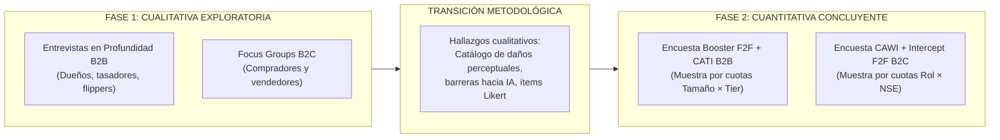

# Guion y Diapositivas de Presentación: Workshop 3 — Población, Muestra y Cuotas
## Proyecto InfoCar — Strategic Marketing (UDD)

- **Asignatura:** Strategic Marketing — Universidad del Desarrollo
- **Docente:** Prof. Claudia Scherman B., MBA
- **Fecha de Entrega y Exposición:** Noviembre 2026
- **Tiempo Asignado:** 10 a 15 minutos (Objetivo: 14:00 min exactos, con 8:00 min en bloque metodológico)
- **Documento Técnico de Respaldo:** `deliverys/workshop-3/03_diseno_muestral_infocar.md`
- **Norma Bibliográfica:** APA 7ª Edición

---

## Estructura Temporal Consolidada (Cronograma de Exposición)

| Lámina | Minuto Reloj | Duración | Bloque Temático | Foco Central de Exposición |
|:---:|:---:|:---:|:---|:---|
| **Slide 1** | 0:00 – 1:00 | 1:00 min | Portada | Portada, integrantes, agenda ejecutiva y naturaleza del negocio InfoCar. |
| **Slide 2** | 1:00 – 2:30 | 1:30 min | Consistencia | Falla de mercado (Akerlof), diagnóstico de usadas y encadenamiento canónico SMART (GO + OE1–OE5). |
| **Slide 3** | 2:30 – 3:30 | 1:00 min | Metodología | Diseño Mixto Secuencial ratificado: transferencia de hallazgos cualitativos al instrumento cuantitativo. |
| **Slide 4** | 3:30 – 5:30 | 2:00 min | **Población** | Delimitación formal bajo las 5 dimensiones (B2B y B2C); descriptores cualitativos y justificación causal. |
| **Slide 5** | 5:30 – 7:30 | 2:00 min | **Muestra Cuali** | 4 perfiles operacionales B2B en 4 escenarios de terreno; dispersión interna y mínimo de 2 focus groups B2C. |
| **Slide 6** | 7:30 – 10:00 | 2:30 min | **Muestra Cuanti** | Proceso de 5 pasos (Scherman, 2026b), matrices de cuotas B2C ($n=230$, todas $\ge 30$) y B2B ($n=60$), TLC y tabla $\sigma=1$. |
| **Slide 7** | 10:00 – 11:30 | 1:30 min | **Filtros / Sesgos** | Filtros eliminatorios de screening B2B y B2C, funnel de campo (tasa de respuesta) y 5 protocolos contra sesgos. |
| **Slide 8** | 11:30 – 13:00 | 1:30 min | **Instrumentos / Brechas** | Dos cuestionarios modulares con núcleo común; contraste sistemático Diseño Ideal vs. Diseño Realista. |
| **Slide 9** | 13:00 – 14:00 | 1:00 min | Cierre | Síntesis de cumplimiento acumulativo y apertura a la ronda de preguntas y feedback docente. |

*Total Tiempo de Exposición: 14:00 min (Bloque Metodológico: Slides 4 a 7 = 8:00 min exactos, en estricto cumplimiento del requerimiento de 6 a 8 minutos).*

---

### Slide 1: Portada y Hoja de Ruta Ejecutiva
- **Tiempo sugerido:** 1:00 min (Reloj: 0:00 – 1:00)
- **Título de la Lámina:** InfoCar: Certidumbre Técnica y Económica en Vehículos Usados
- **Subtítulo:** Workshop 3: Definición Formal de Población Objetivo, Diseño Muestral y Plan de Cuotas

#### Contenido Visual y Puntos Clave:
- **Equipo Consultor:** Alumnos Strategic Marketing — FEN UDD.
- **Docente:** Profesora Claudia Scherman B., MBA.
- **Naturaleza del Negocio InfoCar:** Solución SaaS B2B2C *asset-light* que integra visión computacional móvil para inspección perimetral de carrocería y algoritmo de costeo paramétrico de reparaciones de taller para mitigar la asimetría de información en la compraventa de usados.
- **Hoja de Ruta de la Presentación:**
  1. Consistencia acumulativa: Diagnóstico y Objetivos canónicos.
  2. Metodología ratificada: Enfoque Mixto Secuencial.
  3. Delimitación de Población B2B y B2C en 5 dimensiones.
  4. Diseño muestral cualitativo (Diversidad de perfiles y escenarios de terreno).
  5. Diseño muestral cuantitativo (TLC, regla del 30, matrices de cuotas y tabla de error).
  6. Filtros de screening, embudo de contactos y mitigación de sesgos.
  7. Modularidad de cuestionarios y matriz de brechas (Ideal vs. Realista).

> [!NOTE]
> **Notas del Expositor (Speaker Notes):**
> *"Buenas tardes profesora. En esta tercera entrega presentamos el diseño muestral completo para InfoCar. Este trabajo es estrictamente acumulativo: conservamos el diagnóstico y los objetivos aprobados en el Certamen 1, y hoy resolvemos lo que en dicha etapa quedó formalmente diferido: delimitar con exactitud a quiénes investigaremos (población) y cómo construiremos las muestras cualitativa y cuantitativa, incorporando los principios de la nueva fuente doctrinal de cátedra."*

---

### Slide 2: Marco de Consistencia Estratégica: Diagnóstico y Objetivos
- **Tiempo sugerido:** 1:30 min (Reloj: 1:00 – 2:30)
- **Título de la Lámina:** De la Falla de Mercado a los Objetivos Canónicos de Investigación

#### Contenido Visual y Puntos Clave:
- **Diagnóstico Empírico del Mercado Chileno:**
  - *Volumen transaccional:* 1.060.919 transferencias de usados en 2025 (relación 3,4 a 1 frente a nuevos; CAVEM, 2026a). El 84,7% de las compras son de personas naturales (CAVEM, 2026c).
  - *Falla de mercado:* Asimetría de información y selección adversa (Akerlof, 1970). Sin garantía legal SERNAC en ventas C2C (Mellado, 2026).
  - *Judicialización récord:* 41.700 causas por fraude vehicular en 2025 (+64% interanual; The Clinic, 2026).
  - *Latencia crítica en talleres:* 52,3 días promedio de inmovilización vehicular en desabolladura y pintura (La Tercera, 2026).
  - *Marcas chinas:* 12,95% de transferencias de usados y 41,4% de nuevos (CAVEM; ANAC); envejecimiento y pérdida de garantía.
- **Objetivo General Canónico (Scherman, 2026a):**
  > **Comprender la valoración de la certidumbre técnica y económica en la determinación del valor transaccional de vehículos usados.**
- **Encadenamiento SMART (OE1–OE5):**
  - **OE1:** Identificar atributos físicos y estéticos determinantes (daños de carrocería).
  - **OE2:** Analizar el impacto de la anticipación de costos de taller en la oferta de compra.
  - **OE3:** Evaluar barreras de desconfianza y resistencia a la IA frente al peritaje humano.
  - **OE4:** Describir la experiencia operativa y cuellos de botella temporales en inspección.
  - **OE5:** Evaluar atractivo percibido, diferenciación e intención de adopción de InfoCar (Pricing).

> [!NOTE]
> **Notas del Expositor (Speaker Notes):**
> *"Como enseñó la profesora: 'Los objetivos solo son buenos si el análisis de situación actual es bueno'. InfoCar ataca un mercado de más de un millón de autos al año con 41.700 fraudes y 52 días de espera en taller. Nuestro Objetivo General está redactado en formato canónico puro: verbo en infinitivo más fenómeno, sin quiénes ni dónde. Cada objetivo específico operacionaliza una decisión estratégica clave: desde los daños que más castigan el precio (OE1) hasta la disposición a pagar por el software (OE5)."*

---

### Slide 3: Metodología Ratificada: Enfoque Mixto Secuencial
- **Tiempo sugerido:** 1:00 min (Reloj: 2:30 – 3:30)
- **Título de la Lámina:** Arquitectura Metodológica: Diseño Mixto Secuencial (Cuali $\rightarrow$ Cuanti)

#### Contenido Visual y Diagrama Mermaid:

- **¿Por qué este diseño y no otro?**
  - La fase cualitativa explora el léxico real, los miedos subyacentes al peritaje automatizado y los cuellos de botella de mesón.
  - El nexo metodológico traduce el discurso no estructurado en ítems cerrados, escalas psicométricas (Likert 1–7) y baterías de pricing.
  - La fase cuantitativa permite medir incidencia, validar hipótesis y generalizar estadísticamente.

> [!NOTE]
> **Notas del Expositor (Speaker Notes):**
> *"No redefinimos la metodología acordada en Certamen 1: ratificamos el enfoque Mixto Secuencial. Primero exploramos cualitativamente para entender las dinámicas humanas y comerciales, y luego utilizamos esos hallazgos como insumo directo para construir los cuestionarios de la fase cuantitativa concluyente."*

---

### Slide 4: Delimitación de Población Objetivo B2B y B2C
- **Tiempo sugerido:** 2:00 min (Reloj: 3:30 – 5:30) — *Inicio del Bloque Metodológico*
- **Título de la Lámina:** Definición Formal de Población: Las 5 Dimensiones y Justificación Causal

#### Contenido Visual: Tabla Comparativa B2B vs. B2C
| Dimensión | Población B2B (Operadores Comerciales) | Población B2C (Consumidores Particulares) |
|:---|:---|:---|
| **Demográfica** | Dueños, gerentes, tasadores y flippers con operación continua ($\ge 5$ veh/mes) en compraventas formales de RM. | Hombres y mujeres de 22 a 65 años, estratos ABC1, C2 y C3 (AIM), bancarizados y con licencia vigente. |
| **Geográfica** | Región Metropolitana de Santiago (Polos: Bilbao, Gran Avenida, San Miguel, Quinta Normal, 10 de Julio). | Comunas urbanas de la Región Metropolitana de Santiago. |
| **Psicográfica / Cualitativa** *(Base Mínima)* | Alta aversión al riesgo por vicios ocultos de carrocería; urgencia por rotación de capital; escepticismo inicial hacia la IA frente a su peritaje empírico. | Elevada aversión a estafas mecánicas y cosméticas; inseguridad ante la asimetría de información; búsqueda de respaldo técnico objetivo. |
| **Consumo / Conducta** | Compraventa y retoma habitual de vehículos livianos/medianos usados (1 a 15 años de antigüedad; $\ge 5$ autos/mes). | Compra o venta de un vehículo usado en los últimos 12 meses, o en búsqueda/publicación activa hoy. |
| **Necesidades** | Estandarizar inspecciones perimetrales, recortar demoras de taller y justificar descuentos de retoma con respaldo pericial. | Conocer el estado real del vehículo antes de pagar, evitar sobreprecio y contar con poder negociador. |

- **Principio Doctrinal Clave:** *"No se puede incluir en la muestra criterios que no hayan sido definidos previamente en la población"* (Scherman, 2026b). Todas las variables de cuota están formalmente ancladas en esta definición.

> [!NOTE]
> **Notas del Expositor (Speaker Notes):**
> *"La cátedra exige que toda población contenga como base mínima descriptores demográficos y cualitativos. En B2B no nos limitamos al tamaño de la automotora: explicitamos el perfil cualitativo del operador, marcado por el miedo al vicio oculto que inmovilice su capital y su escepticismo cultural hacia el peritaje por inteligencia artificial. En B2C, consideramos a compradores y vendedores de estratos ABC1, C2 y C3 en la RM con transacciones en los últimos 12 meses."*

---

### Slide 5: Diseño Muestral Cualitativo (Fase 1)
- **Tiempo sugerido:** 2:00 min (Reloj: 5:30 – 7:30)
- **Título de la Lámina:** Muestra Cualitativa: Diversidad, Dispersión de Perfiles y Escenarios de Terreno

#### Contenido Visual:
1. **Entrevistas en Profundidad B2B (Principio Note 2: 2 entrevistas por perfil o 1 en muestra optimizada):**
   - **4 Perfiles Operacionales:** (1) Dueño de automotora tradicional; (2) Jefe de taller y reacondicionamiento; (3) Flipper ágil independiente; (4) Tasador institucional de red formal.
   - **4 Escenarios Físicos de Terreno:** (A) Patio de venta al aire libre; (B) Mesón técnico y fosa de taller; (C) Centro logístico / acopio masivo de remates; (D) Peritaje en calle / domicilio.
   - **Muestra B2B:** 8 entrevistas en diseño realista (2 por perfil) vs. 12 entrevistas en diseño ideal (con saturación teórica).
2. **Focus Groups B2C (Principio Docente: Mínimo 2 grupos para triangulación):**
   - **Grupo 1 (Compradores Particulares):** Dispersión interna: 50% primerizos (alta ansiedad) vs 50% experimentados; compra C2C vs concesionario; estratos ABC1, C2 y C3 balanceados.
   - **Grupo 2 (Vendedores Particulares):** Dispersión interna: Venta urgente por liquidez vs venta planificada por renovación; canal directo vs retoma en automotora.
   - **Composición:** 6 a 7 participantes por sesión, 75 a 90 minutos de duración.

> [!NOTE]
> **Notas del Expositor (Speaker Notes):**
> *"Conforme a la Note 2 de las instrucciones, la investigación cualitativa no busca representatividad estadística, sino diversidad y dispersión. En B2B no nos quedamos en la oficina del dueño: entrevistamos a 4 perfiles distintos en 4 escenarios reales de terreno, desde la fosa del taller hasta el peritaje en la calle. En B2C, la profesora indicó que el mínimo riguroso son 2 focus groups para poder triangular: uno exclusivo de compradores y uno de vendedores, ambos con profunda dispersión interna."*

---

### Slide 6: Diseño Muestral Cuantitativo (Fase 2)
- **Tiempo sugerido:** 2:30 min (Reloj: 7:30 – 10:00)
- **Título de la Lámina:** Muestra Cuantitativa: Teorema del Límite Central ($n \ge 30$) y Matrices de Cuotas

#### Contenido Visual:
1. **Proceso de Estimación Muestral en 5 Pasos (Scherman, 2026b):**
   - *Paso 1:* Objetivos OE1–OE5 | *Paso 2:* Confianza (95% B2C, 90% B2B) | *Paso 3:* Error ($6,5\%$ B2C, $12,9\%$ B2B) | *Paso 4:* Población ($N$ infinita B2C; $N \approx 1.200$ finita B2B) | *Paso 5:* Ecuación representatividad vs precio.
2. **Matriz de Cuotas B2C ($n = 230$) — ¡Cumplimiento 100% de la Regla del 30!:**

| Rol Transaccional | Tramo ABC1 | Tramo C2 | Tramo C3 | Total por Rol | Error Estándar ($EE$) |
|:---|:---:|:---:|:---:|:---:|:---:|
| **Compradores Particulares** | **40** | **50** | **40** | **130** | $8,84\%$ |
| **Vendedores Particulares** | **30** | **40** | **30** | **100** | $10,00\%$ |
| **Total por Estrato NSE** | **70** | **90** | **70** | **$n = 230$** | **$6,50\%$** |
*Todas las celdas tienen $\ge 30$ casos conforme al Teorema del Límite Central (TLC) para inferencia paramétrica confiable.*

3. **Matriz de Cuotas B2B ($n = 60$ sobre población finita de $\sim 1.200$ automotoras RM):**
   - Pequeña (5–15 autos/mes): 15 en Tier 2 + 10 en Tier 3 = **25 encuestas**.
   - Mediana (16–50 autos/mes): 15 en Tier 2 + 10 en Tier 3 = **25 encuestas**.
   - Grande (>50 autos/mes): 10 en Tier 2 + 0 en Tier 3 (cero estructural) = **10 encuestas**.
   - *Cobertura:* 4,8% del universo censal de la RM. Error estándar global: 12,91% (Scherman, 2026b).

> [!NOTE]
> **Notas del Expositor (Speaker Notes):**
> *"Aquí aplicamos de lleno la nueva fuente de NotebookLM: 'Investigación de mercado - Población-Muestra'. La profesora establece que para analizar una celda de datos se requiere un mínimo de 30 casos fundamentado en el Teorema del Límite Central. En nuestra matriz B2C de 230 encuestas, todas las celdas cumplen y superan el umbral de 30 casos: la menor tiene exactamente 30 y la principal 50. En B2B levantamos 60 encuestas, lo que cubre cerca del 5% del universo total de automotoras formales de Santiago."*

---

### Slide 7: Screening, Embudo de Campo y Mitigación de Sesgos
- **Tiempo sugerido:** 1:30 min (Reloj: 10:00 – 11:30) — *Cierre del Bloque Metodológico*
- **Título de la Lámina:** Filtros de Screening, Funnel de Terreno y Protocolos contra Sesgos

#### Contenido Visual:
- **Embudo de Contactos de Campo (Tasa de Caída):**
  - *B2B Booster F2F:* 1 de cada 3 abordajes exitoso $\rightarrow$ ~120 visitas en terreno para 40 encuestas.
  - *B2B CATI:* 1 de cada 8 llamadas efectiva $\rightarrow$ ~160 llamadas con decisor para 20 encuestas.
  - *B2C CAWI:* 1 respuesta cada 80–100 clics (1,2%) $\rightarrow$ ~16.000 impresiones digitales para 180 encuestas.
  - *B2C Intercept:* 1 de cada 4 personas abordadas $\rightarrow$ ~200 transeúntes en notarías/PRT para 50 encuestas.
  - **Total contactos estimados:** Más de 16.000 impactos y abordajes para asegurar 290 encuestas completas.
- **Cinco Protocolos Explícitos contra Sesgos de Muestreo (Scherman, 2026b):**
  1. *Sesgo de exclusión digital:* Cuota obligatoria presencial de 50 encuestas intercept en notarías/PRT para rescatar estratos C3 no digitalizados.
  2. *Sesgo de no respuesta:* Protocolo de 3 reintentos en bandas horarias alternadas e incentivo funcional (Reporte de Mercado RM).
  3. *Control de dependencia familiar:* Prohibición estricta de encuestar a dos personas del mismo grupo familiar en terreno.
  4. *Control de duplicidad:* Validación por RUT comercial en B2B y por huella digital/IP/cookie en CAWI.
  5. *Sesgo de deseabilidad social en pricing:* Batería de Precios de Van Westendorp condicionada con intención real de pago.

> [!NOTE]
> **Notas del Expositor (Speaker Notes):**
> *"Como señala la cátedra: para conseguir 30 encuestas completas se debe contactar a un volumen mucho mayor. En CAWI se requiere una tasa de 1 respuesta por cada 80 a 100 contactos. Además, incorporamos 5 protocolos estrictos contra sesgos: destacamos la prohibición de encuestar a familiares en el mismo punto para evitar autocorrelación, y la cuota de 50 encuestas en notarías y PRT para neutralizar el sesgo de exclusión digital de la web."*

---

### Slide 8: Arquitectura de Cuestionarios y Matriz de Brechas
- **Tiempo sugerido:** 1:30 min (Reloj: 11:30 – 13:00)
- **Título de la Lámina:** Dos Cuestionarios Modulares y Contraste Ideal vs. Realista

#### Contenido Visual:
1. **Modularidad de Instrumentos (Duración Cronometrada):**
   - *¿Por qué dos cuestionarios?* B2B razona en margen comercial y costo de taller; B2C razona en ahorro familiar y miedo al fraude.
   - *Núcleo Compartido:* Screening (Mod. 1), Jerarquía de daños perimetrales (Mod. 2; OE1), Barreras hacia IA (Mod. 3; OE3) y Test de concepto InfoCar (Mod. 6; OE5).
   - *Módulos Exclusivos B2B:* Impacto de taller en retoma (Mod. 4; OE2) y Cuellos de botella de inspección (Mod. 5; OE4).
   - *Duración cronometrada:* B2B de 8 a 10 minutos; B2C de 6 a 8 minutos (control estricto de fatiga).
2. **Matriz de Brechas: Diseño Ideal vs. Realista (Scherman, 2026a, 2026b):**

| Elemento | Diseño Ideal | Diseño Realista | Implicancia y Medida de Mitigación |
|:---|:---:|:---:|:---|
| **Entrevistas B2B** | 12 entrevistas | **8 entrevistas** | Menor saturación en segmento grande; se triangula con la encuesta cuantitativa. |
| **Focus Groups B2C** | 6 grupos (3 y 3) | **2 grupos** (1 y 1) | Menor saturación intra-segmento; se agregan preguntas abiertas de control en CAWI. |
| **Muestra Cuanti B2B** | $n = 80$ ($EE=11,1\%$) | **$n = 60$ ($EE=12,9\%$)** | Análisis de subceldas se realiza a nivel agregado por dimensión (Tamaño y Tier). |
| **Muestra Cuanti B2C** | $n = 300$ ($EE=5,4\%$) | **$n = 230$ ($EE=6,5\%$)** | Celdas mínimas quedan en 30 casos ($EE=18,2\%$); cumplen formalmente con el TLC. |

> [!NOTE]
> **Notas del Expositor (Speaker Notes):**
> *"Diseñamos dos cuestionarios con una columna vertebral común: los módulos de daños perimetrales, barreras hacia la IA y test de concepto InfoCar se aplican a ambos segmentos, pero reservamos las preguntas de impacto de taller para B2B. Finalmente, transparentamos las brechas entre el diseño ideal y el realista, demostrando que con 230 encuestas B2C y 60 B2B preservamos la significancia estadística y la viabilidad de campo."*

---

### Slide 9: Conclusiones Estratégicas y Aseguramiento de Calidad
- **Tiempo sugerido:** 1:00 min (Reloj: 13:00 – 14:00)
- **Título de la Lámina:** Síntesis de Cumplimiento Acumulativo y Discusión Final

#### Contenido Visual:
- **Resumen de Cumplimiento de Requisitos del Taller:**
  - [x] **Población Objetivo:** Delimitada rigurosamente bajo las 5 dimensiones con descriptores demográficos y cualitativos justificados.
  - [x] **Trazabilidad 100%:** Todas las variables de cuota (Tamaño, Tier, Rol, NSE) declaradas previamente en la población.
  - [x] **Muestra Cualitativa:** 4 perfiles B2B en 4 escenarios de terreno (2 por perfil) y 2 focus groups B2C con dispersión interna (Note 2).
  - [x] **Muestra Cuantitativa:** Regla de 30 cumplida en el 100% de las celdas B2C según el Teorema del Límite Central; B2B representativa de población finita.
  - [x] **Sustento Doctrinal:** Integración de los 5 pasos y la tabla de error de Scherman (2026b), con normas APA 7ª Edición.
- **Próximos Pasos:** Pilotaje de instrumentos de campo (pretest de 5 entrevistas y 10 encuestas) y lanzamiento del trabajo de terreno.
- **Ronda de Preguntas y Retroalimentación:** Apertura formal a los comentarios de la profesora Claudia Scherman.

> [!NOTE]
> **Notas del Expositor (Speaker Notes):**
> *"En conclusión, entregamos una propuesta de diseño muestral metodológicamente blindada, fiel a los principios del ramo y viable de ejecutar en el mercado chileno. Quedamos a disposición de sus comentarios y preguntas. Muchas gracias."*
